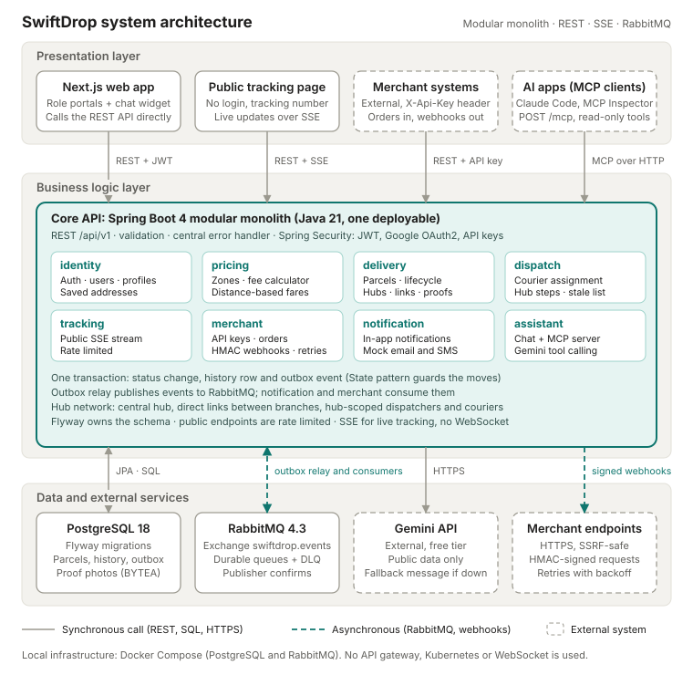

# SwiftDrop

[](https://github.com/ShenSandaru/SwiftDrop/actions/workflows/ci.yml)


**SwiftDrop is a parcel delivery and courier management platform.** Customers book deliveries and follow
them live, couriers collect and deliver, dispatchers move parcels through a network of branch and central
hubs, merchants integrate through a REST API with signed webhooks, and an AI assistant answers tracking and
pricing questions. It is a university Enterprise Application Development project built by a team of 10
students; the requirements are summarized in [docs/project-requirements.md](docs/project-requirements.md).

## Contents

- [Highlights](#highlights)
- [Architecture](#architecture)
- [Portals and roles](#portals-and-roles)
- [Technology stack](#technology-stack)
- [Getting started](#getting-started)
- [API overview](#api-overview)
- [Testing](#testing)
- [Repository layout](#repository-layout)
- [Project status](#project-status)
- [Contributing](#contributing)
- [Documentation](#documentation)

## Highlights

- **Hub network.** A parcel travels origin branch, central hub, destination branch, with three delivery
  attempts, returns and cancellation. Every move is checked against a state machine and recorded in a
  history. Admins can link neighbouring branches so their parcels skip the central hub.
- **Hub-scoped staff.** Dispatchers and couriers work for named hubs. They see and act only on parcels their
  hub is responsible for, and the backend answers `403` anywhere else. Only admins work everywhere.
- **Live tracking.** Anyone with a tracking number sees the parcel move in real time over Server-Sent Events,
  with an estimated delivery day. The public endpoints are rate limited.
- **Reliable events.** A status change, its history row and an outbox event commit in one transaction. A relay
  publishes the outbox to RabbitMQ with publisher confirms, so events are delivered at least once and never
  lost.
- **Merchant integration.** Merchants get API keys, an order API and SSRF-safe webhooks with HMAC signatures
  and retries.
- **AI assistant and MCP server.** A Gemini-powered chat answers "where is my parcel?" and "how much to
  send...?" through read-only tools. The same tools are available to other AI apps over MCP.
- **Security by default.** JWT and Google OAuth2, role and ownership checks on every endpoint, no secrets in
  the repository, and a test matrix that checks each parcel endpoint against every kind of caller.

## Architecture



SwiftDrop is a **modular monolith**: one Spring Boot application split into business modules with strict
boundaries, one Next.js frontend, one PostgreSQL database and one RabbitMQ broker. A module exposes a small
`api` package, and other modules may use nothing else of it (the rule is checked by a test).

**How a status change flows.** The `delivery` module locks the parcel row, checks the transition and who may
make it, then writes the new status, a history row and an outbox event in one transaction. After the commit,
`tracking` pushes the change to every open tracking page over SSE, and the outbox relay publishes the event
to RabbitMQ, where `notification` and `merchant` consume it.

| Module | Responsibility |
|---|---|
| `identity` | Registration, JWT and Google sign-in, profiles, addresses, user administration |
| `pricing` | Delivery zones and the fee calculator (distance-based, with explicit zone-pair overrides) |
| `delivery` | Parcels, lifecycle, hub network and links, home hubs of staff, proofs, receipts, outbox relay |
| `dispatch` | Courier assignment, hub scans and line-haul steps, courier workloads, stale parcels |
| `tracking` | Public live tracking stream (SSE) |
| `merchant` | Merchant accounts, API keys, order API, webhooks and their delivery |
| `notification` | In-app notifications from RabbitMQ events (email and SMS use a mock channel) |
| `assistant` | AI chat and MCP server over read-only tools |
| `config`, `shared` | Security filter chains, CORS, error format, pagination, shared technical code |

**Decisions.** Each significant choice is an [architecture decision record](docs/adr/README.md), for example
[the modular monolith](docs/adr/0001-modular-monolith-in-a-monorepo.md),
[module boundaries](docs/adr/0003-backend-modules-and-boundaries.md),
[messaging reliability](docs/adr/0004-messaging-and-integration-reliability.md),
[the delivery lifecycle](docs/adr/0006-delivery-lifecycle-and-transition-rules.md),
[live tracking over SSE](docs/adr/0007-public-sse-tracking-stream.md),
[the hub network](docs/adr/0009-hub-network-delivery-attempts-and-returns.md),
[the AI assistant and MCP server](docs/adr/0010-ai-delivery-assistant-and-mcp-server.md),
[direct links](docs/adr/0011-direct-links-between-branch-hubs.md) and
[hub-scoped staff](docs/adr/0012-hub-scoped-staff.md). Current detail and status labels are in
[docs/architecture.md](docs/architecture.md).

## Portals and roles

| Role | What they can do | Routes |
|---|---|---|
| **Customer** | Sign up (email and password, or Google), manage profile and addresses, book deliveries with a fee estimate, follow parcels live, view history and receipts | `/customer`, `/customer/new`, `/customer/history`, `/customer/profile` |
| **Anyone** | Track a parcel by its number, no account needed; ask the assistant | `/track`, `/` |
| **Merchant** | Register (admin approval), manage API keys, create orders through the API, configure webhooks | `/merchant`, `/merchant/orders`, `/merchant/api-keys`, `/merchant/webhooks`, `/merchant/status` |
| **Courier** | See assigned pickups, deliveries and returns, update status, capture proof of delivery, report failures | `/courier`, `/courier/parcels/[id]` |
| **Dispatcher** | Assign couriers, scan parcels in and out of hubs, handle returns, watch parcels that need attention. Limited to their own hubs | `/dispatch` |
| **Admin** | Approve merchants, manage users, zones, hubs, direct links and staff assignments, pricing rules | `/admin`, `/admin/merchants`, `/admin/users`, `/admin/hubs`, `/admin/pricing` |

## Technology stack

| Area | Choice |
|---|---|
| Backend | Java 21 (Temurin), Spring Boot 4.1, Maven (Wrapper) |
| Persistence | Spring Data JPA, Hibernate ORM 7, Flyway, PostgreSQL 18 |
| Security | Spring Security 7, JWT resource server, Google OAuth2 / OIDC, merchant API keys |
| Messaging | Spring AMQP, RabbitMQ 4.3 (transactional outbox, consumers, dead-letter queues) |
| Real time | Server-Sent Events (`SseEmitter`) |
| AI | Gemini API through an `LlmClient` interface, hand-written MCP server |
| API docs | springdoc-openapi 3.2 |
| Frontend | Node.js 24, npm, Next.js 16 (App Router), React 19, TypeScript 6, Tailwind CSS 4, shadcn/ui |
| Tests | JUnit, Mockito, AssertJ, Spring Boot Test, Testcontainers (PostgreSQL and RabbitMQ) |
| Local infrastructure | Docker Compose |

Exact versions and the reasons for them are in [ADR 0002](docs/adr/0002-technology-and-version-baseline.md).
There is deliberately no API gateway, Kubernetes or WebSocket layer.

## Getting started

### 1. Prerequisites

| Tool | Version | Notes |
|---|---|---|
| Eclipse Temurin JDK | 21 | `java.version` in `backend/pom.xml` |
| Node.js and npm | 24 LTS and npm 11 | `.nvmrc`, `engines` in `frontend/package.json` |
| Docker Desktop (Compose) | current 4.x | runs PostgreSQL and RabbitMQ |
| Git | any current | |

Maven is not installed separately; the Maven Wrapper pins it. Windows installation steps are in
[docs/development-setup.md](docs/development-setup.md).

### 2. Clone and configure

```bash
git clone https://github.com/ShenSandaru/SwiftDrop.git
cd SwiftDrop
cp .env.example .env        # Windows PowerShell: Copy-Item .env.example .env
```

`.env` is git-ignored and read by Docker Compose and by the backend. Never commit it. Fill in these values;
`.env.example` explains each one and every other setting:

| Variable | Required | Purpose |
|---|---|---|
| `SWIFTDROP_POSTGRES_PASSWORD`, `SWIFTDROP_RABBITMQ_PASSWORD` | yes | Replace the `change-me-...` values with your own |
| `SWIFTDROP_JWT_SECRET` | yes | Token signing key, at least 32 bytes. Generate one with `openssl rand -base64 48` |
| `SWIFTDROP_WEBHOOK_SECRET_KEY` | yes | Encrypts merchant webhook secrets, at least 32 bytes. Generate it the same way |
| `SWIFTDROP_BOOTSTRAP_ADMIN_EMAIL`, `SWIFTDROP_BOOTSTRAP_ADMIN_PASSWORD` | recommended | Creates the first admin account when none exists |
| `SWIFTDROP_GEMINI_API_KEY` | optional | Turns on the AI assistant. Without it the assistant says it is unavailable |
| `SWIFTDROP_GOOGLE_CLIENT_ID`, `SWIFTDROP_GOOGLE_CLIENT_SECRET` | optional | Google sign-in |
| `SWIFTDROP_POSTGRES_PORT`, `SWIFTDROP_RABBITMQ_PORT` | optional | Change a host port if the default is taken |

Database and broker credentials only take effect when their Docker volumes are first created; see
[resetting data](docs/development-setup.md#reset-data-deletes-everything).

### 3. Start the infrastructure

```bash
docker compose up -d     # PostgreSQL and RabbitMQ
docker compose ps        # wait until both are "healthy"
docker compose stop      # stop when done; data is kept
```

### 4. Run the applications

```bash
# Backend, from backend/   (Windows: .\mvnw.cmd spring-boot:run)
cd backend && ./mvnw spring-boot:run

# Frontend, from frontend/ in a second terminal
cd frontend && npm ci && npm run dev
```

| What | URL |
|---|---|
| Frontend | <http://localhost:3000> |
| Backend health | <http://localhost:8080/actuator/health> |
| RabbitMQ management | <http://localhost:15672> (credentials from `.env`) |

The springdoc API docs (`/swagger-ui.html`, `/v3/api-docs`) require a bearer token.

### 5. First run: set up the network

Booking needs zones and hubs, and dispatchers need hubs, so a fresh database needs a few minutes of setup:

1. Sign in at `/login` as the bootstrap admin.
2. In `/admin/hubs`, create the delivery zones and hubs: **one central hub**, plus **one branch hub per
   zone**. Optionally link neighbouring branches under "Direct links".
3. In `/admin/users`, create dispatchers and couriers. Then, in `/admin/hubs` under "Staff and hubs", give
   each of them a hub. A dispatcher with no hub sees nothing, on purpose.
4. Sign up a customer, book a delivery at `/customer/new`, and follow it at `/track`.

## API overview

Everything is under `/api/v1/...` and returns JSON problem details on errors. Roles and ownership are
enforced on the backend.

| Area | Examples | Access |
|---|---|---|
| Authentication | `POST /api/v1/auth/tokens`, Google exchange | public |
| Public tracking | `GET /api/v1/tracked-parcels/{trackingNumber}`, `.../events` (SSE) | public, rate limited |
| Customer parcels | `POST /api/v1/parcels`, `GET /api/v1/parcels`, receipts, cancellation | customer |
| Courier | `GET /api/v1/courier/parcels`, `POST /api/v1/parcels/{id}/status-changes`, proof upload | courier |
| Dispatch | `/api/v1/dispatch/parcels`, `.../hub-scans`, `.../parcel-assignments`, `.../stale-parcels`, `.../scope` | dispatcher, admin |
| Hubs | `/api/v1/hubs`, `/api/v1/hubs/links`, `/api/v1/hubs/staff` | admin (read by dispatchers) |
| Pricing | `POST /api/v1/price-quotes`, zones and rules administration | customer, admin |
| Merchant | `POST /api/v1/merchant-orders` with an `X-Api-Key` header | merchant API key |
| Assistant | `POST /api/v1/assistant/messages`, MCP server at `POST /mcp` | public, rate limited |

Merchant integration is described in [docs/merchant-integration-guide.md](docs/merchant-integration-guide.md)
and the contracts in [docs/merchant-contracts.md](docs/merchant-contracts.md). A local webhook receiver for
testing is in [tools/webhook-receiver](tools/webhook-receiver).

## Testing

```bash
# Backend unit tests, no Docker needed (Windows: .\mvnw.cmd ...)
cd backend && ./mvnw clean verify

# Backend unit and integration tests against real PostgreSQL and RabbitMQ (needs Docker)
cd backend && ./mvnw clean verify -Pintegration

# Frontend checks
cd frontend && npm ci && npm run lint && npx tsc --noEmit && npm run build
```

CI runs the frontend checks and the Docker-free backend build on every pull request into `dev` and `main`
([`ci.yml`](.github/workflows/ci.yml)). Integration tests use Testcontainers, never an in-memory substitute
for PostgreSQL. The verified test state is recorded in [docs/project-status.md](docs/project-status.md).

## Repository layout

```text
.
├── backend/              Spring Boot modular monolith (com.swiftdrop.*), Flyway migrations, Dockerfile
├── frontend/             Next.js App Router application, Dockerfile
├── deploy/               Production Nginx configs and automated VM deployment script
├── swiftdrop-k8s/        Single-node K3s Kubernetes manifests (BON-1, ADR 0013)
├── tools/                Local development tools, for example the webhook receiver
├── docs/                 Architecture, ADRs, CI/CD, deployment guides, contracts and status
├── compose.yaml          Local PostgreSQL and RabbitMQ
├── compose.prod.yaml     Production 5-service Docker Compose stack (with Nginx)
├── .env.example          Template for the git-ignored local .env
├── .env.prod.example     Template for the git-ignored production .env.prod
├── .github/workflows/    GitHub Actions CI and Docker Publish / GCP deployment
├── AGENTS.md, CLAUDE.md  Entry points for AI coding agents
└── CONTRIBUTING.md       Task workflow and team conventions
```

Each application has its own README: [backend/README.md](backend/README.md) and
[frontend/README.md](frontend/README.md).

## Project status

The core backend modules, database migrations, RabbitMQ eventing and the frontend portals are implemented and
verified; see [docs/project-status.md](docs/project-status.md). Known limits:

- Email and SMS notifications default to a mock channel unless external provider credentials are configured; in-app notifications are real.
- Production deployment is automated via GitHub Actions (`docker-publish.yml`) to a GCP VM using `compose.prod.yaml` and Nginx, with separate K3s manifests in `swiftdrop-k8s/` ([Deployment & CI/CD docs](docs/deployment/README.md)).
- Parcels are scanned one at a time; batch scanning and truck manifests are not built.
- Some ADRs are still marked *Proposed* while the team reviews them.

## Contributing

1. Branch from `dev`: `git switch dev && git pull && git switch -c feat/<short-description>`
   (also `fix/`, `docs/`, `chore/`).
2. Keep each commit one logical change, in [Conventional Commits](https://www.conventionalcommits.org/) form.
3. Run the checks above, then open a pull request into `dev`. `main` is the stable branch and is updated by
   pull requests from `dev`.
4. Wait for the `frontend` and `backend` CI checks and an approving review.

Details and the branch protection setup are in [CONTRIBUTING.md](CONTRIBUTING.md). AI coding agents start at
[AGENTS.md](AGENTS.md).

### Troubleshooting

- **`java -version` is not 21:** `JAVA_HOME` or `PATH` points to another JDK.
- **Port already allocated:** another service uses 5432, 5672 or 15672. Do not stop other projects'
  containers; set a free port in `.env` and run `docker compose up -d` again.
- **The backend stops at startup naming a missing secret:** set `SWIFTDROP_JWT_SECRET` and
  `SWIFTDROP_WEBHOOK_SECRET_KEY` (at least 32 bytes each) in `.env`.
- **`password authentication failed`:** the Docker volume was created with other credentials than the
  current `.env`.
- **`Detected resolved migration not applied to database`:** a migration was merged with an older version
  number than ones your database already ran. Start the backend once with
  `--spring.flyway.out-of-order=true`. Fresh databases are not affected.
- **The backend cannot find its settings when started from an IDE:** set the working directory to `backend/`.

More cases: [development setup](docs/development-setup.md#troubleshooting) and
[frontend/README.md](frontend/README.md#known-npm-warnings).

## Documentation

| Document | Contents |
|---|---|
| [Project requirements](docs/project-requirements.md) | The assignment and its requirement IDs |
| [Architecture](docs/architecture.md) | Current architecture with status labels |
| [Architecture decision records](docs/adr/README.md) | Accepted and proposed decisions |
| [Project status](docs/project-status.md) | What is implemented and verified |
| [Development setup](docs/development-setup.md) | Detailed setup and local operations |
| [Deployment & CI/CD](docs/deployment/README.md) | Server specs, GitHub Actions CI/CD, deployment scripts, and K3s architecture |
| [Production deployment](docs/production-deployment.md) | GCP VM Docker Compose + Nginx + Let's Encrypt runbook |
| [Kubernetes deployment](docs/kubernetes-deployment.md) | Single-node K3s deployment guide (`BON-1`) |
| [Merchant integration guide](docs/merchant-integration-guide.md) | Using the order API and webhooks |
| [Implementation contract](docs/implementation-contract.md) | Delivery and tracking contracts |
| [Contributing](CONTRIBUTING.md) | Task workflow, branches, commits, pull requests |
| [AI agent guidelines](docs/ai-agent-guidelines.md) | Rules for AI coding agents and project rules |

## License

No license file is included yet.
