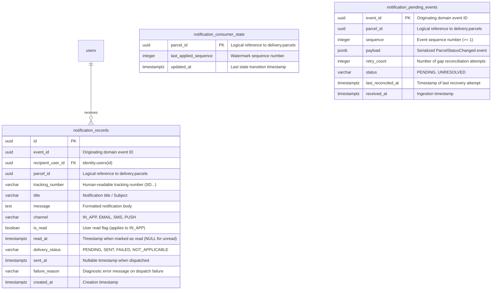

# SwiftDrop Notification Database Design

- **Document:** `docs/architecture/notification-database-design.md`
- **Phase:** Phase 2 – Notification Database Design (Refined)
- **Status:** Complete Architecture & Schema Specification
- **Date:** 2026-11-13
- **Branch:** `feat/dev-notifications`
- **Owning Module:** `com.swiftdrop.notification` (ADR 0003)

---

## 1. Overview and Design Principles

The Notification module provides decoupled, asynchronous, at-least-once status notifications for SwiftDrop actors. In accordance with:
- **ADR 0001 (Monorepo & Single Database)**: All tables reside within the shared PostgreSQL database.
- **ADR 0003 (Modular Monolith Boundaries)**: The `notification` module owns its database schema completely. No foreign keys cross module boundaries to tables owned by `delivery` (`parcels`, `parcel_status_history`) or `pricing` (`pricing_rules`). Foreign keys to the `identity` module's `users` table are permitted following the established project pattern (identical to `parcels.customer_id REFERENCES users(id)` and `merchants.user_id REFERENCES users(id)`).
- **ADR 0004 (Reliability & Sequence Enforcement)**: The schema enforces idempotent event handling, per-parcel in-order event application, sequence gap buffering, and resilient duplicate-message discarding.
- **Flyway Migrations (`MigrationConventionTest`)**: Migration files reside in `backend/src/main/resources/db/migration/notification/` following the strict pattern `V<yyyyMMddHHmm>__notification_<description>.sql`.

---

## 2. Entity Relationship Diagram (ERD)



---

## 3. Table Specifications & DDL Definitions

### 3.1 Table: `notification_records`

#### Purpose
Stores all user notifications, providing the persistent store for the in-app notification feed, user read status management, and audit/dispatch logging for external communication channels (Email, Mock SMS, future Push).

#### Separation of User Read State and Channel Delivery State
A critical requirement is that **user read state** and **channel delivery state** are orthogonal concerns that must not be merged into a single status column:
- **User Read State (`is_read`, `read_at`)**:
  - Pertains strictly to the recipient's interaction with the notification in the application UI.
  - Applies directly to the `IN_APP` channel (e.g. badge counters, mark-as-read in inbox).
  - For external channels (`EMAIL`, `SMS`, `PUSH`), user read tracking either does not apply or is not captured synchronously; these records default to `is_read = FALSE` with `read_at = NULL`.
- **Channel Delivery State (`delivery_status`, `sent_at`, `failure_reason`)**:
  - Pertains to whether the outbound message was successfully dispatched to an external transport or provider.
  - For `IN_APP` notifications: Delivery is immediate and synchronous with row creation in PostgreSQL. Therefore, `delivery_status` is explicitly set to `'NOT_APPLICABLE'` (or `'SENT'`), avoiding artificial delivery queue states.
  - For `EMAIL`, `SMS`, `PUSH`: Tracks the lifecycle of the outbound dispatch (`PENDING` $\rightarrow$ `SENT` or `FAILED`). If a provider call fails, `failure_reason` records sanitized diagnostic info, and `sent_at` remains `NULL`.

#### Proposed DDL
```sql
CREATE TABLE notification_records (
    id                UUID         PRIMARY KEY,
    event_id          UUID         NOT NULL,
    recipient_user_id UUID         NOT NULL REFERENCES users (id) ON DELETE RESTRICT,
    parcel_id         UUID         NOT NULL,
    tracking_number   VARCHAR(16)  NOT NULL,
    title             VARCHAR(200) NOT NULL,
    message           TEXT         NOT NULL,
    channel           VARCHAR(20)  NOT NULL,
    
    -- User read state (primarily for IN_APP notifications)
    is_read           BOOLEAN      NOT NULL DEFAULT FALSE,
    read_at           TIMESTAMPTZ,

    -- Channel delivery state (for external transports and audit)
    delivery_status   VARCHAR(20)  NOT NULL,
    sent_at           TIMESTAMPTZ,
    failure_reason    VARCHAR(500),

    created_at        TIMESTAMPTZ  NOT NULL,

    -- Idempotency: guarantees one notification record per event, channel, and recipient
    CONSTRAINT uq_notification_records_event_channel_user 
        UNIQUE (event_id, channel, recipient_user_id),

    -- Allowed channels
    CONSTRAINT ck_notification_records_channel 
        CHECK (channel IN ('IN_APP', 'EMAIL', 'SMS', 'PUSH')),

    -- Allowed delivery statuses
    CONSTRAINT ck_notification_records_delivery_status 
        CHECK (delivery_status IN ('PENDING', 'SENT', 'FAILED', 'NOT_APPLICABLE')),

    -- State consistency: read_at must be populated if and only if is_read is TRUE
    CONSTRAINT ck_notification_records_read_consistency 
        CHECK ((is_read = TRUE) = (read_at IS NOT NULL)),

    -- Delivery consistency: sent_at must be populated if delivery_status is SENT
    CONSTRAINT ck_notification_records_delivery_consistency 
        CHECK (
            (delivery_status = 'SENT' AND sent_at IS NOT NULL)
            OR (delivery_status <> 'SENT')
        ),

    -- Tracking number format matches system standard (D-05)
    CONSTRAINT ck_notification_records_tracking_number 
        CHECK (tracking_number ~ '^SD[0-9A-HJKMNP-TV-Z]{10}$')
);

-- Index 1: Optimized user notification feed (newest first)
CREATE INDEX ix_notification_records_user_feed 
    ON notification_records (recipient_user_id, created_at DESC);

-- Index 2: Highly efficient partial index for unread notification count badge (IN_APP)
CREATE INDEX ix_notification_records_user_unread 
    ON notification_records (recipient_user_id) 
    WHERE channel = 'IN_APP' AND is_read = FALSE;

-- Index 3: Efficient lookup by parcel for support, audit, and verification queries
CREATE INDEX ix_notification_records_parcel_id 
    ON notification_records (parcel_id);
```

#### Column Details
| Column | Type | Nullable | Description |
| :--- | :--- | :---: | :--- |
| `id` | `UUID` | No | Primary Key, generated via application UUID generator (RFC 4122). |
| `event_id` | `UUID` | No | UUID of the triggering `ParcelStatusChanged` event from `delivery`. |
| `recipient_user_id` | `UUID` | No | Foreign Key to `users(id)` in `identity` module. Enforces valid recipient. |
| `parcel_id` | `UUID` | No | Logical reference to `parcels(id)` (No FK across module boundary per ADR 0003). |
| `tracking_number` | `VARCHAR(16)` | No | 12-char tracking identifier (`SD...`) for display in client UI. |
| `title` | `VARCHAR(200)` | No | Short title for notification banner or email subject line. |
| `message` | `TEXT` | No | Full human-readable notification message body. |
| `channel` | `VARCHAR(20)` | No | Dispatch channel (`IN_APP`, `EMAIL`, `SMS`, `PUSH`). |
| `is_read` | `BOOLEAN` | No | Read flag for in-app feed. Defaults to `FALSE`. |
| `read_at` | `TIMESTAMPTZ` | Yes | Timestamp when user marked notification as read. Set only when `is_read = TRUE`. |
| `delivery_status` | `VARCHAR(20)` | No | Dispatch status (`PENDING`, `SENT`, `FAILED`, `NOT_APPLICABLE`). |
| `sent_at` | `TIMESTAMPTZ` | Yes | Timestamp when dispatched to recipient / channel transport. |
| `failure_reason` | `VARCHAR(500)` | Yes | Sanitized error message if delivery failed. |
| `created_at` | `TIMESTAMPTZ` | No | Creation timestamp (UTC). |

---

### 3.2 Table: `notification_consumer_state`

#### Purpose
Implements the consumer ordering watermark mandated by ADR 0004 §4.3. Tracks the highest applied event sequence number for each parcel. Ensures that out-of-order, late, or duplicate events are handled deterministically without skipped steps.

#### Proposed DDL
```sql
CREATE TABLE notification_consumer_state (
    parcel_id              UUID        PRIMARY KEY,
    last_applied_sequence  INTEGER     NOT NULL,
    updated_at             TIMESTAMPTZ NOT NULL,

    CONSTRAINT ck_notification_consumer_state_sequence 
        CHECK (last_applied_sequence >= 1)
);
```

#### Column Details
| Column | Type | Nullable | Description |
| :--- | :--- | :---: | :--- |
| `parcel_id` | `UUID` | No | Primary Key. The unique identifier of the parcel. |
| `last_applied_sequence` | `INTEGER` | No | Highest sequence number successfully applied for this parcel (starts at 1 for `CREATED`). |
| `updated_at` | `TIMESTAMPTZ` | No | Timestamp of the last applied status transition (UTC). |

---

### 3.3 Table: `notification_pending_events`

#### Purpose
Serves as an event buffer / quarantine store for sequence gaps (ADR 0004 §4.3). When an event with sequence $s > lastApplied + 1$ arrives from RabbitMQ, it cannot be applied immediately because intermediate transitions have not yet been processed. The raw event payload is stored in this table and acknowledged to RabbitMQ. It is either unlocked when the missing sequence arrives, or recovered by the `GapReconciliationScheduler`.

#### Proposed DDL
```sql
CREATE TABLE notification_pending_events (
    event_id           UUID        PRIMARY KEY,
    parcel_id          UUID        NOT NULL,
    sequence           INTEGER     NOT NULL,
    payload            JSONB       NOT NULL,
    retry_count        INTEGER     NOT NULL DEFAULT 0,
    status             VARCHAR(20) NOT NULL DEFAULT 'PENDING',
    last_reconciled_at TIMESTAMPTZ,
    received_at        TIMESTAMPTZ NOT NULL,

    -- Constraint: Only one pending event allowed per parcel sequence number
    CONSTRAINT uq_notification_pending_events_parcel_sequence 
        UNIQUE (parcel_id, sequence),
    CONSTRAINT ck_notification_pending_events_sequence 
        CHECK (sequence >= 1),
    CONSTRAINT ck_notification_pending_events_retry_count 
        CHECK (retry_count >= 0),
    CONSTRAINT ck_notification_pending_events_status 
        CHECK (status IN ('PENDING', 'UNRESOLVED'))
);

-- Index: Used by GapReconciliationScheduler to discover active pending events older than grace period
CREATE INDEX ix_notification_pending_events_reconciliation 
    ON notification_pending_events (received_at, parcel_id)
    WHERE status = 'PENDING';
```

#### Column Details
| Column | Type | Nullable | Description |
| :--- | :--- | :---: | :--- |
| `event_id` | `UUID` | No | Primary Key. Stable event identifier from the message envelope. |
| `parcel_id` | `UUID` | No | The parcel associated with the pending event. |
| `sequence` | `INTEGER` | No | Sequence number of the pending event ($s > 1$). |
| `payload` | `JSONB` | No | Full serialized `ParcelStatusChanged` JSON message body (preserved indefinitely for recovery/investigation). |
| `retry_count` | `INTEGER` | No | Number of times reconciliation was attempted for this pending event. |
| `status` | `VARCHAR(20)` | No | `PENDING` (active retry) or `UNRESOLVED` (exhausted retries, quarantined for operational review). |
| `last_reconciled_at` | `TIMESTAMPTZ` | Yes | Timestamp of the most recent reconciliation attempt. |
| `received_at` | `TIMESTAMPTZ` | No | Arrival timestamp when quarantined. |

---

## 4. Re-Evaluation of the Three Proposed Tables

We explicitly re-evaluated whether all three tables are necessary or whether the design could be simplified:

| Table | Why It Is Genuinely Necessary | Failure Scenario If Omitted |
| :--- | :--- | :--- |
| **`notification_records`** | Required to store the user-facing notification feed (`IN_APP`), drive the unread notification badge, maintain read/unread state, and provide audit logging for outbound dispatches. | Without it, users cannot view past notifications in the application, and the frontend cannot display an unread notification count. |
| **`notification_consumer_state`** | Implements the lightweight watermark ($lastAppliedSequence$) per parcel. Required to detect sequence gaps ($s > last + 1$) and identify duplicate deliveries ($s \le last$). | If omitted, the consumer would have to execute aggregate `MAX(sequence)` queries across `notification_records` on every message. Worse, if a status transition does *not* produce a notification (e.g. `AT_HUB` or `IN_TRANSIT` per ADR 0004 §8), no row is written to `notification_records`, destroying the sequence chain and causing false gap detections. |
| **`notification_pending_events`** | Quarantines out-of-order messages in a durable store so the consumer can acknowledge RabbitMQ without dropping the message. | If omitted, out-of-order messages would have to be rejected (`NACK`) with requeue, causing head-of-line blocking in RabbitMQ, spinning worker threads, and consuming excessive CPU. |

**Conclusion**: All three tables serve distinct, essential responsibilities and cannot be merged or omitted without sacrificing correctness or performance.

---

## 5. Event Sequence Handling & Watermark Mechanics

### 5.1 Universal Sequence Watermark Advancement
- **The Core Rule**: **Every** consumed `ParcelStatusChanged` event that is successfully processed or recognized as valid in-order ($sequence = last\_applied\_sequence + 1$) **must advance the per-parcel sequence watermark** in `notification_consumer_state`.
- **Filtered Events Still Advance State**:
  - As established in ADR 0004 §8, certain events (e.g. `AT_HUB`, `IN_TRANSIT`, or merchant-created parcels) do not generate user-facing notifications.
  - However, the consumer **must still update `notification_consumer_state.last_applied_sequence = sequence`**.
  - If watermark advancement were skipped for `AT_HUB` (sequence 2), the subsequent `OUT_FOR_DELIVERY` event (sequence 3) would be incorrectly flagged as a gap ($3 > 1 + 1$) and permanently stuck in quarantine.
- **Transactional Atomicity**:
  - The evaluation of notification eligibility, the insertion into `notification_records` (if applicable), and the update to `notification_consumer_state` are executed within a **single database transaction** (`@Transactional`).
  - If a notification record is generated, it commits together with the watermark update.
  - If no notification is generated (filtered status), only the watermark update commits.
  - If any failure occurs during database operations, the transaction rolls back completely, ensuring no partial or corrupted watermark advancement.

---

## 6. RabbitMQ Acknowledgement, Transactions & Failure Handling

### 6.1 Strict Commit-Before-Acknowledgement Policy
To guarantee at-least-once delivery without message loss:
1. The RabbitMQ listener operates with container acknowledgment mode set to manual or transaction-synchronized auto-ack (`AcknowledgeMode.AUTO` bound to transaction completion, or explicit manual ACK via `Channel.basicAck`).
2. **Persistence Guarantee**: The database transaction that persists `notification_records` (or `notification_pending_events`) and updates `notification_consumer_state` **must commit successfully before the RabbitMQ message is acknowledged**.
3. **No Early ACKs**: Under no circumstances is a message acknowledged to RabbitMQ while its corresponding database changes are uncommitted or in-flight.

### 6.2 Failure Scenarios and Edge Cases
| Scenario | Consumer Behavior & Invariant | Outcome |
| :--- | :--- | :--- |
| **Duplicate RabbitMQ Delivery** | Incoming event has $sequence \le last\_applied\_sequence$ or $eventId$ exists in `notification_records`. | Recognized as duplicate. The listener skips business processing, no database mutation occurs, and the message is safely acknowledged (**idempotent no-op**). |
| **Database Transaction Failure** | Database lock timeout, connectivity blip, or constraint violation occurs during processing. | The transaction rolls back. Spring AMQP negatively acknowledges the message (`basicNack(requeue = true)`). RabbitMQ redelivers the message according to quorum queue retry limits. |
| **Application Crash After DB Commit but Before ACK** | Database commit succeeded, but node crashes before the ACK frame reaches RabbitMQ. | On node restart, RabbitMQ redelivers the message. The consumer checks `notification_consumer_state`, detects $sequence \le last\_applied\_sequence$, recognizes it as an already-processed duplicate, and immediately ACKs. **Zero duplicate notifications are created**. |
| **Permanent Deserialization / Payload Error** | Message body is unparseable JSON or corrupted schema. | Deserializer error handler routes message directly to the Dead-Letter Queue (`notification.parcel-status-changed.dlq`) and ACKs the primary queue to avoid blocking worker threads. |

---

## 7. Reconciliation Failure & Operational Isolation

### 7.1 Strict Decoupling from Delivery Lifecycle
- **Fundamental Invariant**: **Notification failures must NEVER alter, degrade, or mutate the actual `delivery.parcels` lifecycle status.**
- The parcel in the physical world is unaffected by background notification delays: a parcel that is `OUT_FOR_DELIVERY` or `DELIVERED` remains valid and unchanged in `delivery_parcels` and `delivery_parcel_status_history`.
- Under no circumstances does the Notification module write to `delivery_parcels` or invoke status changes on `delivery`.

### 7.2 Notification-Specific Operational Tracking (`status = 'UNRESOLVED'`)
In earlier drafts, the term "STUCK parcel" was used colloquially. To eliminate any ambiguity with delivery domain state, this is formalized strictly as a **notification-level operational state**:
- In `notification_pending_events`, the column `status` tracks:
  - `'PENDING'`: Active quarantine awaiting normal arrival or gap recovery.
  - `'UNRESOLVED'`: Indicates that **5 consecutive reconciliation attempts** (`retry_count >= 5`) over a bounded retry duration failed to retrieve the missing sequence from `delivery.api.ParcelEvents`.
- When an event transitions to `UNRESOLVED`:
  1. The raw event payload is **preserved indefinitely** in `notification_pending_events(payload)` for audit, replay, and root-cause analysis.
  2. The `GapReconciliationScheduler` excludes `UNRESOLVED` events from its periodic query (`WHERE status = 'PENDING'`), eliminating infinite polling loops and database load spikes.
  3. An `ERROR` log line is emitted containing `event_id`, `parcel_id`, and `sequence` (omitting personal data).
  4. An operational metric is incremented: `notifications.reconciliation.unresolved`.
  5. System administrators can manually inspect the payload and trigger re-evaluation after resolving upstream issues.

---

## 8. PostgreSQL Types, Naming Conventions, and Flyway Consistency

The schema strictly adheres to the conventions observed across `backend/src/main/resources/db/migration/`:
- **Naming Prefix**: Tables are singular/plural words prefixed by the module name (`notification_records`, `notification_consumer_state`, `notification_pending_events`).
- **Identifiers**: Primary keys are named `id` or `<aggregate>_id` of type `UUID`.
- **Timestamps**: All timestamps use `TIMESTAMPTZ` (UTC).
- **Constraints & Indexes**:
  - Primary keys: `PRIMARY KEY`.
  - Unique constraints: `uq_<table_name>_<columns>`.
  - Check constraints: `ck_<table_name>_<rule>`.
  - Indexes: `ix_<table_name>_<columns>`.
- **Flyway Target**: Prepared for migration file `backend/src/main/resources/db/migration/notification/V202611131000__notification_create_tables.sql`.

---

## 9. Unresolved Architectural Decisions

The following open items are documented for confirmation:

1. **Email Channel Phase 1 Implementation**:
   - For Phase 1, `MockChannelSender` satisfies the assignment requirement for mock dispatch logging.
   - When real email is enabled in Phase 2, `notification_records.delivery_status` will track `PENDING` $\rightarrow$ `SENT`/`FAILED`.
2. **Data Retention Cleanup Schedule**:
   - Recommended retention: 30 days for `is_read = TRUE`, 90 days for unread. An automated daily cleanup worker can be introduced in Phase 3 without schema changes.
3. **Courier / Recipient Phone Numbers**:
   - Confirmed that `users` has no phone number. SMS dispatch will remain mocked using recipient details from `delivery.api.DeliveryContact` or fallback identifiers.
