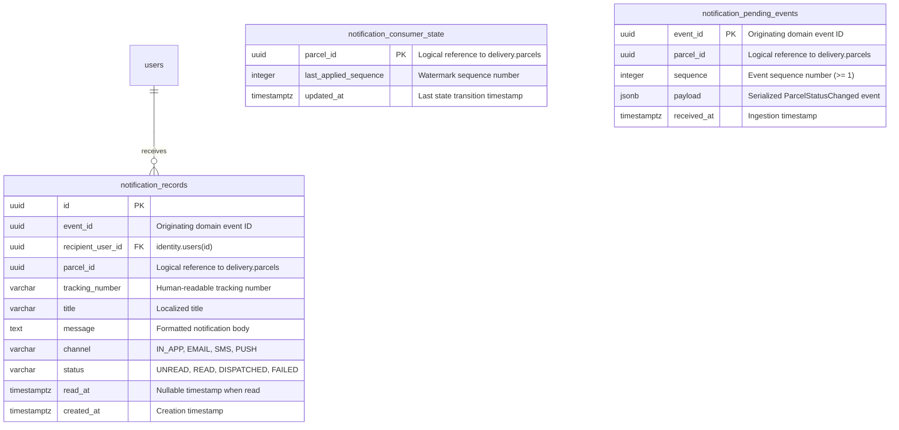

# SwiftDrop Notification Database Design

- **Document:** `docs/architecture/notification-database-design.md`
- **Phase:** Phase 2 – Notification Database Design
- **Status:** Complete Architecture & Schema Specification
- **Date:** 2026-11-13
- **Branch:** `feat/dev-notifications`
- **Owning Module:** `com.swiftdrop.notification` (ADR 0003)

---

## 1. Overview and Design Principles

The Notification module provides decoupled, asynchronous, at-least-once status notifications for SwiftDrop actors. In accordance with:
- **ADR 0001 (Monorepo & Single Database)**: All tables reside within the shared PostgreSQL database.
- **ADR 0003 (Modular Monolith Boundaries)**: The `notification` module owns its database schema completely. No foreign keys cross module boundaries to tables owned by `delivery` (`parcels`, `parcel_status_history`) or `pricing` (`pricing_rules`). Foreign keys to the `identity` module's `users` table are permitted following the established project pattern (identical to `parcels.customer_id REFERENCES users(id)` and `merchants.user_id REFERENCES users(id)`).
- **ADR 0004 (Reliability & Sequence Enforcement)**: The schema enforces idempotent event handling, per-parcel in-order event application, sequence gap buffering, and resilient duplicate-message discarding.
- **Flyway Migrations (`MigrationConventionTest`)**: Future migration files will reside in `backend/src/main/resources/db/migration/notification/` following the strict pattern `V<yyyyMMddHHmm>__notification_<description>.sql`.

---

## 2. Entity Relationship Diagram (ERD)



---

## 3. Table Specifications & DDL Definitions

### 3.1 Table: `notification_records`

#### Purpose
Stores all user notifications, providing the persistent store for the in-app notification feed, read/unread status management, and audit logging for simulated/dispatched channel communications (Mock SMS, Email, future Push).

#### Proposed DDL
```sql
CREATE TABLE notification_records (
    id                UUID         PRIMARY KEY,
    event_id          UUID         NOT NULL,
    recipient_user_id UUID         NOT NULL REFERENCES users (id) ON DELETE RESTRICT,
    parcel_id         UUID         NOT NULL,
    tracking_number   VARCHAR(16)  NOT NULL,
    title             VARCHAR(200) NOT NULL,
    message           TEXT         NOT NULL,
    channel           VARCHAR(20)  NOT NULL,
    status            VARCHAR(20)  NOT NULL,
    read_at           TIMESTAMPTZ,
    created_at        TIMESTAMPTZ  NOT NULL,

    -- Idempotency: guarantees one notification record per event, channel, and recipient
    CONSTRAINT uq_notification_records_event_channel_user 
        UNIQUE (event_id, channel, recipient_user_id),

    -- Enumeration constraints
    CONSTRAINT ck_notification_records_channel 
        CHECK (channel IN ('IN_APP', 'EMAIL', 'SMS', 'PUSH')),
    CONSTRAINT ck_notification_records_status 
        CHECK (status IN ('UNREAD', 'READ', 'DISPATCHED', 'FAILED')),

    -- State consistency: read_at must be populated if and only if status is READ
    CONSTRAINT ck_notification_records_read_state 
        CHECK ((status = 'READ') = (read_at IS NOT NULL)),

    -- Tracking number format matches system standard
    CONSTRAINT ck_notification_records_tracking_number 
        CHECK (tracking_number ~ '^SD[0-9A-HJKMNP-TV-Z]{10}$')
);

-- Index 1: Optimized user notification feed (newest first)
CREATE INDEX ix_notification_records_user_feed 
    ON notification_records (recipient_user_id, created_at DESC);

-- Index 2: Highly efficient partial index for unread notification count badge
CREATE INDEX ix_notification_records_user_unread 
    ON notification_records (recipient_user_id) 
    WHERE status = 'UNREAD';

-- Index 3: Efficient lookup by parcel for support and audit queries
CREATE INDEX ix_notification_records_parcel_id 
    ON notification_records (parcel_id);
```

#### Column Details
| Column | Type | Nullable | Description |
| :--- | :--- | :---: | :--- |
| `id` | `UUID` | No | Primary Key, generated via application UUID generator (RFC 4122). |
| `event_id` | `UUID` | No | UUID of the triggering `ParcelStatusChanged` event from `delivery`. |
| `recipient_user_id` | `UUID` | No | Foreign Key to `users(id)` in `identity` module. Enforces valid recipient. |
| `parcel_id` | `UUID` | No | Logical reference to `parcels(id)` (No FK to maintain ADR 0003 boundary). |
| `tracking_number` | `VARCHAR(16)` | No | 12-char tracking identifier (`SD...`) for display in client UI. |
| `title` | `VARCHAR(200)` | No | Short title for notification banner or email subject line. |
| `message` | `TEXT` | No | Full human-readable notification message body. |
| `channel` | `VARCHAR(20)` | No | Dispatch channel (`IN_APP`, `EMAIL`, `SMS`, `PUSH`). |
| `status` | `VARCHAR(20)` | No | Delivery/Read status (`UNREAD`, `READ`, `DISPATCHED`, `FAILED`). |
| `read_at` | `TIMESTAMPTZ` | Yes | Timestamp when user marked notification as read. |
| `created_at` | `TIMESTAMPTZ` | No | Creation timestamp (UTC). |

---

### 3.2 Table: `notification_consumer_state`

#### Purpose
Implements the consumer ordering watermark mandated by ADR 0004 §4.3. Tracks the highest applied event sequence number for each parcel. Ensures that out-of-order, late, or duplicate events are handled deterministically without skipped steps.

#### Proposed DDL
```sql
CREATE TABLE notification_consumer_state (
    parcel_id              UUID        PRIMARY KEY,
    last_applied_sequence  INTEGER     NOT NULL,
    updated_at             TIMESTAMPTZ NOT NULL,

    CONSTRAINT ck_notification_consumer_state_sequence 
        CHECK (last_applied_sequence >= 1)
);
```

#### Column Details
| Column | Type | Nullable | Description |
| :--- | :--- | :---: | :--- |
| `parcel_id` | `UUID` | No | Primary Key. The unique identifier of the parcel. |
| `last_applied_sequence` | `INTEGER` | No | Highest sequence number successfully applied for this parcel (starts at 1 for `CREATED`). |
| `updated_at` | `TIMESTAMPTZ` | No | Timestamp of the last applied status transition (UTC). |

---

### 3.3 Table: `notification_pending_events`

#### Purpose
Serves as an event buffer / quarantine store for sequence gaps (ADR 0004 §4.3). When an event with sequence $s > lastApplied + 1$ arrives from RabbitMQ, it cannot be applied immediately because intermediate transitions have not yet been processed. The raw event payload is stored in this table and acknowledged to RabbitMQ. It is either unlocked when the missing sequence arrives, or recovered by the `GapReconciliationScheduler`.

#### Proposed DDL
```sql
CREATE TABLE notification_pending_events (
    event_id    UUID        PRIMARY KEY,
    parcel_id   UUID        NOT NULL,
    sequence    INTEGER     NOT NULL,
    payload     JSONB       NOT NULL,
    received_at TIMESTAMPTZ NOT NULL,

    -- Only one pending event allowed per parcel sequence number
    CONSTRAINT uq_notification_pending_events_parcel_sequence 
        UNIQUE (parcel_id, sequence),
    CONSTRAINT ck_notification_pending_events_sequence 
        CHECK (sequence >= 1)
);

-- Index: Used by GapReconciliationScheduler to discover orphaned pending events older than grace period
CREATE INDEX ix_notification_pending_events_reconciliation 
    ON notification_pending_events (received_at, parcel_id);
```

#### Column Details
| Column | Type | Nullable | Description |
| :--- | :--- | :---: | :--- |
| `event_id` | `UUID` | No | Primary Key. Stable event identifier from the message envelope. |
| `parcel_id` | `UUID` | No | The parcel associated with the pending event. |
| `sequence` | `INTEGER` | No | Sequence number of the pending event ($s > 1$). |
| `payload` | `JSONB` | No | Full serialized `ParcelStatusChanged` JSON message body. |
| `received_at` | `TIMESTAMPTZ` | No | Arrival timestamp when quarantined. |

---

## 4. Verification Against Core System Requirements

### 4.1 Multiple Notifications per User
- A single user can have multiple notifications across different parcels or multiple notifications across the lifecycle of a single parcel (`CREATED`, `PICKED_UP`, `OUT_FOR_DELIVERY`, `DELIVERED`).
- Supported by: `notification_records.id` as primary key and compound index on `(recipient_user_id, created_at DESC)`.

### 4.2 Efficient Unread Notification Queries
- In-app notification bells frequently execute `COUNT(*)` or fetch only unread notifications.
- Supported by: **Partial index** `ix_notification_records_user_unread` (`WHERE status = 'UNREAD'`). PostgreSQL scans only unread rows, resulting in index-only scans that execute in sub-millisecond time even with millions of read historical notifications.

### 4.3 Idempotent Event Processing & Duplicate Deliveries
- RabbitMQ redeliveries or unconfirmed message requeues present duplicate messages with identical `eventId`.
- Supported by:
  1. Watermark check on `notification_consumer_state`: if $s \le last\_applied\_sequence$, event is dropped with zero side effects.
  2. Database constraint `uq_notification_records_event_channel_user`: prevents duplicate notification records if the consumer state check is bypassed.
  3. Unique constraint `uq_notification_pending_events_parcel_sequence`: prevents duplicate quarantine records.

### 4.4 Event Sequence Gap Recovery Flow
- If sequence 1 arrives, then sequence 3 arrives:
  1. Sequence 3 ($s=3, last=1$) fails condition $s = last + 1$.
  2. Sequence 3 is inserted into `notification_pending_events` and acknowledged.
  3. When sequence 2 arrives later:
     - Sequence 2 is processed, setting $last = 2$.
     - Consumer immediately inspects `notification_pending_events` for `parcel_id` with sequence 3.
     - Sequence 3 is applied, deleted from `notification_pending_events`, and $last$ advances to 3.
  4. If sequence 2 never arrives (lost broker message):
     - `GapReconciliationScheduler` polls `ix_notification_pending_events_reconciliation` for `received_at < NOW() - INTERVAL '60 seconds'`.
     - Calls `delivery.api.ParcelEvents.eventsBetween(parcelId, 2, 3)` to fetch sequence 2 directly from historical status logs.
     - Processes sequences 2 and 3 sequentially, cleaning up the pending table.

### 4.5 Future Channel Extensibility (Email, SMS, Push)
- The column `channel` (`IN_APP`, `EMAIL`, `SMS`, `PUSH`) allows a single business event to create distinct dispatch records.
- For example, a `DELIVERED` event can generate:
  - Record A: `channel = 'IN_APP'`, `status = 'UNREAD'`.
  - Record B: `channel = 'EMAIL'`, `status = 'DISPATCHED'`.
- Both are tracked under the same `event_id` and `parcel_id` without collision due to `UNIQUE (event_id, channel, recipient_user_id)`.

---

## 5. Data Retention & Archival Considerations

1. **`notification_consumer_state`**:
   - Must be retained as long as the parcel is active.
   - For terminal parcels (`DELIVERED`, `RETURNED`, `CANCELLED`, `FAILED`), state records can safely be retained for 90 days after parcel termination, or kept indefinitely given the small row footprint (~48 bytes per parcel).
2. **`notification_pending_events`**:
   - Highly ephemeral table. Rows are deleted immediately upon resolution.
   - If an event remains in pending status beyond max reconciliation attempts (default 5 retries, ADR 0004 §9), it is flagged as stuck and moved to DLQ / operational logs.
3. **`notification_records`**:
   - In-app notification feed retention: Recommended retention of **30 days for READ notifications** and **90 days for UNREAD notifications**.
   - A scheduled daily cleanup worker (`NotificationRetention`) can purge expired rows:
     ```sql
     DELETE FROM notification_records 
     WHERE (status = 'READ' AND read_at < NOW() - INTERVAL '30 days')
        OR (created_at < NOW() - INTERVAL '90 days');
     ```

---

## 6. Review Against Existing Backend Architecture & Identified Risks

| Area | Assessment & Findings | Risk Mitigation |
| :--- | :--- | :--- |
| **Module Boundary Isolation (ADR 0003)** | No foreign key to `delivery.parcels` is declared. `parcel_id` is stored as an unconstrained UUID, identical to how `delivery.parcels.merchant_id` references `merchants.id`. | Strictly complies with ADR 0003. `ModuleBoundaryTest` will remain green. |
| **Identity Reference** | `recipient_user_id` declares `REFERENCES users (id) ON DELETE RESTRICT`. | Matches established project conventions (`parcels.customer_id`, `merchants.user_id`). Prevents accidental user deletion while active notification records exist. |
| **PostgreSQL JSONB Compatibility** | `payload JSONB` used in `notification_pending_events`. | PostgreSQL 18 supports JSONB natively; already utilized in `delivery_parcel_outbox_events.payload`. |
| **Migration Directory & Naming** | Migration will be placed in `backend/src/main/resources/db/migration/notification/`. | Conforms to `MigrationConventionTest` naming: `V<timestamp>__notification_<description>.sql`. |
| **Open Decision: Recipient Phone Number** | `users` table does not contain a phone number column. If SMS notifications are added later, contact numbers must be fetched via `delivery.api.DeliveryContact` or stored in an extended profile. | For Phase 2/3, in-app and email channels are fully supported by `identity_users(email)`. |

---

## 7. Phase 2 Conclusion

The proposed database design completely fulfills the requirements of the Notification module:
- Implements strict ordering, sequence gap buffering, and deduplication (ADR 0004).
- Adheres strictly to modular monolith boundary rules (ADR 0003).
- Optimizes query performance for unread badge counters and notification feeds.
- Prepares the data layer for seamless integration with upcoming Java entities in Phase 3.

