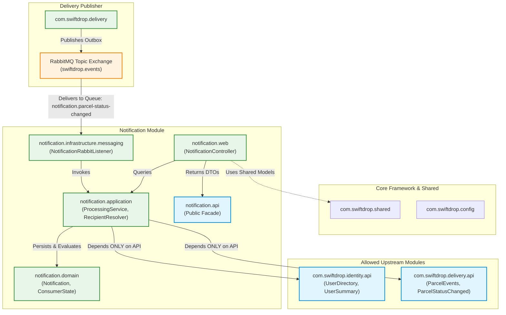
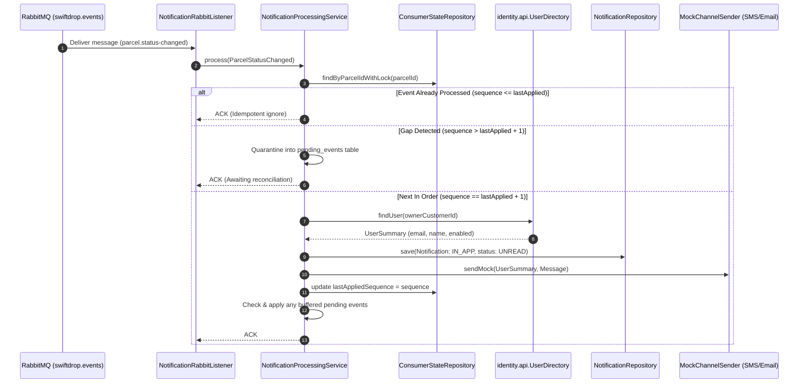
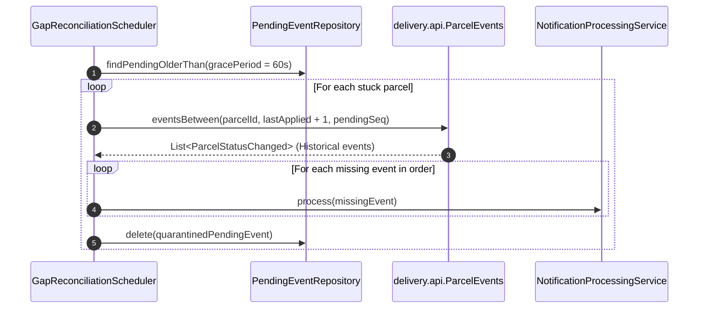
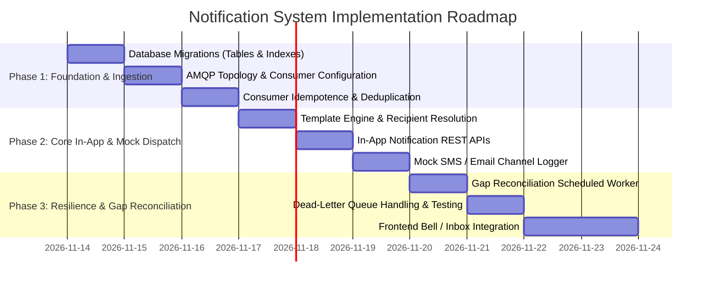

# SwiftDrop Notification System Architecture

- **Document:** `docs/architecture/notification-system-architecture.md`
- **Status:** Proposed Architecture & Design Specification
- **Date:** 2026-11-13
- **Branch:** `feat/dev-notifications`
- **Scope:** Complete architectural blueprint for the `com.swiftdrop.notification` module within the Modular Monolith

---

## 1. Architecture Overview

SwiftDrop is built as a **Modular Monolith in a monorepo** (governed by ADR 0001, ADR 0002, and ADR 0003). As demonstrated in the baseline assessment (`docs/reviews/notification-backend-assessment.md`), business logic is decoupled across well-defined domain boundaries, and compile-time/test-time architectural isolation is strictly enforced by `com.swiftdrop.ModuleBoundaryTest`.

The Notification System is designed to provide **reliable, decoupled, asynchronous communication** with SwiftDrop actors (Customers, Merchants, Couriers, Dispatchers, and Admins) about critical operational events (primarily parcel lifecycle transitions).

### Core Architectural Principles
1. **At-Least-Once Asynchronous Event Consumption**: The Notification module consumes domain events from RabbitMQ via durable quorum queues bound to the publisher's durable topic exchange (`swiftdrop.events`), driven by `delivery`'s Transactional Outbox pattern (ADR 0004).
2. **Strict Module Boundary Isolation**: The Notification module depends **only** on the public APIs of allowed modules (`identity.api` and `delivery.api`). It does not directly access foreign database tables, JPA repositories, internal services, or web packages (ADR 0003).
3. **Idempotence & Sequence Gap Reconciliation**: Because distributed messaging provides at-least-once delivery, the consumer enforces per-parcel event ordering, deduplicates events by `eventId`, and reconciles missing sequence numbers via `delivery.api.ParcelEvents` before applying side effects (ADR 0004 §4.3).
4. **Channel Decoupling**: Business event ingestion and internal notification storage are separated from channel-specific dispatchers (In-App notifications, Mock SMS, Email, future Push). Notification failures in external channels never impact transaction consistency or parcel lifecycle operations.

---

## 2. Functional Requirements

### 2.1 Core Capabilities
- **FR-01 (Event Ingestion)**: Automatically consume `parcel.status-changed` events from the `swiftdrop.events` exchange.
- **FR-02 (Recipient Resolution)**: Resolve target user identities and contact details using `identity.api.UserDirectory` or `delivery.api.ParcelQueries`.
- **FR-03 (Notification Generation & Formatting)**: Generate localized, formatted message titles, bodies, and metadata based on lifecycle status changes and recipient role.
- **FR-04 (In-App Notification Feed)**: Provide authenticated REST endpoints for users to view, paginate, count unread, and mark notifications as read.
- **FR-05 (Channel Abstraction & Mock Dispatch)**: Provide an extensible channel delivery SPI. For local and academic demonstration, implement a **Mock SMS/Email dispatcher** that records outbound dispatches in the database without incurring third-party API dependencies or costs (ADR 0004 §8).
- **FR-06 (Sequence Ordering & Deduplication)**: Enforce strict per-parcel sequence processing. Discard redundant duplicate event IDs and handle out-of-order sequence arrivals using a pending quarantine table.
- **FR-07 (Automated Gap Reconciliation)**: Periodically reconcile orphaned pending events by querying historical events via `delivery.api.ParcelEvents.eventsBetween(...)`.

---

## 3. Non-Functional Requirements

- **NFR-01 (Reliability & Fault Tolerance)**: Transient consumer failures (broker hiccup, database locks) must trigger bounded retries with exponential backoff before routing to a Dead-Letter Queue (`notification.parcel-status-changed.dlq`).
- **NFR-02 (Data Privacy & PII Protection)**: Notification log tables, RabbitMQ event payloads, and logging statements must **never** record unencrypted or plain-text credentials, passwords, or excessive PII. Log messages must use aggregate IDs and sanitized identifiers (Project Rules, ADR 0004 §2).
- **NFR-03 (Row-Level Security & Isolation)**: Users may query and update only their own notifications. Endpoint access must resolve caller identity directly from the authenticated JWT token (`Jwt.getSubject()`).
- **NFR-04 (Performance & Throughput)**: Ingestion and in-app persistence must happen with low latency (<50ms per message under normal broker load). External channel delivery must not block consumer worker threads.
- **NFR-05 (Zero Side-Effect Regression)**: Notification processing or external notification failure must never block, delay, or roll back upstream parcel lifecycle transitions in the `delivery` module.

---

## 4. Actor and Notification Matrix

The matrix below maps each actor to their operational notifications, categorizing them into:
- **Category A**: Supported by the existing `parcel.status-changed` domain event.
- **Category B**: Requires new events or modifications to upstream modules (Documented as future integration requirements).

| Actor | Trigger Event / Status | Category | Target Recipient | Channel(s) | Information Included |
| :--- | :--- | :---: | :--- | :--- | :--- |
| **Customer** | `CREATED` | A | Sender Customer | In-App, Email | Booking confirmed, tracking number, estimated delivery date, fee paid. |
| **Customer** | `PICKED_UP` | A | Sender Customer | In-App, SMS/Email | Parcel collected from pickup location, current transit status. |
| **Customer** | `OUT_FOR_DELIVERY` | A | Sender & Recipient | In-App, SMS/Email | Out for delivery, attempt number, instructions for delivery receipt. |
| **Customer** | `DELIVERED` | A | Sender Customer | In-App, Email | Successful delivery confirmation, delivered timestamp. |
| **Customer** | `DELIVERY_ATTEMPT_FAILED` | A | Sender Customer | In-App, SMS/Email | Delivery attempt failed, failure reason code, next steps / reattempt notice. |
| **Customer** | `CANCELLED` | A | Sender Customer | In-App, Email | Parcel booking cancellation confirmation. |
| **Customer** | `RETURNING` / `RETURNED` | A | Sender Customer | In-App, SMS/Email | Parcel failed max attempts and is returning/returned to sender. |
| **Merchant** | `parcel.status-changed` (All) | A | Merchant Contact | Webhook (Merchant module) / In-App | Order reference, new status, timestamp. *(Note: Merchants primarily receive webhooks per ADR 0004 §7; in-app alerts are optional summary feeds).* |
| **Courier** | Courier Assigned (`PICKUP`/`DELIVERY`) | **B** | Assigned Courier | In-App, Push | *Requires new event*: Assignment ID, Task type (pickup/delivery), parcel ID. *(Currently `ParcelAssignmentService` updates database without an outbox event).* |
| **Courier** | Parcel Cancelled before pickup | A | Assigned Courier (if any) | In-App, Push | Tracking number, cancellation notice to prevent redundant dispatch. |
| **Dispatcher** | `FAILED` (Lost / Damaged) | A | Dispatchers / Admin | In-App, Dashboard Alert | Parcel tracking number, failure reason, dispatcher intervention required. |
| **Dispatcher** | `DELIVERY_ATTEMPT_FAILED` (Attempt 3/3) | A | Dispatchers | In-App | Threshold reached; parcel transitioning to `RETURNING`. |
| **Admin** | High-Rate Failures / Stuck Outbox | **B** | System Admin | System Alert / Email | *Operational metric alert*: Queue depth threshold or repeated DLQ events. |

---

## 5. Existing Event Inventory & Integration Reuse

### 5.1 Reusable Outbox & Exchange Infrastructure
The `delivery` module already publishes the versioned event envelope `ParcelStatusChanged` to RabbitMQ:
- **Exchange**: `swiftdrop.events` (Durable topic exchange, declared in `ParcelEventsExchangeConfiguration`).
- **Routing Key**: `parcel.status-changed`.
- **Payload Envelope**: `com.swiftdrop.delivery.api.ParcelStatusChanged`:
  - `UUID eventId` (Unique event ID for deduplication).
  - `String eventType` (`"parcel.status-changed"`).
  - `int schemaVersion` (`1`).
  - `Instant occurredAt`.
  - `String producer` (`"delivery"`).
  - `ParcelStatusChangedData data`:
    - `UUID parcelId`
    - `String trackingNumber`
    - `ParcelStatus previousStatus`
    - `ParcelStatus newStatus`
    - `int sequence` (Monotonically increasing per parcel, starts at 1)
    - `ParcelSource source` (`CUSTOMER` or `MERCHANT`)
    - `UUID ownerCustomerId` (Present for customer parcels)
    - `UUID ownerMerchantId` (Present for merchant parcels)
    - `String merchantOrderReference`
    - `FailureReason failureReasonCode` (Non-null for `FAILED` and `DELIVERY_ATTEMPT_FAILED`)
    - `String hubCode` (Present for `AT_HUB` / `IN_TRANSIT`)
    - `Integer attempt` (Delivery attempt counter)

### 5.2 Public API Cross-Module Reuse
The Notification module can consume existing public contracts without modifying upstream code:
1. `com.swiftdrop.identity.api.UserDirectory`:
   - `Optional<UserSummary> findUser(UUID id)`: Resolves recipient user's full name, registered email, active roles, and account enabled state.
2. `com.swiftdrop.delivery.api.ParcelEvents`:
   - `List<ParcelStatusChanged> eventsBetween(UUID parcelId, int fromSequence, int toSequence)`: Reconstructs historical events to bridge sequence gaps when out-of-order delivery occurs.
3. `com.swiftdrop.delivery.api.ParcelQueries`:
   - `findPublicTrackingView(String trackingNumber)`: Fetches public-safe tracking metadata if needed for message enrichment.

---

## 6. Proposed Notification Architecture

The Notification module is organized into standard Clean/Hexagonal layers under `com.swiftdrop.notification`:

```
backend/src/main/java/com/swiftdrop/notification/
├── api/                             # Public contract (records, views, lookup interfaces)
│   ├── NotificationSummary.java
│   └── package-info.java
├── domain/                          # Internal aggregate roots, entities, enums, repositories
│   ├── Notification.java            # Aggregate root for an in-app / dispatched notification
│   ├── NotificationChannel.java     # IN_APP, EMAIL, SMS, PUSH
│   ├── NotificationStatus.java      # PENDING, SENT, FAILED, READ
│   ├── NotificationRecipient.java   # Value object (userId, email, phone)
│   ├── NotificationRepository.java  # Spring Data JPA repository
│   ├── ConsumerState.java           # Tracks last applied sequence per parcel
│   ├── ConsumerStateRepository.java
│   ├── PendingEvent.java            # Quarantined out-of-order events
│   └── PendingEventRepository.java
├── application/                     # Orchestration, event handling, gap reconciliation
│   ├── NotificationEventListener.java      # Application handler (invoked by RabbitMQ listener)
│   ├── NotificationProcessingService.java  # Deduplication, ordering, dispatch routing
│   ├── RecipientResolver.java              # Resolves contact details via UserDirectory
│   ├── NotificationTemplateEngine.java     # Formats titles/bodies from status events
│   ├── NotificationQueryService.java       # User in-app notification queries & mark-as-read
│   └── GapReconciliationScheduler.java    # Scheduled task querying ParcelEvents
├── infrastructure/                  # RabbitMQ listeners, channel dispatchers, external adapters
│   ├── messaging/
│   │   ├── NotificationAmqpConfiguration.java   # Queue, binding & DLQ declarations
│   │   ├── NotificationRabbitListener.java      # @RabbitListener consuming swiftdrop.events
│   │   └── NotificationEventConverter.java      # JSON deserializer / contract mapper
│   └── channel/
│       ├── NotificationChannelSender.java       # Dispatcher interface (Strategy pattern)
│       ├── InAppNotificationSender.java         # Persists directly to notification table
│       └── MockChannelSender.java               # Logs simulated SMS/Email dispatch
└── web/                             # REST controllers & request/response DTOs
    ├── NotificationController.java  # GET /api/v1/notifications, PATCH /api/v1/notifications/{id}/read
    ├── NotificationResponse.java
    └── NotificationExceptionHandler.java
```

### Layer Responsibilities

1. **`notification.api`**:
   - The only package exposed to other backend modules. Contains read-only records (`NotificationSummary`) and interfaces.
2. **`notification.domain`**:
   - Owns domain persistence (`Notification`, `ConsumerState`, `PendingEvent`). Encapsulates lifecycle state transitions (e.g., mark as read, mark as failed).
3. **`notification.application`**:
   - Implements business logic: evaluating whether a status change requires a notification (ADR 0004 §8 policy), resolving recipient details via `identity.api.UserDirectory`, validating sequence numbers against `ConsumerState`, and formatting messages.
4. **`notification.infrastructure`**:
   - Manages AMQP bindings and `@RabbitListener` endpoints. Houses channel delivery strategies (`NotificationChannelSender`).
5. **`notification.web`**:
   - Exposes REST endpoints for the frontend notification bell/inbox, validating authentication JWTs and enforcing user isolation.

---

## 7. Module Dependency Diagram



---

## 8. Detailed Event Processing Workflows

### 8.1 Primary Ingestion & Notification Flow (Happy Path)



### 8.2 Sequence Gap Reconciliation Flow



---

## 9. Reliability, Deduplication, and Failure Handling

### 9.1 Deduplication & Idempotence
- **At-Least-Once Delivery**: The outbox relay republishes unacknowledged rows on restart, and RabbitMQ redelivers un-acked messages.
- **Deduplication Strategy**:
  1. Each incoming `ParcelStatusChanged` carries a unique `UUID eventId` and a per-parcel monotonic `sequence`.
  2. Table `notification_consumer_state` stores `(parcel_id, last_applied_sequence)`.
  3. Table `notification_records` has a unique constraint on `(event_id, channel)`.
  4. If `sequence <= last_applied_sequence` or `event_id` exists, the message is acknowledged immediately with zero side-effects.

### 9.2 RabbitMQ Queue Topology & Dead-Letter Handling
Conforming to ADR 0004 §5.1:
- **Primary Queue**: `notification.parcel-status-changed`
  - Quorum queue (`x-queue-type: quorum`).
  - Dead-letter exchange: `swiftdrop.dead-letter`.
  - Dead-letter routing key: `notification.parcel-status-changed.dlq`.
  - Delivery limit: `5` (`x-delivery-limit: 5`).
  - Overflow strategy: `reject-publish`.
  - Max length: `100000`.
- **Dead-Letter Queue (DLQ)**: `notification.parcel-status-changed.dlq`
  - Bound to `swiftdrop.dead-letter` with routing key `notification.parcel-status-changed.dlq`.
  - Holds poison messages for administrative inspection and diagnostic analysis.

---

## 10. Notification Channels Architecture

### 10.1 Channel Responsibilities & Phased Strategy

```
                       ┌───────────────────────────────┐
                       │  NotificationChannelSender   │
                       └──────────────┬────────────────┘
                                      │
         ┌────────────────────────────┼───────────────────────────┐
         ▼                            ▼                           ▼
┌──────────────────┐        ┌──────────────────┐        ┌──────────────────┐
│ In-App Channel   │        │ Mock SMS/Email   │        │ Future Live Push │
│ (Phase 1 - Core) │        │ (Phase 1 - Demo) │        │ (Phase 3)        │
│ DB Persistence   │        │ Log/DB Sandbox   │        │ WebSockets / SSE │
└──────────────────┘        └──────────────────┘        └──────────────────┘
```

1. **In-App Notifications (Recommended for Phase 1)**:
   - **Why**: Zero external API dependencies, 100% reliable within local Docker Compose, directly visible in the SwiftDrop web application header/bell dropdown.
   - **Mechanism**: Stored in `notification_records` table and queried via authenticated REST endpoints.
2. **Mock SMS / Mock Email (Recommended for Phase 1)**:
   - **Why**: ADR 0004 §8 specifically mandates a mock channel that stores messages in the database and logs sanitized metadata without external provider costs or secrets.
   - **Mechanism**: Persists outbound audit records to `notification_channel_dispatches` and emits info logs (sanitizing phone/email).
3. **Live Email (Phase 2)**:
   - SMTP / JavaMailSender or SendGrid/Postmark adapter. Activated conditionally via Spring properties (`swiftdrop.notification.email.enabled=false`).
4. **SMS & Mobile Push (Phase 3)**:
   - Twilio / Firebase Cloud Messaging (FCM). Requires recipient phone verification and mobile push device token registration.

---

## 11. Conceptual Database Design (Schema Specification)

All tables belong strictly to the `notification` module, created via Flyway migrations under `backend/src/main/resources/db/migration/notification/`.

### Table 1: `notification_records`
Stores generated in-app notifications and outbound message payloads.
- `id` (UUID, Primary Key)
- `event_id` (UUID, NOT NULL) — Originating domain event ID.
- `recipient_user_id` (UUID, NOT NULL, Indexed) — References user in `identity_users`.
- `parcel_id` (UUID, NOT NULL, Indexed) — Originating parcel.
- `tracking_number` (VARCHAR(50), NOT NULL)
- `title` (VARCHAR(200), NOT NULL)
- `message` (TEXT, NOT NULL)
- `channel` (VARCHAR(20), NOT NULL) — `IN_APP`, `SMS`, `EMAIL`.
- `status` (VARCHAR(20), NOT NULL) — `UNREAD`, `READ`, `DISPATCHED`, `FAILED`.
- `read_at` (TIMESTAMPTZ, NULL)
- `created_at` (TIMESTAMPTZ, NOT NULL)
- *Constraint*: `UNIQUE (event_id, channel, recipient_user_id)`

### Table 2: `notification_consumer_state`
Maintains per-parcel consumer ordering and sequence numbers (ADR 0004 §4.3).
- `parcel_id` (UUID, Primary Key)
- `last_applied_sequence` (INT, NOT NULL)
- `updated_at` (TIMESTAMPTZ, NOT NULL)

### Table 3: `notification_pending_events`
Quarantine table for out-of-order events arriving ahead of missing sequences.
- `event_id` (UUID, Primary Key)
- `parcel_id` (UUID, NOT NULL, Indexed)
- `sequence` (INT, NOT NULL)
- `payload` (JSONB / TEXT, NOT NULL) — Serialized `ParcelStatusChanged` JSON.
- `received_at` (TIMESTAMPTZ, NOT NULL)
- *Constraint*: `UNIQUE (parcel_id, sequence)`

---

## 12. Security & User Isolation Considerations

1. **Authentication**: Endpoints under `/api/v1/notifications/**` require a valid JWT Bearer token via `SecurityConfiguration`.
2. **User Data Isolation**:
   - The user's UUID is extracted from the JWT principal (`UUID.fromString(jwt.getSubject())`).
   - Repository queries strictly enforce `WHERE recipient_user_id = :userId`.
   - Modifying notification read status validates ownership:
     ```java
     notificationRepository.findByIdAndRecipientUserId(id, callerUserId)
         .orElseThrow(NotificationNotFoundException::new);
     ```
3. **No Cross-Module Identity Leaks**:
   - User profile queries use `UserDirectory.findUser(UUID)`.
   - Notification records never log plaintext passwords, authentication tokens, or unredacted personal telephone numbers.

---

## 13. Testing Strategy

1. **Module Boundary Verification (`ModuleBoundaryTest`)**:
   - Verify that adding `com.swiftdrop.notification` classes does not violate package graph constraints.
   - Ensure `notification` imports only `com.swiftdrop.identity.api.*` and `com.swiftdrop.delivery.api.*`.
2. **Flyway Migration Tests (`MigrationConventionTest`, `DatabaseMigrationIT`)**:
   - Validate that new `V<timestamp>__notification_*.sql` migrations follow standard naming and execute cleanly on PostgreSQL testcontainers.
3. **RabbitMQ Consumer Integration Tests (`@RabbitListenerTest` / Testcontainers)**:
   - Test outbox-to-consumer delivery: Publish `ParcelStatusChanged` -> assert `notification_records` row created.
   - Test duplicate message handling: Send identical `eventId` twice -> assert single notification record.
   - Test gap handling & reconciliation: Send sequence 1, then sequence 3 -> assert sequence 3 is quarantined in pending table until sequence 2 is received or reconciled.
4. **Web Security & Authorization Tests (`NotificationAuthorizationTest`)**:
   - Assert customer A cannot read or mark customer B's notifications.
   - Assert unauthenticated requests receive 401 Unauthorized.

---

## 14. Phased Implementation Roadmap



---

## 15. Open Architectural Decisions Requiring Approval

Before beginning Phase 1 implementation, the following decisions should be reviewed and confirmed:

1. **Courier Assignment Notifications**:
   - *Issue*: `ParcelAssignmentService` currently changes courier assignment records without updating parcel status or publishing outbox events.
   - *Option A (Recommended for Phase 1)*: Defer courier push/in-app notifications until a dedicated `parcel.assigned` domain event is designed in a future sprint.
   - *Option B*: Update `delivery.application.ParcelAssignmentService` to publish a new domain event. *(Note: This alters `delivery` business logic, which requires explicit architectural approval).*
2. **Recipient Notifications for Merchant Parcels**:
   - *Issue*: For parcels created by e-commerce merchants (`ParcelSource.MERCHANT`), the final recipient's customer ID is null (external buyer), while recipient phone/name are stored in `delivery_parcels`.
   - *Decision*: In Phase 1, should notifications be restricted to `ParcelSource.CUSTOMER` direct senders (as specified in ADR 0004 §8), while merchant parcels rely solely on merchant webhooks? *(Recommended: Yes, adhere strictly to ADR 0004 §8 for Phase 1).*
3. **Notification Preferences**:
   - *Issue*: Should users have a preference toggle (e.g. opt-out of SMS or in-app alerts)?
   - *Decision*: For academic and MVP scope, default all notifications to enabled; defer user preference tables to a future enhancement.

