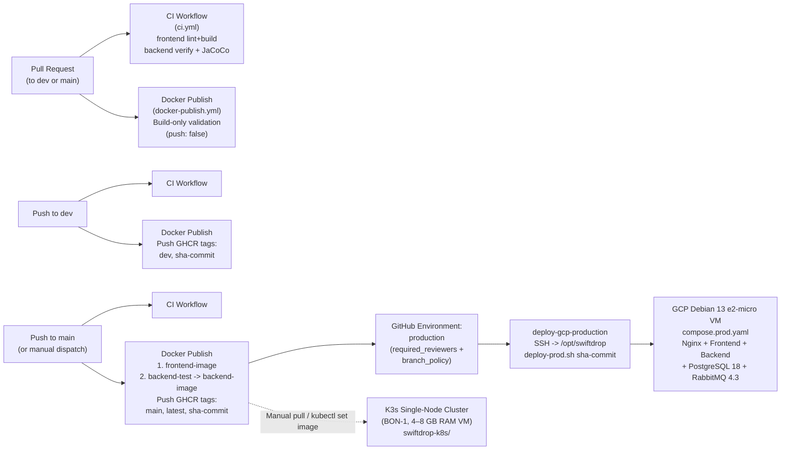

# SwiftDrop CI/CD & Deployment Architecture Record

**Last Updated:** 2026-11-22  
**Repository:** `ShenSandaru/SwiftDrop`  
**Reference Commit:** `a71d1b8` (PR #171)  
**Authoritative ADR:** [ADR 0013 — Containerized production deployment and K3s manifests](adr/0013-containerized-and-k3s-deployment.md)

This document records the complete CI/CD pipeline, container build architecture, GitHub repository configuration, automated GCP VM deployment flow, and Kubernetes (`K3s`) deployment option for SwiftDrop. For step-by-step operational runbooks, see [docs/production-deployment.md](production-deployment.md) (Docker Compose on GCP VM) and [docs/kubernetes-deployment.md](kubernetes-deployment.md) (K3s `BON-1`).

---

## 1. End-to-End CI/CD & Deployment Flow

---

## 2. GitHub Actions Workflows

All GitHub Actions steps use **SHA-pinned action versions** with least-privilege `permissions` blocks.

### 2.1 Continuous Integration ([`.github/workflows/ci.yml`](../.github/workflows/ci.yml))

* **Triggers:** `pull_request` and `push` targeting `main` and `dev`.
* **Permissions:** `contents: read`.
* **Concurrency:** `ci-${{ github.ref }}` (`cancel-in-progress: true` on pull requests).

| Job | Runner & Timeout | Working Dir | Steps |
|---|---|---|---|
| `frontend` | `ubuntu-latest` (15m) | `frontend/` | Checkout (`persist-credentials: false`) → Setup Node 24 via `.nvmrc` (npm cache) → `npm ci` → `npm run lint` → `npm run build` |
| `backend` | `ubuntu-latest` (20m) | `backend/` | Checkout → Setup Temurin JDK 21 (Maven cache) → `./mvnw --batch-mode --no-transfer-progress clean verify` (Docker-free unit tests) → Upload `jacoco-coverage-report` artifact (`backend/target/site/jacoco/`, 14-day retention, `if: always()`) |

### 2.2 Container Build, Publish & Deploy ([`.github/workflows/docker-publish.yml`](../.github/workflows/docker-publish.yml))

* **Triggers:**
  * `push` to `main`, `dev`, or semver tags `v*.*.*`
  * `pull_request` targeting `main` or `dev`
  * `workflow_dispatch` with boolean input `deploy_production` (default `false`; only deploys when run on `main`)
* **Registry:** `ghcr.io` (GitHub Container Registry)
* **Concurrency:** `docker-publish-${{ github.ref }}` (`cancel-in-progress: true` on pull requests). The `deploy-production` job has its own non-cancelling concurrency group: `production-deploy-gcp` (`cancel-in-progress: false`).

| Job | Needs | Permissions | Timeout | Responsibility |
|---|---|---|---|---|
| `frontend` (`frontend-image`) | — | `contents: read`, `packages: write` | 20m | Builds `frontend/Dockerfile` (`linux/amd64`) with `NEXT_PUBLIC_*` build args and GHA cache (`scope=swiftdrop-frontend`). Pushes to `ghcr.io/shensandaru/swiftdrop-frontend` on non-PR events. |
| `backend-test` | — | `contents: read` | 20m | Runs `./mvnw --batch-mode --no-transfer-progress test` on Temurin JDK 21 before allowing backend image publication. |
| `backend` (`backend-image`) | `backend-test` | `contents: read`, `packages: write` | 25m | Builds `backend/Dockerfile` (`linux/amd64`) with GHA cache (`scope=swiftdrop-backend`). Pushes to `ghcr.io/shensandaru/swiftdrop-backend` on non-PR events. |
| `deploy-production` (`deploy-gcp-production`) | `frontend`, `backend` | `contents: read` | 15m | Targets GitHub Environment `production`. Runs on `push` to `main` or `workflow_dispatch` on `main` with `deploy_production == true`. Deploys immutable `sha-<7-char>` images to `/opt/swiftdrop` on the GCP VM via SSH. |

### 2.3 Image Tagging Strategy

| Event | Published Tags (`swiftdrop-frontend` & `swiftdrop-backend`) | Auto-Deploys Production? |
|---|---|---|
| Pull request (`main`, `dev`) | None (`push: false`, build validation only) | No |
| Push to `dev` | `dev`, `sha-<short>` | No |
| Push to `main` | `main`, `latest`, `sha-<short>` | **Yes** (deploys `sha-<short>`) |
| Git tag `vX.Y.Z` | `X.Y.Z`, `X.Y`, `sha-<short>` | No |
| Manual `workflow_dispatch` on `main` | `main`, `latest`, `sha-<short>` | Only if `deploy_production=true` |

---

## 3. GitHub Repository Configuration (Verified)

Configuration verified directly on `ShenSandaru/SwiftDrop`:

* **Active Workflows:** `CI`, `Docker Publish`, and `Copilot cloud agent`.
* **GitHub Environments:**
  * `production` — protected by **`required_reviewers`** (manual deployment approval) and **`branch_policy`** (`custom_branch_policies: true`).
  * `copilot` — no protection rules.
* **Repository Actions Variables:**
  * `NEXT_PUBLIC_ENABLE_GOOGLE_LOGIN` (configured at repository level).
  * Optional build-time variables supported by `docker-publish.yml`: `NEXT_PUBLIC_API_BASE_URL` (defaults to `""` for same-origin routing behind Nginx/Ingress) and `NEXT_PUBLIC_FIREBASE_*` (7 Firebase Web SDK variables).
* **`production` Environment Secrets (Deployment Access Only):**
  * `GCP_VM_HOST`
  * `GCP_VM_USER`
  * `GCP_VM_SSH_PRIVATE_KEY`
  * `GCP_VM_SSH_KNOWN_HOSTS`
  * *(Optional, only if GHCR packages are made Private: `GHCR_USERNAME`, `GHCR_TOKEN`)*
* **Runtime Application Secrets (VM Only):**
  * Never stored in Git or GitHub Actions. Stored exclusively on the GCP VM in `/opt/swiftdrop/.env.prod` (`chmod 600`, git-ignored), created from [`.env.prod.example`](../.env.prod.example).

---

## 4. Containerization Architecture

### 4.1 Backend Image ([`backend/Dockerfile`](../backend/Dockerfile))

* **Builder stage:** `eclipse-temurin:21-jdk-alpine`
  * Runs `./mvnw dependency:go-offline` and `./mvnw package -DskipTests` (unit tests run in `backend-test` job beforehand).
  * Uses `jlink` to assemble a minimal custom JRE including `jdk.random` (required by `RandomGenerator.getDefault()` in `WebhookSenderConfiguration`, which is omitted from `eclipse-temurin:21-jre-alpine`).
* **Runner stage:** `alpine:3.21`
  * Installs `ca-certificates`, `tzdata`, `libstdc++`.
  * Runs as non-root user `swiftdrop`.
  * Default `JAVA_TOOL_OPTIONS="-XX:MaxRAMPercentage=65.0 -XX:+ExitOnOutOfMemoryError"` (overridden in `compose.prod.yaml` for `e2-micro`).
  * Built-in `HEALTHCHECK` against `http://127.0.0.1:8080/actuator/health`.

### 4.2 Frontend Image ([`frontend/Dockerfile`](../frontend/Dockerfile))

* **Stages:** `node:24-alpine` (`deps` → `builder` → `runner`).
* Uses Next.js `output: "standalone"` so only `.next/standalone`, `.next/static`, and `public/` are copied into the runtime image.
* Runs as non-root user `nextjs` (UID/GID `1001`) on port `3000`.
* Built-in `HEALTHCHECK` using Node `fetch('http://127.0.0.1:3000/')`.

### 4.3 Production Docker Compose Stack ([`compose.prod.yaml`](../compose.prod.yaml))

Project name: `swiftdrop-prod`. Tuned by default for a **GCP Debian 13 `e2-micro` VM** (1 GB RAM + 2 GB swap), with 4 GB / 8 GB override profiles documented in `.env.prod.example`.

| Service | Image | Networks | Default Memory / Swap Cap | Health Check |
|---|---|---|---|---|
| `postgres` | `postgres:18-alpine` | `internal` | `256m` / `512m` | `pg_isready` |
| `rabbitmq` | `rabbitmq:4.3-alpine` | `internal` | `384m` / `768m` | `rabbitmq-diagnostics check_port_connectivity` |
| `backend` | `ghcr.io/shensandaru/swiftdrop-backend:${SWIFTDROP_IMAGE_TAG}` | `internal`, `edge` | `512m` / `1024m` | `GET /actuator/health` |
| `frontend` | `ghcr.io/shensandaru/swiftdrop-frontend:${SWIFTDROP_IMAGE_TAG}` | `edge` | `256m` / `512m` | `GET http://127.0.0.1:3000/` |
| `nginx` | `nginx:1.27-alpine` | `edge` | `64m` / `128m` | `GET /nginx-health` |

* **Network isolation:** `internal` is marked `internal: true`. Only Nginx exposes host ports (`80` and `443`).
* **Persistent volumes:** `postgres-data`, `rabbitmq-data`, `certbot-webroot`, `certbot-conf`.
* **Log rotation:** All services use `json-file` capped at `10m × 3` files.
* **Nginx routing:** [`deploy/nginx/snippets/swiftdrop-routes.conf`](../deploy/nginx/snippets/swiftdrop-routes.conf) proxies `/api/`, `/actuator/health`, `/login/oauth2/`, `/oauth2/`, `/mcp` to `backend:8080`, disables proxy buffering for SSE (`/api/v1/tracked-parcels/*/events`), enforces a `3m` upload limit, and routes all other traffic to `frontend:3000`.

---

## 5. Automated Production Deployment & Rollback ([`deploy/scripts/deploy-prod.sh`](../deploy/scripts/deploy-prod.sh))

When `deploy-gcp-production` runs:

1. **Pre-flight & SSH setup:** Validates all 4 required secrets, computes `IMAGE_TAG=sha-<7-char>`, writes `deploy_key` and `known_hosts` under `${RUNNER_TEMP}/swiftdrop-ssh` (`chmod 600`), and connects with `StrictHostKeyChecking=yes` and `BatchMode=yes`. Temporary SSH files are always deleted in a final `if: always()` step.
2. **Exact commit sync:** On the VM (`/opt/swiftdrop`), records `PREVIOUS_COMMIT`, fetches `origin main`, and checks out the exact 40-char `DEPLOY_COMMIT` (`git checkout --force`), preserving git-ignored `.env.prod` and `deploy/nginx/https.conf`.
3. **Deployment execution (`deploy-prod.sh`):**
   * Backs up `.env.prod` to a `chmod 600` temp file and updates only `SWIFTDROP_IMAGE_TAG`.
   * Runs `docker compose --env-file .env.prod -f compose.prod.yaml config --quiet`.
   * Pulls `frontend` and `backend` images (`compose pull frontend backend`) — never builds on the VM.
   * Starts updated containers (`compose up -d --no-build --remove-orphans`).
   * Validates and reloads Nginx (`nginx -t` → `nginx -s reload`).
   * Waits up to `180s` (`HEALTH_TIMEOUT_SECONDS`) for all 5 containers to report `healthy`.
   * Verifies live HTTP/HTTPS endpoints (`/nginx-health`, `/actuator/health` returning `"status":"UP"`, and `/`).
   * Prunes dangling untagged image layers (`docker image prune -f`) to protect disk space.
4. **Automatic rollback on failure:**
   * If any step fails, prints container status, `free -h`, and recent logs from `backend`, `frontend`, and `nginx`.
   * Restores `PREVIOUS_COMMIT` and the backed-up `.env.prod`, pulls/recreates the previous containers, reloads Nginx, re-verifies health, and exits `1` so GitHub Actions marks the deployment failed.
   * **Caveat:** Flyway database migrations are **not** automatically rolled back. Take a `pg_dump` backup before merging irreversible schema changes into `main`.

---

## 6. Kubernetes (K3s) Deployment Option (`BON-1`)

To satisfy the optional Kubernetes bonus (`BON-1`) without overloading the 1 GB `e2-micro` VM, single-node K3s manifests are maintained separately under [`swiftdrop-k8s/`](../swiftdrop-k8s/):

* **Target sizing:** Minimum 2 vCPU / 4 GB RAM (recommended 8 GB RAM) running K3s with Traefik and `local-path` StorageClass.
* **Workloads:** `postgres` StatefulSet (`5Gi` PVC), `rabbitmq` StatefulSet (`2Gi` PVC), `backend` Deployment (`replicas: 1` per ADR 0013 because SSE streams and rate limiters are in-memory), `frontend` Deployment, and Traefik Ingress (with a dedicated SSE ingress bypassing upload buffering).
* **Images:** Consumes the exact same prebuilt GHCR images published by `docker-publish.yml`.
* **Runbook:** [docs/kubernetes-deployment.md](kubernetes-deployment.md).

---

## 7. Verified GitHub Actions Run Record

Recent verified runs on `ShenSandaru/SwiftDrop`:

| Workflow | Event / Branch | Run ID | Result | Notes |
|---|---|---|---|---|
| `CI` | `push` / `dev` (PR #170) | `44876100146` | Success | Verified `frontend` + `backend` checks |
| `CI` | `push` / `main` (PR #171) | `44878739430` | Success | Verified `main` merge |
| `Docker Publish` | `push` / `main` (PR #171) | `44878739447` | Success | Built & pushed images + deployed to GCP VM |
| `Docker Publish` | `workflow_dispatch` / `main` | `44912363240` | Success | Manual production publish/deploy verification |
| `CI` | `push` / `dev` (PR #171 sync) | `44923646876` | Success | Verified `dev` branch |
| `Docker Publish` | `push` / `dev` (PR #171 sync) | `44923646841` | Success | Published `dev` + `sha-*` images to GHCR |
