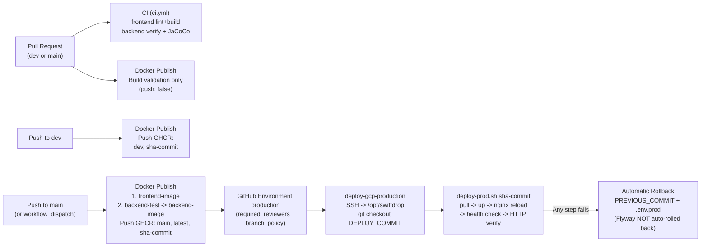

# CI/CD Workflows & Deployment Script Execution

**Last Updated:** 2026-11-22  
**Repository:** `ShenSandaru/SwiftDrop`  
**Workflows:** [`.github/workflows/ci.yml`](../../.github/workflows/ci.yml), [`.github/workflows/docker-publish.yml`](../../.github/workflows/docker-publish.yml)  
**Deployment Script:** [`deploy/scripts/deploy-prod.sh`](../../deploy/scripts/deploy-prod.sh)

---

## 1. End-to-End CI/CD Flow

---

## 2. GitHub Actions Workflows

All actions are **SHA-pinned** with least-privilege `permissions`.

### 2.1 `CI` ([`ci.yml`](../../.github/workflows/ci.yml))

* **Triggers:** `pull_request` and `push` to `main` and `dev`.
* **Concurrency:** `ci-${{ github.ref }}` (`cancel-in-progress: true` on PRs).
* **Jobs:**
  * `frontend` (15m): Node 24 (`.nvmrc`, npm cache) → `npm ci` → `npm run lint` → `npm run build`.
  * `backend` (20m): Temurin JDK 21 (Maven cache) → `./mvnw --batch-mode --no-transfer-progress clean verify` (Docker-free unit tests) → uploads `jacoco-coverage-report` artifact (14-day retention, `if: always()`).

### 2.2 `Docker Publish` ([`docker-publish.yml`](../../.github/workflows/docker-publish.yml))

* **Triggers:** `push` (`main`, `dev`, tags `v*.*.*`), `pull_request` (`main`, `dev`), `workflow_dispatch` (`deploy_production` boolean, default `false`).
* **Jobs:**
  1. `frontend-image` (20m): Builds `frontend/Dockerfile` (`linux/amd64`) with `NEXT_PUBLIC_*` build args and GHA cache (`scope=swiftdrop-frontend`). Pushes to `ghcr.io/shensandaru/swiftdrop-frontend` on non-PR events.
  2. `backend-test` (20m): Runs `./mvnw --batch-mode --no-transfer-progress test` on Temurin JDK 21.
  3. `backend-image` (25m, `needs: [backend-test]`): Builds `backend/Dockerfile` (`linux/amd64`) with GHA cache (`scope=swiftdrop-backend`). Pushes to `ghcr.io/shensandaru/swiftdrop-backend` on non-PR events.
  4. `deploy-gcp-production` (15m, `needs: [frontend, backend]`, `environment: production`, concurrency `production-deploy-gcp` with `cancel-in-progress: false`): Runs on `push` to `main` or `workflow_dispatch` on `main` with `deploy_production == true`.

### 2.3 Image Tagging Matrix

| Event | Published GHCR Tags | Deploys Production? |
|---|---|---|
| Pull request (`main`, `dev`) | None (`push: false`) | No |
| Push to `dev` | `dev`, `sha-<7-char>` | No |
| Push to `main` | `main`, `latest`, `sha-<7-char>` | **Yes** (`sha-<7-char>`) |
| Tag `vX.Y.Z` | `X.Y.Z`, `X.Y`, `sha-<7-char>` | No |
| `workflow_dispatch` on `main` | `main`, `latest`, `sha-<7-char>` | Only if `deploy_production=true` |

---

## 3. Live GitHub Repository Configuration (Verified)

Verified on `ShenSandaru/SwiftDrop`:

* **Active Workflows:** `CI`, `Docker Publish`, `Copilot cloud agent`.
* **Environments:**
  * `production`: protected by **`required_reviewers`** (manual approval gate) and **`branch_policy`** (`custom_branch_policies: true`).
  * `copilot`: no protection rules.
* **Repository Variables:** `NEXT_PUBLIC_ENABLE_GOOGLE_LOGIN` (optional `NEXT_PUBLIC_API_BASE_URL` and `NEXT_PUBLIC_FIREBASE_*` also supported).
* **`production` Environment Secrets:** `GCP_VM_HOST`, `GCP_VM_USER`, `GCP_VM_SSH_PRIVATE_KEY`, `GCP_VM_SSH_KNOWN_HOSTS` (plus optional `GHCR_USERNAME` / `GHCR_TOKEN` if GHCR packages are made Private).
* **VM-Only Runtime Secrets:** Stored exclusively in `/opt/swiftdrop/.env.prod` (`chmod 600`), never in Git or GitHub Actions.

---

## 4. How `deploy/scripts/deploy-prod.sh` Runs

### Invocation from GitHub Actions

1. Validates all 4 required SSH secrets and derives `IMAGE_TAG=sha-<7-char>`.
2. Writes `deploy_key` and `known_hosts` (`chmod 600`) to `${RUNNER_TEMP}/swiftdrop-ssh` (always cleaned up in an `if: always()` step).
3. Connects via SSH (`BatchMode=yes`, `StrictHostKeyChecking=yes`, `ConnectTimeout=15`), pipes `GHCR_TOKEN` (if set) on stdin, and runs inside `/opt/swiftdrop`:
   * Records `PREVIOUS_COMMIT="$(git rev-parse HEAD)"`.
   * Runs `GIT_TERMINAL_PROMPT=0 git fetch origin main` and `git checkout --force <DEPLOY_COMMIT>` (preserving git-ignored `.env.prod` and `deploy/nginx/https.conf`).
   * Executes `bash /opt/swiftdrop/deploy/scripts/deploy-prod.sh '<IMAGE_TAG>'`.

### Step-by-Step Script Execution

1. **Input validation:** Checks `<image-tag>` (`^[a-zA-Z0-9._-]+$`), `PREVIOUS_COMMIT` (40-char hex SHA), and existence of `compose.prod.yaml` and `.env.prod`.
2. **Optional GHCR login:** If `GHCR_USERNAME` and `GHCR_TOKEN_ON_STDIN=1` are set, runs `docker login ghcr.io --password-stdin`.
3. **Backup & tag update:** Saves `PREVIOUS_TAG` and copies `.env.prod` to a `chmod 600` temp backup (cleaned up on `EXIT`), then updates only `SWIFTDROP_IMAGE_TAG` in `.env.prod`.
4. **Deploy & verify sequence:**
   * `docker compose --env-file .env.prod -f compose.prod.yaml config --quiet`
   * `compose pull frontend backend` *(never builds on the VM)*
   * `compose up -d --no-build --remove-orphans`
   * `compose exec -T nginx nginx -t` → `nginx -s reload`
   * `wait_for_stack_health` — polls `postgres`, `rabbitmq`, `backend`, `frontend`, and `nginx` every 5s up to `HEALTH_TIMEOUT_SECONDS` (default `180s`).
   * `verify_http_endpoints` — checks `http://127.0.0.1:<http_port>/nginx-health` (`ok`), `/actuator/health` (`"status":"UP"`), and `/` (using `--resolve` over HTTPS if `SWIFTDROP_FRONTEND_BASE_URL` starts with `https://`).
5. **Cleanup on success:** Runs `docker image prune -f` (dangling untagged layers only) and exits `0`.
6. **Automatic rollback on failure:**
   * Prints diagnostics (`compose ps`, `free -h`, recent `backend`/`frontend`/`nginx` logs).
   * If commit or tag changed, runs `git checkout --force <PREVIOUS_COMMIT>`, restores `.env.prod` from backup, pulls/recreates previous containers, reloads Nginx, re-verifies health, and exits `1` so GitHub Actions flags the failure.
   * **Caveat:** Flyway database migrations are **not** automatically rolled back.

---

## 5. Verified GitHub Actions Run Record

| Workflow | Event / Branch | Run ID | Result |
|---|---|---|---|
| `CI` | `push` / `dev` (PR #170) | `44876100146` | Success |
| `CI` | `push` / `main` (PR #171) | `44878739430` | Success |
| `Docker Publish` | `push` / `main` (PR #171) | `44878739447` | Success |
| `Docker Publish` | `workflow_dispatch` / `main` | `44912363240` | Success |
| `CI` | `push` / `dev` (PR #171 sync) | `44923646876` | Success |
| `Docker Publish` | `push` / `dev` (PR #171 sync) | `44923646841` | Success |
