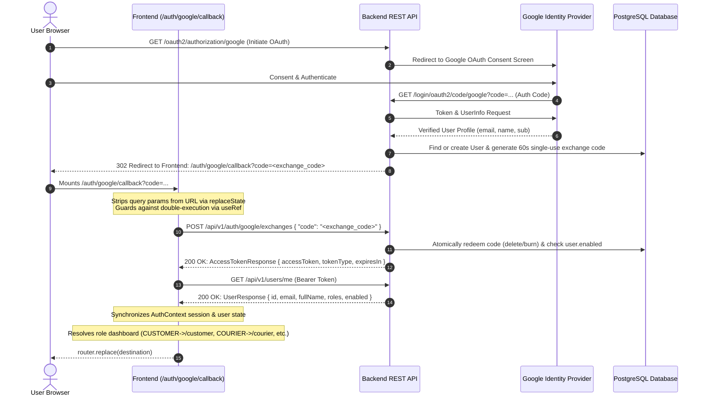

# Implementation Report: SD-110 — Frontend Google OAuth Callback Routing & Context Synchronization

**Task ID:** SD-110  
**GitHub Issue:** [#92](https://github.com/swiftdrop-ead/swiftdrop/issues/92)  
**Parent Epic:** [#100 — Identity & Authentication Completion](https://github.com/swiftdrop-ead/swiftdrop/issues/100)  
**Branch:** `fix/complete-identity-module`  
**Date:** 2026-11-05  

---

## 1. Executive Summary

This report documents the completion of **SD-110 (Frontend Google OAuth Callback Routing and Context Synchronization)**.

In accordance with [ADR 0005: OAuth2 Google Sign-In Handoff](../../adr/0005-oauth2-google-sign-in-handoff.md), browser authentication via Google OAuth relies on a secure single-use exchange code pattern. The backend issues a 60-second exchange code and redirects the user agent to `http://localhost:3000/auth/google/callback?code=<exchange_code>`. Bearer tokens are never transmitted in URL query parameters.

Prior to this task:
1. `frontend/lib/auth-context.tsx` omitted `/auth/google/callback` and `/portals` from its `publicPaths` check. If a request failed or 401 was returned, the global `onUnauthorized` handler immediately redirected the browser to `/login?expired=true&redirect=...`, creating an infinite redirection loop and preventing the callback page from displaying the proper error messages.
2. The callback page did not dynamically route users to their role-appropriate dashboard upon completing authentication (defaulting strictly to `/customer` instead of routing Couriers to `/courier`, Merchants to `/merchant`, or Dispatcher/Admins to `/dispatch`).
3. There were no unit tests verifying internal redirect sanitization and role-to-dashboard mappings.

All identified deficiencies have been resolved, verified with unit tests and production builds, and integrated cleanly with zero backend regressions.

---

## 2. End-to-End OAuth Architecture Flow



---

## 3. Implementation Details

### 3.1 Public Route Protection (`frontend/lib/auth-context.tsx`)

The authentication context monitors unauthorized API responses via `onUnauthorized`. When a 401 occurs, the context checks if the active path is allowlisted as public.

```typescript
const publicPaths = ["/login", "/signup", "/track", "/", "/auth/google/callback", "/portals"];
const currentPath = window.location.pathname;
const isPublic =
  publicPaths.includes(currentPath) ||
  currentPath.startsWith("/track") ||
  currentPath.startsWith("/auth/google/callback");
if (!isPublic) {
  const targetUrl = new URL(`/login?expired=true&redirect=${encodeURIComponent(currentPath)}`, window.location.origin).href;
  window.location.assign(targetUrl);
}
```

- Added `/auth/google/callback` and `/portals` to `publicPaths`.
- Added prefix matching for `/auth/google/callback` to cover parameterized and nested paths.
- Updated `login(token)` to return `Promise<UserResponse | null>`, enabling consumers to inspect the authenticated user profile synchronously upon session creation.

### 3.2 Role-Based Dashboard Routing & Open Redirect Prevention (`frontend/lib/redirect.ts`)

Centralized the redirect sanitization and role-dashboard mapping:

```typescript
export function getDefaultDashboardForRoles(roles?: string[] | null): string {
  if (!roles || roles.length === 0) {
    return "/customer";
  }
  if (roles.includes("DISPATCHER_ADMIN")) {
    return "/dispatch";
  }
  if (roles.includes("COURIER")) {
    return "/courier";
  }
  if (roles.includes("MERCHANT")) {
    return "/merchant";
  }
  if (roles.includes("CUSTOMER")) {
    return "/customer";
  }
  return "/customer";
}
```

The post-login destination resolution follows strict priority:
1. If a valid, sanitized return destination was saved in `sessionStorage` (`swiftdrop_auth_redirect`) prior to OAuth handoff (e.g., `/courier/parcels/123`), that destination is used.
2. Otherwise, the destination falls back to the user's role-specific primary workspace (`/dispatch`, `/courier`, `/merchant`, or `/customer`).
3. External hostnames, protocol-relative URLs (`//attacker.com`), backslash tricks (`/\attacker.com`), CRLF injection, and `/login` loop destinations are rejected, falling back to the safe role dashboard.

### 3.3 StrictMode Double-Exchange Protection (`frontend/app/auth/google/callback/page.tsx`)

In React 18/19 StrictMode (development), `useEffect` runs twice on component mount. Since ADR 0005 specifies that exchange codes are strictly single-use and burned upon redemption, a second execution would fail with 401:

```typescript
// Guard against React StrictMode double-execution and repeated effect triggers
const hasProcessedRef = useRef(false);

useEffect(() => {
  // Clear temporary parameters from browser address bar immediately without losing extracted values
  if (typeof window !== "undefined" && (errorParam || codeParam)) {
    window.history.replaceState({}, document.title, window.location.pathname);
  }

  if (initialError || !codeParam) {
    return;
  }

  if (hasProcessedRef.current) {
    return;
  }
  hasProcessedRef.current = true;

  async function exchangeCode() { ... }
  exchangeCode();
}, [codeParam, errorParam, initialError, login, router]);
```

### 3.4 Allowlisted Error Handling (ADR 0005)

When Google OAuth fails or the user cancels the prompt, the backend redirects with `?error=<code_from_allowlist>`. The frontend strictly maps allowlisted codes to user-friendly messages:

| Error Code | Rendered User Message |
|:---|:---|
| `conflict_email_exists` | "An account with this email already exists. Please sign in with your email and password." |
| `unverified_email` | "Your Google account email address is not verified. Please verify your email with Google and try again." |
| `account_disabled` | "Your account has been deactivated. Please contact support." |
| `cancelled` | "Google sign-in was cancelled." |
| `oauth_failed` | "Google sign-in failed. Please try again." |
| *(Any unknown error)* | "Google sign-in could not be completed. Please try again." |

All error states provide a direct link button: **"Return to Sign In"** (`/login`).

---

## 4. Verification & Test Results

### 4.1 Unit Tests (`frontend/lib/redirect.test.ts`)

Automated tests were written and executed using the native Node.js test runner (`npm test`):
```text
> swiftdrop-frontend@0.1.0 test
> node --test lib/redirect.test.ts

✔ sanitizeInternalRedirect returns fallback for empty or root target (0.92ms)
✔ sanitizeInternalRedirect accepts safe internal paths (0.27ms)
✔ sanitizeInternalRedirect prevents open redirect vectors (0.18ms)
✔ getDefaultDashboardForRoles maps roles accurately with safe fallback (0.14ms)
ℹ tests 4
ℹ suites 0
ℹ pass 4
ℹ fail 0
```

### 4.2 Frontend Linting & Build Verification

Executed Next.js linting and production build:
- **`npm run lint`**: Passed with zero errors or warnings (exit code `0`).
- **`npm run build`**: Prerendered all 22 static and dynamic application routes including `/auth/google/callback` and `/portals` with zero TypeScript errors (exit code `0`).

### 4.3 Backend Regression Testing

Executed Spring Boot tests covering OAuth exchange endpoints, token issuance, and module boundaries:
- **Command:** `mvnw test -Dtest=AuthenticationApiTest,ModuleBoundaryTest,GoogleLoginApiTest,GoogleExchangeApiTest,IdentityAuthorizationMatrixTest`
- **Result:** Tests run: 87, Failures: 0, Errors: 0, Skipped: 0 (`BUILD SUCCESS`).

---

## 5. Security Summary

1. **No Token Exposure in URLs:** Tokens are never transmitted via query strings or HTTP redirects.
2. **Single-Use Code Protection:** Exchange codes expire in 60 seconds and are immediately invalidated on first use.
3. **Open Redirect Defenses:** Arbitrary external targets, CRLF sequences, and protocol manipulation tricks are neutralized by `sanitizeInternalRedirect`.
4. **Session Cleanup:** Address bar query parameters are erased via `window.history.replaceState` immediately upon component mount.
5. **No Secret Leakage:** No `.env` secrets or mock credentials were created, read, or committed.

---

## 6. Next Steps in EPIC-01 (#100)

With **SD-109 (#91)** and **SD-110 (#92)** complete, the remaining tasks under **Epic #100** are:
1. **SD-107 (#9):** Google OAuth live credential configuration & verification in staging/production environments.
2. **SD-108 (#90):** UserDirectory API documentation and cross-module client consumption integration.

