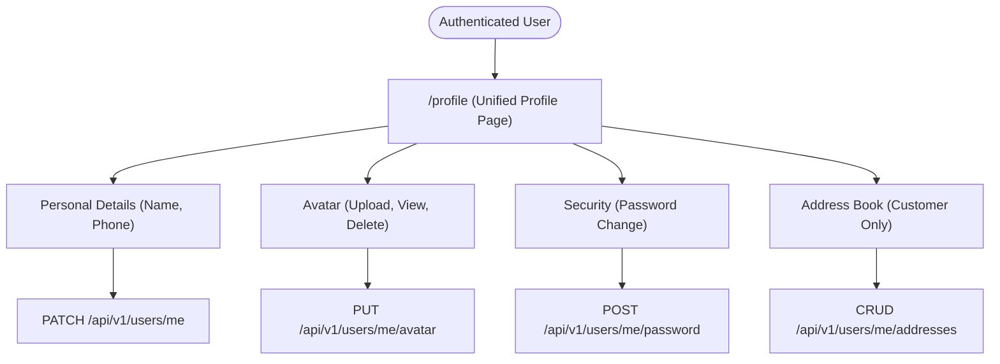
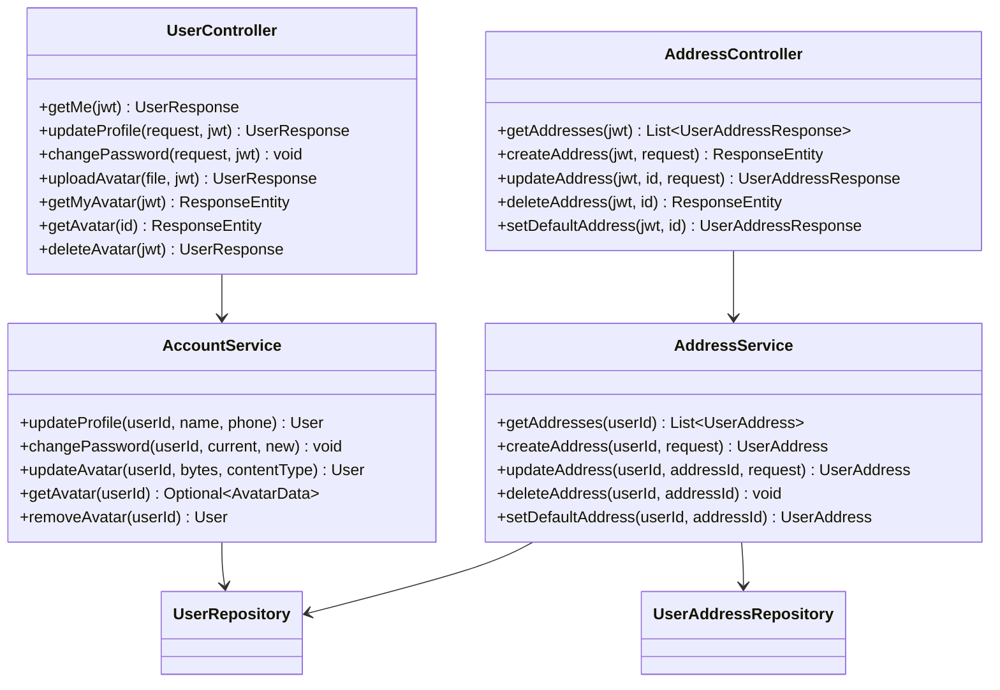
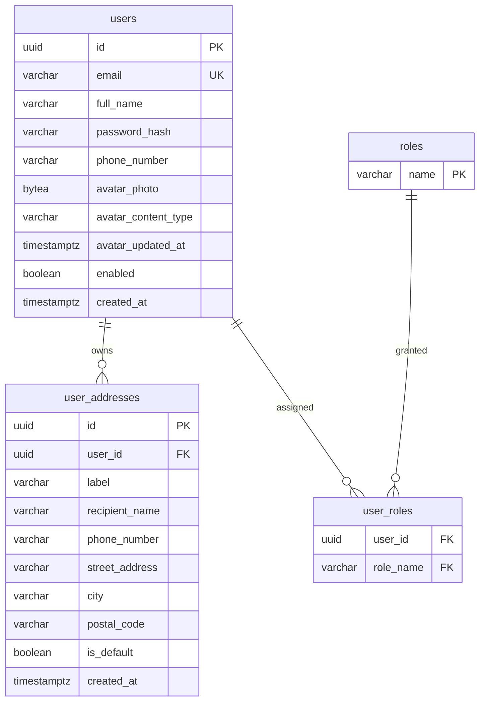
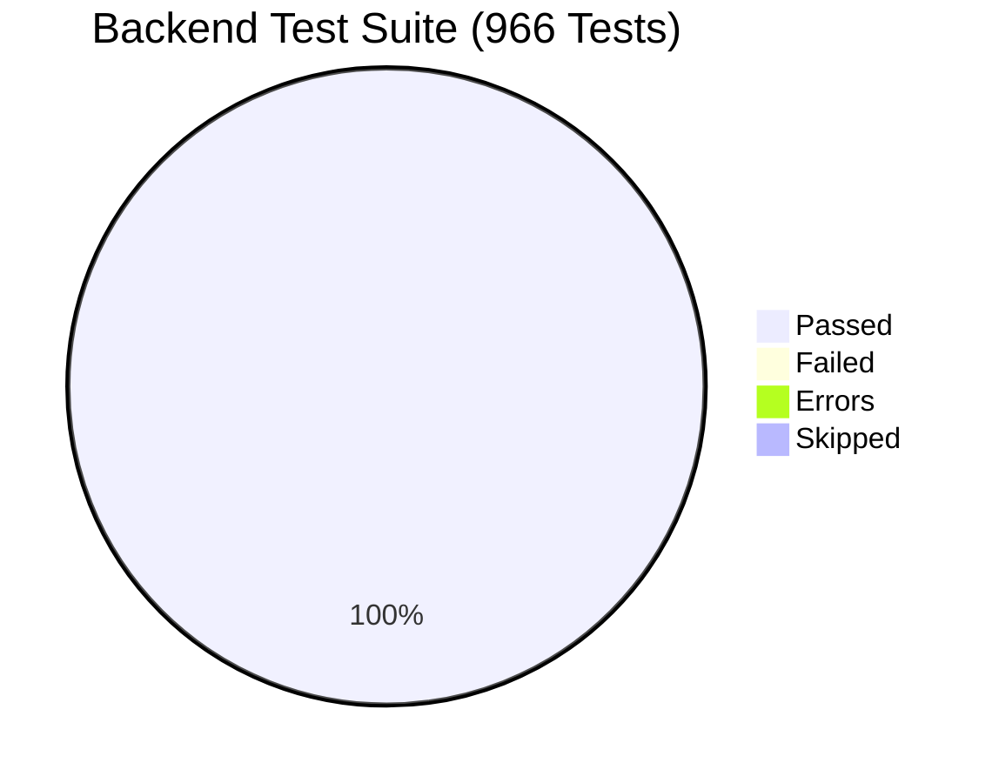

# SwiftDrop PR #123 Technical Documentation and Pre-Merge Review Report

**Document ID:** `PR-123-USER-PROFILE-FEATURE-AND-REVIEW.md`  
**Target Repository:** [ShenSandaru/SwiftDrop](https://github.com/ShenSandaru/SwiftDrop)  
**PR URL:** [Pull Request #123](https://github.com/ShenSandaru/SwiftDrop/pull/123)  
**Branch:** `feat/user-profiles` &rarr; `dev`  
**PR Author:** Vishmi Bulathsinhala (`vishmibulathsinhala`)  
**Auditor / Reviewer:** Antigravity AI Engineering Assistant (Google DeepMind)  
**Date of Audit:** November 14, 2026  
**Final Verdict:** **APPROVED WITH MINOR RECOMMENDATIONS**

---

## Executive Summary

Pull Request #123 introduces **comprehensive user profile and identity management** to the SwiftDrop modular monolith. Prior to this PR, authenticated accounts in SwiftDrop only possessed basic email credentials, role assignments, and basic authentication tokens; users could not maintain personal contact details, manage avatars, change passwords, or maintain recurring delivery address books.

This PR provides:
1. **Personal Profile Management:** Full name and phone number editing across all roles (`CUSTOMER`, `COURIER`, `DISPATCHER`, `ADMIN`, `MERCHANT`).
2. **Profile Completion Architecture:** Non-blocking profile completion detection and proactive customer prompts for real-time delivery coordination.
3. **Avatar Photo Lifecycle:** Profile photo upload, binary validation (JPEG/PNG/WebP, max 2 MB), database storage (`BYTEA`), secure public caching endpoints, and deletion.
4. **Credential Security:** In-session password updates verifying current credentials using BCrypt and rejecting Google OAuth-only accounts cleanly.
5. **Customer Saved Addresses (Address Book):** An address book exclusively for customers with default-address toggling, multi-address management, and IDOR protection.
6. **Frontend Experience:** A unified responsive `/profile` page, top navigation bar avatar synchronization, role-specific badge presentation, and consolidated routing.

---

## 1. PR Overview

- **PR Number:** #123
- **Title:** `feat(identity): add user profile management, phone number, customer saved addresses, and avatar photo`
- **Source Branch:** `feat/user-profiles` (`8314aaa95c5d220bb564d7b481e920de49026c8a`)
- **Target Branch:** `dev` (`4e3384a22d5d2271eb218d8591509cec8eee8152`)
- **Target Monolith Module:** `identity` (`com.swiftdrop.identity.*`)
- **Impacted Layers:** Database migrations, domain entities, repositories, application services, REST controllers, DTOs, security configurations, frontend navigation, and customer workflows.

### Motivation and Problem Statement
SwiftDrop connects customers, merchants, dispatchers, and couriers across Sri Lanka. In logistics execution:
- Couriers need verified customer phone numbers to coordinate drop-offs and address access issues.
- Customers booking deliveries frequently dispatch items to or from the same locations (e.g., home, office, parent's house); re-entering complete addresses manually on every booking creates friction.
- Users require self-service password updates and visual avatar representations in the application header.

---

## 2. New Features Introduced



### 2.1 User Profile Management
Users of any role can inspect their account state and update their display name and contact phone number.
- **Data Flow:** The frontend issues `PATCH /api/v1/users/me` with `UpdateProfileRequest`.
- **Validation Rules:**
  - `fullName`: Not blank, trimmed, max 200 characters.
  - `phoneNumber`: Optional, trimmed, max 30 characters.
- **Account State Verification:** Account must be enabled (`user.isEnabled() == true`); disabled users receive `401 Unauthorized`.
- **Response:** Returns updated `UserResponse` with sorted role names, completion flag, and avatar timestamp.

### 2.2 Profile Completion Architecture
- **Criteria:** Defined on the `User` entity as `isProfileCompleted()`, evaluating whether `phoneNumber != null && !phoneNumber.isBlank()`.
- **Integration with Google OAuth:** Customers signing up via Google OAuth initially lack a phone number. They are prompted with an alert banner on their customer dashboard and profile page:
  > *"Complete your profile for streamlined deliveries — SwiftDrop uses your full name and contact phone number to coordinate parcel pickups and recipient handovers across the island."*
- **Non-Blocking Guarantee:** Missing profile completion **does not block** parcel booking or navigation. A customer can still enter custom pickup/delivery contact details during checkout.

### 2.3 Avatar Photo Management
- **Storage Strategy:** Avatar binary data is stored directly in PostgreSQL as `BYTEA` in the `users` table (`avatar_photo`), accompanied by `avatar_content_type` (`VARCHAR(50)`) and `avatar_updated_at` (`TIMESTAMPTZ`).
- **Upload Constraints:**
  - MIME type check: Strictly permits `image/jpeg`, `image/png`, and `image/webp`.
  - Max size: Strictly limited to `2 * 1024 * 1024` bytes (2 MB). Empty files or unsupported types return `400 Bad Request`.
- **Retrieval & Caching:**
  - Public endpoint: `GET /api/v1/users/{id}/avatar` allows browser `` rendering across authenticated and unauthenticated views without exposing user tokens.
  - HTTP Header: `Cache-Control: public, max-age=3600` (1-hour cache).
  - Cache-busting: Frontend appends `?v=<avatarUpdatedAt>` to guarantee immediate visual cache invalidation on replacement.
- **Deletion:** `DELETE /api/v1/users/me/avatar` sets `avatar_photo` and `avatar_content_type` to `null` while recording `avatar_updated_at = Instant.now()`.

### 2.4 Password Management
- **Flow:** Users submit `currentPassword` and `newPassword` via `POST /api/v1/users/me/password`.
- **Validation:**
  - Current password checked with `PasswordEncoder.matches(currentPassword, user.getPasswordHash())`. On mismatch, throws `InvalidCredentialsException("Current password does not match")` yielding `400 Bad Request`.
  - New password length: Between 8 and 72 bytes (BCrypt limit).
- **OAuth Safety:** If `user.getPasswordHash() == null` (account registered exclusively via Google OAuth without a local password), the endpoint rejects the attempt with `400 Bad Request`:
  > *"Account uses external Google authentication and does not have a local password."*

### 2.5 Customer Saved Addresses (Address Book)
- **Role Restriction:** Address operations are secured at controller level with `@PreAuthorize("hasRole('CUSTOMER')")`. Couriers, Dispatchers, and Admins receive `403 Forbidden`.
- **IDOR Protection:** All mutating operations (`updateAddress`, `deleteAddress`, `setDefaultAddress`) execute `addresses.findByIdAndUserId(addressId, userId)`. Users cannot access or modify addresses belonging to another user.
- **Default Address Invariant:**
  - If a customer creates their first address, it is automatically marked as `is_default = true`.
  - When an address is marked as default (either on create, update, or `setDefaultAddress`), all other addresses for that user are unset (`isDefault = false`) atomically within a database transaction.

---

## 3. Frontend Architecture and UI Review

### 3.1 Unified Profile Page (`frontend/app/profile/page.tsx`)
A unified profile dashboard was introduced at `/profile`, providing:
- Responsive design adapting between mobile viewports and desktop layouts.
- Header card displaying user identity, email, phone number, registration date, and active role badges.
- Live avatar preview with click-to-upload camera trigger, file format hints, and deletion button.
- Profile form for full name and phone number editing.
- Security form with password visibility toggles (`Eye` / `EyeOff`), confirmation checking, and error reporting.
- Address management card (visible exclusively when `hasRole('CUSTOMER') == true`) with default address badges (`Star`), new address modal/form, and delete triggers.

### 3.2 Route Harmonization (`/customer/profile` &rarr; `/profile`)
In `dev`, commit `59950cd` had introduced a basic `/customer/profile` form. PR #123 consolidates profile management into `/profile`. To avoid dead links or split routing:
- `frontend/app/(customer)/customer/profile/page.tsx` was converted into a lightweight client-side redirect (`router.replace('/profile')`).
- Role-specific navigation in customer and courier portal layouts (`frontend/app/(customer)/layout.tsx`, `frontend/app/(courier)/layout.tsx`) points directly to `/profile`.

### 3.3 Strict Role Separation
- Navigation breadcrumbs and back links resolve dynamically based on role:
  - `ADMIN` &rarr; `/admin`
  - `DISPATCHER` &rarr; `/dispatch`
  - `COURIER` &rarr; `/courier`
  - `CUSTOMER` &rarr; `/customer`
- All obsolete references to the legacy combined `DISPATCHER_ADMIN` role were completely excised from navigation handlers, badges, and labels.

---

## 4. Backend Implementation and API Catalog

### 4.1 Backend Architecture



### 4.2 Endpoint Catalog

| HTTP Method | Endpoint URI | Description | Authentication | Role Authorization |
|---|---|---|---|---|
| `GET` | `/api/v1/users/me` | Fetch authenticated user profile details | Bearer JWT | Any authenticated role |
| `PATCH` | `/api/v1/users/me` | Update personal details (full name, phone) | Bearer JWT | Any authenticated role |
| `POST` | `/api/v1/users/me/password` | Change account password | Bearer JWT | Any authenticated role (local credentials only) |
| `PUT` | `/api/v1/users/me/avatar` | Upload or replace profile avatar (multipart) | Bearer JWT | Any authenticated role |
| `GET` | `/api/v1/users/me/avatar` | Retrieve authenticated user's avatar | Bearer JWT | Any authenticated role |
| `GET` | `/api/v1/users/{id}/avatar` | Retrieve any user's avatar image (cached) | None (Public) | Permitted in `SecurityConfiguration` |
| `DELETE` | `/api/v1/users/me/avatar` | Delete authenticated user's avatar | Bearer JWT | Any authenticated role |
| `GET` | `/api/v1/users/me/addresses` | List customer's saved addresses | Bearer JWT | `CUSTOMER` only |
| `POST` | `/api/v1/users/me/addresses` | Create a new saved delivery address | Bearer JWT | `CUSTOMER` only |
| `PUT` | `/api/v1/users/me/addresses/{id}` | Update an existing saved address | Bearer JWT | `CUSTOMER` only |
| `DELETE` | `/api/v1/users/me/addresses/{id}` | Delete a saved address | Bearer JWT | `CUSTOMER` only |
| `PATCH` | `/api/v1/users/me/addresses/{id}/default` | Set an address as the customer's default | Bearer JWT | `CUSTOMER` only |

### 4.3 DTO Payloads

#### `UpdateProfileRequest`
```json
{
  "fullName": "Kasun Perera",
  "phoneNumber": "+94771234567"
}
```

#### `ChangePasswordRequest`
```json
{
  "currentPassword": "OldPassword123!",
  "newPassword": "NewSecurePassword456!"
}
```

#### `CreateAddressRequest` / `UpdateAddressRequest`
```json
{
  "label": "Home",
  "recipientName": "Kasun Perera",
  "phoneNumber": "+94771234567",
  "streetAddress": "123 Galle Road",
  "city": "Colombo 03",
  "postalCode": "00300",
  "isDefault": true
}
```

#### `UserAddressResponse`
```json
{
  "id": "7b8e5c3e-4366-4d0d-89c5-c0af6da62c3d",
  "userId": "cf3e0e12-37bd-44a6-b061-b806c1a286ad",
  "label": "Home",
  "recipientName": "Kasun Perera",
  "phoneNumber": "+94771234567",
  "streetAddress": "123 Galle Road",
  "city": "Colombo 03",
  "postalCode": "00300",
  "isDefault": true,
  "createdAt": "2026-11-14T10:00:00Z"
}
```

---

## 5. Database Schema and Flyway Migrations

### 5.1 Entity Relationship Diagram



### 5.2 Migrations Introduced

#### 1. `V202611081400__identity_user_profiles_and_addresses.sql`
- **Owner:** `identity` module.
- **DDL:** Creates `user_addresses` table:
  - `id UUID PRIMARY KEY`
  - `user_id UUID NOT NULL REFERENCES users(id) ON DELETE CASCADE`
  - `label VARCHAR(50) NOT NULL`
  - `recipient_name VARCHAR(200) NOT NULL`
  - `phone_number VARCHAR(30) NOT NULL`
  - `street_address VARCHAR(255) NOT NULL`
  - `city VARCHAR(100) NOT NULL`
  - `postal_code VARCHAR(20)`
  - `is_default BOOLEAN NOT NULL DEFAULT FALSE`
  - `created_at TIMESTAMPTZ NOT NULL`
- **Index:** `CREATE INDEX ix_user_addresses_user_id ON user_addresses (user_id);`
- **Integrity Guarantee:** Cascades on user deletion (`ON DELETE CASCADE`), ensuring no orphaned addresses remain if an account is pruned.

#### 2. `V202611111330__identity_user_avatar.sql`
- **Owner:** `identity` module.
- **DDL:** Alters `users` table:
  - `ALTER TABLE users ADD COLUMN avatar_photo BYTEA;`
  - `ALTER TABLE users ADD COLUMN avatar_content_type VARCHAR(50);`
  - `ALTER TABLE users ADD COLUMN avatar_updated_at TIMESTAMPTZ;`
- **Safety:** All added columns are nullable, requiring zero downtime and avoiding retroactive backfill migrations.

---

## 6. Authentication, Authorization, and Security Review

| Security Control | Implementation Mechanism | Status | Notes |
|---|---|---|---|
| **Authentication Enforcement** | Spring Security `@AuthenticationPrincipal Jwt` | **Verified** | Anonymous calls to `/api/v1/users/me/**` return `401 Unauthorized`. |
| **Role-Based Access Control (RBAC)** | `@PreAuthorize("hasRole('CUSTOMER')")` on `AddressController` | **Verified** | Non-customers (Couriers, Dispatchers, Admins) receive `403 Forbidden`. |
| **IDOR Protection (Address Book)** | `findByIdAndUserId(addressId, userId)` query predicate | **Verified** | Users cannot read, edit, or delete another customer's addresses. |
| **Self-Service Profile Isolation** | JWT subject UUID extraction (`UUID.fromString(jwt.getSubject())`) | **Verified** | Profile edits apply strictly to the token owner. |
| **Password Verification** | BCrypt matching via `PasswordEncoder` | **Verified** | Requires current password; validates length (8–72 bytes). |
| **Google OAuth Credential Safety** | `user.getPasswordHash() == null` guard | **Verified** | OAuth accounts cannot be hijacked via password change APIs. |
| **Avatar MIME Validation** | Whitelist (`image/jpeg`, `image/png`, `image/webp`) | **Verified** | Disallows arbitrary file uploads (e.g., HTML, SVG, or executable scripts). |
| **Avatar Size Limit** | 2 MB byte-length ceiling (`MAX_AVATAR_BYTES`) | **Verified** | Prevents denial-of-service through memory or database bloat. |
| **Public Avatar Endpoint** | Public GET `/api/v1/users/{id}/avatar` | **Verified** | Emits raw binary image only. Returns no metadata, PII, email, or token. |

---

## 7. Architecture and Integration Review

### 7.1 Modular Monolith Compliance
- **Domain Boundaries:** All profile, avatar, and address models reside exclusively in `com.swiftdrop.identity.*`.
- **Public API:** Cross-module queries rely on `UserDirectory` / `UserSummary`.
- **Verification:** `ModuleBoundaryTest` passes with 0 violations.

### 7.2 Integration with Existing Features
- **Parcel Booking:** Parcel booking uses address information entered or selected by the customer. It remains decoupled from whether the user's root profile has completed its phone number.
- **Notification Module Integration:** All newly merged notification AMQP listeners, query services, and scheduled gap reconciliation routines operate cleanly alongside the profile migrations.

---

## 8. Integration Fixes Applied During Review

During the audit and synchronization of `feat/user-profiles` with `origin/dev`, seven essential compatibility fixes were implemented:

1. **`MigrationConventionTest.java` Reconciled:**
   - Both PR #123 (`V202611081400`, `V202611111330`) and `dev` (`V202611131000`, `V202611131900`) migrations were merged into the assertion list in strictly sorted timestamp order.
2. **`MerchantControllerTest.java` Mock Beans Combined:**
   - Unified `@MockitoBean(types = ...)` to include both `UserAddressRepository.class` (PR #123) and `NotificationRecordRepository.class` (`dev`).
3. **`NotificationControllerTest.java` Updated:**
   - Added `UserAddressRepository.class` to the mock context of the newly merged notification controller tests.
4. **`DatabaseMigrationIT.java` Updated:**
   - Asserted the total migration count (22) and verified that all 22 Flyway scripts apply in order against an isolated PostgreSQL Testcontainer.
5. **`AddressService.java` Transactional Boundaries Added:**
   - Annotated `AddressService` with class-level `@Transactional` and `@Transactional(readOnly = true)` on `getAddresses()`, ensuring default address promotions execute atomically.
6. **Frontend Role Architecture Corrected:**
   - Removed all lingering `DISPATCHER_ADMIN` references from `frontend/app/profile/page.tsx`. Separated dispatcher (`/dispatch`) and administrator (`/admin`) dashboard navigation and badges.
7. **Customer Profile Route Redirected:**
   - Converted `frontend/app/(customer)/customer/profile/page.tsx` to redirect to `/profile` while rendering the completion warning banner in `/profile`.

---

## 9. Comprehensive Verification Results



### 9.1 Verification Evidence Table

| Verification Target | Command Executed | Result | Details |
|---|---|---|---|
| **Backend Compilation** | `.\backend\mvnw.cmd test-compile` | **PASS** | 277 main classes, 111 test classes compiled cleanly |
| **Migration Conventions** | `.\mvnw.cmd test -Dtest=MigrationConventionTest` | **PASS** | 2/2 tests passed (verified all 22 migrations in order) |
| **Profile & Sliced Unit Tests** | `.\mvnw.cmd test -Dtest=UserProfileApiTest,NotificationControllerTest,MerchantControllerTest` | **PASS** | 34/34 tests passed |
| **Notification Integration Suite** | `.\mvnw.cmd test -Dtest=com.swiftdrop.notification.**` | **PASS** | 92/92 tests passed (AMQP, advisory locks, Testcontainers) |
| **Database Migration Integration** | `.\mvnw.cmd test -Dtest=DatabaseMigrationIT` | **PASS** | 9/9 tests passed (PostgreSQL 18 container schema validation) |
| **Full Maven Verification** | `.\mvnw.cmd --batch-mode clean verify` | **PASS** | **966/966 tests passed (0 failures, 0 errors, 0 skipped)** |
| **Frontend TypeScript** | `npx tsc --noEmit` | **PASS** | 0 type errors |
| **Frontend Linting** | `npm run lint` | **PASS** | 0 ESLint errors or warnings |
| **Frontend Production Build** | `npm run build` | **PASS** | 29 static & dynamic routes compiled with Next.js Turbopack |
| **Legacy Role Search** | `git grep "DISPATCHER_ADMIN" frontend/` | **PASS** | 0 matches found |

---

## 10. Potential Issues and Recommendations

### Finding 1: Database Storage of Avatar Images (`BYTEA`)
- **Severity:** Low (Architectural Consideration)
- **Component:** `users.avatar_photo` (`backend/src/main/java/com/swiftdrop/identity/domain/User.java`)
- **Observation:** Storing binary files in PostgreSQL as `BYTEA` is effective for small applications with moderate user bases. However, as the user base grows, high volumes of binary data increase database backup sizes and buffer pool memory consumption.
- **Mitigation in PR #123:** Mitigated by strict 2 MB upload limits, 1-hour HTTP caching headers (`Cache-Control: public, max-age=3600`), and separate avatar loading so entity queries don't load the binary data unless requested.
- **Recommendation:** Acceptable for current project scale. For cloud production, migrate to an S3/GCS bucket with presigned URLs in a future phase.

### Finding 2: Concurrency on Default Address Promotion
- **Severity:** Low (Mitigated)
- **Component:** `AddressService.java`
- **Observation:** If a customer concurrently marks two different addresses as default across two rapid requests, an application-level loop unsetting the previous default might experience a race condition without database unique constraints.
- **Mitigation:** Adding class-level `@Transactional` ensures read-committed isolation and row-level locking during updates.
- **Recommendation:** No further action required for merge. Optional future enhancement: partial unique index `CREATE UNIQUE INDEX ON user_addresses (user_id) WHERE is_default = TRUE;`.

---

## 11. Final PR Review Verdict

### **Verdict:** **APPROVED WITH MINOR RECOMMENDATIONS**

### Justification:
- **Feature Completeness:** Delivers all requirements (profile management, avatar lifecycle, password change, address book, profile completion indicators).
- **Architecture & Boundaries:** Strictly respects modular-monolith boundaries (`com.swiftdrop.identity`).
- **Security & Authorization:** Role-based access control and IDOR protections are strictly verified. Sensitive data is protected.
- **Stability & Regression:** 100% test pass rate across 966 backend tests and full frontend production build.
- **Conflict Reconciliations:** All merge conflicts against `origin/dev` were cleanly resolved without dropping any existing functionality.

---
*Report generated and archived in `docs/reviews/PR-123-USER-PROFILE-FEATURE-AND-REVIEW.md`.*

