# ACT-09: P0 Stabilization Sprint Planning

- **Document ID:** ACT-09
- **Date:** 2026-11-04
- **Audited Commit / Branch:** `dev` at `681d019df6f0be88e21aed16e6e94d85a706adc1` (synchronized identically with `main`, `origin/dev`, and `origin/main`)
- **Preceding Audits:**
  - `docs/reviews/act-07-project-progress-audit.md` (System implementation & test audit)
  - `docs/reviews/act-08-github-issue-refinement-proposal.md` (Backlog classification & restructuring)
  - `docs/reviews/act-08-1-consistency-validation.md` (Classification arithmetic & consistency validation)
- **Target Audience:** SwiftDrop 10-Member Engineering Team & Evaluators
- **Mode:** Strictly READ-ONLY Planning & Analysis (zero application code, configuration, migration, or GitHub issue state changes)

---

## 1. Executive Summary

The objective of **ACT-09** is to establish an actionable, evidence-based development sprint plan for the **P0 Stabilization Sprint**. Following the comprehensive code and backlog audits in ACT-07, ACT-08, and ACT-08.1, the team's priority must shift from adding new features to stabilizing the merged core, restoring 100% green integration tests, unblocking fresh-database customer bookings, and eliminating security vulnerabilities.

### Key Stabilization Outcomes
1. **Restore Backend Integration Test Suite (`-Pintegration`):**
   - Eliminate the 2 failing tests in `DeliveryQueriesIT` (timestamp nanosecond precision drift) and `DatabaseMigrationIT` (local `.env` bootstrap credential leakage).
   - Eliminate the 30-second Tomcat shutdown hang in `LiveTrackingIT` caused by an unclosed HTTP Server-Sent Events (SSE) `InputStream`.
2. **Unblock Fresh-Database Customer Parcel Booking:**
   - Eliminate the native browser `stepMismatch` validation bug on `/customer/new` caused by `min="0.001" step="0.1"` on the weight input.
   - Implement Phase 1 of `SD-009` (`@Profile("demo")` seed runner) to populate default delivery zones and pricing rules, preventing `409 Conflict: Route not priced` on clean deployments.
3. **Remediate High-Priority Security & Exception Gaps:**
   - Prevent disabled users from executing privileged operations using active, unexpired JWTs (`SEC-01`).
   - Fix `GlobalExceptionHandler` so Spring MVC 4xx exceptions (malformed UUIDs, 404, 405, 415) return RFC 9457 `ProblemDetail` instead of `500 Internal Server Error` (`SEC-02`).
   - Add `/auth/google/callback` and `/portals` to `publicPaths` in `frontend/lib/auth-context.tsx` to stop OAuth failure redirect loops.
4. **Synchronize Governance & Clear Backlog Clutter:**
   - Advance `ADR 0007` from `Proposed` to `Accepted`, sync `ADR 0006` in documentation indexes, and update monorepo `README.md` and `AGENTS.md`.
   - Close the **18 verified completed GitHub issues** (`#8`, `#12`, `#17`, `#18`, `#19`, `#20`, `#21`, `#22`, `#23`, `#24`, `#25`, `#26`, `#29`, `#30`, `#31`, `#32`, `#34`, `#60`).

---

## 2. Current Project Baseline

### 2.1 Git Repository & Remote State
- **Active Branch:** `dev` at commit `681d019df6f0be88e21aed16e6e94d85a706adc1`.
- **Remote Synchronization:** All five tracking references (`HEAD`, `dev`, `main`, `origin/dev`, `origin/main`) point to `681d019`.
- **Working Tree State:** Completely clean working tree (no staged or unstaged application modifications; audit deliverables preserved).
- **Local Infrastructure Containers:** `swiftdrop-postgres-1` (`postgres:18-alpine`, port 5432) and `swiftdrop-rabbitmq-1` (`rabbitmq:4.3-management-alpine`, ports 5672/15672) running healthy.

### 2.2 Reconciled Backlog Status (from ACT-08.1)
The 71 issues (`#8` through `#78`) are classified as follows:
- **Implemented — Close Candidates:** **18 open issues** ready for immediate closure.
- **Implemented (Already Closed):** **1 issue** (`#11 SD-201`).
- **Partially Implemented:** **4 issues** (`#13`, `#33`, `#56`, `#59`).
- **Needs Refinement:** **5 issues** (`#10`, `#16`, `#37`, `#54`, `#63`).
- **Still Valid:** **29 issues** (future workstream features).
- **Blocked:** **14 issues** (dependent on upstream messaging, Docker, or schema migrations).
- **Assigned Issues:** Only **6 issues** currently have assigned owners on GitHub; **65 issues (91.5%) remain unassigned**.

---

## 3. P0 Stabilization Scope

Eight core technical stabilization problems have been investigated and confirmed in the merged codebase:

### A. Backend Integration Test Stability
- **P0-01: Timestamp Precision Inconsistency (`DeliveryQueriesIT` Failure):**
  - *Root Cause:* In `ParcelEventRecorder.java:51-62`, `clock.instant()` produces nanosecond precision (`.123456789Z`) on JDK 21 on Windows. This nanosecond timestamp is serialized directly into `parcel_outbox_events.payload` JSON. However, PostgreSQL `TIMESTAMPTZ` in `parcel_status_history.occurred_at` rounds to microseconds (`.123457Z`). When `ParcelEvents.eventsBetween(...)` reconstructs `ParcelStatusChanged` events from history, its microsecond `occurredAt` does not equal the nanosecond `occurredAt` in the outbox payload.
  - *Fix Strategy:* Truncate `Instant` to `ChronoUnit.MICROS` across `ParcelBookingService`, `ParcelStatusService`, `MerchantParcelCreation`, and `ParcelEventRecorder`.
- **P0-02: Database Migration Test Isolation (`DatabaseMigrationIT` Failure):**
  - *Root Cause:* `application.properties:4` includes `spring.config.import=optional:file:../.env[.properties]`. When local `.env` defines `SWIFTDROP_BOOTSTRAP_ADMIN_EMAIL` and password, `BootstrapAdminService` initializes and seeds 1 user on startup. `DatabaseMigrationIT.java:119` asserts `SELECT COUNT(*) FROM users` equals 0, which fails (`expected: 0 but was: 1`).
  - *Fix Strategy:* Add `@TestPropertySource(properties = {"swiftdrop.identity.bootstrap.admin-email=", "swiftdrop.identity.bootstrap.admin-password="})` to `DatabaseMigrationIT`.
- **P0-03: SSE Integration Test Resource Cleanup (`LiveTrackingIT` Shutdown Hang):**
  - *Root Cause:* In `LiveTrackingIT.java:118` (`rolledBackChangesAreNeverPushed`), `open(trackingNumber)` establishes an HTTP connection to the embedded Tomcat port and returns an `InputStream`. The test reads from it but never closes it. Tomcat graceful shutdown waits for active requests to complete, stalling the JVM exit for 30 seconds until Maven Failsafe force-kills the process.
  - *Fix Strategy:* Wrap the `InputStream` in `try-with-resources` or close it in a `finally` block, and disconnect the underlying `HttpURLConnection`.

### B. Frontend Booking Stability
- **P0-04: Customer Booking Weight Input Step Validation (`stepMismatch` Bug):**
  - *Root Cause:* In `frontend/app/(customer)/customer/new/page.tsx:169`, `<Input id="weight" type="number" min="0.001" max="30" step="0.1" required />` sets the HTML5 step base to `0.001`. Valid browser values are `0.001, 0.101, ..., 0.901, 1.001`. Entering standard weights like `1` or `0.5` triggers a native browser `stepMismatch` error, preventing `<form onSubmit={confirm}>` from submitting.
  - *Fix Strategy:* Update `step="0.001"` (or `step="any"`), allowing any 1-gram increments up to 30 kg, and add client-side validation for `1 <= weightGrams <= 30000`.

### C. OAuth Callback Handling
- **P0-05: Google OAuth Callback Public Route & Redirect Hijack:**
  - *Root Cause:* In `frontend/lib/auth-context.tsx:48`, `publicPaths = ["/login", "/signup", "/track", "/"]` omits `/auth/google/callback` and `/portals`. If `POST /api/v1/auth/google/exchanges` fails (e.g. code expired or state mismatch) and returns 401, `auth-context.tsx:34` intercepts the response and force-redirects to `/login?expired=true&redirect=%2Fauth%2Fgoogle%2Fcallback`, hiding the error UI.
  - *Fix Strategy:* Add `"/auth/google/callback"` and `"/portals"` to `publicPaths` in `auth-context.tsx`.

### D. Security Stabilization
- **P0-06: Disabled-User JWT Authorization Validation (`SEC-01`):**
  - *Root Cause:* `JwtConfiguration` and `SecurityConfiguration` validate JWT signatures and expiration (`exp`) statelessly. If an administrator deactivates a user account (`PATCH /api/v1/users/{id}/status` -> `enabled: false`), only `UserController.me()` checks `user.isEnabled()`. Mutating endpoints under `/api/v1/parcels/**`, `/api/v1/courier/parcels`, `/api/v1/users/**`, and `/api/v1/staff-users` continue accepting the token for up to 16 minutes.
  - *Fix Strategy:* Add a security filter (`UserStatusValidationFilter`) or a custom `JwtAuthenticationConverter` that queries `UserDirectory.findById(userId)` (with a fast in-memory Caffeine cache of 15–30s TTL to prevent database thrashing) and rejects requests from disabled accounts with HTTP 401/403.

### E. HTTP Exception Handling
- **P0-07: Global Spring MVC Exception Mapping (`SEC-02`):**
  - *Root Cause:* In Spring Framework 7 / Boot 4, exceptions like `MethodArgumentTypeMismatchException` (e.g. invalid UUIDs), `HttpRequestMethodNotSupportedException` (405), `HttpMediaTypeNotSupportedException` (415), `MissingServletRequestParameterException` (400), and `NoResourceFoundException` (404) are caught by `GlobalExceptionHandler.handleUnexpected(...)` and mapped to `500 Internal Server Error` outside `delivery.web`. Additionally, `IdentityExceptionHandler` lacks `@Order(Ordered.HIGHEST_PRECEDENCE)`.
  - *Fix Strategy:* Add explicit `@ExceptionHandler` methods in `GlobalExceptionHandler` mapping standard 4xx exceptions to RFC 9457 `ProblemDetail`. Add `@Order(Ordered.HIGHEST_PRECEDENCE)` to `IdentityExceptionHandler`.

### F. Fresh Database Booking Readiness
- **P0-08: Pricing Seed Data & Booking Flow (`SD-009` Phase 1):**
  - *Root Cause:* Flyway migrations properly contain zero sample data. Admin endpoints to create zones and rules (`SD-211`) do not exist yet. On a fresh database, `zones` and `pricing_rules` are empty. Booking a parcel fails with `409 Conflict: Route not priced`.
  - *Fix Strategy:* Implement Phase 1 of `SD-009`: a Spring `@Component` active under `@Profile("demo")` (or an initial database seeder) that idempotently inserts standard delivery zones (e.g. `COLOMBO`, `KANDY`, `GALLE`) and route pricing rules, plus demo users.

---

## 4. Review of Other Identified Defects (P0 vs P1–P3 Justification)

Not every open issue belongs in P0. Below is the technical justification for classifying remaining items:

| Item / Defect | Recommended Priority | Technical Justification |
|---|---|---|
| **Missing Foreign Keys (`parcels` -> `zones`)** | **P1** | Important for referential integrity, but does not break runtime booking if valid zone UUIDs are supplied. Should be shipped with a dedicated migration (`V202611031040`) in P1. |
| **Proof Photo Gating (`status == DELIVERED`)** | **P1** | Low-risk information disclosure edge case (`SEC-05`); proof photos are only visible to the owner and courier anyway. |
| **EXIF Metadata Stripping** | **P2** | Privacy enhancement; local photos are currently stored in database `BYTEA` <= 2 MB. Can be implemented with image processing pipeline in P2. |
| **Courier Client-Side 2 MB Photo Check** | **P1** | Backend already strictly enforces 2 MB limit via magic-byte and length check (`400 Bad Request`); client validation is UX polish. |
| **API Rate Limiting** | **P2** | Desirable for public tracking and auth, but not required for functional evaluation or local demonstrations. |
| **Swagger UI / Actuator Lockdown** | **P2** | Deployment hardening. Swagger UI is useful during team development and evaluation; disable only in production profile. |
| **Duplicate Staff Endpoint (`/users/staff`)** | **P2** | Technical debt. `POST /api/v1/staff-users` works; keeping the legacy alias does not break functionality. Deprecate in P2. |
| **Stale Monorepo README & AGENTS Docs** | **P0** | **Belongs in P0.** Takes minimal effort and prevents developer confusion regarding implemented vs. planned modules. |
| **Backend & Frontend Dockerfiles** | **P1** | Needed for containerized deployment (`SD-801..803`), but local development currently runs cleanly via Maven Wrapper and npm. |
| **Frontend Automated Testing Framework** | **P1** | **Moved from P2 to early P1.** Setting up Vitest & RTL early supports ongoing portal development without blocking P0. |
| **RabbitMQ Topology & Outbox Relay** | **P2** | Major asynchronous messaging feature (`SD-501..503`). Should be developed as a dedicated P2 workstream. |
| **Dispatch & Merchant Modules** | **P1 / P2** | Core business capabilities. Dispatch courier management is P1; Merchant onboarding is P1/P2. |
| **Notification Module** | **P2** | Downstream event consumer dependent on RabbitMQ topology. |

---

## 5. GitHub Issue Mapping & Structural Convention

### 5.1 Resolution of ACT-08.1 Counting Convention
In ACT-08.1, the proposal described "10 top-level proposed issue groups (`NEW-01` through `NEW-10`)", but listed 12 entries because `NEW-01` had three sub-tasks (`NEW-01A`, `NEW-01B`, `NEW-01C`).

**Authoritative Convention for ACT-09:**
To maintain 100% clarity across project management tools, we adopt the **Discrete Work Item Model**:
- **7 Discrete P0 Implementation Tasks** for bug fixes and security hardening (`P0-TASK-01` through `P0-TASK-07`).
- **1 Discrete P0 Demo Seed Task** (`P0-TASK-08` / `#10 Phase 1`).
- **1 Discrete P0 Governance Task** (`P0-TASK-09` / `NEW-10`).
- This maps directly to **8 actionable pull request boundaries**.

### 5.2 Mapping Table for P0 Tasks

| Task ID | Implementation Title | Related GitHub Issue | Issue State | Dependencies | PR Boundary |
|---|---|---|---|---|---|
| **P0-TASK-01** | Truncate Outbox Timestamps to Microseconds | `SD-505` (`#56`) / `NEW-01A` | Partially Implemented | None | `fix/outbox-timestamp-precision` |
| **P0-TASK-02** | Isolate DatabaseMigrationIT from Host `.env` | `NEW-01B` | Proposed Bug | None | `fix/migration-it-env-isolation` |
| **P0-TASK-03** | Close SSE HTTP Stream in LiveTrackingIT | `NEW-01C` | Proposed Bug | None | `fix/livetracking-it-stream-leak` |
| **P0-TASK-04** | Fix Customer Weight Input Step & Validation | `SD-209` (`#33`) / `NEW-02` | Partially Implemented | None | `fix/customer-booking-weight-step` |
| **P0-TASK-05** | Add OAuth Callback & Portals to Public Paths | `NEW-03` | Proposed Bug | None | `fix/auth-public-paths` |
| **P0-TASK-06** | Enforce Disabled-User Check on Active JWTs | `NEW-04` (`SEC-01`) | Proposed Security | None | `fix/jwt-disabled-user-validation` |
| **P0-TASK-07** | Map Spring MVC 4xx Exceptions to ProblemDetail | `NEW-05` (`SEC-02`) | Proposed Bug | None | `fix/global-4xx-exception-mapping` |
| **P0-TASK-08** | Implement Phase 1 Demo Pricing & User Seed Data | `SD-009` (`#10 Phase 1`) | Needs Refinement | None | `feat/demo-pricing-seed-data` |
| **P0-TASK-09** | Sync ADR 0006/0007 Statuses & Monorepo README | `NEW-10` | Proposed Governance | None | `docs/sync-adr-and-readme` |

---

## 6. Architecture and Product Decisions

The following four architectural and product decisions must be formally ratified:

### D-01: Price Quote API Authentication (`SD-203`)
- **Context:** Contract §4.2 specified `POST /api/v1/price-quotes` and `GET /api/v1/zones` as public (`PUB`). In PR `#84`, both were implemented requiring JWT authentication (`401` when unauthenticated).
- **Options:**
  - *Option A (Public Access):* Whitelist `/api/v1/price-quotes` and `GET /api/v1/zones` in `SecurityConfiguration`. Allows unauthenticated visitors on the landing page to calculate delivery estimates.
  - *Option B (Authenticated Only):* Keep them authenticated; amend contract §4.2 and issue `#13`.
- **Recommendation:** **Option A (Public Access).** Public fee calculation is standard ecommerce UX and matches the landing page marketing requirements. *(Requires team approval).*

### D-02: ADR 0007 — Public SSE Tracking Stream Acceptance
- **Context:** `ADR 0007` is implemented and merged on `main`, but its markdown header still reads `Status: Proposed`. The issue text (`SD-508`) mentioned `/live` and 15s heartbeat, while ADR 0007 chose `/events` and 25s heartbeat.
- **Recommendation:** **Accept ADR 0007 as implemented.** Path `/api/v1/tracked-parcels/{trackingNumber}/events` with 25s heartbeat comment and 30m timeout is clean, resource-safe, and fully tested. Formally mark `Status: Accepted` in `docs/adr/0007-public-sse-tracking-stream.md` and `docs/adr/README.md`.

### D-03: Demo Seed Credentials Strategy (`SD-009`)
- **Context:** Fresh environments need default zones, pricing rules, and evaluation users without hardcoding secrets in Git (`D-27`).
- **Recommendation:** Active only when `spring.profiles.active=demo`. Seed accounts use environment variables (`SWIFTDROP_DEMO_*`) with safe default fallbacks in `.env.example` (e.g. `customer@swiftdrop.local`, `courier@swiftdrop.local`, `admin@swiftdrop.local`). Never run demo seeder in production profile.

### D-04: Webhook Master Key Storage (`ADR 0004 §7.4`)
- **Context:** Merchant webhook secret encryption requires an AES-256 master key.
- **Recommendation:** Confirm property name `swiftdrop.merchant.webhook.master-key`. This decision does **not** block P0 stabilization; it belongs to the Phase P2 Merchant workstream.

---

## 7. Task Dependencies & Architecture Diagram

```mermaid
flowchart TD
    subgraph P0_Backend_Tests ["P0: Integration Test Stability"]
        P0_01["P0-TASK-01<br/>Timestamp Microsecond Truncation<br/>(ParcelEventRecorder)"]
        P0_02["P0-TASK-02<br/>DatabaseMigrationIT .env Isolation<br/>(@TestPropertySource)"]
        P0_03["P0-TASK-03<br/>LiveTrackingIT Stream Cleanup<br/>(try-with-resources)"]
    end

    subgraph P0_Frontend ["P0: Frontend Stability"]
        P0_04["P0-TASK-04<br/>Weight Input Step Fix<br/>(customer/new/page.tsx)"]
        P0_05["P0-TASK-05<br/>OAuth Callback Public Path<br/>(auth-context.tsx)"]
    end

    subgraph P0_Security ["P0: Security & Web Hardening"]
        P0_06["P0-TASK-06<br/>Disabled User JWT Check<br/>(UserStatusFilter)"]
        P0_07["P0-TASK-07<br/>Global 4xx Exception Mapping<br/>(GlobalExceptionHandler)"]
    end

    subgraph P0_Seed_Gov ["P0: Seed & Governance"]
        P0_08["P0-TASK-08<br/>Phase 1 Demo Pricing Seed<br/>(@Profile 'demo')"]
        P0_09["P0-TASK-09<br/>ADR 0006/0007 Sync & README<br/>(Docs & Close 18 Issues)"]
    end

    P0_Verify["P0-VERIFY<br/>Clean verify -Pintegration & npm run build<br/>100% Green Suite"]

    P0_01 --> P0_Verify
    P0_02 --> P0_Verify
    P0_03 --> P0_Verify
    P0_04 --> P0_Verify
    P0_05 --> P0_Verify
    P0_06 --> P0_Verify
    P0_07 --> P0_Verify
    P0_08 --> P0_Verify
    P0_09 --> P0_Verify
```

---

## 8. Sprint Execution Sequence

To prevent merge conflicts and maintain velocity, the sprint is organized into three sequential batches:

### Batch 1: Immediate Test & Build Fixes (Day 1)
- **Tasks:** `P0-TASK-01`, `P0-TASK-02`, `P0-TASK-03`, `P0-TASK-04`, `P0-TASK-05`.
- **Outcome:** All existing unit and integration tests pass (`mvnw clean verify -Pintegration` green); customer booking form can be submitted in real browsers; OAuth callback does not redirect on errors.
- **Parallelism:** Tasks operate on completely independent files and can proceed 100% in parallel.

### Batch 2: Security & Seed Readiness (Day 2)
- **Tasks:** `P0-TASK-06`, `P0-TASK-07`, `P0-TASK-08`.
- **Outcome:** Disabled users are immediately blocked from API access; malformed requests return proper 4xx responses; clean databases automatically boot with demo zones and pricing rules.
- **Parallelism:** Security filter, exception handler, and demo seeder touch separate packages (`config`, `shared.web`, `pricing`).

### Batch 3: Governance, Documentation & Backlog Alignment (Day 3)
- **Tasks:** `P0-TASK-09` + Administrative GitHub closure of the 18 close candidates.
- **Outcome:** Zero documentation drift; clean GitHub issue board; ADRs formally accepted.

---

## 9. Team Work Allocation Strategy (10 Workstreams)

The team consists of 10 members across 10 established workstreams. To prevent bottlenecks, only workstreams directly impacted by P0 tasks are assigned to stabilization. Other workstreams continue forward P1/P2 development on isolated branches:

| Workstream | Workstream Name | P0 Role | Assigned P0 Task(s) | Parallel Forward Work (P1/P2) |
|---|---|---|---|---|
| **WS1** | Monorepo, CI & Foundations | **Active P0** | `P0-TASK-02`, `P0-TASK-09` | Prepare CI integration test workflow (`SD-703`). |
| **WS2** | Customer Booking & UI | **Active P0** | `P0-TASK-04`, `P0-TASK-05` | Prepare customer notification UI components. |
| **WS3** | Delivery Core & Lifecycle | **Active P0** | `P0-TASK-01` | Prepare delivery performance reporting (`SD-314`). |
| **WS4** | Merchant Operations & UI | Independent | None | Develop merchant registration & portal UI (`SD-401..407`). |
| **WS5** | Merchant API & Intake | Independent | None | Implement `X-Api-Key` filter and order intake (`SD-404..405`). |
| **WS6** | Pricing Engine & Zones | **Active P0** | `P0-TASK-08` | Develop admin pricing CRUD endpoints (`SD-211`). |
| **WS7** | Dispatch & Workloads | Independent | None | Implement courier profile schema and APIs (`SD-305..308`). |
| **WS8** | Courier Operations & Proof | Independent | None | Mobile courier UX polish and 2 MB client photo check. |
| **WS9** | Notifications & Messaging | Independent | None | Declare RabbitMQ exchange/queue topology (`SD-501`). |
| **WS10** | Public Tracking & SSE | **Active P0** | `P0-TASK-03` | Prepare public tracking UI polish and error states. |

*Active P0 Workstreams: WS1, WS2, WS3, WS6, WS10. Independent P1/P2 Workstreams: WS4, WS5, WS7, WS8, WS9.*

---

## 10. Testing and Validation Strategy

Every task in the P0 stabilization sprint must be verified by automated tests:

### Backend Test Commands
- **Unit & Slice Tests:** `.\mvnw.cmd --batch-mode --no-transfer-progress clean test` (Must maintain 430+ passing tests, 0 failures, 0 errors).
- **Architecture & Migration Conventions:** `.\mvnw.cmd clean verify` (Verifies `ModuleBoundaryTest` and `MigrationConventionTest` without Docker).
- **Full Integration Suite:** `.\mvnw.cmd clean verify -Pintegration` (Executes all 8 `*IT` classes against Testcontainers PostgreSQL 18; must pass with **0 failures, 0 errors, and clean shutdown in < 60s**).

### Frontend Test Commands
- **Linter:** `npm run lint` (0 errors, 0 warnings).
- **Typecheck & Production Build:** `npm run build` (Turbopack Next.js build passes cleanly across all 22 routes).

### Functional Manual Verification Checklist
1. **Fresh Database Startup:** Wipe local database volume, start containers via `docker compose up`, start backend with `spring.profiles.active=demo`. Verify `GET /api/v1/zones` returns seeded zones.
2. **Customer Booking Flow:** Navigate to `/customer/new`, select seeded zones, enter weight `1.5 kg`, calculate quote, and submit booking. Verify tracking number is returned.
3. **Live Tracking:** Navigate to `/track?code=<trackingNumber>`. Verify snapshot timeline renders and live SSE connection remains connected without errors.
4. **Disabled User Lockout:** Authenticate as customer, deactivate user account in DB (`enabled = false`), invoke `POST /api/v1/parcels` with token. Verify immediate HTTP 401/403.
5. **Malformed Request Handling:** Send `GET /api/v1/parcels/not-a-valid-uuid` with valid token. Verify HTTP 400 `ProblemDetail` (not 500).

---

## 11. Risks and Mitigation

| Risk | Impact | Likelihood | Mitigation Strategy |
|---|---|---|---|
| **Timestamp Truncation Breaks Existing Tests** | High | Low | Truncate `Instant` to `ChronoUnit.MICROS` centrally in `ParcelEventRecorder` and verify both unit tests and `DeliveryQueriesIT`. |
| **JWT User Check Causes Database Bottleneck** | Medium | Medium | Use a fast in-memory cache (Caffeine, 15-30s TTL) for user enabled status checks; single-instance modular monolith has zero cache invalidation lag. |
| **Demo Seeder Contaminates Integration Tests** | High | Low | Restrict demo seed runner strictly to `@Profile("demo")`. Integration tests run under default profile where seeder is inactive. |
| **Frontend Weight Validation Diverges from Backend** | Medium | Low | Ensure frontend converts decimal `kg` to integer `grams` (`Math.round(parseFloat(weightKg) * 1000)`) matching `1 <= weightGrams <= 30000`. |

---

## 12. Definition of Ready (DoR)

A P0 stabilization task is **Ready for Development** only when:
1. The defect has an exact file path and line number reference in this plan.
2. The root cause and fix strategy are clearly defined and reviewed.
3. Clear acceptance criteria and automated test expectations are specified.
4. The task has zero unresolved architectural dependencies.

---

## 13. Definition of Done (DoD)

A P0 stabilization task is **Done** only when:
1. Implementation follows the approved fix strategy without modifying module boundaries.
2. Automated unit or integration tests are added/updated verifying the fix.
3. `mvnw clean verify -Pintegration` executes cleanly against PostgreSQL 18 with 0 failures, 0 errors, and clean shutdown.
4. Frontend changes pass `npm run lint` and `npm run build` with 0 warnings.
5. A focused PR is opened against `dev`, reviewed, and merged.

---

## 14. Out-of-Scope Work for P0

The following tasks are strictly **Out of Scope** for the P0 Stabilization Sprint:
- Developing full Dispatch module APIs (`SD-305..308`).
- Developing Merchant registration, API keys, or order intake (`SD-401..407`).
- Implementing RabbitMQ message consumers or transactional outbox relay (`SD-501..504`).
- Building production multi-stage Dockerfiles (`SD-801..803`).
- Authoring final submission documents (`SD-901..910`).
- Refactoring working code merely for stylistic preferences.

---

## 15. Recommended Next Phase (Phase P1)

Upon successful completion and verification of the P0 Stabilization Sprint:
1. **P1-A: Admin Pricing CRUD (`SD-211`, `SD-212`):** Provide interactive web UI and REST endpoints to manage delivery zones and pricing rules without relying on seed profiles.
2. **P1-B: Dispatch Courier Profiles & Assignment (`SD-305..308`):** Enable dispatchers to create courier profiles and assign parcels via the dispatcher console.
3. **P1-C: Frontend Automated Testing (`NEW-09`):** Introduce Vitest and React Testing Library to provide component regression coverage for upcoming portal features.
4. **P1-D: Delivery Volume & Failure Reports (`SD-314`, `SD-315`):** Implement administrative reporting endpoints and dashboard charts.

