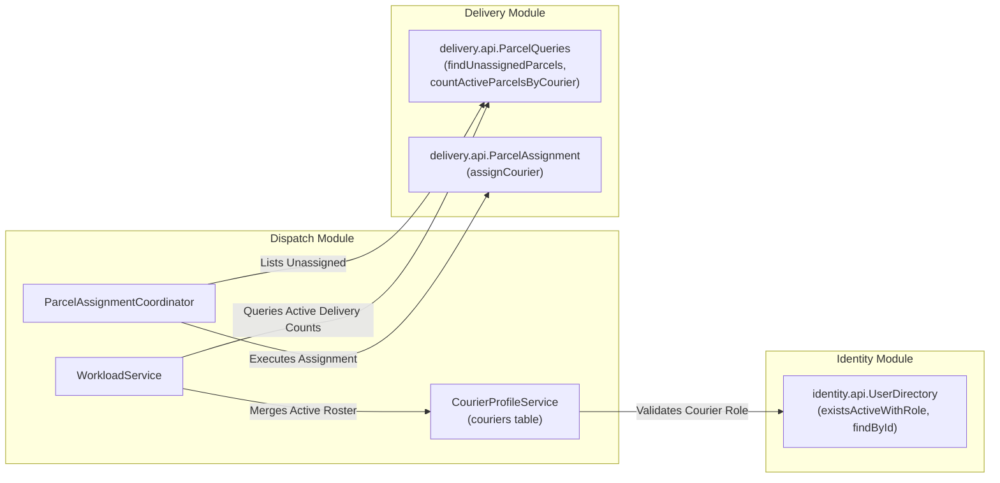
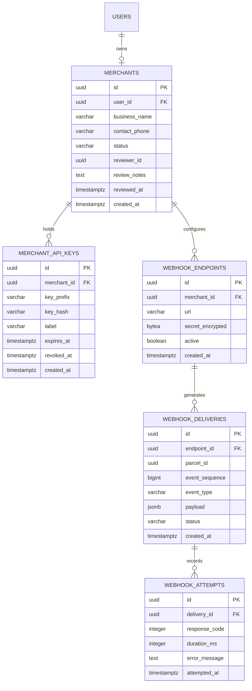
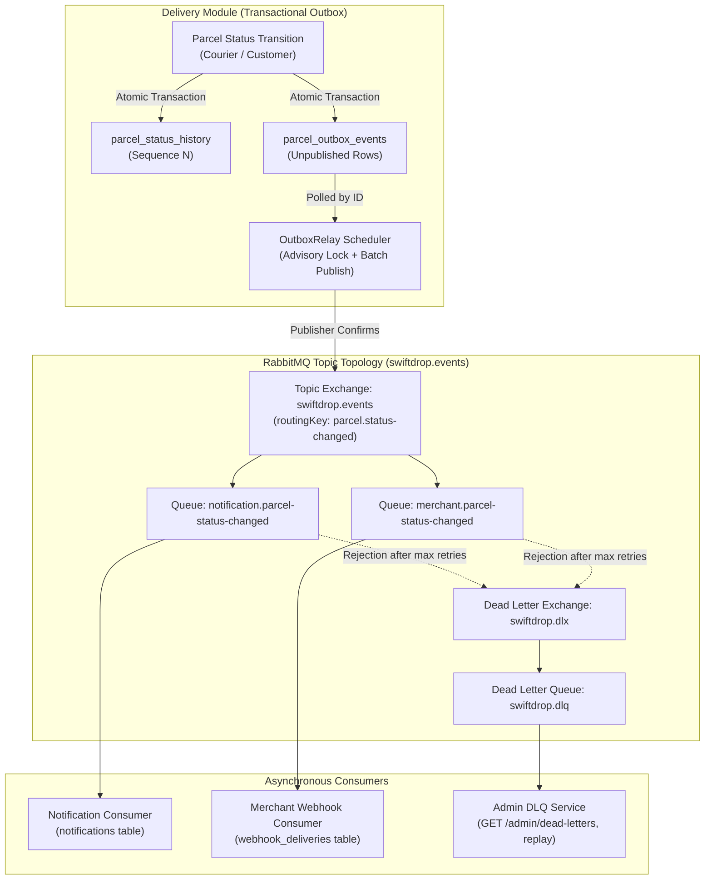
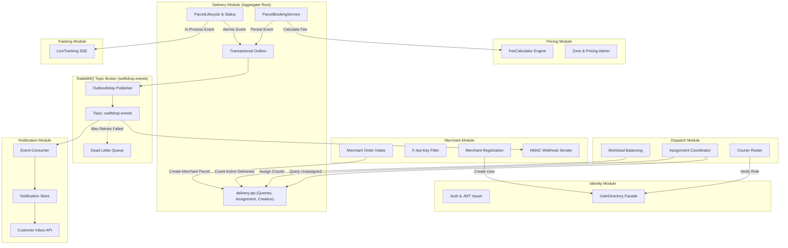
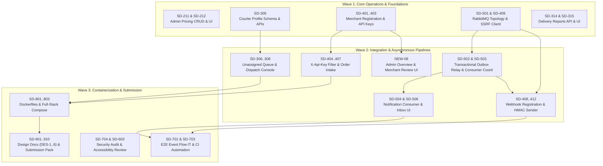

# ACT-11: SwiftDrop Remaining Feature Development & Integration Planning

- **Document ID:** ACT-11
- **Date:** 2026-11-04
- **Audited Commit / Branch:** `dev` at `ce3f6d48a6650f90f1656e4de55003bceb31a916` (synchronized with `origin/dev`; `main` at `681d019`)
- **Preceding Audits & Baselines:**
  - `docs/reviews/act-07-project-progress-audit.md` (System progress audit & test execution)
  - `docs/reviews/act-08-github-issue-refinement-proposal.md` (Backlog classification & restructuring)
  - `docs/reviews/act-08-1-consistency-validation.md` (Backlog arithmetic reconciliation)
  - `docs/reviews/act-09-p0-stabilization-sprint-plan.md` (P0 stabilization sprint specification)
- **Target Audience:** SwiftDrop 10-Member Engineering Team & Evaluators
- **Mode:** Strictly READ-ONLY Planning & Architecture Integration (zero application code, migration, or GitHub issue state changes)

---

## 1. Executive Summary

The objective of **ACT-11** is to provide a comprehensive, dependency-aware development roadmap for completing the remaining major functional modules and integrating the complete SwiftDrop Parcel Delivery and Courier Management System.

While **ACT-09** focused on immediate stabilization (fixing integration test failures, customer booking form validation, disabled-user JWT checks, and initial pricing seed data), **ACT-11** designs the path forward across the **Five Major Functional Targets**:
1. **Target 01 — Identity Module Completion:** Live Google OAuth 2.0 / OIDC verification (`SD-107`), profile management, and activation of the `UserDirectory` cross-module facade.
2. **Target 02 — Dispatch Module Completion:** Courier profile persistence (`SD-305`), unassigned parcel queue (`SD-306`), real-time courier workload management (`SD-307`), and the interactive Dispatcher Console UI (`SD-308`).
3. **Target 03 — Role-Based Dashboards Completion:** Transitioning 8 placeholder routes across Customer, Merchant, Courier, and Dispatcher/Admin portals into fully integrated interfaces.
4. **Target 04 — Merchant Module Completion & Webhooks:** Merchant business registration and admin approval (`SD-401..402`), SHA-256 API key management and `X-Api-Key` security filter (`SD-403..404`), idempotent order intake (`SD-405`), and outbound HMAC-SHA256 signed webhooks with SSRF-safe HTTP client (`SD-408..413`).
5. **Target 05 — RabbitMQ Messaging & Notification Integration:** Standardized AMQP topology declaration (`SD-501`), scheduled transactional `OutboxRelay` publisher (`SD-502`), boundary-safe ordered consumer coordinator (`SD-503`), persistent notification store and customer inbox UI (`SD-504`, `SD-506`), and administrative dead-letter queue (DLQ) replay (`SD-507`).

### Roadmap Delivery Waves Overview
The roadmap organizes 32 implementation tasks across three progressive delivery waves:
- **Wave 1 — Core Operational Workflows & Foundations:** Admin pricing CRUD, courier profile management, merchant registration and API keys, RabbitMQ topology, SSRF client, and delivery reporting.
- **Wave 2 — Cross-Module Integration & Asynchronous Pipelines:** Dispatcher assignment console, transactional outbox relay, idempotent merchant order intake, customer notification inbox, signed webhook dispatch, and admin merchant review.
- **Wave 3 — Full-Stack Containerization, Verification & Academic Submission:** Multi-stage production Dockerfiles, full-stack Compose profile (`--profile app`), mandatory `TST-1` end-to-end event integration test, security/accessibility audits, design documentation (`DES-1..6`), and demo runbook (`DEM-1..6`).

---

## 2. Current Project Baseline & Prerequisite Context

### 2.1 Git Status & ACT-10 Relationship
- **Active Branch:** `dev` at commit `ce3f6d48a6650f90f1656e4de55003bceb31a916` (`docs: add project audits and P0 stabilization plan`).
- **Remote Alignment:** `dev` is synchronized with `origin/dev`. `main` is at `681d019df6f0be88e21aed16e6e94d85a706adc1`.
- **ACT-10 Implementation Status:** **Not yet implemented.** Commit `ce3f6d4` added documentation reports only. The underlying codebase (Java classes, migrations, configuration, and frontend pages) remains identical to commit `681d019`.
- **Prerequisite Boundary:** The P0 stabilization sprint detailed in ACT-09 (`P0-TASK-01` through `P0-TASK-09`) is treated as an essential prerequisite for this feature roadmap. Stabilizing the integration test suite, fixing the weight input step bug, and seeding default pricing rules are required before end-to-end cross-module workflows can be validated.

### 2.2 Reconciled Backlog Status (from ACT-08.1)
- **Total Backlog Range:** 71 issues (`#8` through `#78`).
- **Closed Issues:** 1 issue (`#11 SD-201`).
- **Close Candidates:** 18 open issues verified complete in code (`#8`, `#12`, `#17`, `#18`, `#19`, `#20`, `#21`, `#22`, `#23`, `#24`, `#25`, `#26`, `#29`, `#30`, `#31`, `#32`, `#34`, `#60`).
- **Partially Implemented:** 4 issues (`#13`, `#33`, `#56`, `#59`).
- **Needs Refinement:** 5 issues (`#10`, `#16`, `#37`, `#54`, `#63`).
- **Still Valid (Forward Work):** 29 issues.
- **Blocked:** 14 issues.
- **Unassigned Issues:** 65 of 71 issues (91.5%) currently have no assigned owner on GitHub.

---

## 3. Remaining Feature Completion Matrix

| Module | Subsystem / Feature | Current Implementation Status | Backend State | Database Schema | Frontend UI | Associated GitHub Issues |
|---|---|---|---|---|---|---|
| **Identity** | Google OIDC Live Round-Trip | Implemented (Unverified) | `GoogleExchangeController`, `GoogleOidcUserService` | `external_identities`, `google_login_codes` | `/auth/google/callback` | `#9 (SD-107)` |
| **Identity** | Profile Management & Update | Partially Implemented | `GET /api/v1/users/me` (read-only) | `users` | User menu in header | Proposed `NEW-11` |
| **Identity** | `UserDirectory` Cross-Module Facade | Implemented (Unconsumed) | `UserDirectoryService` ready | `users`, `user_roles` | N/A | Cross-module API |
| **Pricing** | Admin Zone & Rule CRUD Endpoints | Not Started | Only `GET /api/v1/zones` (active) exists | `zones`, `pricing_rules` | `/admin/pricing` (Placeholder) | `#14 (SD-211)` |
| **Pricing** | Admin Pricing Management UI | Not Started | None | `zones`, `pricing_rules` | `/admin/pricing` (Placeholder) | `#15 (SD-212)` |
| **Pricing** | Demo Pricing Seed Data Runner | Not Started | None | None (in-memory/seed runner) | N/A | `#10 (SD-009 Phase 1)` |
| **Dispatch** | Courier Profile Schema & Management | Scaffolded Only | `package-info.java` only | None (`couriers` missing) | `/dispatch` (Placeholder) | `#35 (SD-305)` |
| **Dispatch** | Unassigned Queue & Assignment API | Scaffolded Only | `delivery.api` ready; dispatch missing | None | `/dispatch` (Placeholder) | `#36 (SD-306)` |
| **Dispatch** | Courier Workload Query API | Scaffolded Only | `delivery.api` ready; dispatch missing | None | `/dispatch` (Placeholder) | `#37 (SD-307)` |
| **Dispatch** | Dispatcher Management Console UI | UI Placeholder | None | None | `/dispatch` (Placeholder) | `#38 (SD-308)` |
| **Merchant** | Merchant Registration & Approval | Scaffolded Only | `package-info.java` only | None (`merchants` missing) | `/merchant` (Placeholder) | `#39 (SD-401)`, `#40 (SD-402)` |
| **Merchant** | API Key Management & Hashing | Scaffolded Only | None | None (`merchant_api_keys` missing) | `/merchant/api-keys` (Placeholder) | `#41 (SD-403)` |
| **Merchant** | `X-Api-Key` Spring Security Filter | Scaffolded Only | None | None | N/A (API authentication) | `#42 (SD-404)` |
| **Merchant** | Idempotent Order Intake REST API | Scaffolded Only | `delivery.api.ParcelCreation` ready | None | N/A (Machine-to-machine) | `#43 (SD-405)` |
| **Merchant** | Merchant Dashboard Orders Query & UI | Scaffolded Only | `delivery.api.ParcelQueries` ready | None | `/merchant`, `/merchant/orders` (Placeholders) | `#44 (SD-406)`, `#45 (SD-407)` |
| **Merchant** | Webhook Endpoint Registration & AES | Scaffolded Only | None | None (`webhook_endpoints` missing) | `/merchant/webhooks` (Placeholder) | `#46 (SD-408)` |
| **Merchant** | SSRF-Safe Outbound HTTP Client | Not Started | None (`httpclient5` not in pom) | None | N/A (Internal client) | `#47 (SD-409)` |
| **Merchant** | RabbitMQ Consumer & Delivery Log | Blocked | None | None (`webhook_deliveries` missing) | N/A (Background listener) | `#48 (SD-410)` |
| **Merchant** | HMAC Outbound Sender & Backoff | Blocked | None | None (`webhook_attempts` missing) | N/A (Scheduled worker) | `#49 (SD-411)` |
| **Merchant** | Webhook History & Redelivery UI | UI Placeholder | None | None | `/merchant/webhooks` (Placeholder) | `#50 (SD-412)` |
| **Merchant** | Standalone Demo Webhook Receiver | Not Started | None | None | `tools/webhook-receiver/` | `#51 (SD-413)` |
| **Messaging** | RabbitMQ Topic Exchange & Topology | Not Started | `spring-boot-starter-amqp` in pom | None | N/A (Broker config) | `#52 (SD-501)` |
| **Messaging** | Scheduled Transactional Outbox Relay | Blocked | Table `parcel_outbox_events` exists | `parcel_outbox_events` | N/A (Scheduled worker) | `#53 (SD-502)` |
| **Messaging** | Shared Ordered Consumer Support | Needs Refinement | None | None | N/A (Shared library) | `#54 (SD-503)` |
| **Notification** | Consumer & Mock SMS Delivery Store | Blocked | `package-info.java` only | None (`notifications` missing) | N/A (Background listener) | `#55 (SD-504)` |
| **Notification** | Customer Inbox REST API & UI Bell | Blocked | None | None | Header bell missing | `#57 (SD-506)` |
| **Messaging** | Admin Dead-Letter Queue Replay | Blocked | None | None | `/admin/dead-letters` missing | `#58 (SD-507)` |
| **Delivery** | Performance & Failure Rate Reports | Still Valid | None | `parcels`, `parcel_status_history` | `/admin/reports` (Placeholder) | `#27 (SD-314)`, `#28 (SD-315)` |
| **Delivery** | Foreign Keys to Zones & Pricing | Database Gap | `V202611031000` omitted FKs | `parcels` | N/A | `NEW-06` (`V202611031040`) |
| **Delivery** | Proof Photo Delivery Gating | Security Gap | Accessible in `FAILED`/`OUT_FOR_DELIVERY` | `delivery_proofs` | `/courier/parcels/[id]` | `NEW-07` |
| **Admin** | Admin Dashboard Overview Page | UI Placeholder | None | None | `/admin` (Placeholder) | `NEW-08` |
| **Admin** | Admin Merchant Review Interface | Missing | None | None | `/admin/merchants` (Missing) | `NEW-08` |
| **DevOps** | Backend & Frontend Dockerfiles | Still Valid | None | None | N/A | `#65 (SD-801)`, `#66 (SD-802)` |
| **DevOps** | Full-Stack Compose Application Profile | Blocked | `compose.yaml` has DB + broker only | None | N/A | `#67 (SD-803)` |
| **Testing** | CI Surefire/Failsafe & Integration Run | Needs Refinement | CI runs Docker-free `verify` only | None | N/A | `#63 (SD-703)` |
| **Testing** | Mandatory E2E Event Test (`TST-1`) | Blocked | None | None | N/A | `#62 (SD-701)` |
| **Testing** | Frontend Component Testing Suite | Missing | None | None | No test script in package.json | `NEW-09` |

---

## 4. Target 01 — Identity Module Completion Plan

### 4.1 Current Architecture & Implementation State
The `com.swiftdrop.identity` module is the most mature backend module (43 Java files, 3 migrations, 9 test classes):
- Local email/password authentication with BCrypt hashing and constant-time dummy hash verification.
- HS256 JWT generation with 15-minute expiration, claims parsing, and role extraction (`CUSTOMER`, `COURIER`, `DISPATCHER_ADMIN`, `MERCHANT`).
- Google OAuth 2.0 / OpenID Connect single-use handoff code pattern per ADR 0005 (`GoogleOAuthSuccessHandler`, `GoogleOidcUserService`, `GoogleExchangeController`, `GoogleLoginCodeCleanupJob`).
- User directory facade `com.swiftdrop.identity.api.UserDirectory` (`findById`, `existsActiveWithRole`, `createUser`).

### 4.2 Gap Analysis & Remaining Work
1. **Live Google OAuth Provider Round-Trip Verification (`SD-107`, Issue `#9`):**
   - The backend token exchange code is merged, but has never been verified against Google's live identity provider with verified team credentials in a local environment.
   - Required work: Run manual browser consent flow with valid Google Client ID/Secret, verify user creation in `external_identities`, verify existing-user login, test email collision with local accounts (`409 Conflict`), and record execution outcome in `docs/architecture.md §9`.
2. **Profile Update Endpoint (`PATCH /api/v1/users/me`):**
   - Currently, `GET /api/v1/users/me` exists, but users cannot update contact phone numbers or display names.
   - Proposed new issue `NEW-11`: Add `PATCH /api/v1/users/me` accepting `{ fullName, phone }` and update user profile in `users` table.
3. **Consuming `UserDirectory` Across Module Boundaries:**
   - `UserDirectory` is fully implemented in `identity.api`, but no other module calls it yet.
   - Required integration:
     - `dispatch` module calls `UserDirectory.existsActiveWithRole(userId, RoleName.COURIER)` when managing courier profiles (`SD-305`).
     - `merchant` module calls `UserDirectory.createUser(email, password, RoleName.MERCHANT)` during public merchant business registration (`SD-401`).

---

## 5. Target 02 — Dispatch Module Completion Plan

### 5.1 Architecture & Responsibility Boundaries
Per ADR 0003, the `dispatch` module manages courier availability, eligibility rosters, parcel allocation, and workload balancing. It depends on `identity.api` for user verification and `delivery.api` for parcel querying and assignment. It **never** queries delivery database tables directly.



### 5.2 Implementation Breakdown

#### Task DSP-01: Courier Profile Schema & Management (`SD-305`, Issue `#35`)
- **Database Migration:** Create `db/migration/dispatch/V202611051200__dispatch_create_couriers.sql`:
  ```sql
  CREATE TABLE couriers (
      id           UUID         PRIMARY KEY,
      user_id      UUID         NOT NULL UNIQUE REFERENCES users(id),
      vehicle_type VARCHAR(50)  NOT NULL,
      active       BOOLEAN      NOT NULL DEFAULT true,
      version      BIGINT       NOT NULL DEFAULT 0,
      created_at   TIMESTAMPTZ  NOT NULL
  );
  CREATE INDEX ix_couriers_active ON couriers (active);
  ```
- **Backend Components:**
  - Entity `Courier` in `com.swiftdrop.dispatch.domain`.
  - Service `CourierProfileService`: Calls `identity.api.UserDirectory.existsActiveWithRole(userId, RoleName.COURIER)` before inserting or activating a profile.
  - REST Controller `CourierProfileController`:
    - `POST /api/v1/courier-profiles` (Admin only: `{ userId, vehicleType }`).
    - `GET /api/v1/courier-profiles` (Admin only: filter by active status).
    - `PATCH /api/v1/courier-profiles/{id}` (Admin only: update active status or vehicle type).

#### Task DSP-02: Unassigned Parcel Queue & Courier Assignment (`SD-306`, Issue `#36`)
- **Backend Service:** `ParcelAssignmentCoordinator`:
  - `GET /api/v1/unassigned-parcels` (Admin only, paged): Calls `delivery.api.ParcelQueries.findUnassignedParcels(PageRequest)` which returns parcels in `CREATED` status without assigned courier, oldest first.
  - `POST /api/v1/parcel-assignments` (Admin only): Request body `{ parcelId, courierId }`.
    - Validates that `courierId` exists in `couriers` table and `active == true`.
    - Invokes `delivery.api.ParcelAssignment.assignCourier(parcelId, courierId)`.
    - Throws `409 Conflict` if parcel has progressed beyond `CREATED` status.
- **Reassignment Support:**
  - If a parcel is still in `CREATED` status, dispatchers may reassign it to a different courier without status transition or outbox event generation (per ADR 0006 §3).

#### Task DSP-03: Real-Time Courier Workload Query (`SD-307`, Issue `#37`)
- **Backend Service:** `WorkloadService`:
  - `GET /api/v1/courier-workload` (Admin only):
    - Queries `delivery.api.ParcelQueries.countActiveParcelsByCourier()` which returns `Map<UUID, Long>` of in-progress deliveries per courier.
    - Queries `couriers` table for all active courier profiles.
    - Merges the datasets so idle couriers are explicitly returned with `activeDeliveries = 0`.
    - Returns list of `{ courierId, userId, fullName, vehicleType, activeDeliveries }`.

#### Task DSP-04: Dispatcher Management Console UI (`SD-308`, Issue `#38`)
- **Frontend Page:** Replace placeholder at `frontend/app/(dispatch)/dispatch/page.tsx`:
  - Split-view dashboard:
    - **Left / Top:** Unassigned parcels table (tracking number, pickup city, dropoff city, size, age) with quick-assign button.
    - **Right / Bottom:** Courier fleet roster with real-time workload badges (e.g. `0 active`, `3 active`, `5 active`).
    - **Modal:** Assignment modal displaying eligible couriers sorted by lowest current workload, with 1-click confirmation.

---

## 6. Target 03 — Completion of All Role-Based Dashboards

### 6.1 Current Status & Dashboard Completion Matrix

| Dashboard Role | Route Path | Current Status | Backend API Dependency | Integration Strategy |
|---|---|---|---|---|
| **Customer** | `/customer` | Functional | `GET /api/v1/parcels` | Completed. Shows active parcel summary cards. |
| **Customer** | `/customer/new` | Functional (Step Bug) | `GET /zones`, `POST /price-quotes`, `POST /parcels` | Unblock via P0 weight input fix and demo pricing seed. |
| **Customer** | `/customer/history` | Functional | `GET /api/v1/parcels` | Completed. Filterable by status and date. |
| **Customer** | `/customer/parcels/[id]` | Functional | `GET /parcels/{id}`, `GET /proof/photo`, SSE | Completed. Real-time timeline + proof photo fetch. |
| **Customer** | `/customer/parcels/[id]/receipt` | Functional | `GET /parcels/{id}/receipt` | Completed. `@media print` printable stylesheet. |
| **Customer** | `/customer/notifications` | Missing | `GET /api/v1/notifications`, `PATCH /read` | Add notification bell in `NavHeader` and drawer (`SD-506`). |
| **Courier** | `/courier` | Functional | `GET /api/v1/courier/parcels` | Completed. Groups Active vs Finished Today. |
| **Courier** | `/courier/parcels/[id]` | Functional | `GET /parcels/{id}`, `PUT /proof`, `POST /status-changes` | Completed. Status advancement, camera POD, failure reason. |
| **Merchant** | `/merchant` | UI Placeholder | `GET /api/v1/merchants/me/orders` | Replace with order metrics cards and recent shipments (`SD-406`). |
| **Merchant** | `/merchant/orders` | UI Placeholder | `GET /api/v1/merchants/me/orders` | Replace with filterable orders data table (`SD-406`). |
| **Merchant** | `/merchant/api-keys` | UI Placeholder | `GET/POST/DELETE /api/v1/merchant/api-keys` | API key list, generate modal with show-once secret (`SD-407`). |
| **Merchant** | `/merchant/webhooks` | UI Placeholder | `GET/POST /api/v1/merchant/webhooks`, redelivery | Endpoint registration, secret display, redeliver button (`SD-50` / `SD-412`). |
| **Merchant** | `/merchant/register` | Missing | `POST /api/v1/merchants` | Public registration form outside `RoleGuard` (`SD-401`). |
| **Admin** | `/admin` | UI Placeholder | Aggregated admin metrics | Overview dashboard cards (deliveries, revenue, couriers) (`NEW-08`). |
| **Admin** | `/dispatch` | UI Placeholder | `GET /unassigned-parcels`, `GET /courier-workload` | Dispatcher assignment console (`SD-308`). |
| **Admin** | `/admin/users` | Functional | `GET /users`, `POST /staff-users`, `PATCH /status` | Completed. User table, staff onboarding, status toggle. |
| **Admin** | `/admin/pricing` | UI Placeholder | `GET/POST/PATCH /zones`, `GET/POST/PATCH /pricing-rules` | Zone creator, rule editor, rate modifier (`SD-212`). |
| **Admin** | `/admin/reports` | UI Placeholder | `GET /api/v1/reports/deliveries-per-day`, `/delivery-performance` | Date-range analytics, failure rate trend charts (`SD-315`). |
| **Admin** | `/admin/merchants` | Missing | `GET/POST /api/v1/admin/merchants/**` | Merchant application review, approval/rejection modal (`NEW-08`). |
| **Admin** | `/admin/dead-letters` | Missing | `GET /admin/dead-letters`, `POST /replay` | DLQ inspection table, error headers, replay action (`SD-507`). |

### 6.2 Frontend Architecture & Shared UI Primitives
To ensure consistency across the newly built dashboards:
- Reuse `@/components/portal` primitives (`PortalShell`, `RoleGuard`, `DataTable`, `StatCard`).
- Standardize all data-fetching with React 19 `useTransition` / `useCallback` and `frontend/lib/api.ts` error handling.
- Enforce standard loading skeletons (`Skeleton`) and empty states (`EmptyState`) across all newly implemented data tables.
- Verify responsive layout at 360px viewport width (especially for courier mobile views and tracking timelines).

---

## 7. Target 04 — Merchant Module Completion and Integration

### 7.1 Domain Model & Database Schema



### 7.2 Implementation Tasks

#### Task MER-01: Merchant Registration & Admin Approval (`SD-401`, `SD-402`, Issues `#39`, `#40`)
- **Database Migration:** `db/migration/merchant/V202611061000__merchant_create_merchants.sql`.
- **Public Registration:** `POST /api/v1/merchants`:
  - Calls `identity.api.UserDirectory.createUser(email, password, RoleName.MERCHANT)`.
  - Inserts `Merchant` record with `status = 'PENDING'`.
- **Admin Review Endpoints:**
  - `GET /api/v1/admin/merchants` (filter by `PENDING`, `APPROVED`, `REJECTED`, `SUSPENDED`).
  - `POST /api/v1/admin/merchants/{id}/approval` (sets `status = 'APPROVED'`).
  - `POST /api/v1/admin/merchants/{id}/rejection` (sets `status = 'REJECTED'`, requires `reason`).
  - `POST /api/v1/admin/merchants/{id}/suspension` (sets `status = 'SUSPENDED'`).
- **Security Check:** Non-approved merchants receive `403 Forbidden` on merchant operational endpoints.

#### Task MER-02: API Key Management & `X-Api-Key` Security Filter (`SD-403`, `SD-404`, Issues `#41`, `#42`)
- **Database Migration:** `db/migration/merchant/V202611061010__merchant_create_api_keys.sql`.
- **Key Generation:** High-entropy string (`swiftdrop_live_` + 32 secure random hex bytes). Raw key displayed once upon creation. SHA-256 hash stored in `merchant_api_keys`.
- **Spring Security Filter:** `MerchantApiKeyAuthenticationFilter`:
  - Protects `/api/v1/merchant-orders/**`.
  - Extracts `X-Api-Key` header; performs constant-time SHA-256 verification against active keys.
  - Injects `MerchantAuthenticationToken` into `SecurityContextHolder`.
  - Rejects invalid or revoked keys with uniform `401 Unauthorized`.
  - Prevents JWT bearer tokens from being accepted on API-key routes and vice versa.

#### Task MER-03: Idempotent Merchant Order Intake (`SD-405`, Issue `#43`)
- **Controller:** `MerchantOrderController` (`POST /api/v1/merchant-orders`):
  - Request body: `merchantOrderReference`, sender/pickup details, recipient details, size, weightGrams.
  - Calls `delivery.api.ParcelCreation.createMerchantParcel(NewMerchantParcel)`.
  - Idempotency per Decision D-25: Duplicate submission with identical `(merchantId, merchantOrderReference)` returns `200 OK` with existing `CreatedParcel` (`newlyCreated = false`), without creating a duplicate parcel or outbox event!
  - First-time submission returns `201 Created` with `CreatedParcel` (`newlyCreated = true`) and tracking number.
  - `GET /api/v1/merchant-orders/{ref}`: Retrieves order details for calling merchant only (`404` for unowned reference).

#### Task MER-04: Outbound Webhook Subsystem (`SD-408..413`, Issues `#46`–`#51`)
- **Webhook Registration (`SD-408`):** Encrypts signing secrets using AES-256-GCM authenticated encryption with master key property `swiftdrop.merchant.webhook.master-key`.
- **SSRF-Safe HTTP Client (`SD-409`):** Configures Apache `HttpClient5` with custom DNS resolver blocking loopback (`127/8`, `::1`), link-local, private RFC 1918 (`10/8`, `172.16/12`, `192.168/16`), cloud metadata (`169.254.169.254`), and redirects.
- **Event Consumer (`SD-410`):** Listens to RabbitMQ queue `merchant.parcel-status-changed`; filters for `source == MERCHANT`; creates pending `webhook_deliveries` record.
- **Outbound Dispatcher (`SD-411`):** Scheduled background worker polling pending deliveries with `SELECT ... FOR UPDATE SKIP LOCKED`. Signs payload with HMAC-SHA256 (`X-SwiftDrop-Signature: t=...,v1=...`). Dispatches HTTP POST via SSRF client. Retries transient failures with exponential backoff and jitter.
- **Webhook UI & Redelivery (`SD-412`):** Dashboard tab at `/merchant/webhooks` with manual re-trigger button.
- **Demo Receiver Tool (`SD-413`):** Standalone Node.js script in `tools/webhook-receiver/` verifying HMAC signatures and logging delivery attempts.

---

## 8. Target 05 — RabbitMQ and Notification Implementation Plan

### 8.1 Messaging Architecture & Reliability Topology



### 8.2 Implementation Tasks

#### Task MSG-01: Standardized RabbitMQ Topology Declaration (`SD-501`, Issue `#52`)
- **Spring AMQP Configuration:** In `com.swiftdrop.config.MessagingConfiguration`:
  - Declare durable topic exchange `swiftdrop.events`.
  - Declare dead-letter exchange `swiftdrop.dlx` and queue `swiftdrop.dlq`.
  - Declare queues `notification.parcel-status-changed` and `merchant.parcel-status-changed` with arguments `x-dead-letter-exchange=swiftdrop.dlx` and `x-dead-letter-routing-key=dead-letter`.
  - Configure publisher confirms (`spring.rabbitmq.publisher-confirm-type=correlated`) and publisher returns (`spring.rabbitmq.publisher-returns=true`).
  - Integration test verifying message routing on Testcontainers RabbitMQ 4.3 container.

#### Task MSG-02: Scheduled Transactional Outbox Relay (`SD-502`, Issue `#53`)
- **Scheduled Background Worker:** In `com.swiftdrop.delivery.infrastructure.outbox.OutboxRelay`:
  - Polling query: `SELECT * FROM parcel_outbox_events WHERE published_at IS NULL AND next_attempt_at <= now() ORDER BY id ASC LIMIT 50`.
  - High availability lock: PostgreSQL session-level advisory lock (`SELECT pg_try_advisory_lock(749201948)`).
  - Publication: Publishes serialized event JSON to `swiftdrop.events` with routing key `parcel.status-changed`.
  - Confirmation: Awaits broker publisher confirm. On positive ack, sets `published_at = clock.instant()`.
  - Failure handling: On broker failure, increments `attempts` and sets exponential backoff delay (`next_attempt_at = now() + (2^attempts * 5s)`).

#### Task MSG-03: Shared Ordered Event Consumer Coordinator (`SD-503`, Issue `#54`)
- **Boundary-Safe Design in `com.swiftdrop.shared.messaging`:**
  - Define generic SPI `SequenceGapResolver<T>` callback to avoid forbidden dependency on `delivery.api`.
  - Track highest processed sequence per aggregate ID.
  - If received sequence == expected: process immediately.
  - If received sequence < expected: discard as duplicate (idempotent ack).
  - If received sequence > expected: buffer premature event in memory/store, invoke gap resolver to fetch missing events, process sequentially.

#### Task MSG-04: Notification Consumer, SMS Store & Customer Inbox (`SD-504`, `SD-506`, Issues `#55`, `#57`)
- **Database Migration:** `db/migration/notification/V202611071000__notification_create_notifications.sql`:
  ```sql
  CREATE TABLE notifications (
      id              UUID         PRIMARY KEY,
      user_id         UUID         NOT NULL REFERENCES users(id),
      tracking_number VARCHAR(16)  NOT NULL,
      title           VARCHAR(200) NOT NULL,
      message         TEXT         NOT NULL,
      read            BOOLEAN      NOT NULL DEFAULT false,
      created_at      TIMESTAMPTZ  NOT NULL
  );
  CREATE INDEX ix_notifications_user_created ON notifications (user_id, created_at DESC);
  ```
- **Consumer:** Consumes `parcel.status-changed`. Formats alert message (e.g. "Your parcel SD-XXXXXXXXXX has been picked up"). Excludes all personal address/contact data. Persists notification record.
- **Customer Inbox API:**
  - `GET /api/v1/notifications` (Authenticated customer, paged via `PageResponse<T>`, newest first).
  - `PATCH /api/v1/notifications/{id}/read` (Marks alert read).
- **Frontend Center:** Notification bell icon in `NavHeader` with unread count badge, opening an interactive notification drawer.

#### Task MSG-05: Admin Dead-Letter Queue Inspection & Replay (`SD-507`, Issue `#58`)
- **Controller:** `DeadLetterController` (Admin only):
  - `GET /api/v1/admin/dead-letters`: Reads dead-letter messages from `swiftdrop.dlq` using `RabbitTemplate.receive()`, parses `x-death` headers and error causes.
  - `POST /api/v1/admin/dead-letters/{id}/replay`: Re-publishes message to original target queue with audit logging.

---

## 9. Cross-Module Integration Architecture

The diagram below maps all cross-module interactions across the complete system:



---

## 10. End-to-End Workflow Analysis

### Workflow A: Customer Parcel Delivery Lifecycle
1. **Booking & Fee Calculation:** Customer logs in -> navigates to `/customer/new` -> selects origin/destination zones -> calls `POST /api/v1/price-quotes` -> clicks Confirm -> calls `POST /api/v1/parcels`. Delivery module invokes `FeeCalculator.calculateFee`, generates Crockford Base32 tracking number (`SD-XXXXXXXXXX`), inserts `Parcel` (`CREATED`), records history sequence 1, and inserts outbox event row in a single database transaction. Returns `201 Created`.
2. **Dispatch Assignment:** Parcel appears on unassigned queue (`GET /api/v1/unassigned-parcels`). Dispatcher opens `/dispatch`, views courier workloads (`GET /api/v1/courier-workload`), and assigns Courier B via `POST /api/v1/parcel-assignments`. Delivery aggregate validates parcel is in `CREATED` status and sets `assigned_courier_id`.
3. **Courier Execution:** Courier B logs into mobile portal (`/courier`), sees parcel in daily delivery list (`GET /api/v1/courier/parcels`), advances status to `PICKED_UP`, `IN_TRANSIT`, and `OUT_FOR_DELIVERY`. Each transition commits history sequence and outbox event under pessimistic parcel lock (`SELECT ... FOR UPDATE`).
4. **Proof of Delivery & Completion:** At drop-off location, Courier B captures recipient name and photo via `PUT /api/v1/parcels/{id}/proof`. Magic bytes validated (JPEG/PNG <= 2 MB). Courier advances status to `DELIVERED`. `ParcelStatusService` verifies proof exists and marks parcel terminal.
5. **Asynchronous Alerts:** `OutboxRelay` polls outbox rows and publishes `parcel.status-changed` events to RabbitMQ `swiftdrop.events`. Notification consumer processes events and inserts alerts in `notifications`. Customer's `NavHeader` bell badge increments. Customer detail view updates in real time via live SSE stream.

### Workflow B: Programmatic Merchant Order Intake & Webhooks
1. **Onboarding & Approval:** Prospective merchant registers via `POST /api/v1/merchants` (`status = PENDING`). Administrator reviews business credentials on `/admin/merchants` and clicks Approve (`POST /api/v1/admin/merchants/{id}/approval`).
2. **API Key Generation:** Approved merchant logs in to `/merchant/api-keys` and creates API key. Secret `swiftdrop_live_...` displayed show-once; SHA-256 hash stored in `merchant_api_keys`.
3. **Order Intake:** Merchant external ERP sends `POST /api/v1/merchant-orders` with `X-Api-Key` header and unique `merchantOrderReference`. `MerchantApiKeyAuthenticationFilter` validates key hash in constant time. Controller calls `delivery.api.ParcelCreation.createMerchantParcel`. If identical reference was previously submitted, returns `200 OK` with existing tracking number (idempotent per D-25). If new, returns `201 Created`.
4. **Signed Webhooks:** As courier advances parcel through lifecycle, outbox publishes events to RabbitMQ. Merchant consumer matches `source == MERCHANT` and creates `webhook_deliveries` record. Outbound sender decrypts merchant webhook secret (AES-256-GCM), signs JSON payload with HMAC-SHA256 (`X-SwiftDrop-Signature`), and sends HTTP POST via SSRF-safe client. Merchant views delivery logs on `/merchant/webhooks`.

### Workflow C: Courier Field Operations
1. **Authentication & Daily List:** Courier logs in -> navigates to `/courier` -> `CourierController.today` retrieves non-terminal deliveries assigned to courier plus deliveries completed today in `SWIFTDROP_BUSINESS_TIME_ZONE` (`Asia/Colombo`).
2. **Field Execution:** Courier views pickup/delivery addresses, phone contacts, and special instructions.
3. **Failure Handling:** If recipient is absent, courier marks parcel `FAILED`, selecting mandatory `FailureReason` (e.g. `RECIPIENT_UNAVAILABLE`) and optional note. Domain state machine marks parcel terminal and records failure reason in status history.

### Workflow D: Dispatcher Operational Balancing
1. **Console Overview:** Dispatcher logs into `/dispatch`.
2. **Queue Monitoring:** Unassigned parcel queue displays pending requests sorted by booking age.
3. **Workload Balancing:** Fleet roster displays couriers and current active delivery counts.
4. **Assignment:** Dispatcher selects optimal courier with lowest workload and assigns parcel.

---

## 11. Dependency Matrix and Phased Delivery Roadmap



---

## 12. Detailed Task Breakdown & GitHub Backlog Mapping

The table below specifies all 32 remaining implementation tasks across Waves 1, 2, and 3:

| Task ID | Module | Title | Current Status | Priority | Dependencies | API Contracts | DB Changes | Effort | Related Issue | PR Scope |
|---|---|---|---|---|---|---|---|---|---|---|
| **W1-PRC-01** | `pricing` | Admin Zone & Rule CRUD APIs | Not Started | P1 | None | `POST/PATCH /api/v1/zones`, `GET/POST/PATCH /pricing-rules` | None | Medium | `#14 (SD-211)` | `feat/pricing-admin-api` |
| **W1-PRC-02** | `frontend` | Admin Pricing & Zone UI | UI Placeholder | P1 | W1-PRC-01 | Integrates with W1-PRC-01 | None | Medium | `#15 (SD-212)` | `feat/admin-pricing-ui` |
| **W1-DSP-01** | `dispatch` | Courier Profile Schema & APIs | Scaffolded | P1 | None | `POST/GET/PATCH /api/v1/courier-profiles` | `couriers` table (`V202611051200`) | Medium | `#35 (SD-305)` | `feat/dispatch-courier-profiles` |
| **W1-MER-01** | `merchant` | Merchant Registration & Approval APIs | Scaffolded | P1 | None | `POST /merchants`, `GET/POST /admin/merchants/**` | `merchants` table (`V202611061000`) | Medium | `#39 (SD-401)`, `#40 (SD-402)` | `feat/merchant-registration-api` |
| **W1-MER-02** | `merchant` | API Key Management & Hashing | Scaffolded | P1 | W1-MER-01 | `GET/POST/DELETE /api/v1/merchant/api-keys` | `merchant_api_keys` (`V202611061010`) | Medium | `#41 (SD-403)` | `feat/merchant-api-keys` |
| **W1-MSG-01** | `config` | RabbitMQ Topic Topology & DLQ | Not Started | P1 | None | Declares exchange, queues, DLX, publisher confirms | None | Small | `#52 (SD-501)` | `feat/rabbitmq-topology` |
| **W1-MSG-02** | `merchant` | SSRF-Safe Webhook HTTP Client | Not Started | P1 | None | Apache HttpClient5 custom DNS resolver | None | Medium | `#47 (SD-409)` | `feat/ssrf-safe-http-client` |
| **W1-REP-01** | `delivery` | Performance & Failure Rate Reports | Still Valid | P1 | None | `GET /api/v1/reports/deliveries-per-day`, `/delivery-performance` | None | Medium | `#27 (SD-314)` | `feat/delivery-reports-api` |
| **W1-REP-02** | `frontend` | Admin Reports Dashboard UI | UI Placeholder | P1 | W1-REP-01 | Integrates with W1-REP-01 | None | Medium | `#28 (SD-315)` | `feat/admin-reports-ui` |
| **W1-TST-01** | `frontend` | Component Testing Framework (Vitest/RTL) | Missing | P1 | None | Vitest, RTL, `@testing-library/jest-dom` | None | Medium | `NEW-09` | `chore/frontend-test-setup` |
| **W2-DSP-01** | `dispatch` | Unassigned Queue & Assignment APIs | Scaffolded | P1 | W1-DSP-01 | `GET /unassigned-parcels`, `POST /parcel-assignments` | None | Medium | `#36 (SD-306)` | `feat/dispatch-assignment-api` |
| **W2-DSP-02** | `dispatch` | Real-Time Courier Workload API | Scaffolded | P1 | W1-DSP-01 | `GET /api/v1/courier-workload` | None | Small | `#37 (SD-307)` | `feat/courier-workload-api` |
| **W2-DSP-03** | `frontend` | Dispatcher Management Console UI | UI Placeholder | P1 | W2-DSP-01, W2-DSP-02 | Integrates with W2-DSP-01 and W2-DSP-02 | None | Medium | `#38 (SD-308)` | `feat/dispatch-console-ui` |
| **W2-MSG-01** | `delivery` | Transactional Outbox Relay Publisher | Blocked | P1 | W1-MSG-01 | Scheduled task; publishes to `swiftdrop.events` | None | Large | `#53 (SD-502)` | `feat/outbox-relay-publisher` |
| **W2-MSG-02** | `shared` | Ordered Consumer Support & Gap Deduplication | Needs Refinement | P1 | W1-MSG-01 | `com.swiftdrop.shared.messaging` generic SPI | None | Medium | `#54 (SD-503)` | `feat/ordered-consumer-support` |
| **W2-MER-01** | `merchant` | `X-Api-Key` Spring Security Filter | Scaffolded | P1 | W1-MER-02 | Filter protecting `/api/v1/merchant-orders/**` | None | Medium | `#42 (SD-404)` | `feat/api-key-security-filter` |
| **W2-MER-02** | `merchant` | Idempotent Merchant Order Intake API | Scaffolded | P1 | W2-MER-01 | `POST/GET /api/v1/merchant-orders/**` | None | Large | `#43 (SD-405)` | `feat/merchant-order-intake` |
| **W2-MER-03** | `merchant` | Merchant Dashboard Orders Query API | Scaffolded | P1 | W1-MER-01 | `GET /api/v1/merchants/me/orders` | None | Medium | `#44 (SD-406)` | `feat/merchant-orders-query` |
| **W2-MER-04** | `frontend` | Merchant Portal Dashboard & Order UI | UI Placeholder | P1 | W2-MER-03 | Replaces `/merchant` and `/merchant/orders` | None | Large | `#45 (SD-407)` | `feat/merchant-portal-ui` |
| **W2-NOT-01** | `notification` | Notification Consumer & SMS Store | Blocked | P1 | W1-MSG-01, W2-MSG-02 | RabbitMQ listener on `notification.parcel-status-changed` | `notifications` (`V202611071000`) | Medium | `#55 (SD-504)` | `feat/notification-consumer` |
| **W2-NOT-02** | `notification` | Customer Inbox API & Header Bell UI | Blocked | P1 | W2-NOT-01 | `GET /api/v1/notifications`, `PATCH /read` | None | Medium | `#57 (SD-506)` | `feat/customer-notification-inbox` |
| **W2-WHK-01** | `merchant` | Webhook Endpoint Registration & AES-256 | Scaffolded | P1 | W1-MER-01 | `GET/POST /api/v1/merchant/webhooks` | `webhook_endpoints` (`V202611081000`) | Medium | `#46 (SD-408)` | `feat/webhook-registration` |
| **W2-WHK-02** | `merchant` | RabbitMQ Merchant Event Consumer | Blocked | P1 | W1-MSG-01, W2-WHK-01 | RabbitMQ listener creating `webhook_deliveries` | `webhook_deliveries` (`V202611081010`) | Medium | `#48 (SD-410)` | `feat/webhook-event-consumer` |
| **W2-WHK-03** | `merchant` | Outbound HMAC-SHA256 Webhook Sender | Blocked | P1 | W1-MSG-02, W2-WHK-02 | Scheduled worker sending HTTP POST | `webhook_attempts` (`V202611081020`) | Large | `#49 (SD-411)` | `feat/webhook-outbound-sender` |
| **W2-WHK-04** | `frontend` | Webhook Delivery History & Redeliver UI | UI Placeholder | P2 | W2-WHK-03 | Replaces `/merchant/webhooks` with history & replay | None | Medium | `#50 (SD-412)` | `feat/webhook-management-ui` |
| **W2-WHK-05** | `tools` | Demo Webhook Receiver Test Tool | Not Started | P2 | W2-WHK-03 | Node.js receiver in `tools/webhook-receiver/` | None | Small | `#51 (SD-413)` | `feat/demo-webhook-receiver` |
| **W2-ADM-01** | `frontend` | Admin Overview & Merchant Review UI | Missing | P1 | W1-MER-01 | Implements `/admin` and `/admin/merchants` | None | Medium | `NEW-08` | `feat/admin-overview-and-merchants` |
| **W2-DLQ-01** | `messaging` | Admin Dead-Letter Queue Replay API | Blocked | P2 | W1-MSG-01 | `GET/POST /api/v1/admin/dead-letters/**` | None | Medium | `#58 (SD-507)` | `feat/admin-dlq-replay` |
| **W3-DCK-01** | `devops` | Multi-Stage Production Dockerfiles | Still Valid | P2 | None | Backend (Temurin JRE 21) & Frontend (Next.js standalone) | None | Medium | `#65 (SD-801)`, `#66 (SD-802)` | `feat/docker-containers` |
| **W3-DCK-02** | `devops` | Full-Stack Compose Application Profile | Blocked | P2 | W3-DCK-01 | Updates `compose.yaml` with `--profile app` | None | Small | `#67 (SD-803)` | `feat/full-stack-compose` |
| **W3-TST-01** | `testing` | End-to-End Event Integration Test (`TST-1`) | Blocked | P1 | W2-MSG-01, W2-NOT-01 | Test verifying status -> outbox -> RabbitMQ -> notif/webhook | None | Large | `#62 (SD-701)` | `test/e2e-event-flow-tst1` |
| **W3-DOC-01** | `docs` | System Design & Submission Package | Still Valid | P2 | All Waves | `DES-1..6`, `SUB-1..4`, `DEM-1..6` runbooks in `docs/` | None | Large | `#68`–`#78` | `docs/submission-deliverables` |

---

## 13. Team Workstream Allocation (10 Workstreams)

The 10 team members are allocated across 10 established workstreams to enable concurrent progress without stepping on module boundaries:

```mermaid
flowchart LR
    subgraph Wave_1_Allocation ["Wave 1: Parallel Development"]
        WS1["WS1: CI & Tooling<br/>(Vitest Setup & CI Automation)"]
        WS6["WS6: Pricing Engine<br/>(Admin Pricing CRUD & UI)"]
        WS7["WS7: Dispatch<br/>(Courier Profile Schema & APIs)"]
        WS4_5["WS4 & WS5: Merchant<br/>(Registration, Approval & API Keys)"]
        WS9["WS9: Messaging<br/>(RabbitMQ Topology & SSRF Client)"]
        WS3["WS3: Delivery<br/>(Performance & Failure Reports)"]
    end

    subgraph Wave_2_Allocation ["Wave 2: Integration & Pipelines"]
        WS7_2["WS7 & WS2: Dispatch Console<br/>(Queue, Workload & /dispatch UI)"]
        WS3_9["WS3 & WS9: Outbox Relay<br/>(Transactional Relay & Ordered Consumer)"]
        WS5_4["WS5 & WS4: Merchant Intake<br/>(X-Api-Key, Order Intake & Portal UI)"]
        WS9_2["WS9 & WS2: Notifications<br/>(Notification Consumer & Inbox Bell UI)"]
        WS4_9["WS4 & WS9: Webhooks<br/>(HMAC Sender, AES Encryption & History UI)"]
        WS8["WS8: Courier Operations<br/>(Courier UX Polish & POD Hardening)"]
        WS10["WS10: Tracking<br/>(Live SSE Stream Polish & Resilience)"]
    end

    subgraph Wave_3_Allocation ["Wave 3: Submission & Hardening"]
        WS1_ALL["All Workstreams: Final Verification<br/>(Dockerfiles, TST-1 Test, Security Audit, Design Docs DES-1..6)"]
    end

    Wave_1_Allocation --> Wave_2_Allocation
    Wave_2_Allocation --> Wave_3_Allocation
```



### Workstream Ownership Details:
- **WS1 (Monorepo, CI & Foundations):** Owns `NEW-09` (Vitest/RTL setup), `SD-703` (Surefire/Failsafe CI test report archiving), and `SD-801..803` (Dockerfiles and Compose).
- **WS2 (Customer Booking & UI):** Collaborates on `SD-506` (Customer notification inbox UI in `NavHeader`) and customer portal polish.
- **WS3 (Delivery Core & Lifecycle):** Owns `SD-314` and `SD-315` (Delivery reports API and UI), and collaborates on `SD-502` (Outbox relay publisher).
- **WS4 (Merchant Operations & UI):** Owns `SD-401` (Merchant registration), `SD-406..407` (Merchant orders dashboard UI), `SD-412` (Webhook history UI), and `NEW-08` (Admin merchant review UI).
- **WS5 (Merchant API & Intake):** Owns `SD-403` (API key management), `SD-404` (`X-Api-Key` filter), and `SD-405` (Idempotent order intake).
- **WS6 (Pricing Engine & Zones):** Owns `SD-211` and `SD-212` (Admin zone and rule CRUD endpoints and UI).
- **WS7 (Dispatch & Workloads):** Owns `SD-305` (Courier profile schema/APIs), `SD-306` (Unassigned queue and assignment), `SD-307` (Courier workload API), and `SD-308` (Dispatcher console UI).
- **WS8 (Courier Operations & Proof):** Owns mobile courier UX polish, client-side <= 2MB photo checks, and proof photo access gating (`NEW-07`).
- **WS9 (Notifications & Messaging):** Owns `SD-501` (RabbitMQ topology), `SD-409` (SSRF client), `SD-503` (Ordered consumer support), `SD-504` (Notification consumer), `SD-410..411` (Webhook consumer and HMAC sender), and `SD-507` (DLQ replay).
- **WS10 (Public Tracking & SSE):** Owns live SSE tracking stream resilience, reconnect handling, and public tracking UI error states.

---

## 14. Recommended Implementation Sequence (Phased Waves)

### Sprint Wave 1: Core Operations & Foundations (Target: 1.5 Weeks)
1. **WS6:** Implement Admin Pricing REST APIs (`W1-PRC-01`) and interactive UI (`W1-PRC-02`).
2. **WS7:** Implement Courier Profile schema and management APIs (`W1-DSP-01`).
3. **WS4 & WS5:** Implement Merchant registration aggregate, admin approval, and API key generation (`W1-MER-01`, `W1-MER-02`).
4. **WS9:** Declare RabbitMQ topic topology (`W1-MSG-01`) and implement SSRF-safe HTTP client (`W1-MSG-02`).
5. **WS3:** Implement Delivery Performance and Failure Rate reporting APIs and dashboard UI (`W1-REP-01`, `W1-REP-02`).
6. **WS1:** Configure Vitest & React Testing Library frontend testing suite (`W1-TST-01`).

### Sprint Wave 2: Integration & Asynchronous Pipelines (Target: 2 Weeks)
1. **WS7 & WS2:** Implement unassigned queue, courier assignment, workload API, and `/dispatch` UI (`W2-DSP-01..03`).
2. **WS3 & WS9:** Implement scheduled transactional `OutboxRelay` publisher (`W2-MSG-01`) and boundary-safe ordered consumer coordinator (`W2-MSG-02`).
3. **WS5 & WS4:** Implement `X-Api-Key` filter (`W2-MER-01`), idempotent order intake (`W2-MER-02`), and merchant portal orders UI (`W2-MER-03..04`).
4. **WS9 & WS2:** Implement RabbitMQ notification consumer, SMS store, and customer inbox UI (`W2-NOT-01..02`).
5. **WS4 & WS9:** Implement webhook secret encryption (`W2-WHK-01`), event consumer (`W2-WHK-02`), HMAC sender (`W2-WHK-03`), and redelivery UI (`W2-WHK-04`).
6. **WS4:** Implement Admin Overview and Merchant Review UI (`W2-ADM-01`).
7. **WS9:** Implement Admin Dead-Letter Queue Replay API (`W2-DLQ-01`).

### Sprint Wave 3: Containerization, Verification & Submission Pack (Target: 1.5 Weeks)
1. **WS1:** Create multi-stage production Dockerfiles (`W3-DCK-01`) and full-stack Compose `--profile app` (`W3-DCK-02`).
2. **WS9 & WS1:** Implement mandatory `TST-1` end-to-end event integration test (`W3-TST-01`) and configure CI `-Pintegration` runs.
3. **All:** Execute project-wide security/PII audit (`SD-704`) and WCAG accessibility audit (`SD-603`).
4. **All:** Compile final system design documents (`DES-1..6`), submission test report (`SUB-3`), team contribution matrix (`SUB-4`), and live demo rehearsal guide (`DEM-1..6`).

---

## 15. Testing and Quality Strategy

### 15.1 Testing Pyramid & Coverage Targets

| Test Level | Scope | Framework / Tool | Execution Target | Coverage Target |
|---|---|---|---|---|
| **Unit Tests** | Domain models, calculators, filters, serializers | JUnit 5, Mockito, AssertJ | Docker-free `mvnw clean test` | >= 90% Line Coverage |
| **API Slice Tests** | Controllers, auth guards, validation errors | Spring Boot `@WebMvcTest` | Docker-free `mvnw clean test` | 100% of REST Endpoints |
| **Architecture Tests** | Module boundaries, Flyway migration names | ArchUnit (`ModuleBoundaryTest`) | Docker-free `mvnw clean verify` | Zero Boundary Violations |
| **Integration Tests** | Persistence, transactions, Testcontainers | `@SpringBootTest`, Testcontainers | `mvnw clean verify -Pintegration` | 100% Passing against PG 18 & RMQ 4.3 |
| **Frontend Tests** | Components, form validation, auth context | Vitest, React Testing Library | `npm run test` (in CI) | Core user journeys covered |
| **Lint & Typecheck** | Next.js routes, TypeScript AST, Tailwind | ESLint 9, `tsc --noEmit` | `npm run lint`, `npm run build` | 0 Errors, 0 Warnings |
| **End-to-End Event** | Status -> Outbox -> RMQ -> Webhook/Notif | `TST-1` with Testcontainers | `-Pintegration` | Full event flow verified |

### 15.2 Mandatory Test Commands
- **Backend Docker-Free Verify:** `.\mvnw.cmd --batch-mode --no-transfer-progress clean verify`
- **Backend Full Integration Verify:** `.\mvnw.cmd --batch-mode --no-transfer-progress clean verify -Pintegration`
- **Frontend Code Quality:** `npm run lint` && `npm run build`
- **Frontend Automated Tests:** `npm run test` (once configured in W1-TST-01)

---

## 16. Risks and Mitigation

| Risk | Impact | Likelihood | Mitigation Strategy |
|---|---|---|---|
| **Cross-Module Import Boundary Violations** | High | Medium | `ModuleBoundaryTest` runs in default CI. Shared messaging coordinator (`SD-503`) must use generic SPI interfaces rather than importing `delivery.api`. |
| **SSRF Webhook Vulnerabilities** | Critical | Low | `SD-409` strictly blocks private, loopback, and metadata IPs at DNS resolution time and disables HTTP 3xx redirects. |
| **Outbox Relay Concurrency Duplicate Publishing** | High | Low | `OutboxRelay` acquires a PostgreSQL session-level advisory lock (`pg_try_advisory_lock`) to guarantee a single active publisher across instances. |
| **Idempotency Race on Programmatic Order Intake** | High | Low | Unique database constraint on `(merchant_id, merchant_order_reference)` coupled with `MerchantParcelCreation` handling `DataIntegrityViolationException` by loading existing parcel. |
| **Webhook Delivery Denial-of-Service** | High | Medium | Outbound HTTP requests enforce strict connect (5s) and socket timeouts (5s); dead-letter exchanges capture permanent 4xx failures. |
| **Late Integration Test Failures in CI** | Critical | High | Refine `SD-703` to execute `-Pintegration` on every pull request to `dev` so Testcontainers tests run automatically. |

---

## 17. Definition of Ready (DoR)

A feature task is **Ready for Development** only when:
1. Architectural module boundaries and data ownership are identified per ADR 0003.
2. If synchronous cross-module interaction is required, the public `.api` interface and immutable DTOs are documented.
3. Database migrations have a reserved timestamp prefix adhering to `MigrationConventionTest`.
4. The related GitHub issue has updated, measurable acceptance criteria.
5. All prerequisite upstream tasks in the dependency matrix are merged to `dev`.

---

## 18. Definition of Done (DoD)

A feature task is **Done** only when:
1. Application code satisfies all functional and non-functional acceptance criteria.
2. Backend code includes comprehensive unit and slice tests; integration tests pass against Testcontainers.
3. Docker-free `mvnw clean verify` passes with 0 failures, 0 errors, and zero `ModuleBoundaryTest` violations.
4. Frontend code passes `npm run lint` and `npm run build` with 0 errors and 0 warnings.
5. If asynchronous messaging is touched, outbox events and consumer payloads exclude all PII.
6. A focused pull request is reviewed, approved, and merged into `dev`.

---

## 19. Out-of-Scope Items for Feature Implementation

The following capabilities are deliberately excluded from the core project scope:
- Multi-tenancy or complex organizational hierarchies beyond single-merchant and single-courier scopes.
- Real-time GPS vehicle telematics / live courier map tracking (static city checkpoints and SSE status events satisfy assignment requirements).
- Payment gateway integration or credit card processing (immutable fee calculation and snapshotting satisfy the brief).
- Native mobile applications (responsive Next.js mobile web portal satisfies courier requirements).
- Multiple dispatch depots or automated heuristic routing algorithms (manual dispatcher console assignment satisfies requirements).

---

## 20. Recommended Next Phase & Immediate Team Actions

To kick off development immediately following ACT-09 stabilization:
1. **Sprint Planning & Issue Assignment:**
   - Review and assign the 32 tasks across the 10 workstreams.
   - Refine issues `#10`, `#14`, `#15`, `#35`, `#39`, `#51`, `#52` to incorporate acceptance criteria from this roadmap.
2. **Commence Wave 1 in Parallel:**
   - **WS6:** Start `W1-PRC-01` (Admin pricing CRUD APIs).
   - **WS7:** Start `W1-DSP-01` (Courier profile schema and APIs).
   - **WS4/WS5:** Start `W1-MER-01` (Merchant registration and approval).
   - **WS9:** Start `W1-MSG-01` (RabbitMQ topology declaration) and `W1-MSG-02` (SSRF client).
   - **WS1:** Start `W1-TST-01` (Vitest/RTL frontend testing setup).
3. **Continuous Integration Guardrails:**
   - Require clean `mvnw clean verify` and `npm run build` on all PRs before merging to `dev`.

