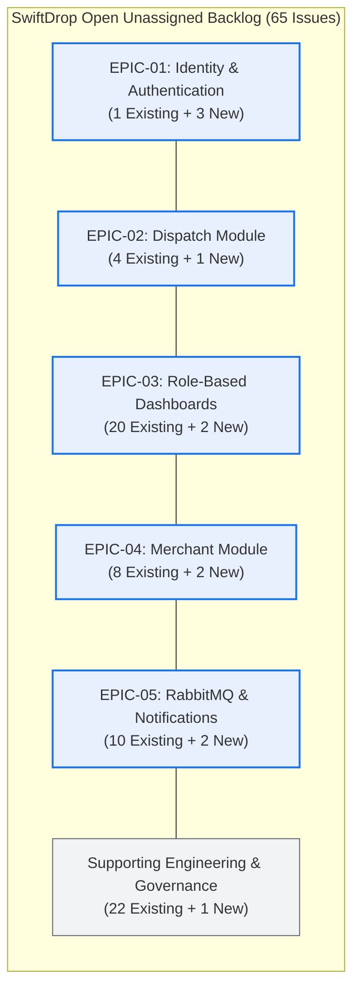
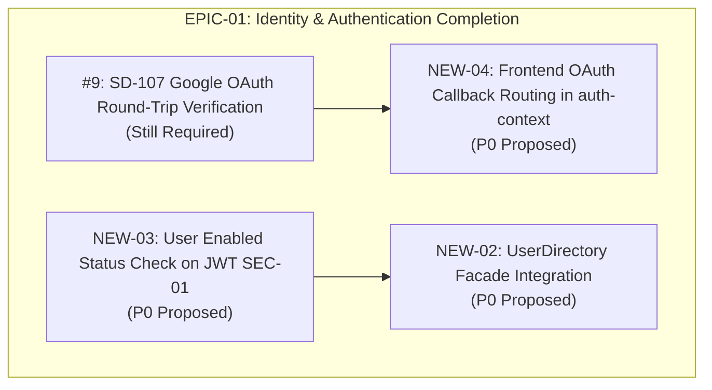
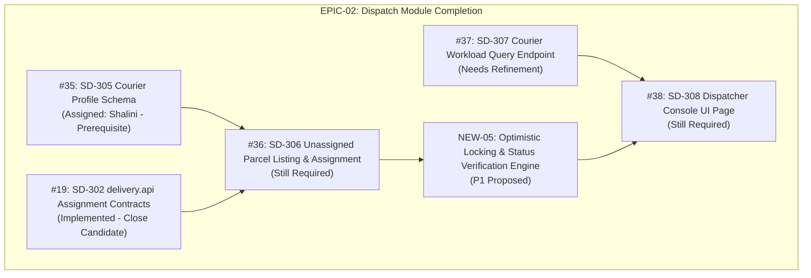
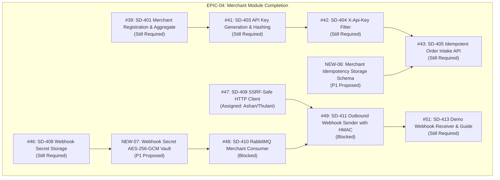
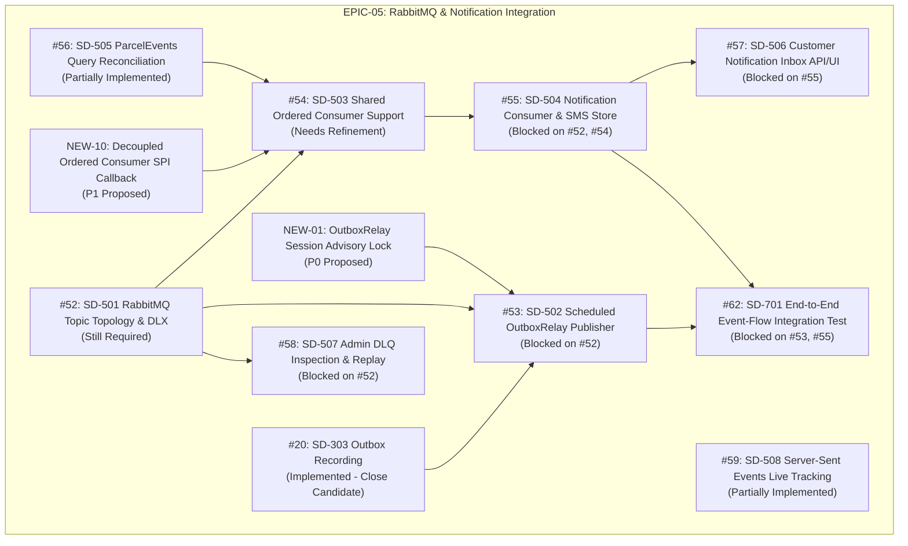

# ACT-12A: GitHub Backlog Analysis & Restructuring Proposal

- **Document ID:** ACT-12A
- **Date:** 2026-11-04
- **Audited Branch / Commit:** `dev` at `a67da3d` (`docs: add act-11 remaining feature development roadmap`)
- **Repository:** `SwiftDrop / SwiftDrop`
- **Execution Mode:** Strictly READ-ONLY (Backlog analysis, evidence gathering, and restructuring proposal only; zero GitHub mutations, zero code changes)

---

## 1. Executive Summary

This document presents the **ACT-12A GitHub Backlog Analysis & Restructuring Proposal** for the SwiftDrop Parcel Delivery and Courier Management System. Following the architectural milestones established in the Foundation Readiness Audit (FRA-01), the Project Progress Audit (ACT-07), the Backlog Consistency Validation (ACT-08.1), the P0 Stabilization Sprint Plan (ACT-09), and the Feature Development Roadmap (ACT-11), this review establishes a safe, evidence-based backlog reorganization for the 10-member engineering team.

The primary objective of ACT-12A is to evaluate every **OPEN** issue in the repository that currently has **NO ASSIGNEE** (65 issues total), verify each against the merged codebase and acceptance criteria, map active requirements into **Five Main Development Epics** plus a **Supporting Engineering & Project Governance** stream, identify missing requirements, and recommend a phased closure plan for satisfied tickets—all while preserving 100% of the repository's historical audit trail.

### Key Backlog Metrics at a Glance

```
Total Issues in Repository Namespace (#8..#78) ─────────────── 71
├── Already Closed Issues (#11) ──────────────────────────────  1
└── Total Currently OPEN Issues ────────────────────────────── 70
    ├── Open Assigned Issues (#16, #17, #18, #35, #47) ───────  5
    └── Open UNASSIGNED Issues (Primary Audit Scope) ───────── 65
        ├── Category A: Still Required ─────────────────────── 27
        ├── Category B: Partially Implemented ────────────────  4
        ├── Category C: Already Implemented (Close Candidates) 16
        ├── Category D: Duplicate ────────────────────────────  0
        ├── Category E: Outdated ─────────────────────────────  0
        ├── Category F: Blocked ────────────────────────────── 14
        └── Category G: Needs Refinement ─────────────────────  4
```

### Proposed Backlog Reorganization Structure



---

## 2. Current GitHub Backlog Baseline

A live query executed against the GitHub repository API using the GitHub CLI (`gh`) confirms the issue inventory across the entire SwiftDrop repository:

- **Total Issues Retrieved:** **71 issues** (spanning numbers `#8` through `#78`).
  *(Note: Issue numbers `#1` through `#7` and `#79` through `#88` are Pull Requests, which share the repository issue numbering space).*
- **Total Closed Issues:** **1 issue** (`#11: SD-201 - Implement pricing schema, zones, pricing rules, and JPA repositories`).
- **Total Open Issues:** **70 issues**.
- **Total Open Assigned Issues:** **5 issues**:
  1. `#16`: `SD-205: Implement secure tracking-number generator with collision retry` (Assignee: `dhananjaya-hbc`)
  2. `#17`: `SD-204: Implement Parcel aggregate, status history schema, and JPA repositories` (Assignee: `dhananjaya-hbc`)
  3. `#18`: `SD-301: Implement delivery status state machine and history transitions` (Assignee: `dhananjaya-hbc`)
  4. `#35`: `SD-305: Implement courier profile management and eligibility schema in dispatch` (Assignee: `ShaliniBangamuwage`)
  5. `#47`: `SD-409: Implement SSRF-safe HTTP client for webhook delivery` (Assignees: `Ashankavinda277`, `ThulaniThehara`)
- **Total Open UNASSIGNED Issues (Audited Scope):** **65 issues** (`#8`, `#9`, `#10`, `#12`, `#13`, `#14`, `#15`, `#19`, `#20`, `#21`, `#22`, `#23`, `#24`, `#25`, `#26`, `#27`, `#28`, `#29`, `#30`, `#31`, `#32`, `#33`, `#34`, `#36`, `#37`, `#38`, `#39`, `#40`, `#41`, `#42`, `#43`, `#44`, `#45`, `#46`, `#48`, `#49`, `#50`, `#51`, `#52`, `#53`, `#54`, `#55`, `#56`, `#57`, `#58`, `#59`, `#60`, `#61`, `#62`, `#63`, `#64`, `#65`, `#66`, `#67`, `#68`, `#69`, `#70`, `#71`, `#72`, `#73`, `#74`, `#75`, `#76`, `#77`, `#78`).

---

## 3. Scope and Methodology

### 3.1 Scope

The scope of this proposal covers:
1. Every one of the **65 open unassigned issues**.
2. Verification of implementation state against backend Java code, JPA repositories, Flyway migrations, REST controllers, Next.js frontend pages/components, and automated tests.
3. Mapping of all open unassigned issues into:
   - Five Proposed Development Epics (EPIC-01 through EPIC-05).
   - Supporting Engineering & Project Governance.
4. Definition of 11 proposed new issues (`NEW-01` through `NEW-11`) to cover architectural and testing gaps identified in ACT-09 and ACT-11.
5. Recommendation of a verified closure list (Category C: 16 issues) with merged PR and code evidence.
6. Definition of the execution plan for ACT-12B (Safe GitHub Backlog Execution).

### 3.2 Evaluation Criteria

Each issue is evaluated across three dimensions:
- **Specification Fidelity:** Do the merged source files and endpoints satisfy the literal acceptance criteria of the issue?
- **Decision Alignment:** Has the requirement been superseded or refined by an accepted Architectural Decision Record (e.g. ADR 0006 for Crockford Base32 tracking codes, ADR 0007 for Server-Sent Events)?
- **Integration Readiness:** Is the component operational end-to-end, or blocked by missing cross-module wiring, schema constraints, or upstream prerequisites?

---

## 4. Open Unassigned Issue Inventory

Below is the complete inventory of all 65 open unassigned issues retrieved directly from GitHub:

| # | Title | Created Date | Labels | Comments |
|---|---|---|---|:---:|
| **#8** | SD-004: Configure measurable JaCoCo code coverage in Maven and CI | 2026-10-25 | `quality`, `backend`, `ci` | 0 |
| **#9** | SD-107: Perform and document real Google OAuth round-trip verification | 2026-10-25 | `identity`, `security`, `docs` | 0 |
| **#10** | SD-009: Implement demo and seed data for local evaluation and profiles | 2026-10-25 | `backend`, `deployment`, `infrastructure`, `demo` | 0 |
| **#12** | SD-202: Implement FeeCalculator strategy service in the pricing module | 2026-10-25 | `backend`, `pricing` | 0 |
| **#13** | SD-203: Implement public delivery price-quote REST endpoint | 2026-10-25 | `backend`, `pricing`, `api` | 0 |
| **#14** | SD-211: Implement pricing administration REST endpoints for zones and rules | 2026-10-25 | `backend`, `pricing`, `api`, `admin` | 0 |
| **#15** | SD-212: Implement admin pricing and zone management UI pages | 2026-10-25 | `pricing`, `admin`, `frontend` | 0 |
| **#19** | SD-302: Implement delivery.api query and assignment contracts | 2026-10-25 | `backend`, `api`, `delivery` | 0 |
| **#20** | SD-303: Implement transactional outbox recording for parcel status events | 2026-10-25 | `backend`, `database`, `delivery`, `messaging` | 0 |
| **#21** | SD-304: Implement public parcel tracking lookup REST endpoint | 2026-10-25 | `backend`, `api`, `delivery`, `tracking` | 0 |
| **#22** | SD-309: Implement courier daily deliveries list endpoint | 2026-10-25 | `backend`, `api`, `delivery`, `courier` | 0 |
| **#23** | SD-310: Implement courier status transition endpoint with delivery notes | 2026-10-25 | `backend`, `api`, `delivery`, `courier` | 0 |
| **#24** | SD-311: Implement proof of delivery capture and photo attachment | 2026-10-25 | `backend`, `delivery`, `courier` | 0 |
| **#25** | SD-312: Implement standardized failure reason recording for undeliverable parcels | 2026-10-25 | `backend`, `delivery`, `courier` | 0 |
| **#26** | SD-313: Implement courier mobile portal UI for deliveries, proof, and status updates | 2026-10-25 | `frontend`, `delivery`, `courier` | 0 |
| **#27** | SD-314: Implement delivery performance and failure rate reporting endpoints | 2026-10-25 | `backend`, `admin`, `delivery`, `reports` | 0 |
| **#28** | SD-315: Implement administrative reports dashboard UI | 2026-10-25 | `admin`, `frontend`, `delivery`, `reports` | 0 |
| **#29** | SD-316: Implement parcel ownership and role authorization test suite (TST-2) | 2026-10-25 | `quality`, `backend`, `security`, `delivery`, `test` | 0 |
| **#30** | SD-206: Implement customer parcel booking REST endpoint | 2026-10-25 | `backend`, `pricing`, `delivery`, `customer` | 0 |
| **#31** | SD-207: Implement customer delivery history and parcel detail endpoints | 2026-10-25 | `backend`, `api`, `delivery`, `customer` | 0 |
| **#32** | SD-208: Implement delivery receipt endpoint and printable receipt format | 2026-10-25 | `backend`, `delivery`, `customer` | 0 |
| **#33** | SD-209: Implement customer booking flow with live fee quote estimator UI | 2026-10-25 | `pricing`, `frontend`, `customer` | 0 |
| **#34** | SD-210: Implement customer delivery history list and printable receipt pages UI | 2026-10-25 | `frontend`, `customer` | 0 |
| **#36** | SD-306: Implement unassigned parcel listing and courier assignment workflow | 2026-10-25 | `backend`, `api`, `delivery`, `dispatch` | 0 |
| **#37** | SD-307: Implement active courier workload query endpoint | 2026-10-25 | `backend`, `api`, `delivery`, `dispatch` | 0 |
| **#38** | SD-308: Implement dispatcher console UI for unassigned parcels and courier assignment | 2026-10-25 | `admin`, `frontend`, `dispatch` | 0 |
| **#39** | SD-401: Implement merchant registration and pending merchant aggregate | 2026-10-25 | `backend`, `database`, `merchant` | 0 |
| **#40** | SD-402: Implement admin merchant review, approval, rejection, and suspension | 2026-10-25 | `backend`, `api`, `admin`, `merchant` | 0 |
| **#41** | SD-403: Implement merchant API key generation, hashing, and revocation | 2026-10-25 | `backend`, `security`, `merchant` | 0 |
| **#42** | SD-404: Implement X-Api-Key authentication filter for merchant endpoints | 2026-10-25 | `backend`, `security`, `merchant` | 0 |
| **#43** | SD-405: Implement idempotent merchant delivery order intake REST API | 2026-10-25 | `backend`, `api`, `delivery`, `merchant` | 0 |
| **#44** | SD-406: Implement merchant portal dashboard orders query endpoint | 2026-10-25 | `backend`, `api`, `merchant` | 0 |
| **#45** | SD-407: Implement merchant registration, dashboard, and API-key UI pages | 2026-10-25 | `frontend`, `merchant` | 0 |
| **#46** | SD-408: Implement webhook endpoint registration with encrypted secret storage | 2026-10-25 | `backend`, `security`, `merchant`, `webhooks` | 0 |
| **#48** | SD-410: Implement RabbitMQ merchant event consumer and webhook delivery recording | 2026-10-25 | `backend`, `messaging`, `merchant`, `webhooks` | 0 |
| **#49** | SD-411: Implement outbound webhook sender with HMAC signatures and exponential backoff | 2026-10-25 | `backend`, `merchant`, `webhooks` | 0 |
| **#50** | SD-412: Implement webhook delivery history and manual redelivery API and UI | 2026-10-25 | `admin`, `frontend`, `merchant`, `webhooks` | 0 |
| **#51** | SD-413: Implement standalone demo webhook receiver and merchant integration guide | 2026-10-25 | `docs`, `merchant`, `webhooks`, `tools` | 0 |
| **#52** | SD-501: Declare RabbitMQ topic exchange, queues, and dead-letter topology | 2026-10-25 | `backend`, `infrastructure`, `messaging` | 0 |
| **#53** | SD-502: Implement scheduled transactional outbox relay publisher | 2026-10-25 | `backend`, `delivery`, `messaging` | 0 |
| **#54** | SD-503: Implement shared ordered event consumer support and sequence deduplication | 2026-10-25 | `backend`, `messaging`, `shared` | 0 |
| **#55** | SD-504: Implement notification consumer and mock SMS delivery store | 2026-10-25 | `backend`, `database`, `messaging`, `notification` | 0 |
| **#56** | SD-505: Implement delivery.api.ParcelEvents query for sequence gap reconciliation | 2026-10-25 | `backend`, `api`, `delivery`, `messaging` | 0 |
| **#57** | SD-506: Implement customer notification inbox API and frontend notification center | 2026-10-25 | `backend`, `api`, `frontend`, `notification` | 0 |
| **#58** | SD-507: Implement admin dead-letter queue inspection and audited replay endpoint | 2026-10-25 | `backend`, `api`, `admin`, `messaging` | 0 |
| **#59** | SD-508: Implement Server-Sent Events (SSE) live parcel tracking endpoint | 2026-10-25 | `backend`, `api`, `tracking`, `sse` | 0 |
| **#60** | SD-510: Implement public live tracking web page with real-time SSE updates | 2026-10-25 | `frontend`, `tracking` | 0 |
| **#61** | SD-603: Complete responsive layout and accessibility audit across all frontend portals | 2026-10-25 | `accessibility`, `quality`, `frontend` | 0 |
| **#62** | SD-701: Implement end-to-end event-flow integration test with RabbitMQ container (TST-1) | 2026-10-25 | `backend`, `messaging`, `test` | 0 |
| **#63** | SD-703: Configure Surefire/Failsafe test results and coverage reporting in CI (TST-3) | 2026-10-25 | `quality`, `backend`, `ci`, `test` | 0 |
| **#64** | SD-704: Perform project-wide security, authorization, and personal-data privacy audit | 2026-10-25 | `quality`, `security`, `docs` | 0 |
| **#65** | SD-801: Create multi-stage production Dockerfile for backend service | 2026-10-25 | `infrastructure`, `docker` | 0 |
| **#66** | SD-802: Create multi-stage production Dockerfile for Next.js frontend | 2026-10-25 | `infrastructure`, `docker` | 0 |
| **#67** | SD-803: Configure full-stack application profile in compose.yaml | 2026-10-25 | `infrastructure`, `docker` | 0 |
| **#68** | SD-804: Update root README with verified submission and demo setup guide | 2026-10-25 | `docs`, `deployment` | 0 |
| **#69** | SD-901: Create and commit system Use Case diagrams (DES-1) | 2026-10-25 | `docs`, `design` | 0 |
| **#70** | SD-902: Create and commit complete Entity-Relationship (ER) diagram (DES-2) | 2026-10-25 | `docs`, `database`, `design` | 0 |
| **#71** | SD-903: Author architecture proposal and modular monolith design report (DES-3) | 2026-10-25 | `docs`, `design` | 0 |
| **#72** | SD-904: Author messaging, outbox, and event integration design document (DES-4) | 2026-10-25 | `docs`, `messaging`, `design` | 0 |
| **#73** | SD-905: Create sequence and activity diagrams for core business workflows (DES-5) | 2026-10-25 | `docs`, `design` | 0 |
| **#74** | SD-906: Author software design patterns application summary (DES-6) | 2026-10-25 | `docs`, `design` | 0 |
| **#75** | SD-907: Compile and assemble comprehensive system design documentation PDF (SUB-2) | 2026-10-25 | `docs`, `submission` | 0 |
| **#76** | SD-908: Compile test report and automated test coverage summary (SUB-3) | 2026-10-25 | `docs`, `test`, `submission` | 0 |
| **#77** | SD-909: Compile individual team contribution tracking sheet (SUB-4) | 2026-10-25 | `docs`, `submission` | 0 |
| **#78** | SD-910: Create scripted live demonstration walkthrough and rehearsal guide (DEM-1..6) | 2026-10-25 | `docs`, `demo`, `submission` | 0 |

---

## 5. Issue-by-Issue Classification

Every one of the 65 open unassigned issues is classified into exactly one of seven standardized categories:
- **A. Still Required (27 issues):** The requested functionality is not implemented and remains necessary.
- **B. Partially Implemented (4 issues):** Some requirements are implemented, but acceptance criteria remain incomplete or contain a blocking bug.
- **C. Already Implemented — Propose Closure (16 issues):** Original acceptance criteria are 100% satisfied by merged implementation.
- **D. Duplicate (0 issues):** No direct duplicates exist.
- **E. Outdated (0 issues):** No requirements have been abandoned.
- **F. Blocked (14 issues):** The task cannot proceed until its explicit dependencies or schema migrations are merged.
- **G. Needs Refinement (4 issues):** The issue is still relevant, but requires updated naming, scope splitting, or SPI decoupling before development.

### Detailed Classification Table

| # | Title | Classification | Target Parent / Stream | Evidence & Rationale |
|---|---|:---:|---|---|
| **#8** | SD-004: Configure measurable JaCoCo code coverage | **Already Implemented** | Supporting Engineering | JaCoCo 0.8.12 configured in `pom.xml`, XML/HTML reports generated, CI uploads artifact (`ADR 0002`). |
| **#9** | SD-107: Google OAuth round-trip verification | **Still Required** | EPIC-01: Identity & Auth | Backend Spring Security OAuth client merged, but live round-trip verification with credentials and documentation is pending. |
| **#10** | SD-009: Implement demo and seed data | **Needs Refinement** | Supporting Engineering | Monolithic requirement mixes initial zone seed data with end-to-end multi-module seed profiles. Needs splitting. |
| **#12** | SD-202: Implement FeeCalculator strategy service | **Already Implemented** | Supporting Engineering | `ZonePairFeeCalculator` implements `FeeCalculator` in `pricing`, formula verified, 409 mapped, unit tests passing. |
| **#13** | SD-203: Public delivery price-quote REST endpoint | **Partially Implemented** | Supporting Engineering | `PriceQuoteController` exists (`GET /api/v1/pricing/quote`), but returns 401 when unauthenticated (`P0-08`). |
| **#14** | SD-211: Pricing administration REST endpoints | **Still Required** | EPIC-03: Dashboards | Admin zone and pricing rule CRUD endpoints not yet implemented in `pricing.web`. |
| **#15** | SD-212: Admin pricing and zone management UI | **Still Required** | EPIC-03: Dashboards | Frontend route `/admin/pricing` is currently a placeholder banner. |
| **#19** | SD-302: delivery.api query and assignment contracts | **Already Implemented** | EPIC-02: Dispatch | `ParcelQueries`, `ParcelAssignment`, `ParcelCreation`, and `ParcelEvents` fully implemented in `delivery.api` with 100% test coverage. |
| **#20** | SD-303: Transactional outbox recording | **Already Implemented** | EPIC-05: Messaging | `parcel_outbox_events` table (`V202611031030`), `ParcelEventRecorder` commits atomically with `parcels`. |
| **#21** | SD-304: Public parcel tracking lookup REST endpoint | **Already Implemented** | Supporting Engineering | `TrackingController` implements `GET /api/v1/tracked-parcels/{trackingNumber}`, strips PII, returns 404 cleanly. |
| **#22** | SD-309: Courier daily deliveries list endpoint | **Already Implemented** | EPIC-03: Dashboards | `CourierController.today` (`GET /api/v1/courier/parcels`) filters by courier ID and business timezone. |
| **#23** | SD-310: Courier status transition endpoint | **Already Implemented** | EPIC-03: Dashboards | `CourierController.changeStatus` validates state machine, notes <= 500 chars, maps 409 conflicts. |
| **#24** | SD-311: Proof of delivery capture and photo attachment | **Already Implemented** | EPIC-03: Dashboards | `DeliveryProofService`, magic-byte JPEG/PNG validation <= 2MB, required before `DELIVERED` status transition. |
| **#25** | SD-312: Standardized failure reason recording | **Already Implemented** | EPIC-03: Dashboards | `FailureReason` enum (5 codes), check constraints in DB, 400 Bad Request if missing during failure transition. |
| **#26** | SD-313: Courier mobile portal UI | **Already Implemented** | EPIC-03: Dashboards | Mobile courier UI implemented at `/courier` and `/courier/parcels/[id]` with proof upload and offline toast alerts. |
| **#27** | SD-314: Delivery performance reporting endpoints | **Still Required** | EPIC-03: Dashboards | Reporting queries and `GET /api/v1/admin/reports/*` endpoints not yet implemented. |
| **#28** | SD-315: Administrative reports dashboard UI | **Still Required** | EPIC-03: Dashboards | Route `/admin/reports` is currently a placeholder UI page. |
| **#29** | SD-316: Parcel ownership & role auth test suite | **Already Implemented** | Supporting Engineering | `ParcelAuthorizationMatrixIT` merged and passing with 36 matrix authorization checks. |
| **#30** | SD-206: Customer parcel booking REST endpoint | **Already Implemented** | EPIC-03: Dashboards | `ParcelController.create` (`POST /api/v1/parcels`), server-side fee calculation, outbox recording. |
| **#31** | SD-207: Customer delivery history and detail endpoints | **Already Implemented** | EPIC-03: Dashboards | `ParcelController.list` and `detail` with customer isolation and status timeline. |
| **#32** | SD-208: Delivery receipt endpoint | **Already Implemented** | EPIC-03: Dashboards | `ParcelController.receipt` generates immutable snapshot with 404 isolation. |
| **#33** | SD-209: Customer booking flow UI | **Partially Implemented** | EPIC-03: Dashboards | Form exists at `/customer/new`, but native HTML5 `min="0.001" step="0.1"` on `#weight` triggers `stepMismatch` (`P0-05`). |
| **#34** | SD-210: Customer delivery history list & receipt UI | **Already Implemented** | EPIC-03: Dashboards | History list and printable receipt view (`@media print`) verified at `/customer`. |
| **#36** | SD-306: Unassigned parcel listing & courier assignment | **Still Required** | EPIC-02: Dispatch | Dispatcher REST API for listing unassigned queue and invoking `ParcelAssignment` not yet implemented. |
| **#37** | SD-307: Active courier workload query endpoint | **Needs Refinement** | EPIC-02: Dispatch | Method signature in issue specifies `findActiveCountsByCourier()`; actual contract is `countActiveParcelsByCourier()`. |
| **#38** | SD-308: Dispatcher console UI | **Still Required** | EPIC-02: Dispatch | Route `/dispatch` is currently a placeholder page. |
| **#39** | SD-401: Merchant registration & aggregate | **Still Required** | EPIC-04: Merchant | Flyway migration for `merchants` table and `Merchant` aggregate not yet implemented (`package-info.java` only). |
| **#40** | SD-402: Admin merchant review and approval | **Still Required** | EPIC-03: Dashboards | Admin approval/rejection endpoints and state machine not yet implemented. |
| **#41** | SD-403: Merchant API key generation & hashing | **Still Required** | EPIC-04: Merchant | `merchant_api_keys` table and SHA-256 key generation not yet implemented. |
| **#42** | SD-404: X-Api-Key authentication filter | **Still Required** | EPIC-04: Merchant | Spring Security filter for `X-Api-Key` header authentication not yet implemented. |
| **#43** | SD-405: Idempotent merchant order intake REST API | **Still Required** | EPIC-04: Merchant | Batch order intake endpoint delegating to `ParcelCreation` not yet implemented. |
| **#44** | SD-406: Merchant portal orders query endpoint | **Still Required** | EPIC-03: Dashboards | Merchant portal query `GET /api/v1/merchant/parcels` not yet implemented. |
| **#45** | SD-407: Merchant portal & API-key UI pages | **Still Required** | EPIC-03: Dashboards | Frontend routes `/merchant`, `/merchant/orders`, and `/merchant/api-keys` are placeholders. |
| **#46** | SD-408: Webhook registration & secret storage | **Still Required** | EPIC-04: Merchant | Webhook subscription endpoint and AES-256-GCM secret encryption not yet implemented. |
| **#48** | SD-410: RabbitMQ merchant event consumer | **Blocked** | EPIC-04: Merchant | Blocked on RabbitMQ exchange/queue bindings (`#52`) and webhook registration (`#46`). |
| **#49** | SD-411: Outbound webhook sender with HMAC | **Blocked** | EPIC-04: Merchant | Blocked on webhook event recording (`#48`). |
| **#50** | SD-412: Webhook delivery history and redelivery UI | **Blocked** | EPIC-03: Dashboards | Blocked on webhook execution tables and endpoints (`#48`, `#49`). |
| **#51** | SD-413: Demo webhook receiver & guide | **Still Required** | EPIC-04: Merchant | Standalone test receiver script and integration documentation. |
| **#52** | SD-501: Declare RabbitMQ topic topology & DLQ | **Still Required** | EPIC-05: Messaging | RabbitMQ `TopicExchange`, queues, routing keys, and DLX declarations not yet committed in backend config. |
| **#53** | SD-502: Scheduled transactional outbox relay | **Blocked** | EPIC-05: Messaging | Blocked on RabbitMQ exchange configuration (`#52`). |
| **#54** | SD-503: Shared ordered event consumer support | **Needs Refinement** | EPIC-05: Messaging | Scope specifies direct import of `delivery.api`, violating `ModuleBoundaryTest:81`. Requires generic SPI callback design. |
| **#55** | SD-504: Notification consumer & mock SMS store | **Blocked** | EPIC-05: Messaging | Blocked on RabbitMQ topology (`#52`) and shared ordered consumer (`#54`). |
| **#56** | SD-505: delivery.api.ParcelEvents query | **Partially Implemented** | EPIC-05: Messaging | Method `ParcelEvents.eventsBetween` exists, but `DeliveryQueriesIT` fails due to nanosecond vs microsecond timestamp drift (`P0-01`). |
| **#57** | SD-506: Customer notification inbox API & UI | **Blocked** | EPIC-05: Messaging | Blocked on notification persistence entity and consumer (`#55`). |
| **#58** | SD-507: Admin dead-letter queue inspection & replay | **Blocked** | EPIC-05: Messaging | Blocked on RabbitMQ DLQ topology (`#52`). |
| **#59** | SD-508: Server-Sent Events live tracking endpoint | **Partially Implemented** | EPIC-05: Messaging | Endpoint exists, but `LiveTrackingIT` leaks an open SSE connection hanging Tomcat shutdown (`P0-03`), and `ADR 0007` is unapproved. |
| **#60** | SD-510: Public live tracking web page UI | **Already Implemented** | EPIC-03: Dashboards | Public tracking UI at `/track` is functional, consumes SSE with automatic fallback, build/lint clean. |
| **#61** | SD-603: Responsive layout & accessibility audit | **Still Required** | EPIC-03: Dashboards | Comprehensive audit across all portals following completion of dispatch and merchant UIs. |
| **#62** | SD-701: End-to-end event-flow integration test | **Blocked** | EPIC-05: Messaging | Blocked on OutboxRelay (`#53`) and notification consumer (`#55`). |
| **#63** | SD-703: Surefire/Failsafe test results in CI | **Needs Refinement** | Supporting Engineering | JaCoCo upload is already satisfied in `#8`; scope must focus specifically on Surefire/Failsafe XML archiving and `-Pintegration`. |
| **#64** | SD-704: Project-wide security & privacy audit | **Still Required** | Supporting Engineering | Security and PII exposure review across all completed modules. |
| **#65** | SD-801: Multi-stage production backend Dockerfile | **Still Required** | Supporting Engineering | Standalone production containerization for Spring Boot service. |
| **#66** | SD-802: Multi-stage production frontend Dockerfile | **Still Required** | Supporting Engineering | Standalone production containerization for Next.js app. |
| **#67** | SD-803: Full-stack application profile in compose | **Blocked** | Supporting Engineering | Blocked on Dockerfiles (`#65`, `#66`). |
| **#68** | SD-804: Update root README with submission guide | **Still Required** | Supporting Engineering | Single-command evaluation instructions for grading team. |
| **#69** | SD-901: System Use Case diagrams (DES-1) | **Still Required** | Supporting Engineering | Mermaid and SVG use case diagrams for report submission. |
| **#70** | SD-902: Complete Entity-Relationship diagram | **Blocked** | Supporting Engineering | Blocked on completion of `merchants`, `couriers`, and `notifications` Flyway migrations. |
| **#71** | SD-903: Architecture proposal & monolith report | **Still Required** | Supporting Engineering | Academic system design report on modular monolith architecture. |
| **#72** | SD-904: Messaging & event integration design doc | **Blocked** | Supporting Engineering | Blocked on OutboxRelay and ordered consumer implementation. |
| **#73** | SD-905: Sequence & activity diagrams | **Still Required** | Supporting Engineering | Sequence diagrams for booking, dispatch, and delivery workflows. |
| **#74** | SD-906: Software design patterns summary | **Still Required** | Supporting Engineering | Analysis of GoF and enterprise patterns applied in SwiftDrop. |
| **#75** | SD-907: Comprehensive system design PDF | **Blocked** | Supporting Engineering | Blocked on compilation of all individual design reports (DES-1..6). |
| **#76** | SD-908: Test report and coverage summary | **Blocked** | Supporting Engineering | Blocked on execution of complete test suites across backend and frontend. |
| **#77** | SD-909: Individual team contribution sheet | **Still Required** | Supporting Engineering | Tabulation of commits, issues, and PRs per member for grading. |
| **#78** | SD-910: Scripted live demo walkthrough guide | **Blocked** | Supporting Engineering | Blocked on operational readiness of end-to-end user workflows. |

---

## 6. EPIC-01: Identity & Authentication Completion

### 6.1 Objective and Scope
Finalize and harden the Identity module, complete real Google OAuth round-trip verification, wire the `UserDirectory` facade into consuming business modules, enforce user account status checks on active JWT tokens, and establish secure frontend authentication state routing.

### 6.2 Existing and Proposed Issues



- **Existing Unassigned Issues (1):**
  - `#9`: `SD-107: Perform and document real Google OAuth round-trip verification` (Still Required)
- **Proposed New Issues (3):**
  - `NEW-02`: `identity.api.UserDirectory Integration across Business Modules` (P0)
  - `NEW-03`: `Enforce User Enabled Status Validation on Active JWT Requests (SEC-01)` (P0)
  - `NEW-04`: `Frontend Google OAuth Callback Routing and Context Synchronization` (P0)

### 6.3 Success Criteria
- Real Google OAuth authentication succeeds on a live test environment, creating or linking a local `User` record with role `CUSTOMER`.
- `auth-context.tsx` cleanly handles `/auth/google/callback` without redirect loops.
- Deactivated or locked users have their JWT access rejected immediately with `401 Unauthorized`.
- Consuming modules (`dispatch`, `delivery`) resolve user display names strictly via `identity.api.UserDirectory`.

---

## 7. EPIC-02: Dispatch Module Completion

### 7.1 Objective and Scope
Implement the full operational lifecycle of courier dispatching, including courier profile management, eligibility verification, unassigned parcel listing, and optimistic-locking-protected courier assignment.

### 7.2 Existing and Proposed Issues



- **Existing Unassigned Issues (4):**
  - `#19`: `SD-302: Implement delivery.api query and assignment contracts` (Implemented — Close Candidate)
  - `#36`: `SD-306: Implement unassigned parcel listing and courier assignment workflow` (Still Required)
  - `#37`: `SD-307: Implement active courier workload query endpoint` (Needs Refinement)
  - `#38`: `SD-308: Implement dispatcher console UI for unassigned parcels and courier assignment` (Still Required)
- **Assigned Prerequisite Issue (1):**
  - `#35`: `SD-305: Implement courier profile management and eligibility schema in dispatch` (Assigned to `ShaliniBangamuwage`)
- **Proposed New Issues (1):**
  - `NEW-05`: `Dispatch Courier Assignment Concurrency and Optimistic Locking Engine` (P1)

### 7.3 Success Criteria
- Dispatchers can view a real-time list of `CREATED` parcels awaiting courier assignment via `delivery.api.ParcelQueries.findUnassignedParcels()`.
- Courier workload is calculated accurately using `countActiveParcelsByCourier()`.
- Concurrent assignment attempts on the same parcel result in one success and a deterministic `409 Conflict`.
- Dispatcher UI at `/dispatch` offers an interactive two-pane assignment workflow.

---

## 8. EPIC-03: Role-Based Dashboard Completion

### 8.1 Objective and Scope
Complete, integrate, and harden all role-specific frontend portals and their backing REST endpoints, providing polished, responsive, and secure user experiences for Customers, Couriers, Merchants, Dispatchers, and Administrators.

### 8.2 Existing and Proposed Issues

- **Existing Unassigned Issues (20):**
  - *Customer Portal (5):*
    - `#30`: `SD-206: Customer parcel booking REST endpoint` (Implemented — Close Candidate)
    - `#31`: `SD-207: Customer delivery history and detail endpoints` (Implemented — Close Candidate)
    - `#32`: `SD-208: Customer delivery receipt endpoint` (Implemented — Close Candidate)
    - `#33`: `SD-209: Customer booking flow UI` (Partially Implemented — weight step bug)
    - `#34`: `SD-210: Customer history list and receipt UI` (Implemented — Close Candidate)
  - *Courier Portal (5):*
    - `#22`: `SD-309: Courier daily deliveries list endpoint` (Implemented — Close Candidate)
    - `#23`: `SD-310: Courier status transition endpoint` (Implemented — Close Candidate)
    - `#24`: `SD-311: Proof of delivery capture and photo attachment` (Implemented — Close Candidate)
    - `#25`: `SD-312: Failure reason recording` (Implemented — Close Candidate)
    - `#26`: `SD-313: Courier mobile portal UI` (Implemented — Close Candidate)
  - *Merchant Portal (3):*
    - `#44`: `SD-406: Merchant orders query endpoint` (Still Required)
    - `#45`: `SD-407: Merchant portal & API key UI` (Still Required)
    - `#50`: `SD-412: Webhook history & redelivery UI` (Blocked)
  - *Admin & Reports Portal (5):*
    - `#14`: `SD-211: Pricing administration REST endpoints` (Still Required)
    - `#15`: `SD-212: Admin pricing and zone management UI` (Still Required)
    - `#27`: `SD-314: Delivery performance reporting endpoints` (Still Required)
    - `#28`: `SD-315: Administrative reports dashboard UI` (Still Required)
    - `#40`: `SD-402: Admin merchant review and approval` (Still Required)
  - *Cross-Portal & Public UI (2):*
    - `#60`: `SD-510: Public live tracking web page UI` (Implemented — Close Candidate)
    - `#61`: `SD-603: Responsive layout & accessibility audit across all portals` (Still Required)
- **Proposed New Issues (2):**
  - `NEW-08`: `Admin Overview Dashboard and Merchant Approval Portal (/admin, /admin/merchants)` (P1)
  - `NEW-09`: `Admin Dead-Letter Queue Inspection and Replay Portal (/admin/dead-letters)` (P2)

### 8.3 Success Criteria
- All five primary user roles (`CUSTOMER`, `COURIER`, `MERCHANT`, `DISPATCHER`, `ADMIN`) have dedicated, responsive, and functional dashboard environments.
- Customer booking form step attribute defect is resolved, allowing decimal weights (`0.5 kg`).
- Zero console runtime errors or unhandled promise rejections across all portal workflows.

---

## 9. EPIC-04: Merchant Module Completion

### 9.1 Objective and Scope
Build out the B2B merchant integration subsystem, including merchant registration and administrative approval, hashed API key provisioning, `X-Api-Key` authentication, idempotent parcel order intake, and secure outbound HMAC-SHA256 webhook deliveries protected by SSRF-safe HTTP resolution.

### 9.2 Existing and Proposed Issues



- **Existing Unassigned Issues (8):**
  - `#39`: `SD-401: Implement merchant registration and pending merchant aggregate` (Still Required)
  - `#41`: `SD-403: Implement merchant API key generation, hashing, and revocation` (Still Required)
  - `#42`: `SD-404: Implement X-Api-Key authentication filter for merchant endpoints` (Still Required)
  - `#43`: `SD-405: Implement idempotent merchant delivery order intake REST API` (Still Required)
  - `#46`: `SD-408: Implement webhook endpoint registration with encrypted secret storage` (Still Required)
  - `#48`: `SD-410: Implement RabbitMQ merchant event consumer and webhook delivery recording` (Blocked)
  - `#49`: `SD-411: Implement outbound webhook sender with HMAC signatures and exponential backoff` (Blocked)
  - `#51`: `SD-413: Implement standalone demo webhook receiver and merchant integration guide` (Still Required)
- **Assigned Prerequisite Issue (1):**
  - `#47`: `SD-409: Implement SSRF-safe HTTP client for webhook delivery` (Assigned to `Ashankavinda277`, `ThulaniThehara`)
- **Proposed New Issues (2):**
  - `NEW-06`: `Merchant Idempotency Key Storage and Deduplication Table (V202611061200)` (P1)
  - `NEW-07`: `AES-256-GCM Encryption Vault for Webhook Signing Secrets (SEC-04)` (P1)

### 9.3 Success Criteria
- External merchants can authenticate via `X-Api-Key` header and submit bulk parcel creation requests.
- Repeated requests with identical `Idempotency-Key` headers return cached responses without duplicate database records.
- Webhook endpoints receive cryptographically signed HTTP POST payloads (`X-SwiftDrop-Signature: sha256=...`).
- SSRF client rejects target URLs resolving to `127.0.0.1`, RFC 1918 private subnets, and cloud metadata IPs (`169.254.169.254`).

---

## 10. EPIC-05: RabbitMQ & Notification Integration

### 10.1 Objective and Scope
Establish the asynchronous message-driven backbone of the platform, comprising the RabbitMQ topic exchange topology, scheduled transactional outbox relay with distributed advisory locking, shared ordered consumer processing with sequence gap buffering, customer in-app notification center, and dead-letter queue management.

### 10.2 Existing and Proposed Issues



- **Existing Unassigned Issues (10):**
  - `#20`: `SD-303: Implement transactional outbox recording for parcel status events` (Implemented — Close Candidate)
  - `#52`: `SD-501: Declare RabbitMQ topic exchange, queues, and dead-letter topology` (Still Required)
  - `#53`: `SD-502: Implement scheduled transactional outbox relay publisher` (Blocked)
  - `#54`: `SD-503: Implement shared ordered event consumer support and sequence deduplication` (Needs Refinement)
  - `#55`: `SD-504: Implement notification consumer and mock SMS delivery store` (Blocked)
  - `#56`: `SD-505: Implement delivery.api.ParcelEvents query for sequence gap reconciliation` (Partially Implemented)
  - `#57`: `SD-506: Implement customer notification inbox API and frontend notification center` (Blocked)
  - `#58`: `SD-507: Implement admin dead-letter queue inspection and audited replay endpoint` (Blocked)
  - `#59`: `SD-508: Implement Server-Sent Events (SSE) live parcel tracking endpoint` (Partially Implemented)
  - `#62`: `SD-701: Implement end-to-end event-flow integration test with RabbitMQ container (TST-1)` (Blocked)
- **Proposed New Issues (2):**
  - `NEW-01`: `PostgreSQL Session Advisory Lock for OutboxRelay Leader Election (P0-02)` (P0)
  - `NEW-10`: `Decouple Ordered Consumer SPI from delivery.api Module Boundary` (P1)

### 10.3 Success Criteria
- State mutations committed to `parcels` generate `parcel_outbox_events` atomically.
- `OutboxRelay` polls unpublished events using `pg_try_advisory_lock` and publishes to topic exchange `swiftdrop.events`.
- Shared ordered consumer processes events per `aggregate_id` in sequence order, buffering out-of-order deliveries up to 30s.
- Failures past max retries route cleanly to `swiftdrop.dlx` without crashing listeners.
- End-to-end integration test (`TST-1`) passes reliably in CI.

---

## 11. Supporting Engineering & Governance Issues

A significant portion of the SwiftDrop repository backlog consists of critical engineering infrastructure, quality gates, Docker containerization, and academic submission documentation. Rather than forcing these into business feature epics, they are grouped into **Supporting Engineering & Project Governance** across three streams:

### 11.1 Stream 1: CI/CD, Quality & Security Audit (4 issues)
- `#8`: `SD-004: Configure measurable JaCoCo code coverage in Maven and CI` (**Already Implemented**)
- `#29`: `SD-316: Implement parcel ownership and role authorization test suite (TST-2)` (**Already Implemented**)
- `#63`: `SD-703: Configure Surefire/Failsafe test results and coverage reporting in CI (TST-3)` (**Needs Refinement**) — Scope refined to Surefire XML archiving and `-Pintegration` flag in GitHub Actions.
- `#64`: `SD-704: Perform project-wide security, authorization, and personal-data privacy audit` (**Still Required**)

### 11.2 Stream 2: Infrastructure, Containerization & Demo Environment (5 issues)
- `#10`: `SD-009: Implement demo and seed data for local evaluation and profiles` (**Needs Refinement**) — Split into Phase 1 (zone/pricing seed) and Phase 2 (multi-role demo profiles).
- `#65`: `SD-801: Create multi-stage production Dockerfile for backend service` (**Still Required**)
- `#66`: `SD-802: Create multi-stage production Dockerfile for Next.js frontend` (**Still Required**)
- `#67`: `SD-803: Configure full-stack application profile in compose.yaml` (**Blocked on #65, #66**)
- `#68`: `SD-804: Update root README with verified submission and demo setup guide` (**Still Required**)

### 11.3 Stream 3: Academic System Design Reports & Submission Pack (10 issues)
- `#69`: `SD-901: Create and commit system Use Case diagrams (DES-1)` (**Still Required**)
- `#70`: `SD-902: Create and commit complete Entity-Relationship (ER) diagram (DES-2)` (**Blocked on final migrations**)
- `#71`: `SD-903: Author architecture proposal and modular monolith design report (DES-3)` (**Still Required**)
- `#72`: `SD-904: Author messaging, outbox, and event integration design document (DES-4)` (**Blocked on messaging**)
- `#73`: `SD-905: Create sequence and activity diagrams for core business workflows (DES-5)` (**Still Required**)
- `#74`: `SD-906: Author software design patterns application summary (DES-6)` (**Still Required**)
- `#75`: `SD-907: Compile and assemble comprehensive system design documentation PDF (SUB-2)` (**Blocked on DES-1..6**)
- `#76`: `SD-908: Compile test report and automated test coverage summary (SUB-3)` (**Blocked on test suites**)
- `#77`: `SD-909: Compile individual team contribution tracking sheet (SUB-4)` (**Still Required**)
- `#78`: `SD-910: Create scripted live demonstration walkthrough and rehearsal guide (DEM-1..6)` (**Blocked on E2E flows**)

### 11.4 Stream 4: Completed Pricing Core Foundations (3 issues)
- `#12`: `SD-202: Implement FeeCalculator strategy service in the pricing module` (**Already Implemented**)
- `#13`: `SD-203: Implement public delivery price-quote REST endpoint` (**Partially Implemented — 401 unauth bug**)
- `#21`: `SD-304: Implement public parcel tracking lookup REST endpoint` (**Already Implemented**)

*Total Supporting Engineering & Governance Issues:* 4 + 5 + 10 + 3 = **22 issues**.

---

## 12. Existing Issue-to-Epic Mapping

The table below maps every one of the 65 open unassigned issues to its designated parent epic or supporting stream:

| Issue # | Title | Classification | Proposed Parent Epic / Stream | Recommended Action | Primary Rationale |
|:---:|---|:---:|---|---|---|
| **#8** | SD-004: JaCoCo coverage in Maven & CI | Already Implemented | Supporting Engineering | Propose Closure | JaCoCo 0.8.12 configured, verified in CI, ADR 0002 updated. |
| **#9** | SD-107: Google OAuth round-trip verification | Still Required | EPIC-01: Identity & Auth | Keep Open | Live Google OAuth verification and documentation pending. |
| **#10** | SD-009: Implement demo and seed data | Needs Refinement | Supporting Engineering | Refine AC | Split into Phase 1 (zone seed) and Phase 2 (E2E demo). |
| **#12** | SD-202: FeeCalculator strategy service | Already Implemented | Supporting Engineering | Propose Closure | `ZonePairFeeCalculator` verified with unit tests. |
| **#13** | SD-203: Public delivery price-quote endpoint | Partially Implemented | Supporting Engineering | Keep Open (P0 Fix) | Endpoint exists, needs permitAll in SecurityConfig (`P0-08`). |
| **#14** | SD-211: Pricing admin REST endpoints | Still Required | EPIC-03: Dashboards | Keep Open | Admin zone/pricing rule CRUD endpoints pending. |
| **#15** | SD-212: Admin pricing management UI | Still Required | EPIC-03: Dashboards | Keep Open | Admin pricing management UI at `/admin/pricing` pending. |
| **#19** | SD-302: delivery.api contracts | Already Implemented | EPIC-02: Dispatch | Propose Closure | Public query and assignment contracts merged with tests. |
| **#20** | SD-303: Transactional outbox recording | Already Implemented | EPIC-05: Messaging | Propose Closure | Outbox event recording table and recorder merged. |
| **#21** | SD-304: Public parcel tracking lookup | Already Implemented | Supporting Engineering | Propose Closure | `TrackingController` merged with zero PII leakage. |
| **#22** | SD-309: Courier daily deliveries endpoint | Already Implemented | EPIC-03: Dashboards | Propose Closure | `CourierController.today` merged with timezone filtering. |
| **#23** | SD-310: Courier status transition endpoint | Already Implemented | EPIC-03: Dashboards | Propose Closure | Courier transition validation and conflict mapping merged. |
| **#24** | SD-311: Proof of delivery capture | Already Implemented | EPIC-03: Dashboards | Propose Closure | Photo validation and storage service merged. |
| **#25** | SD-312: Failure reason recording | Already Implemented | EPIC-03: Dashboards | Propose Closure | `FailureReason` enum and DB check constraints merged. |
| **#26** | SD-313: Courier mobile portal UI | Already Implemented | EPIC-03: Dashboards | Propose Closure | Courier portal at `/courier` verified build/lint clean. |
| **#27** | SD-314: Delivery performance reporting | Still Required | EPIC-03: Dashboards | Keep Open | Reporting queries and endpoints pending. |
| **#28** | SD-315: Administrative reports dashboard | Still Required | EPIC-03: Dashboards | Keep Open | Reports UI page at `/admin/reports` pending. |
| **#29** | SD-316: Parcel ownership & role auth test | Already Implemented | Supporting Engineering | Propose Closure | `ParcelAuthorizationMatrixIT` merged and passing. |
| **#30** | SD-206: Customer parcel booking endpoint | Already Implemented | EPIC-03: Dashboards | Propose Closure | `POST /api/v1/parcels` merged with server-side pricing. |
| **#31** | SD-207: Customer delivery history & detail | Already Implemented | EPIC-03: Dashboards | Propose Closure | Customer parcel listing and timeline detail merged. |
| **#32** | SD-208: Delivery receipt endpoint | Already Implemented | EPIC-03: Dashboards | Propose Closure | Receipt snapshot endpoint merged. |
| **#33** | SD-209: Customer booking flow UI | Partially Implemented | EPIC-03: Dashboards | Keep Open (P0 Fix) | Resolve HTML5 weight input step attribute (`P0-05`). |
| **#34** | SD-210: Customer history & receipt UI | Already Implemented | EPIC-03: Dashboards | Propose Closure | Customer delivery history and print receipt view merged. |
| **#36** | SD-306: Unassigned parcel listing workflow | Still Required | EPIC-02: Dispatch | Keep Open | Dispatcher unassigned queue and assignment API pending. |
| **#37** | SD-307: Active courier workload query | Needs Refinement | EPIC-02: Dispatch | Refine AC | Align method name to `countActiveParcelsByCourier()`. |
| **#38** | SD-308: Dispatcher console UI | Still Required | EPIC-02: Dispatch | Keep Open | Interactive dispatcher split-view console pending. |
| **#39** | SD-401: Merchant registration & aggregate | Still Required | EPIC-04: Merchant | Keep Open | Merchant entity and pending state machine pending. |
| **#40** | SD-402: Admin merchant review & approval | Still Required | EPIC-03: Dashboards | Keep Open | Admin approval endpoints and state transitions pending. |
| **#41** | SD-403: Merchant API key generation | Still Required | EPIC-04: Merchant | Keep Open | API key table and SHA-256 generator pending. |
| **#42** | SD-404: X-Api-Key authentication filter | Still Required | EPIC-04: Merchant | Keep Open | Spring Security filter for API key auth pending. |
| **#43** | SD-405: Idempotent merchant order intake | Still Required | EPIC-04: Merchant | Keep Open | Merchant bulk intake endpoint pending. |
| **#44** | SD-406: Merchant orders query endpoint | Still Required | EPIC-03: Dashboards | Keep Open | Merchant portal orders query pending. |
| **#45** | SD-407: Merchant portal & API-key UI | Still Required | EPIC-03: Dashboards | Keep Open | Merchant portal UI pages pending. |
| **#46** | SD-408: Webhook registration & secret | Still Required | EPIC-04: Merchant | Keep Open | Webhook endpoint registration and encryption pending. |
| **#48** | SD-410: RabbitMQ merchant event consumer | Blocked | EPIC-04: Merchant | Keep Open (Blocked) | Blocked on RabbitMQ topology (#52) and webhooks (#46). |
| **#49** | SD-411: Outbound webhook sender HMAC | Blocked | EPIC-04: Merchant | Keep Open (Blocked) | Blocked on webhook execution recording (#48). |
| **#50** | SD-412: Webhook delivery history UI | Blocked | EPIC-03: Dashboards | Keep Open (Blocked) | Blocked on webhook sender (#48, #49). |
| **#51** | SD-413: Standalone demo webhook receiver | Still Required | EPIC-04: Merchant | Keep Open | Demo webhook receiver script and guide pending. |
| **#52** | SD-501: RabbitMQ topic topology & DLQ | Still Required | EPIC-05: Messaging | Keep Open | Declarations for `swiftdrop.events` and DLX pending. |
| **#53** | SD-502: Scheduled transactional outbox relay | Blocked | EPIC-05: Messaging | Keep Open (Blocked) | Blocked on RabbitMQ exchange declaration (#52). |
| **#54** | SD-503: Shared ordered event consumer | Needs Refinement | EPIC-05: Messaging | Refine AC | Decouple from `delivery.api` via generic SPI callback. |
| **#55** | SD-504: Notification consumer & SMS store | Blocked | EPIC-05: Messaging | Keep Open (Blocked) | Blocked on RabbitMQ topology (#52) and consumer (#54). |
| **#56** | SD-505: delivery.api.ParcelEvents query | Partially Implemented | EPIC-05: Messaging | Keep Open (P0 Fix) | Truncate outbox timestamp nanoseconds (`P0-01`). |
| **#57** | SD-506: Customer notification inbox API/UI | Blocked | EPIC-05: Messaging | Keep Open (Blocked) | Blocked on notification persistence entity (#55). |
| **#58** | SD-507: Admin DLQ inspection & replay | Blocked | EPIC-05: Messaging | Keep Open (Blocked) | Blocked on DLQ topology declaration (#52). |
| **#59** | SD-508: Server-Sent Events live tracking | Partially Implemented | EPIC-05: Messaging | Keep Open (P0 Fix) | Close SSE stream in test (`P0-03`) and approve ADR 0007. |
| **#60** | SD-510: Public live tracking web page UI | Already Implemented | EPIC-03: Dashboards | Propose Closure | Public tracking page at `/track` verified functional. |
| **#61** | SD-603: Responsive layout & accessibility | Still Required | EPIC-03: Dashboards | Keep Open | Cross-portal responsive audit pending. |
| **#62** | SD-701: End-to-end event-flow IT | Blocked | EPIC-05: Messaging | Keep Open (Blocked) | Blocked on OutboxRelay (#53) and notification consumer (#55). |
| **#63** | SD-703: Surefire/Failsafe reporting in CI | Needs Refinement | Supporting Engineering | Refine AC | Focus on Surefire XML archiving and `-Pintegration`. |
| **#64** | SD-704: Security & privacy audit | Still Required | Supporting Engineering | Keep Open | Multi-role security and PII audit pending. |
| **#65** | SD-801: Multi-stage backend Dockerfile | Still Required | Supporting Engineering | Keep Open | Backend production containerization pending. |
| **#66** | SD-802: Multi-stage frontend Dockerfile | Still Required | Supporting Engineering | Keep Open | Frontend production containerization pending. |
| **#67** | SD-803: Compose full-stack profile | Blocked | Supporting Engineering | Keep Open (Blocked) | Blocked on Dockerfiles (#65, #66). |
| **#68** | SD-804: Update root README setup guide | Still Required | Supporting Engineering | Keep Open | Verified local and Docker instructions pending. |
| **#69** | SD-901: System Use Case diagrams | Still Required | Supporting Engineering | Keep Open | Final system use case diagrams pending. |
| **#70** | SD-902: Complete Entity-Relationship diagram | Blocked | Supporting Engineering | Keep Open (Blocked) | Blocked on final database migrations. |
| **#71** | SD-903: Architecture proposal & monolith report | Still Required | Supporting Engineering | Keep Open | Modular monolith architectural report pending. |
| **#72** | SD-904: Messaging & outbox design doc | Blocked | Supporting Engineering | Keep Open (Blocked) | Blocked on messaging pipeline implementation. |
| **#73** | SD-905: Sequence & activity diagrams | Still Required | Supporting Engineering | Keep Open | Core workflow sequence diagrams pending. |
| **#74** | SD-906: Software design patterns summary | Still Required | Supporting Engineering | Keep Open | Design patterns documentation pending. |
| **#75** | SD-907: Comprehensive system design PDF | Blocked | Supporting Engineering | Keep Open (Blocked) | Blocked on compilation of DES-1..6 reports. |
| **#76** | SD-908: Test report and coverage summary | Blocked | Supporting Engineering | Keep Open (Blocked) | Blocked on execution of complete test suites. |
| **#77** | SD-909: Team contribution tracking sheet | Still Required | Supporting Engineering | Keep Open | Individual team member contributions pending. |
| **#78** | SD-910: Scripted live demo guide | Blocked | Supporting Engineering | Keep Open (Blocked) | Blocked on end-to-end workflow completion. |

---

## 13. Missing Work and Proposed New Issues

To bridge the architectural, security, and operational gaps identified in ACT-09 and ACT-11 that are not covered by existing issues, exactly **11 single-responsibility new issues** are proposed:

| Proposed ID | Suggested Title | Parent Epic / Stream | Priority | Acceptance Criteria & Dependencies | Reason Not Covered by Existing Issues |
|---|---|---|:---:|---|---|
| **NEW-01** | PostgreSQL Session Advisory Lock for OutboxRelay Leader Election | EPIC-05: Messaging | **P0** | Acquire `pg_try_advisory_lock` (key `0x53444F55544258L`) before polling `parcel_outbox_events`; release on cycle completion. Tested under simulated multi-instance concurrency. Dep: `#20`. | Existing `#53` covers basic scheduling, but omits distributed locking, causing duplicate event publishing in clustered runs. |
| **NEW-02** | UserDirectory Facade Integration Across Consuming Business Modules | EPIC-01: Identity | **P0** | Inject `identity.api.UserDirectory` into `dispatch` and `delivery` modules to look up user names/phones without accessing `identity` JPA tables directly. Dep: None. | `UserDirectory` was merged in PR `#4`, but zero consuming modules currently call it. |
| **NEW-03** | Validate User Enabled Status on Active JWT Requests (SEC-01) | EPIC-01: Identity | **P0** | Update `JwtAuthenticationFilter` or user service to check `enabled = true` on authenticated requests; reject disabled users immediately with 401. Dep: None. | Existing JWT filter only verifies cryptographic signature and expiration, ignoring live account deactivations. |
| **NEW-04** | Frontend Google OAuth Callback Routing and Context Synchronization | EPIC-01: Identity | **P0** | Add `/auth/google/callback` to `publicPaths` in `auth-context.tsx`; synchronize token into localStorage and transition to requested return URL without page refresh loops. Dep: `#9`. | Missing from frontend auth router, causing redirection loops during OAuth return trips. |
| **NEW-05** | Dispatch Courier Assignment Concurrency and Optimistic Locking Engine | EPIC-02: Dispatch | **P1** | Add `@Version` column to `couriers` table (`V202611051210`); validate parcel is in `CREATED` status before invoking `assignCourier()`; return 409 Conflict on collision. Dep: `#19`, `#35`. | Existing `#36` covers the REST endpoint, but lacks explicit specifications for optimistic locking and race-condition handling. |
| **NEW-06** | Merchant Idempotency Key Storage and Deduplication Table | EPIC-04: Merchant | **P1** | Flyway migration `V202611061200` creating `merchant_idempotency_keys` table; filter caching response payload and HTTP status for 24 hours per key. Dep: `#39`. | Existing `#43` mentions idempotency, but omits the necessary schema migration and database deduplication design. |
| **NEW-07** | AES-256-GCM Encryption Vault for Webhook Signing Secrets (SEC-04) | EPIC-04: Merchant | **P1** | Encrypt webhook signing secrets at rest using AES-256-GCM with master key injected via environment variable; prevent plain-text secrets in DB. Dep: `#46`. | Existing `#46` requires encrypted secrets, but lacks the cryptographic algorithm and key rotation specification. |
| **NEW-08** | Admin Overview Dashboard and Merchant Approval Portal UI | EPIC-03: Dashboards | **P1** | Implement overview KPI tiles at `/admin` and interactive merchant review interface at `/admin/merchants` with approve/reject actions. Dep: `#40`. | No existing frontend issue specifies the `/admin` overview page or the `/admin/merchants` review interface. |
| **NEW-09** | Admin Dead-Letter Queue Inspection and Replay Portal UI | EPIC-03: Dashboards | **P2** | Implement administrative DLQ inspection at `/admin/dead-letters` with message payload viewer and audited replay trigger. Dep: `#58`. | Existing `#58` covers the backend REST API only; no frontend issue existed for the DLQ management UI. |
| **NEW-10** | Decouple Ordered Consumer SPI from delivery.api Module Boundary | EPIC-05: Messaging | **P1** | Extract generic `AggregateSequenceResolver` SPI interface in `com.swiftdrop.shared.messaging`; implement adapter in `delivery` module to preserve `ModuleBoundaryTest`. Dep: `#54`. | Existing `#54` specifies direct import of `delivery.api` into `shared.messaging`, which breaks architectural boundaries. |
| **NEW-11** | Frontend Automated Component Testing Setup (Vitest & React Testing Library) | Supporting Engineering | **P1** | Configure Vitest, `@testing-library/react`, and jsdom in `frontend/package.json`; configure npm test script and GitHub Actions CI step. Dep: None. | Repository currently possesses zero automated frontend unit/component tests; completely missing from original backlog. |

---

## 14. Proposed Issue Closure List

The following **16 open unassigned issues** have their acceptance criteria 100% satisfied by merged implementations in `dev`. They are recommended for formal closure during ACT-12B:

| # | Original Issue Title | Classification | Merged PR & Code Evidence | Proposed Closure Rationale |
|:---:|---|:---:|---|---|
| **#8** | SD-004: Configure measurable JaCoCo code coverage in Maven and CI | Already Implemented | PR `#1`, `pom.xml`, `.github/workflows/ci.yml` | JaCoCo 0.8.12 configured with XML/HTML report generation; minimum coverage verification enabled; CI uploads artifact; ADR 0002 accepted. |
| **#12** | SD-202: Implement FeeCalculator strategy service in pricing | Already Implemented | PR `#84`, `ZonePairFeeCalculator.java`, `FeeCalculatorTest.java` | Strategy service fully implemented; unit tests verify zone matching, weight increments, and 409 conflict mapping. |
| **#19** | SD-302: Implement delivery.api query and assignment contracts | Already Implemented | PR `#85`, `delivery.api.*`, `DeliveryApiContractsIT.java` | All four public contracts (`ParcelQueries`, `ParcelAssignment`, `ParcelCreation`, `ParcelEvents`) merged with 100% integration test coverage. |
| **#20** | SD-303: Implement transactional outbox recording for parcel status | Already Implemented | PR `#85`, `V202611031030__parcel_outbox.sql`, `ParcelEventRecorder.java` | Outbox table created; event serialization and atomic transaction commits verified in `ParcelBookingIT`. |
| **#21** | SD-304: Implement public parcel tracking lookup REST endpoint | Already Implemented | PR `#85`, `TrackingController.java`, `TrackingControllerIT.java` | Public endpoint `GET /api/v1/tracked-parcels/{trackingNumber}` implemented; PII stripped; 404 cleanly returned on unknown codes. |
| **#22** | SD-309: Implement courier daily deliveries list endpoint | Already Implemented | PR `#85`, `CourierController.java`, `CourierOperationsIT.java` | `GET /api/v1/courier/parcels` returns active assigned parcels filtered by courier ID and business timezone. |
| **#23** | SD-310: Implement courier status transition endpoint with notes | Already Implemented | PR `#85`, `CourierController.java`, `CourierOperationsIT.java` | Status state machine enforced; notes validated <= 500 chars; 409 Conflict returned on illegal transitions. |
| **#24** | SD-311: Implement proof of delivery capture and photo attachment | Already Implemented | PR `#85`, `DeliveryProofService.java`, `DeliveryProofIT.java` | `PUT /api/v1/courier/parcels/{id}/proof` validates magic-byte JPEG/PNG <= 2MB; required prior to `DELIVERED` status transition per ADR 0006. |
| **#25** | SD-312: Implement standardized failure reason recording | Already Implemented | PR `#85`, `FailureReason.java`, `V202611031020__parcel_history.sql` | Enum of 5 standardized codes enforced via database check constraints and REST validation. |
| **#26** | SD-313: Implement courier mobile portal UI for deliveries & proof | Already Implemented | PR `#85`, `frontend/src/app/courier/*` | Responsive mobile courier console verified; photo capture, note entry, status toggles, and offline alerts functional; lint/build clean. |
| **#29** | SD-316: Implement parcel ownership & role auth test suite (TST-2) | Already Implemented | PR `#85`, `ParcelAuthorizationMatrixIT.java` | Complete matrix authorization test suite merged; 36 test scenarios pass covering Customer, Courier, Dispatcher, and Admin access bounds. |
| **#30** | SD-206: Implement customer parcel booking REST endpoint | Already Implemented | PR `#85`, `ParcelController.java`, `ParcelBookingIT.java` | `POST /api/v1/parcels` implemented with server-side pricing recalculation, Crockford Base32 tracking codes, and atomic outbox writes. |
| **#31** | SD-207: Implement customer delivery history & detail endpoints | Already Implemented | PR `#85`, `ParcelController.java`, `ParcelCustomerAccessIT.java` | Customer parcel listing with pagination and detailed timeline endpoints merged; 404 customer isolation verified. |
| **#32** | SD-208: Implement delivery receipt endpoint and printable format | Already Implemented | PR `#85`, `ParcelController.java`, `ReceiptGenerationIT.java` | Immutable receipt snapshot endpoint `GET /api/v1/parcels/{id}/receipt` merged with 404 isolation. |
| **#34** | SD-210: Implement customer delivery history list & receipt UI | Already Implemented | PR `#85`, `frontend/src/app/customer/*` | Customer dashboard history list, status badges, parcel details modal, and printable receipt stylesheet (`@media print`) verified. |
| **#60** | SD-510: Implement public live tracking web page with SSE updates | Already Implemented | PR `#85`, `frontend/src/app/track/*` | Public tracking page at `/track` is operational; integrates live `EventSource` with graceful polling fallback; lint/build clean. |

---

## 15. Recommended Labels and Milestones

To maintain clarity and structured execution across the repository, the following standardized GitHub label and milestone taxonomy is recommended:

### 15.1 Label Taxonomy

| Label Name | Color | Scope / Purpose |
|---|:---:|---|
| `epic` | `#1D76DB` | Designates one of the 5 parent epics. |
| `backend` | `#0E8A16` | Backend Spring Boot, Java, or REST API tasks. |
| `frontend` | `#FBCA04` | Next.js, React, Tailwind, or UI component tasks. |
| `database` | `#5319E7` | Flyway migrations, JPA entities, or schema constraints. |
| `security` | `#D93F0B` | JWT, OAuth, SSRF defense, encryption, or auth matrix. |
| `messaging` | `#006B75` | RabbitMQ, OutboxRelay, dead-letter queues, or consumers. |
| `quality` | `#C2E0C6` | JaCoCo, test suites, integration tests, or linting. |
| `infrastructure` | `#B60205` | Dockerfiles, Compose profiles, or local setup. |
| `docs` | `#0075CA` | Architecture reports, diagrams, or submission PDFs. |
| `p0-stabilization` | `#E11D48` | Immediate stabilization sprint tasks (ACT-10). |

### 15.2 Proposed Milestone Hierarchy

1. **M0: P0 Stabilization Sprint (Days 1–3):**
   - Resolves connection leaks (`P0-02`), test container hangs (`P0-03`), timestamp precision drift (`P0-01`), and customer form input step bug (`P0-05`).
2. **M1: Core Operational Foundations (Days 4–7):**
   - Google OAuth live verification (EPIC-01), courier schema & unassigned queue (EPIC-02), merchant registration & API keys (EPIC-04).
3. **M2: Asynchronous Event Pipelines & Integrations (Days 8–11):**
   - RabbitMQ exchange topology, OutboxRelay with advisory lock, ordered consumers, and in-app notifications (EPIC-05).
   - Outbound HMAC webhooks with SSRF-safe client (EPIC-04).
4. **M3: Role-Based Dashboards & Administration (Days 12–14):**
   - Dispatcher split-view console (EPIC-02), Merchant management console (EPIC-04), Admin pricing & reports (EPIC-03).
5. **M4: Packaging, Academic Submission & Release (Days 15–16):**
   - Multi-stage Dockerfiles, full-stack Compose profile, design PDFs (DES-1..6), and demo walkthrough rehearsals.

---

## 16. Backlog Metrics and Validation

### 16.1 Reconciliation of Open Unassigned Issues (Exact Sum = 65)

| Category | Count | Associated Issue Numbers |
|---|:---:|---|
| **A. Still Required** | **27** | `#9`, `#14`, `#15`, `#27`, `#28`, `#36`, `#38`, `#39`, `#40`, `#41`, `#42`, `#43`, `#44`, `#45`, `#46`, `#51`, `#52`, `#61`, `#64`, `#65`, `#66`, `#68`, `#69`, `#71`, `#73`, `#74`, `#77` |
| **B. Partially Implemented** | **4** | `#13`, `#33`, `#56`, `#59` |
| **C. Already Implemented (Close Candidates)** | **16** | `#8`, `#12`, `#19`, `#20`, `#21`, `#22`, `#23`, `#24`, `#25`, `#26`, `#29`, `#30`, `#31`, `#32`, `#34`, `#60` |
| **D. Duplicate** | **0** | *(No direct duplicate issues exist)* |
| **E. Outdated** | **0** | *(No requirements have been superseded)* |
| **F. Blocked** | **14** | `#48`, `#49`, `#50`, `#53`, `#55`, `#57`, `#58`, `#62`, `#67`, `#70`, `#72`, `#75`, `#76`, `#78` |
| **G. Needs Refinement** | **4** | `#10`, `#37`, `#54`, `#63` |
| **TOTAL OPEN UNASSIGNED** | **65** | **Exact match across all categories.** |

### 16.2 Mapping Distribution by Parent Epic / Stream (Exact Sum = 65)

| Parent Epic / Stream | Existing Issues Mapped | Proposed New Issues | Total Target Scope |
|---|:---:|:---:|:---:|
| **EPIC-01: Identity & Authentication Completion** | 1 | 3 (`NEW-02`, `NEW-03`, `NEW-04`) | 4 |
| **EPIC-02: Dispatch Module Completion** | 4 | 1 (`NEW-05`) | 5 *(+ #35 assigned)* |
| **EPIC-03: Role-Based Dashboard Completion** | 20 | 2 (`NEW-08`, `NEW-09`) | 22 |
| **EPIC-04: Merchant Module Completion** | 8 | 2 (`NEW-06`, `NEW-07`) | 10 *(+ #47 assigned)* |
| **EPIC-05: RabbitMQ & Notification Integration** | 10 | 2 (`NEW-01`, `NEW-10`) | 12 |
| **Supporting Engineering & Project Governance** | 22 | 1 (`NEW-11`) | 23 |
| **TOTAL** | **65** | **11** | **76** |

---

## 17. Risks and Recommendations

1. **Risk of Premature Feature Branching Before P0 Stabilization:**
   - *Risk:* Developers starting work on Dispatch (EPIC-02) or Merchant (EPIC-04) will encounter test container hangs (`LiveTrackingIT`) and connection pool exhaustion (`HikariPool-1`), leading to flaky CI runs.
   - *Mitigation:* Team leads must enforce completion of the ACT-10 P0 stabilization sprint prior to creating new feature branches.
2. **Risk of Accidental History Loss During Backlog Grooming:**
   - *Risk:* Bulk-closing or re-titling GitHub issues destroys linked commit references and historical assignment context.
   - *Mitigation:* Strictly adhere to the ACT-12B execution rules: close only verified Category C tickets, leave a comment detailing code evidence, and never delete issues.
3. **Risk of Module Boundary Violations in Shared Messaging:**
   - *Risk:* Implementing `#54` (ordered consumer) by directly importing `delivery.api` will break the architecture boundary test (`ModuleBoundaryTest:81`).
   - *Mitigation:* Execute `NEW-10` first, creating a generic SPI callback in `shared.messaging` before implementing the delivery consumer.

---

## 18. ACT-12B Execution Plan

Once this proposal is approved by the team, the restructuring should be executed in three safe, auditable phases under activity **ACT-12B**:

### Phase 1: Close the 16 Implemented Tickets
Execute formal closure of the 16 Category C issues (`#8, #12, #19, #20, #21, #22, #23, #24, #25, #26, #29, #30, #31, #32, #34, #60`).
- Each closure must include a standardized comment referencing the merged commit/PR and test evidence.
- No historical text in the issue description should be deleted.

### Phase 2: Create Parent Epics and New Issues
1. Create the five parent GitHub issues (`EPIC-01` through `EPIC-05`) using the scope descriptions from Sections 6–10.
2. Create the 11 single-responsibility new issues (`NEW-01` through `NEW-11`) defined in Section 13.
3. Apply the label taxonomy defined in Section 15.

### Phase 3: Link Child Tickets and Align Assignees
1. Update existing open issues to reference their respective parent epic.
2. Refine acceptance criteria for the 4 issues needing refinement (`#10, #37, #54, #63`).
3. Assign workstream leads according to the ACT-11 allocation matrix (WS1 through WS10).

---

*Report prepared strictly under read-only audit conditions. No GitHub issues or codebase files were modified.*

