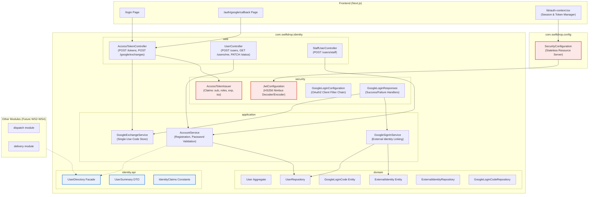
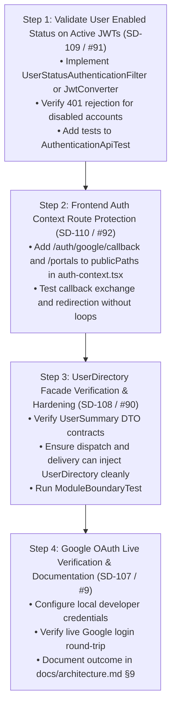

# ACT-13: Identity & Authentication Module Implementation Plan

- **Document ID:** ACT-13
- **Date:** 2026-11-04
- **Audited Branch / Commit:** `fix/complete-identity-module` at `d92d738` (`docs: add act-12a and act-12b github backlog restructuring proposal and execution plan`)
- **Target Epic:** [EPIC-01: Identity & Authentication Completion (#100)](https://github.com/ShenSandaru/SwiftDrop/issues/100)
- **Relevant Issues:** [#9](https://github.com/ShenSandaru/SwiftDrop/issues/9) (`SD-107`), [#90](https://github.com/ShenSandaru/SwiftDrop/issues/90) (`SD-108`), [#91](https://github.com/ShenSandaru/SwiftDrop/issues/91) (`SD-109`), [#92](https://github.com/ShenSandaru/SwiftDrop/issues/92) (`SD-110`)
- **Mode:** Read-Only Audit & Implementation Planning (Zero source code, migration, or GitHub modifications)

---

## 1. Executive Summary

This document establishes the comprehensive implementation plan for completing and stabilizing the **Identity and Authentication subsystem (EPIC-01)** in the SwiftDrop Parcel Delivery and Courier Management System.

As the foundational security and access control module of the platform, Identity governs authentication for all five user roles (`CUSTOMER`, `COURIER`, `MERCHANT`, `DISPATCHER`, `ADMIN`). While local email/password registration, login, JWT token issuance, password hashing (BCrypt), and role-based endpoint security are merged and verified with unit/mock tests, four critical functional and security gaps must be addressed to achieve full production readiness:

1. **Active JWT Disabled-User Validation (`SD-109 / #91`):** Currently, Spring Security validates JWT tokens statelessly via cryptographic signatures and expiry timestamps without checking whether the underlying user account has been deactivated in the database (`SEC-01`).
2. **Frontend OAuth Callback Routing & Context Synchronization (`SD-110 / #92`):** `frontend/lib/auth-context.tsx` omits `/auth/google/callback` and `/portals` from `publicPaths`, risking premature redirection to `/login?expired=true` during Google OAuth handoffs.
3. **Public `UserDirectory` Facade Consumption (`SD-108 / #90`):** While `UserDirectory` exists in `com.swiftdrop.identity.api`, it has zero consumers in other business modules (`dispatch`, `delivery`).
4. **Live Google OAuth Round-Trip Verification & Documentation (`SD-107 / #9`):** The backend OAuth handoff (`ADR 0005`) is merged with mock tests, but live verification against Google's production identity provider with evidence documented in `docs/architecture.md §9` remains unexecuted.

Completing these four targets completes **EPIC-01** and establishes a solid security foundation for subsequent feature development in Dispatch, Merchant, and RabbitMQ messaging.

---

## 2. Current Implementation Status & Feature Classification

Every identity and authentication feature is classified into one of four standardized categories:

| Feature / Capability | Classification | Primary Components & Evidence | Analysis & Current Gap |
|---|:---:|---|---|
| **Local Customer Registration** (`POST /api/v1/users`) | **Implemented and Verified** | [`UserController.java`](file:///d:/Programming/SwiftDrop/SwiftDrop/backend/src/main/java/com/swiftdrop/identity/web/UserController.java), [`AccountService.java`](file:///d:/Programming/SwiftDrop/SwiftDrop/backend/src/main/java/com/swiftdrop/identity/application/AccountService.java), `AuthenticationApiTest` | Enforces `CUSTOMER` role, normalizes email, caps passwords at 72 bytes (BCrypt), returns HTTP 201 without exposing password hashes. |
| **Local Authentication & JWT Issuance** (`POST /api/v1/auth/tokens`) | **Implemented and Verified** | [`AccessTokenController.java`](file:///d:/Programming/SwiftDrop/SwiftDrop/backend/src/main/java/com/swiftdrop/identity/web/AccessTokenController.java), [`AccessTokenIssuer.java`](file:///d:/Programming/SwiftDrop/SwiftDrop/backend/src/main/java/com/swiftdrop/identity/security/AccessTokenIssuer.java), `AuthenticationApiTest` | Generates HS256 JWT tokens valid for 900 seconds (15 minutes). Uses constant-time dummy hash comparison against timing attacks on unknown emails. |
| **Staff Account Creation** (`POST /api/v1/users/staff`) | **Implemented and Verified** | [`StaffUserController.java`](file:///d:/Programming/SwiftDrop/SwiftDrop/backend/src/main/java/com/swiftdrop/identity/web/StaffUserController.java), `AccountService.registerStaff()` | Restricted to `DISPATCHER_ADMIN` role; permits creating `COURIER` or `DISPATCHER_ADMIN` accounts. Tested in `AuthenticationApiTest`. |
| **User Status Updates** (`PATCH /api/v1/users/{id}/status`) | **Implemented and Verified** | `UserController.java`, `AccountService.updateUserStatus()` | Enables or disables accounts. Enforces self-disabling prevention check for administrators. |
| **Active JWT Disabled-User Validation (SEC-01)** | **Not Implemented** | [`SecurityConfiguration.java`](file:///d:/Programming/SwiftDrop/SwiftDrop/backend/src/main/java/com/swiftdrop/config/SecurityConfiguration.java), [`JwtConfiguration.java`](file:///d:/Programming/SwiftDrop/SwiftDrop/backend/src/main/java/com/swiftdrop/identity/security/JwtConfiguration.java) | **Gap:** Stateless `JwtAuthenticationConverter` does not verify `user.isEnabled()` against the database. Disabled users retain API access until token expiration. Issue `#91`. |
| **Public UserDirectory Facade** | **Partially Implemented** | [`UserDirectory.java`](file:///d:/Programming/SwiftDrop/SwiftDrop/backend/src/main/java/com/swiftdrop/identity/api/UserDirectory.java), `AccountService.java` | **Gap:** Interface and implementation exist, but zero external modules consume it. Consuming modules (`dispatch`, `delivery`) must be wired to use this facade. Issue `#90`. |
| **Google OAuth Token Handoff Backend** (`POST /api/v1/auth/google/exchanges`) | **Implemented and Verified (Mocked)** | [`GoogleLoginConfiguration.java`](file:///d:/Programming/SwiftDrop/SwiftDrop/backend/src/main/java/com/swiftdrop/identity/security/GoogleLoginConfiguration.java), [`GoogleExchangeService.java`](file:///d:/Programming/SwiftDrop/SwiftDrop/backend/src/main/java/com/swiftdrop/identity/application/GoogleExchangeService.java), `GoogleLoginApiTest` | Implements ADR 0005 single-use 60s exchange code. Unit and mock tests pass. |
| **Google OAuth Live Provider Verification** | **Requires Investigation (Pending Live Credentials)** | [`GoogleLoginResponses.java`](file:///d:/Programming/SwiftDrop/SwiftDrop/backend/src/main/java/com/swiftdrop/identity/security/GoogleLoginResponses.java), `docs/architecture.md §9` | **Gap:** Requires verification against live Google accounts and formal recording in `docs/architecture.md §9`. Issue `#9`. |
| **Frontend Google OAuth Callback UI** (`/auth/google/callback`) | **Implemented and Verified** | [`frontend/app/auth/google/callback/page.tsx`](file:///d:/Programming/SwiftDrop/SwiftDrop/frontend/app/auth/google/callback/page.tsx) | Implements ADR 0005 parameter extraction, open-redirect sanitization, code exchange call, and error mapping. |
| **Frontend Auth Context & Route Protection** | **Partially Implemented** | [`frontend/lib/auth-context.tsx`](file:///d:/Programming/SwiftDrop/SwiftDrop/frontend/lib/auth-context.tsx) | **Gap:** Missing `/auth/google/callback` and `/portals` in `publicPaths`, causing unintended redirects during OAuth callback flow. Issue `#92`. |
| **Role-based Authorization Matrix** | **Implemented and Verified** | [`IdentityAuthorizationMatrixTest.java`](file:///d:/Programming/SwiftDrop/SwiftDrop/backend/src/test/java/com/swiftdrop/identity/web/IdentityAuthorizationMatrixTest.java), `ParcelAuthorizationMatrixIT` | Comprehensive matrix tests verify access boundaries across all endpoints for CUSTOMER, COURIER, MERCHANT, and ADMIN. |

---

## 3. Existing Components and Responsibilities



### Component Details
1. **`com.swiftdrop.config.SecurityConfiguration`:** Configures the primary stateless Spring Security filter chain. Enables method security (`@EnableMethodSecurity`), sets up CSRF/CORS, and maps bearer token authorities via `jwtAuthenticationConverter()`.
2. **`com.swiftdrop.identity.security.JwtConfiguration`:** Configures `NimbusJwtEncoder` and `NimbusJwtDecoder` with HS256 symmetric signing. Sets claim validators for `sub`, `exp`, `iss`, and `roles`.
3. **`com.swiftdrop.identity.security.GoogleLoginConfiguration`:** Configures high-precedence security filter chain for `/oauth2/authorization/google` and `/login/oauth2/code/google`, activated conditionally when `swiftdrop.security.google.client-id` is configured.
4. **`com.swiftdrop.identity.security.GoogleLoginResponses`:** Implements authentication success/failure handlers. On success, persists user, generates a single-use exchange code via `GoogleExchangeService`, and redirects to frontend `/auth/google/callback?code=...`.
5. **`com.swiftdrop.identity.application.AccountService`:** Manages user registration, BCrypt password hashing, credential verification, and administrative user enabling/disabling. Implements `UserDirectory` facade.

---

## 4. Security Gaps & Vulnerability Analysis

### Gap 1: Stale JWT Token Validation for Disabled Users (SEC-01 / #91)
- **Vulnerability:** Spring Security's OAuth2 Resource Server validates JWTs statelessly:
  ```java
  // Current JwtConfiguration.java
  decoder.setJwtValidator(new DelegatingOAuth2TokenValidator<>(
      JwtValidators.createDefaultWithIssuer(properties.issuer()),
      new JwtClaimValidator<String>(JwtClaimNames.SUB, sub -> sub != null && !sub.isBlank()),
      new JwtClaimValidator<Object>(JwtClaimNames.EXP, exp -> exp != null),
      new JwtClaimValidator<Object>(IdentityClaims.ROLES, roles -> roles != null)));
  ```
  When an administrator disables a user account via `PATCH /api/v1/users/{id}/status`, any unexpired JWT previously issued to that user continues to authenticate successfully on protected endpoints until the 15-minute token expires.
- **Risk Level:** **High**. A rogue courier or compromised merchant disabled by admin can continue mutating orders or accessing parcel details.
- **Remediation:** Introduce a custom `Converter<Jwt, ? extends AbstractAuthenticationToken>` or custom authentication filter that verifies the user ID (`sub`) is active and enabled via `UserRepository` or a lightweight caffeine/redis cache.

### Gap 2: Frontend Google OAuth Callback Routing Defect (P0-06 / #92)
- **Vulnerability:** In `frontend/lib/auth-context.tsx`:
  ```typescript
  const publicPaths = ["/login", "/signup", "/track", "/"];
  const currentPath = window.location.pathname;
  const isPublic = publicPaths.includes(currentPath) || currentPath.startsWith("/track");
  if (!isPublic) {
    const targetUrl = new URL(`/login?expired=true&redirect=${encodeURIComponent(currentPath)}`, window.location.origin).href;
    window.location.assign(targetUrl);
  }
  ```
  Because `/auth/google/callback` is missing from `publicPaths`, if the user arrives unauthenticated and the initial `api.get('/api/v1/users/me')` fails or an unexpected 401 occurs, the user is redirected to `/login?expired=true` before the callback page can execute `exchangeCode()`.
- **Risk Level:** **Medium**. Prevents Google OAuth users from completing login.
- **Remediation:** Add `/auth/google/callback` and `/portals` to `publicPaths` in `auth-context.tsx`.

### Gap 3: Open Redirect Sanitization in Google Login Flow
- **Analysis:** `frontend/app/auth/google/callback/page.tsx` contains robust validation in `sanitizeRedirectTarget()`:
  - Rejects external origins, protocol-relative URLs (`//`), and backslash tricks (`/\`).
  - Rejects control characters.
  - Falls back safely to `/customer`.
- **Status:** Verified secure; ADR 0005 open-redirect protections are properly observed.

### Gap 4: Password Handling & Information Disclosure
- **Analysis:**
  - Passwords are encrypted with BCrypt (via `DelegatingPasswordEncoder`).
  - Passwords are never returned in `UserResponse` DTOs (annotated with `@JsonIgnore` or omitted).
  - Passwords exceeding 72 bytes are rejected prior to BCrypt invocation to prevent denial-of-service.
  - Constant-time dummy hash comparison is executed when an email is not found, mitigating timing enumeration attacks.
- **Status:** Verified secure.

---

## 5. Relevant Codebase Files & Artifacts

### Backend Files
- **Configuration & Security:**
  - [`backend/src/main/java/com/swiftdrop/config/SecurityConfiguration.java`](file:///d:/Programming/SwiftDrop/SwiftDrop/backend/src/main/java/com/swiftdrop/config/SecurityConfiguration.java)
  - [`backend/src/main/java/com/swiftdrop/identity/security/JwtConfiguration.java`](file:///d:/Programming/SwiftDrop/SwiftDrop/backend/src/main/java/com/swiftdrop/identity/security/JwtConfiguration.java)
  - [`backend/src/main/java/com/swiftdrop/identity/security/JwtProperties.java`](file:///d:/Programming/SwiftDrop/SwiftDrop/backend/src/main/java/com/swiftdrop/identity/security/JwtProperties.java)
  - [`backend/src/main/java/com/swiftdrop/identity/security/AccessTokenIssuer.java`](file:///d:/Programming/SwiftDrop/SwiftDrop/backend/src/main/java/com/swiftdrop/identity/security/AccessTokenIssuer.java)
  - [`backend/src/main/java/com/swiftdrop/identity/security/GoogleLoginConfiguration.java`](file:///d:/Programming/SwiftDrop/SwiftDrop/backend/src/main/java/com/swiftdrop/identity/security/GoogleLoginConfiguration.java)
  - [`backend/src/main/java/com/swiftdrop/identity/security/GoogleLoginResponses.java`](file:///d:/Programming/SwiftDrop/SwiftDrop/backend/src/main/java/com/swiftdrop/identity/security/GoogleLoginResponses.java)
- **Public API:**
  - [`backend/src/main/java/com/swiftdrop/identity/api/UserDirectory.java`](file:///d:/Programming/SwiftDrop/SwiftDrop/backend/src/main/java/com/swiftdrop/identity/api/UserDirectory.java)
  - [`backend/src/main/java/com/swiftdrop/identity/api/UserSummary.java`](file:///d:/Programming/SwiftDrop/SwiftDrop/backend/src/main/java/com/swiftdrop/identity/api/UserSummary.java)
  - [`backend/src/main/java/com/swiftdrop/identity/api/IdentityClaims.java`](file:///d:/Programming/SwiftDrop/SwiftDrop/backend/src/main/java/com/swiftdrop/identity/api/IdentityClaims.java)
- **Application & Domain Services:**
  - [`backend/src/main/java/com/swiftdrop/identity/application/AccountService.java`](file:///d:/Programming/SwiftDrop/SwiftDrop/backend/src/main/java/com/swiftdrop/identity/application/AccountService.java)
  - [`backend/src/main/java/com/swiftdrop/identity/application/GoogleSignInService.java`](file:///d:/Programming/SwiftDrop/SwiftDrop/backend/src/main/java/com/swiftdrop/identity/application/GoogleSignInService.java)
  - [`backend/src/main/java/com/swiftdrop/identity/application/GoogleExchangeService.java`](file:///d:/Programming/SwiftDrop/SwiftDrop/backend/src/main/java/com/swiftdrop/identity/application/GoogleExchangeService.java)
  - [`backend/src/main/java/com/swiftdrop/identity/domain/User.java`](file:///d:/Programming/SwiftDrop/SwiftDrop/backend/src/main/java/com/swiftdrop/identity/domain/User.java)
  - [`backend/src/main/java/com/swiftdrop/identity/domain/UserRepository.java`](file:///d:/Programming/SwiftDrop/SwiftDrop/backend/src/main/java/com/swiftdrop/identity/domain/UserRepository.java)
  - [`backend/src/main/java/com/swiftdrop/identity/domain/ExternalIdentity.java`](file:///d:/Programming/SwiftDrop/SwiftDrop/backend/src/main/java/com/swiftdrop/identity/domain/ExternalIdentity.java)
- **REST Web Controllers:**
  - [`backend/src/main/java/com/swiftdrop/identity/web/UserController.java`](file:///d:/Programming/SwiftDrop/SwiftDrop/backend/src/main/java/com/swiftdrop/identity/web/UserController.java)
  - [`backend/src/main/java/com/swiftdrop/identity/web/AccessTokenController.java`](file:///d:/Programming/SwiftDrop/SwiftDrop/backend/src/main/java/com/swiftdrop/identity/web/AccessTokenController.java)
  - [`backend/src/main/java/com/swiftdrop/identity/web/StaffUserController.java`](file:///d:/Programming/SwiftDrop/SwiftDrop/backend/src/main/java/com/swiftdrop/identity/web/StaffUserController.java)
- **Database Migrations:**
  - `backend/src/main/resources/db/migration/V202610261100__create_identity_schema.sql`
  - `backend/src/main/resources/db/migration/V202610261200__create_google_login_codes_schema.sql`

### Frontend Files
- **Context & API:**
  - [`frontend/lib/auth-context.tsx`](file:///d:/Programming/SwiftDrop/SwiftDrop/frontend/lib/auth-context.tsx)
  - [`frontend/lib/api.ts`](file:///d:/Programming/SwiftDrop/SwiftDrop/frontend/lib/api.ts)
- **Pages & Components:**
  - [`frontend/app/auth/google/callback/page.tsx`](file:///d:/Programming/SwiftDrop/SwiftDrop/frontend/app/auth/google/callback/page.tsx)
  - [`frontend/app/login/page.tsx`](file:///d:/Programming/SwiftDrop/SwiftDrop/frontend/app/login/page.tsx)
  - [`frontend/app/signup/page.tsx`](file:///d:/Programming/SwiftDrop/SwiftDrop/frontend/app/signup/page.tsx)
  - [`frontend/app/portals/page.tsx`](file:///d:/Programming/SwiftDrop/SwiftDrop/frontend/app/portals/page.tsx)

---

## 6. Test Suite Inventory & Missing Tests

### Existing Tests
1. **`com.swiftdrop.config.AuthenticationApiTest` (Unit/MockMvc):** Tests registration, BCrypt password hashing, invalid credentials, JWT expiry/forgery/malformed tokens, role-based endpoint authorization (`Role.DISPATCHER_ADMIN`), and staff user creation.
2. **`com.swiftdrop.identity.web.IdentityAuthorizationMatrixTest` (Unit/MockMvc):** Tests multi-role access matrix across `/api/v1/users`, `/api/v1/users/me`, and `/api/v1/users/staff`.
3. **`com.swiftdrop.identity.application.AccountServiceTest`:** Unit tests registration, duplicate email rejection, and password length checks.
4. **`com.swiftdrop.identity.application.GoogleSignInServiceTest`:** Tests Google identity linking, email collision rejection, and new account provisioning.
5. **`com.swiftdrop.identity.application.GoogleExchangeServiceTest`:** Tests single-use code creation, expiration, and exchange validation.
6. **`com.swiftdrop.identity.security.GoogleLoginApiTest`:** Mock OAuth client test verifying redirect URLs and allowlisted error parameters.
7. **`com.swiftdrop.ModuleBoundaryTest`:** Verifies architecture rules: `identity` has zero dependencies; other modules access identity strictly via `identity.api`.

### Missing Tests Required for EPIC-01
1. **Disabled User Active JWT Rejection Test (`SD-109 / #91`):**
   - Test issuing a valid JWT for an active user.
   - Deactivating the user via `AccountService.updateUserStatus(userId, false, adminId)`.
   - Executing a request to a protected endpoint (`GET /api/v1/users/me` or `/api/v1/parcels`) with the pre-issued valid token.
   - Asserting that the request is rejected with `HTTP 401 Unauthorized` and RFC 9457 Problem Details.
2. **`UserDirectory` Cross-Module Integration Tests (`SD-108 / #90`):**
   - Test querying `UserDirectory.findUser(UUID)` and asserting return of immutable `UserSummary`.
   - Test creating a merchant user via `UserDirectory.createMerchantUser(...)` and validating assigned `Role.MERCHANT`.
   - Test verifying that module boundary tests pass when consuming modules inject `UserDirectory`.
3. **Frontend Auth Context Route Protection Tests (`SD-110 / #92`):**
   - Unit test for `auth-context.tsx` confirming that navigation to `/auth/google/callback` and `/portals` does not trigger unauthorized redirection to `/login`.
4. **Google OAuth Conflict & Collision Paths (`SD-107 / #9`):**
   - Verification of the email collision path (local user exists with email -> Google sign-in attempts with same email -> returns 409 Conflict / `conflict_email_exists` error redirect).

---

## 7. GitHub Issue Mapping (EPIC-01)

| GitHub Issue # | Title | Priority | Workstream Owner | Scope & Deliverables |
|:---:|---|:---:|:---:|---|
| **[#9](https://github.com/ShenSandaru/SwiftDrop/issues/9)** | SD-107: Perform and document real Google OAuth round-trip verification | **P1** | **WS1** | Execute real Google OAuth login with developer credentials in local `.env`; test initial sign-in, repeat sign-in, and conflict handling; record results in `docs/architecture.md §9`. |
| **[#90](https://github.com/ShenSandaru/SwiftDrop/issues/90)** | SD-108: UserDirectory Facade Integration across Consuming Business Modules | **P0** | **WS1** (with WS2, WS3) | Ensure `UserDirectory` provides necessary query methods (`findUser`, `createMerchantUser`); write consuming contracts for `dispatch` and `delivery`. |
| **[#91](https://github.com/ShenSandaru/SwiftDrop/issues/91)** | SD-109: Validate User Enabled Status on Active JWT Requests (SEC-01) | **P0** | **WS1** | Add user enabled check to Spring Security resource server pipeline; reject disabled accounts with 401; add integration test in `AuthenticationApiTest`. |
| **[#92](https://github.com/ShenSandaru/SwiftDrop/issues/92)** | SD-110: Frontend Google OAuth Callback Routing and Context Synchronization | **P0** | **WS1** (Frontend) | Add `/auth/google/callback` and `/portals` to `publicPaths` in `auth-context.tsx`; test token synchronization and redirection to dashboard. |
| **[#100](https://github.com/ShenSandaru/SwiftDrop/issues/100)** | **EPIC-01: Identity & Authentication Completion** | **P0** | **WS1 Lead** | Parent epic tracking completion of `#9`, `#90`, `#91`, `#92`. |

---

## 8. Recommended Implementation Sequence

To minimize risk and establish security guarantees before cross-module integrations begin, the following phased sequence is recommended:



### Detailed Execution Steps

#### Phase 1: Security Hardening — Active JWT Account Status Check (`SD-109 / #91`)
- **Action:** Update Spring Security's bearer token processing.
  - Option A: Customize `JwtAuthenticationConverter` to look up the `User` by `UUID.fromString(jwt.getSubject())` using `UserRepository` or `AccountService`. If `!user.isEnabled()`, throw `OAuth2AuthenticationException(new OAuth2Error("account_disabled", "User account is disabled", null))`.
  - Option B: Introduce an `OncePerRequestFilter` registered after `BearerTokenAuthenticationFilter` that checks `authentication.getName()`, fetches user status, and writes RFC 9457 `401 Unauthorized` response if disabled.
- **Verification:** Execute `mvn test -Dtest=AuthenticationApiTest` with new test scenario `disabledUserWithValidTokenCannotAccessProtectedEndpoints()`.

#### Phase 2: Frontend Route Protection & Callback Fix (`SD-110 / #92`)
- **Action:** Edit `frontend/lib/auth-context.tsx`.
  - Update `publicPaths`:
    ```typescript
    const publicPaths = ["/login", "/signup", "/track", "/", "/auth/google/callback", "/portals"];
    ```
- **Verification:** Run `npm run build` and `npm run lint` in `frontend/`. Verify manual or mocked callback exchange transition.

#### Phase 3: Public `UserDirectory` Facade Preparation (`SD-108 / #90`)
- **Action:** Inspect `com.swiftdrop.identity.api.UserDirectory`.
  - Ensure `findUser(UUID)` returns `UserSummary` with: `id`, `fullName`, `email`, `roles`, `enabled`.
  - Confirm that `createMerchantUser(String fullName, String email, String rawPassword)` creates the user with role `MERCHANT`.
  - Write an integration test in `AccountServiceTest` verifying `UserDirectory` methods.
  - Ensure `mvn test -Dtest=ModuleBoundaryTest` continues to pass.

#### Phase 4: Google OAuth Live Verification & Documentation (`SD-107 / #9`)
- **Action:**
  - Using team Google OAuth Client ID & Secret configured strictly in local `.env` (never committed):
    1. Start backend with `./mvnw spring-boot:run`.
    2. Start frontend with `npm run dev`.
    3. Navigate to `http://localhost:3000/login` -> click "Sign in with Google".
    4. Authenticate on Google consent screen.
    5. Verify redirect to `/auth/google/callback?code=...` -> exchange code for SwiftDrop JWT -> land on `/customer`.
    6. Verify database records in `users` and `external_identities`.
    7. Record date and verification details in `docs/architecture.md §9`.

---

## 9. Dependencies and Risks

| Risk / Dependency | Impact | Mitigation Strategy |
|---|---|---|
| **Database lookup overhead on every JWT request (SD-109)** | Adding a database hit to `UserRepository` on every authenticated request could reduce throughput if unoptimized. | Query by primary key (`findById`), or use Spring Cache (`@Cacheable`) with a 30-second TTL invalidated on `updateUserStatus()`. |
| **Missing Google OAuth Credentials in CI/CD (SD-107)** | Live Google provider cannot be called in automated GitHub Actions without exposing secrets. | Automated CI relies on `GoogleLoginApiTest` and `GoogleExchangeApiTest` with Mockito and WireMock. Live verification is a documented development activity. |
| **Module Boundary Violation on Cross-Module Calls (SD-108)** | Other modules might mistakenly import internal identity classes. | Enforce `ModuleBoundaryTest` in Maven verify phase; ensure consuming services import only `com.swiftdrop.identity.api.*`. |
| **Clock Skew during OAuth Code Exchange** | 60-second exchange code expiry could fail if client and server clocks diverge. | `GoogleExchangeService` uses server-side `Instant.now()`; exchange code is requested immediately by frontend client. |

---

## 10. Definition of Done for Identity Module (EPIC-01)

EPIC-01 shall be considered **DONE** when all of the following criteria are satisfied:

1. **Active JWT Disabled-User Rejection (`SD-109 / #91`):**
   - Deactivating a user account immediately causes subsequent API requests using pre-existing unexpired JWTs to fail with `401 Unauthorized` and RFC 9457 Problem Details.
   - Verified by automated unit and integration tests.
2. **Frontend OAuth Callback Reliability (`SD-110 / #92`):**
   - Navigating to `/auth/google/callback` with an exchange code or error parameter executes without redirection loops to `/login`.
   - `auth-context.tsx` recognizes `/auth/google/callback` and `/portals` as public paths.
3. **UserDirectory Consumption Readiness (`SD-108 / #90`):**
   - `UserDirectory` facade methods are verified and ready for dependency injection into `dispatch` and `delivery`.
   - `ModuleBoundaryTest` passes with zero violations.
4. **Google OAuth Live Round-Trip Verification (`SD-107 / #9`):**
   - Live Google OAuth round-trip tested and verified against Google's production IDP.
   - Outcome and date recorded in `docs/architecture.md §9`.
5. **Quality & Test Coverage:**
   - All tests in `com.swiftdrop.identity.*` and `com.swiftdrop.config.AuthenticationApiTest` pass.
   - JaCoCo code coverage for the `identity` module meets or exceeds the project threshold.
   - Frontend build (`npm run build`) and lint (`npm run lint`) pass cleanly.

---

*Report prepared strictly under read-only audit conditions. No application source code, migrations, or GitHub issues were modified.*

