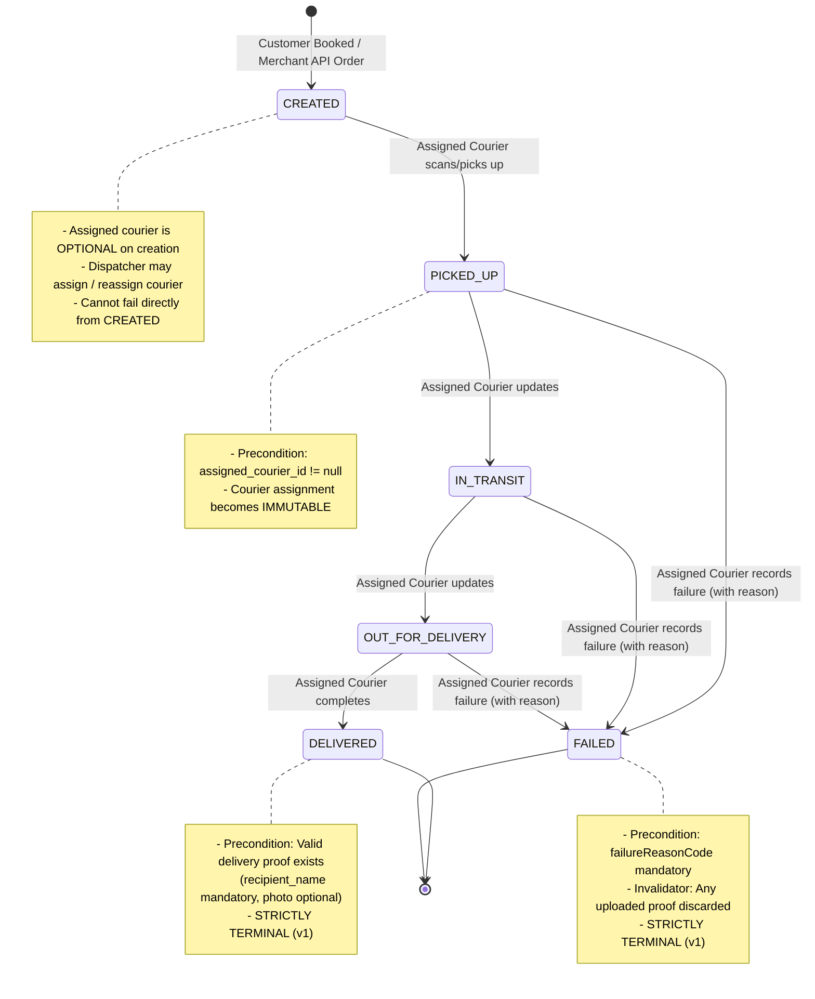
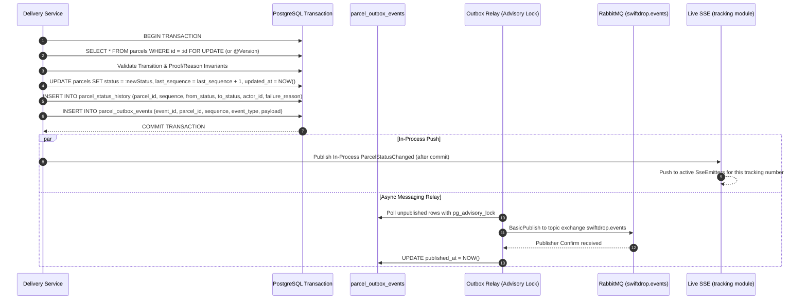

# ADR 0006 — Delivery Lifecycle and Transition Rules: Team Review Record

> **Document Status:** Formally Reviewed and Approved  
> **Target Decision:** [docs/adr/0006-delivery-lifecycle-and-transition-rules.md](../adr/0006-delivery-lifecycle-and-transition-rules.md)  
> **Current ADR Status:** `Accepted` (Approved: 2026-11-01)  
> **Facilitator / Author:** Member 3 (Delivery Module Owner) & System Architect  
> **Target Audience:** All 10 SwiftDrop Engineering Team Members  

---

## Final Review Outcome

- **Decision:** Approved without changes.
- **ADR:** ADR 0006 — Delivery Lifecycle and Transition Rules.
- **Approval Date:** 2026-11-01.
- **Outcome:** The team accepted the proposed delivery lifecycle and its associated transition, proof, failure, authorization, and transactional consistency rules without requesting modifications. ADR 0006 status updated to `Accepted`.

---

## 1. Purpose of the Decision

[ADR 0003](../adr/0003-backend-modules-and-boundaries.md) established the modular monolith architecture and designated the `delivery` module as the sole owner of parcel state, lifecycle transitions, and status history. It defined the high-level sequential progression from the university project requirements:
$$\text{CREATED} \longrightarrow \text{PICKED\_UP} \longrightarrow \text{IN\_TRANSIT} \longrightarrow \text{OUT\_FOR\_DELIVERY} \longrightarrow \text{DELIVERED / FAILED}$$

However, ADR 0003 intentionally left operational lifecycle rules open. Parallel development across the team (specifically Customer Booking WS2, Delivery WS3, Dispatch WS7, Courier WS6, Merchant WS4/WS5, Notifications WS9, and Tracking WS10) cannot safely proceed without explicit, binding rules on:

1. **State progression:** Which status transitions are legal, which steps can be skipped (if any), and whether terminal parcels can be reopened or cancelled.
2. **Assignment boundaries:** When couriers may be assigned or reassigned, and who is authorized to do so.
3. **Delivery completion criteria:** Preconditions for reaching `DELIVERED`, specifically delivery proof (recipient name and optional photo).
4. **Failure handling:** Permitted stages for `FAILED`, standard reason codes (D-19), and proof invalidation.
5. **Security and privacy:** Uniform HTTP error mappings (RFC 9457) and preventing enumeration attacks via `404 Not Found` vs `403 Forbidden`.
6. **Transactional reliability:** Consistency guarantees between database state updates, history appending, and transactional outbox event publishing as mandated by [ADR 0004](../adr/0004-messaging-and-integration-reliability.md).

---

## 2. Current Proposed Lifecycle

The lifecycle forms a deterministic, forward-progressing directed acyclic graph (DAG) where terminal states cannot transition to any other status.

### Lifecycle Classification
- **Existing Requirement:** Status progression sequence (`CREATED` through `DELIVERED`/`FAILED`), courier updates with notes/proof, and failure reasons (SYS-4, CUS-4, COU-3, COU-4).
- **Proposed Interpretation (ADR 0006):** Step skipping is prohibited; `FAILED` is allowed only from `PICKED_UP`, `IN_TRANSIT`, or `OUT_FOR_DELIVERY`; `DELIVERED` and `FAILED` are strictly terminal.
- **Unresolved Question for Team:** Should cancellation from `CREATED` be added now or deferred post-v1? (ADR 0006 recommends deferring to avoid multi-module cancellation cascades).

---

## 3. Transition Rules & Preconditions

Every status change is validated by the `delivery` domain engine prior to committing.

| Source Status | Target Status | Authorized Actor | Preconditions & Validation Invariants | Published Outbox Event |
|---|---|---|---|---|
| `[*] (None)` | `CREATED` | Authenticated Customer or Approved Merchant API | Valid pickup/dropoff zones, parcel size, weight (1–30,000 g), fee quote snapshot. Initial sequence = 1. | `parcel.status-changed` (seq 1) |
| `CREATED` | `PICKED_UP` | Assigned Courier only | Courier must be assigned (`assigned_courier_id != null`). Pre-assignment status change rejected with `409 Conflict`. | `parcel.status-changed` |
| `PICKED_UP` | `IN_TRANSIT` | Assigned Courier only | Strictly sequential. | `parcel.status-changed` |
| `PICKED_UP` | `FAILED` | Assigned Courier only | Mandatory `failureReasonCode` from approved enum. | `parcel.status-changed` |
| `IN_TRANSIT` | `OUT_FOR_DELIVERY` | Assigned Courier only | Strictly sequential. | `parcel.status-changed` |
| `IN_TRANSIT` | `FAILED` | Assigned Courier only | Mandatory `failureReasonCode` from approved enum. | `parcel.status-changed` |
| `OUT_FOR_DELIVERY` | `DELIVERED` | Assigned Courier only | Existing `delivery_proofs` record with non-blank `recipient_name` verified in the same transaction. Missing proof rejected with `409 Conflict`. | `parcel.status-changed` |
| `OUT_FOR_DELIVERY` | `FAILED` | Assigned Courier only | Mandatory `failureReasonCode` from approved enum. Prior uploaded proof is marked invalidated/incomplete. | `parcel.status-changed` |
| `DELIVERED` | Any | None | Terminal state. Any update request rejected with `409 Conflict`. | None |
| `FAILED` | Any | None | Terminal state. Any update request rejected with `409 Conflict`. | None |

### Key Rule Clarifications
1. **Courier Assignment vs Status:** Courier assignment is a database column (`assigned_courier_id`), **not** a parcel status. Assigning a courier does not change the status from `CREATED` and does not emit a `parcel.status-changed` event.
2. **Assignment Immutability:** Once a parcel advances to `PICKED_UP`, its `assigned_courier_id` is locked and immutable. Reassignment is rejected with `409 Conflict`.
3. **Reassignment Window:** Only parcels in `CREATED` status may have their `assigned_courier_id` modified or reassigned by a Dispatcher/Admin.

---

## 4. Role-Based Authorization & Ownership Matrix

SwiftDrop enforces backend authorization at two levels: **Role-Based Access Control (RBAC)** and **Resource Ownership**.

| Endpoint / Operation | CUSTOMER | MERCHANT | COURIER | DISPATCHER_ADMIN | ANONYMOUS (Public) |
|---|---|---|---|---|---|
| `POST /api/v1/parcels` (Customer Booking) | Allowed (Owner = caller) | 403 Forbidden | 403 Forbidden | 403 Forbidden | 401 Unauthorized |
| `POST /api/v1/merchant-orders` (API Key) | 401 Unauthorized | Allowed (Approved only, Owner = merchant) | 401 Unauthorized | 401 Unauthorized | 401 Unauthorized |
| `POST /api/v1/parcel-assignments` | 403 Forbidden | 403 Forbidden | 403 Forbidden | Allowed (Calls `delivery.api.ParcelAssignment`) | 401 Unauthorized |
| `POST /api/v1/parcels/{id}/status-changes` | 403 Forbidden | 403 Forbidden | Allowed **only if currently assigned**; otherwise **404 Not Found** | 403 Forbidden (no manual overrides in v1) | 401 Unauthorized |
| `PUT /api/v1/parcels/{id}/proof` | 403 Forbidden | 403 Forbidden | Allowed **only if currently assigned**; otherwise **404 Not Found** | 403 Forbidden | 401 Unauthorized |
| `GET /api/v1/parcels/{id}/proof/photo` | Allowed if Owner | 403 Forbidden | Allowed if Assigned | Allowed | 401 Unauthorized |
| `GET /api/v1/parcels` (Listing / History) | Own parcels only (filtered by `customer_id`) | Own parcels only via dashboard (`merchant_id`) | 403 Forbidden (use courier endpoint) | All parcels (supports status/date filters) | 401 Unauthorized |
| `GET /api/v1/courier/parcels` (Daily deliveries) | 403 Forbidden | 403 Forbidden | Assigned deliveries for the business day | 403 Forbidden | 401 Unauthorized |
| `GET /api/v1/parcels/{id}` (Detail) | Allowed if Owner; else **404** | Allowed if Owner; else **404** | Allowed if Assigned; else **404** | Allowed | 401 Unauthorized |
| `GET /api/v1/parcels/{id}/receipt` | Allowed if Owner; else **404** | 403 Forbidden | 403 Forbidden | Allowed | 401 Unauthorized |
| `GET /api/v1/tracked-parcels/{trackingNumber}` | Public Sanitized View | Public Sanitized View | Public Sanitized View | Public Sanitized View | Public Sanitized View (No PII) |

### Authorization & Privacy Principles
- **Resource Existence Protection:** When an authenticated customer attempts to access a parcel they do not own, or when Courier A attempts to access a parcel assigned to Courier B, the API returns **`404 Not Found`** rather than `403 Forbidden`. This prevents attackers or curious couriers from enumerating valid tracking numbers or probing assignments.
- **Role Boundary:** Dispatchers/Admins cannot advance parcel delivery statuses directly. Couriers cannot reassign deliveries. Customers cannot alter delivery fees.

---

## 5. Proof-of-Delivery Requirements (D-12)

### A. The Two-Step Submission Workflow
To keep REST endpoints clean, uniform, and compatible with standard JSON payloads, delivery completion utilizes a two-step workflow:

1. **Step 1 — Capture Proof (`PUT /api/v1/parcels/{id}/proof`):**
   - Caller: Assigned Courier while parcel is in `OUT_FOR_DELIVERY`.
   - Content: Multipart form with `recipient_name` (mandatory text) and `photo` (optional binary image).
   - Validation: Photo $\le 2\text{ MB}$, MIME type validated via magic byte sniffing (`image/jpeg`, `image/png`).
   - Persistence: Saved to `delivery_proofs` table associated with `parcel_id`.
2. **Step 2 — Status Advance (`POST /api/v1/parcels/{id}/status-changes`):**
   - Payload: `{"toStatus": "DELIVERED", "note": "Delivered to recipient in person"}`.
   - Atomic Check: In the same database transaction that updates the status, the engine verifies that a record in `delivery_proofs` exists for this parcel with a non-blank recipient name.
   - If missing: Rejects with `409 Conflict` (`"Missing required delivery proof before completion"`).

### B. Proof Data Protection
- Recipient name and photo are operational Personally Identifiable Information (PII).
- **Event Decoupling:** Proof data is **never** included in `parcel.status-changed` events, RabbitMQ payloads, webhook payloads, or public tracking pages.
- Access to proof photos is restricted to the owning customer, assigned courier, and dispatchers/admins via authenticated endpoints.

---

## 6. Failed Delivery Handling (D-19)

### A. Allowed Stages for Failure
A delivery attempt can fail only after physical custody has been transferred to the courier:
- Allowed from: `PICKED_UP`, `IN_TRANSIT`, `OUT_FOR_DELIVERY`.
- Disallowed from: `CREATED`. A parcel that has not yet left the sender cannot fail delivery. If a pickup cannot occur, it must be cancelled or reassigned (see Section 10).

### B. Standard Failure Reason Codes
When `toStatus="FAILED"`, a `failureReasonCode` is mandatory and validated against `com.swiftdrop.delivery.api.FailureReason`:
- `RECIPIENT_UNAVAILABLE`: Recipient was not at the delivery address.
- `ADDRESS_NOT_FOUND`: Address could not be located or does not exist.
- `REFUSED`: Recipient refused to accept the package.
- `DAMAGED`: Package was damaged during transit and cannot be delivered.
- `OTHER`: Unforeseen operational impediment.

### C. Proof Invalidation on Failure
If a courier uploaded proof during `OUT_FOR_DELIVERY` (e.g. prepared handover), but the recipient subsequently refuses or an impediment arises causing transition to `FAILED`:
- The proof record cannot be used to justify delivery completion.
- The proof status is invalidated or flagged as uncompleted attempt.
- The parcel terminates permanently as `FAILED`.

### D. No Automated Retries in v1
- In v1, `FAILED` is strictly terminal.
- Re-attempting delivery or rescheduling requires creating a new parcel request with a new tracking number. This avoids complex outbox retry state machines across consumer queues.

---

## 7. Database & Event Consistency Implications (ADR 0004 Alignment)

Status transitions are the single source of truth for the entire asynchronous messaging architecture. Consistency is strictly maintained using the **Transactional Outbox Pattern**:

### Invariants Guaranteed
1. **Atomicity:** The `Parcel` row update, `parcel_status_history` row, and `parcel_outbox_events` row commit in the exact same relational database transaction. A database rollback rolls back history and events.
2. **Strict Monotonic Sequence:** Each parcel maintains a `last_sequence` counter starting at 1 (`CREATED`). Every subsequent status change increments this by exactly 1 ($2, 3, \dots$). Gaps or duplicates are impossible.
3. **Outbox Ordering:** The outbox relay delivers events in sequence order per parcel. Downstream consumers (`notification`, `merchant`) use the sequence number to detect gaps, reconcile out-of-order deliveries, and deduplicate replays.
4. **Optimistic Locking:** Aggregate concurrency collisions are prevented via `@Version BIGINT version` on `parcels`. Two couriers or race conditions will fail fast with `409 Conflict`.

---

## 8. API & Error-Handling Implications

Endpoints strictly follow RFC 9457 `application/problem+json` via `com.swiftdrop.shared.web.GlobalExceptionHandler`:

| HTTP Status | Trigger Condition | Example Detail Message |
|---|---|---|
| **`400 Bad Request`** | Malformed JSON body; invalid enum value; missing mandatory field; validation failure. | `"Invalid request: failureReasonCode is mandatory for FAILED status"` |
| **`401 Unauthorized`** | Missing, expired, or malformed Bearer JWT token. | `"Full authentication is required to access this resource"` |
| **`404 Not Found`** | Parcel ID does not exist; **or** parcel is not owned by the requesting customer/merchant; **or** parcel is not assigned to the calling courier. | `"Parcel not found"` (never reveals ownership existence) |
| **`409 Conflict`** | Illegal status transition; courier not assigned on `PICKED_UP`; missing delivery proof on `DELIVERED`; reassignment after `CREATED`; `@Version` concurrency collision. | `"Illegal status transition: cannot transition from CREATED to DELIVERED"` |

---

## 9. Related GitHub Issues & Dependencies

Accepting ADR 0006 directly affects 14 planned development issues:

| Issue ID | Issue Title | Owner | Impact of ADR 0006 Acceptance |
|---|---|---|---|
| **SD-204** | Implement Parcel aggregate, schema, and repositories | Member 3 | **UNBLOCKED.** Establishes `parcels` table, status history table, and optimistic lock column. |
| **SD-206** | Customer parcel booking REST endpoint | Member 2 | **UNBLOCKED.** Establishes initial status `CREATED`, sequence 1, and owner linkage. |
| **SD-207** | Customer delivery history and detail | Member 2 | **UNBLOCKED.** Clarifies timeline progression and 404 ownership isolation. |
| **SD-208** | Delivery receipt endpoint | Member 2 | **UNBLOCKED.** Clarifies receipt data availability before vs after delivery. |
| **SD-301** | Status state machine and history transitions | Member 3 | **UNBLOCKED.** Core implementation of the transition matrix and invariant checks. |
| **SD-302** | `delivery.api` query and assignment contracts | Member 3 | **UNBLOCKED.** Implements `ParcelAssignment.assign` with status `CREATED` constraint. |
| **SD-303** | Transactional outbox recording for status events | Member 3 | **UNBLOCKED.** Wires outbox event generation with state changes. |
| **SD-304** | Public parcel tracking lookup REST endpoint | Member 3 | **UNBLOCKED.** Implements tracking lookup with PII stripping. |
| **SD-306** | Unassigned parcel listing and courier assignment | Member 7 | **UNBLOCKED.** Integrates dispatch assignment workflow. |
| **SD-309** | Courier daily deliveries list endpoint | Member 6 | **UNBLOCKED.** Returns assigned parcels for today. |
| **SD-310** | Courier status transition endpoint with notes | Member 6 | **UNBLOCKED.** Implements courier status advance with 404/409 error rules. |
| **SD-311** | Proof of delivery capture and photo attachment | Member 6 | **UNBLOCKED.** Implements `delivery_proofs` multipart upload and validation. |
| **SD-312** | Standardized failure reason recording | Member 6 | **UNBLOCKED.** Validates failure codes during transition to `FAILED`. |
| **SD-316** | Parcel ownership and authorization test suite | Member 6 | **UNBLOCKED.** Implements table-driven TST-2 authorization matrix. |

---

## 10. Unresolved Questions Requiring Team Decisions

During this review, the team must explicitly discuss and reach consensus on four items:

### Question 1: Customer & Merchant Cancellations in v1
- **Context:** Currently, ADR 0006 omits a `CANCELLED` status. A customer who books a parcel cannot cancel it, even while it remains in `CREATED`.
- **Options:**
  - **Option A (Recommended by ADR 0006):** Defer cancellation to post-v1. Eliminates complex cancellation outbox events, compensation logic in dispatch, and refund workflows.
  - **Option B:** Add a `CANCELLED` transition allowed **only** from `CREATED` by the owning customer/merchant.
- **Decision to Record:** Keep Option A (deferred) or adopt Option B?

### Question 2: Dispatcher / Administrator Status Overrides
- **Context:** In real-world courier systems, administrators sometimes manually fix erroneous transitions (e.g. courier accidentally pressed `FAILED`).
- **Options:**
  - **Option A (ADR 0006 proposal):** Strictly forbid admin overrides in v1. `DELIVERED` and `FAILED` remain final. Erroneous parcels must be re-booked.
  - **Option B:** Allow administrators to force transitions or reopen failed parcels. (Risk: disrupts consumer sequence ordering and event stream determinism).
- **Decision to Record:** Confirm Option A (Strictly no overrides).

### Question 3: Handling Proof on Subsequent Failure
- **Context:** If proof is uploaded during `OUT_FOR_DELIVERY`, but the handover fails and the parcel is marked `FAILED`, what happens to the uploaded photo?
- **Options:**
  - **Option A:** Delete the row in `delivery_proofs`.
  - **Option B (ADR 0006 proposal):** Retain the row in `delivery_proofs`, but the parcel status `FAILED` permanently negates it; queries for proof on failed parcels return `404 Not Found` or flag it as uncompleted.
- **Decision to Record:** Confirm Option B.

### Question 4: Tracking Number Collision Retries (D-05)
- **Context:** The tracking number generator (SD-205) uses `SD` + 10 random Crockford base32 characters.
- **Rule:** Bound collision retries to a maximum of 3 attempts before throwing a 500 error, relying on the database unique constraint `uq_parcels_tracking_number`.
- **Decision to Record:** Approve bounded retry strategy.

---

## 11. Risks & Recommended Resolutions

| # | Identified Risk | Impact | Recommended Resolution |
|---|---|---|---|
| **R1** | **Courier race condition:** Two couriers or requests attempt to advance status simultaneously. | Database inconsistency; duplicate outbox events. | Enforce optimistic locking via `@Version` on `Parcel` entity. The second transaction fails with `409 Conflict`. |
| **R2** | **PII leakage in webhooks or public tracking:** Courier notes or recipient names accidentally broadcast to external parties. | Privacy / GDPR compliance failure. | The `parcel.status-changed` JSON payload strictly carries ID references and enum codes only (`failureReasonCode`). Notes and recipient names are stored only in internal delivery tables. |
| **R3** | **Large photo payload blocking database:** High volume of 2 MB photo uploads degrades database performance. | Slower database I/O, increased backup size. | Strict upload limit ($\le 2\text{ MB}$), JPEG/PNG MIME sniffing, and optional external object storage migration path post-v1. |
| **R4** | **Reassignment confusion:** A parcel is reassigned while a courier is en route to pick it up. | Two couriers attempt pickup. | Strict constraint: courier assignment is immutable once parcel status changes from `CREATED`. |

---

## 12. Team Approval Record

The team officially reviewed and verified all domain interactions across all workstreams:

- [x] **WS1 (Identity & Foundations):** Confirmed RBAC role naming (`CUSTOMER`, `COURIER`, `MERCHANT`, `DISPATCHER_ADMIN`) and RFC 9457 Problem Details error formatting.
- [x] **WS2 (Customer Booking):** Confirmed booking workflow, fee snapshotting, and customer receipt availability.
- [x] **WS3 (Delivery Lifecycle Owner):** Confirmed aggregate boundaries, transition matrix, and outbox schema.
- [x] **WS4/WS5 (Merchant Intake & Webhooks):** Confirmed merchant order status tracking and webhook payload structure without PII.
- [x] **WS6 (Courier Operations):** Confirmed courier mobile workflow: two-step proof upload, daily deliveries filter, and failure reason codes.
- [x] **WS7 (Dispatch & Quality Lead):** Confirmed courier eligibility checks and unassigned parcel queries.
- [x] **WS8 (Pricing & Reports):** Confirmed fee quote integration and report definitions based on terminal parcel states.
- [x] **WS9 (RabbitMQ & Notifications):** Confirmed outbox event payload schema and sequence numbering for consumer ordering.
- [x] **WS10 (Tracking & Live SSE):** Confirmed in-process event push after transaction commit for Server-Sent Events.

---
*Status recorded: Approved without changes on 2026-11-01. ADR 0006 updated to `Status: Accepted`.*

