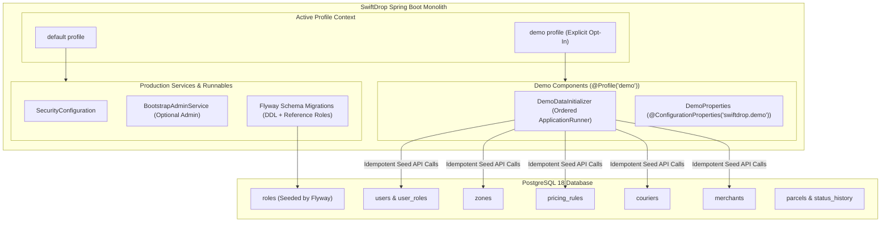
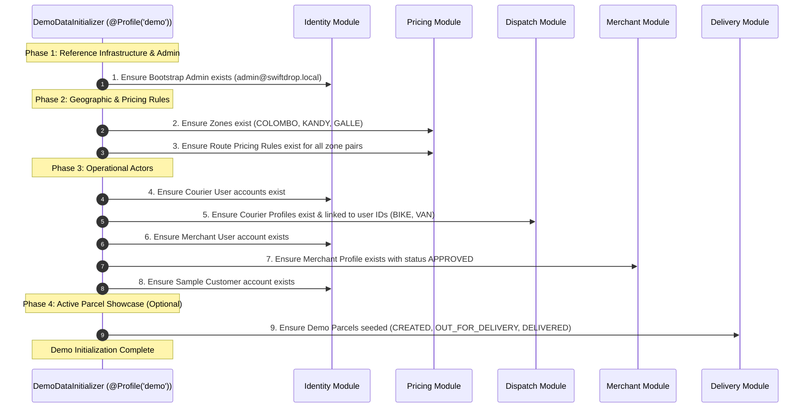
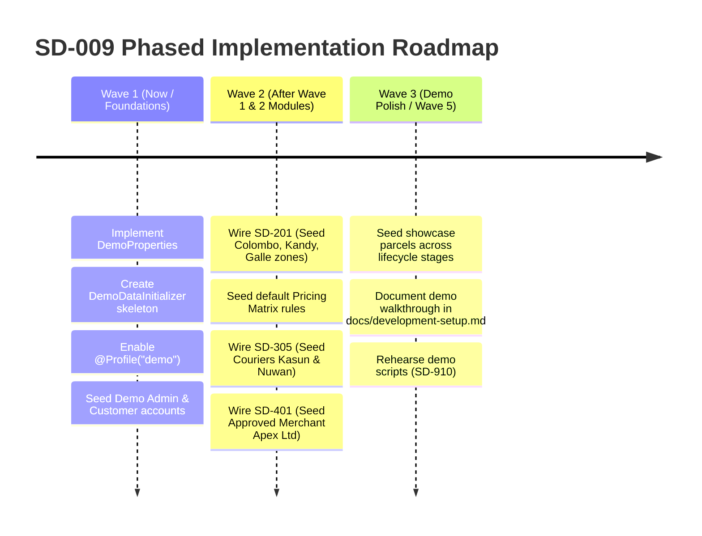

# D-27 Demo Profile Architecture Review: Demonstration & Seed Data Strategy

> **Document Status:** Architecture Review & Design Proposal for Team Decision D-27  
> **Related Task / Issue:** SD-009 (Implement demo and seed data for local evaluation and profiles)  
> **Target Profiles:** `demo` (dedicated demonstration profile) vs `default` / `production`  
> **Author / Lead:** Member 10 (DevOps, Infrastructure & Demo Lead) & System Architect  
> **Target Audience:** All 10 SwiftDrop Engineering Team Members  

---

## 1. Current Implementation Status

Inspection of the SwiftDrop repository confirms the following current state regarding application configuration, seeding, and database initialization:

### A. What Exists Today
1. **Single Bootstrap Admin Runner (`identity` module):**
   - Implemented in [`BootstrapAdminService.java`](file:///d:/Programming/SwiftDrop/SwiftDrop/backend/src/main/java/com/swiftdrop/identity/application/BootstrapAdminService.java).
   - Driven by [`BootstrapAdminProperties.java`](file:///d:/Programming/SwiftDrop/SwiftDrop/backend/src/main/java/com/swiftdrop/identity/application/BootstrapAdminProperties.java) binding to `swiftdrop.identity.bootstrap.admin-email` and `admin-password`.
   - **Environment:** Runs automatically under the `default` profile whenever `SWIFTDROP_BOOTSTRAP_ADMIN_EMAIL` and `SWIFTDROP_BOOTSTRAP_ADMIN_PASSWORD` are provided in `../.env` or system environment variables.
   - **Idempotency:** Checks `users.existsByRoles(Role.DISPATCHER_ADMIN)`; skips execution if any admin user already exists.
2. **Flyway Migrations (`db/migration/identity/`):**
   - Three migrations exist: `V202610251600` (users, roles), `V202610251700` (external identities), and `V202610261800` (Google login codes).
   - Only reference data is seeded: the four system roles (`CUSTOMER`, `MERCHANT`, `COURIER`, `DISPATCHER_ADMIN`).
   - Verified 100% clean of demo accounts, mock users, or test data.
3. **No Spring Profiles Defined:**
   - No `application-demo.properties` or `application-prod.properties` file exists in `backend/src/main/resources/`.
   - The backend runs strictly under the fallback `default` profile.
4. **No Business Domain Schemas Yet:**
   - Modules `pricing`, `delivery`, `dispatch`, `merchant`, and `notification` have **no tables or JPA entities implemented yet**.
   - Consequently, seeding zones, pricing rules, courier operational profiles, merchants, or sample parcels cannot be executed in code today.

---

## 2. Demo Profile Objectives

To conduct successful project evaluations, academic grading walkthroughs, and end-to-end user journey demonstrations (DEM-1 through DEM-6 in `docs/work-plan.md`), the demo profile must achieve five core objectives:

1. **One-Command Setup:** A developer or evaluator can start the full stack with realistic demonstration data by adding `--spring.profiles.active=demo` (or `SPRING_PROFILES_ACTIVE=demo`).
2. **Zero Production Risk:** The demo initializer must be technically and structurally barred from running in production or standard development environments.
3. **Flyway Migration Isolation:** Production database migrations must remain pristine. Sample data must **never** be injected via Flyway SQL scripts.
4. **Complete Multi-Role Coverage:** Automatically seed every persona required by the university brief (Admin, Couriers, Merchant, Customer) along with foundational logistic data (Delivery Zones, Pricing Matrix).
5. **Idempotence & Predictability:** The initialization must be safe across continuous container restarts, application restarts, and rebuilds without duplicating records or throwing constraint violations.

---

## 3. Proposed Architecture

### A. Dedicated Profile Separation
The system will introduce a dedicated Spring profile named `demo`.

### B. Execution Architecture: `DemoDataInitializer`
- Located in `com.swiftdrop.config` (or a dedicated `demo` configuration package).
- Annotated with `@Component`, `@Profile("demo")`, and `@Order(Ordered.LOWEST_PRECEDENCE)`.
- Implements `ApplicationRunner`, guaranteeing that initialization runs **after** the Spring ApplicationContext is fully initialized, Flyway migrations have executed, and Hibernate has validated the schema.
- Uses public module `api` interfaces or internal application services (e.g. `UserDirectory`, `PricingAdminService`, `DispatchAdminService`, `MerchantAdminService`), ensuring business validation rules and password encoding are consistently applied.

---

## 4. Demo Dataset Specification

To support the scripted flows in DEM-1 through DEM-6 (Customer Booking, Courier Delivery, Dispatcher Assignment, Merchant Webhooks), the demo dataset is partitioned into three categories:

### A. Essential Demo Data (Mandatory for Minimal Walkthrough)

| Category | Entity / Identifier | Key Attributes / Values | Purpose |
|---|---|---|---|
| **Delivery Zones** | Zone 1: `COLOMBO` | Name: `"Colombo District"`, Active: `true` | Urban origin zone for instant delivery quotes |
| | Zone 2: `KANDY` | Name: `"Kandy District"`, Active: `true` | Inter-district destination zone |
| | Zone 3: `GALLE` | Name: `"Galle District"`, Active: `true` | Southern regional destination zone |
| **Pricing Rules** | Rule 1: `COLOMBO -> COLOMBO` | Base: `350.00`, Per-Kg: `50.00`, Small: `0.00`, Med: `50.00`, Large: `100.00` LKR | Intra-city base rate |
| | Rule 2: `COLOMBO -> KANDY` | Base: `500.00`, Per-Kg: `80.00`, Small: `0.00`, Med: `80.00`, Large: `150.00` LKR | Inter-city long-haul rate |
| | Rule 3: `COLOMBO -> GALLE` | Base: `450.00`, Per-Kg: `70.00`, Small: `0.00`, Med: `70.00`, Large: `120.00` LKR | Inter-city coastal rate |
| **Administrator** | User: `admin@swiftdrop.local` | Role: `DISPATCHER_ADMIN`, Full Name: `"System Administrator"` | Admin portal login, user management, reports |
| **Couriers** | Courier 1: `courier1@swiftdrop.local` | Role: `COURIER`, Name: `"Kasun Perera"`, Vehicle: `BIKE`, Active: `true` | Primary mobile courier demonstration (DEM-3) |
| | Courier 2: `courier2@swiftdrop.local` | Role: `COURIER`, Name: `"Nuwan Silva"`, Vehicle: `VAN`, Active: `true` | Secondary courier for dispatch balancing |
| **Merchant** | User: `merchant@swiftdrop.local` | Role: `MERCHANT`, Business: `"Apex Electronics Ltd"`, Status: `APPROVED` | Merchant order creation (DEM-2) & webhook recipient |
| **Customer** | User: `customer@swiftdrop.local` | Role: `CUSTOMER`, Name: `"Amara Fernando"` | Pre-registered customer for quick history view |

### B. Optional Pre-Seeded Demonstration Data (Pipeline Showcase)
*These can either be seeded statically or generated live during demo script rehearsal:*
- **Sample Parcels in Progress:**
  - 1 parcel in `CREATED` status (unassigned, ready for the Dispatcher live assignment flow).
  - 1 parcel in `OUT_FOR_DELIVERY` assigned to Courier 1 (ready for live proof upload and completion).
  - 1 historical parcel in `DELIVERED` status (with delivered receipt and status history).
  - 1 historical parcel in `FAILED` status (with reason `RECIPIENT_UNAVAILABLE`).

### C. Unavailable / Missing Prerequisites (Cannot Be Seeded Today)
- **`zones` & `pricing_rules`**: Blocked on **SD-201** (pricing schema and entities).
- **`couriers` operational profile**: Blocked on **SD-305** (dispatch courier profile table).
- **`merchants` profile & approval**: Blocked on **SD-401** (merchant table and registration).
- **`parcels` & `delivery_proofs`**: Blocked on **SD-204** & **SD-311**.

---

## 5. Initialization Sequence & Module Order

Because entities reference each other across module boundaries via UUIDs, the initialization sequence must follow strict relational and lifecycle dependencies:

---

## 6. Idempotency & Concurrency Strategy

The demo runner must be completely safe against:
- Multiple application restarts on the same database volume.
- Restarting local Docker Compose containers without `-v` (volume preserved).
- Concurrent test executions.

### Idempotency Enforcement Rules
1. **Users:** Look up by unique normalized email (`users.findByEmail(normalizedEmail)`). If found, return existing user ID; do not attempt re-registration.
2. **Zones:** Look up by natural zone code (`zones.findByCode(code)`). If present, skip insertion.
3. **Pricing Rules:** Look up by origin and destination zone IDs (`pricingRules.findByOriginAndDestination(originId, destId)`). If present, skip.
4. **Couriers:** Look up by `user_id` (`couriers.findByUserId(userId)`). If present, skip.
5. **Merchants:** Look up by `user_id` (`merchants.findByUserId(userId)`). If present, verify status is `APPROVED`.
6. **Demo Parcels:** Look up by deterministic tracking numbers (e.g. `SDDEMO000001`, `SDDEMO000002`). If present, skip.
7. **Transactional Boundary:** Each category executes in its own distinct `@Transactional` boundary so that an issue in sample parcel seeding does not roll back base zone or user seeds.

---

## 7. Security and Production Safeguards

To prevent catastrophic security failures (e.g., demo accounts with well-known passwords enabled on a production deployment):

### A. Environment-Supplied Credentials
1. **No Hardcoded Passwords:** Passwords must **never** be hardcoded in `.java` source files.
2. **Environment Ingestion:** Demo credentials must be read through `@ConfigurationProperties("swiftdrop.demo")` mapped to environment variables:
   - `SWIFTDROP_DEMO_ADMIN_PASSWORD`
   - `SWIFTDROP_DEMO_COURIER_PASSWORD`
   - `SWIFTDROP_DEMO_MERCHANT_PASSWORD`
   - `SWIFTDROP_DEMO_CUSTOMER_PASSWORD`
3. **Safe Development Defaults:** In `.env.example`, place clear dummy placeholders (e.g., `change-me-demo-admin`).

### B. Production Safeguards & Guard Rails
1. **Explicit Opt-In Only:** The demo initializer is guarded by `@Profile("demo")`. It is **never** active under the `default` profile or a `production` profile.
2. **Startup Fail-Fast in Production Mode:**
   If `spring.profiles.active` contains `demo`, the initializer checks for production indicators (e.g. `SPRING_PROFILES_ACTIVE` containing `prod` or `production`, or a production hostname). If detected, it immediately throws `IllegalStateException("Cannot activate demo profile in production environment")` and halts startup.
3. **Standard Password Hashing:** All demo passwords must pass through the standard delegating `PasswordEncoder` (BCrypt). They are stored hashed in `users.password_hash`, never in plain text.
4. **Fictitious PII Only:** All phone numbers (`+94770000001`), names, and addresses must be explicitly fictitious (e.g., `"Demo Street 1, Colombo"`).

---

## 8. Dependencies & Blocked Development Issues

`SD-009` (Demo and Seed Data) cannot be completed in a single pass today because the dependent modules are not yet implemented.

| Prerequisite Task | Module | Status in Repo | Blocks in Demo Seeding |
|---|---|---|---|
| **SD-101** (Bootstrap Admin) | `identity` | **Implemented** (`BootstrapAdminService`) | Admin account is already unblocked |
| **SD-201** (Zones & Pricing Schema) | `pricing` | **Not Started** (No tables/entities) | Seeding delivery zones & pricing rules |
| **SD-305** (Courier Profiles) | `dispatch` | **Not Started** (No tables/entities) | Seeding courier operational profiles |
| **SD-401** (Merchant Registration) | `merchant` | **Not Started** (No tables/entities) | Seeding approved merchant accounts |
| **SD-204 / SD-301** (Parcel Aggregate & Machine) | `delivery` | **Not Started** (ADR 0006 just accepted) | Seeding active demonstration parcels |

---

## 9. Proposed Phased Implementation Plan

Rather than holding `SD-009` until the entire application is finished, `SD-009` will be executed in **three incremental waves**:

---

## 10. Acceptance Criteria for D-27 & SD-009

- [ ] Dedicated profile `demo` is recognized by the application context (`spring.profiles.active=demo`).
- [ ] Running with default configuration (`mvnw spring-boot:run`) does **not** execute demo initialization.
- [ ] Activating `demo` profile creates:
  - 1 Dispatcher/Admin (`admin@swiftdrop.local`)
  - 1 Customer (`customer@swiftdrop.local`)
  - 3 Delivery Zones (`COLOMBO`, `KANDY`, `GALLE`) *(once SD-201 merges)*
  - 3 Pricing Rules *(once SD-201 merges)*
  - 2 Couriers with active dispatch profiles *(once SD-305 merges)*
  - 1 Approved Merchant with active profile *(once SD-401 merges)*
- [ ] Demo execution is 100% idempotent; restarting the application does not create duplicates or throw SQL exceptions.
- [ ] Flyway production migrations (`db/migration/**`) remain 100% free of demo records.
- [ ] All passwords are read from environment variables and hashed using BCrypt.
- [ ] Instructions for activating the demo profile are documented in `docs/development-setup.md`.

---

## 11. Unresolved Decisions Requiring Team Approval

During the upcoming sprint planning session, the team should confirm:

1. **Standard Demo Domain Names:** Standardize on `@swiftdrop.local` for all demo accounts (e.g., `admin@swiftdrop.local`, `courier1@swiftdrop.local`) to prevent accidental confusion with real external email addresses.
2. **Environment Variable Naming:** Formally approve prefix `SWIFTDROP_DEMO_*` in `.env.example`.
3. **Default Intended Demonstration Zones:** Confirm Colombo, Kandy, and Galle as the default demonstration geographic regions.
4. **Staging / Demonstration Parcels:** Confirm whether sample parcels should be created automatically on startup or created live during the demo rehearsal via the REST API. (Recommendation: Initializer seeds users, zones, and rules; demo script creates parcels live to showcase real-time events).

