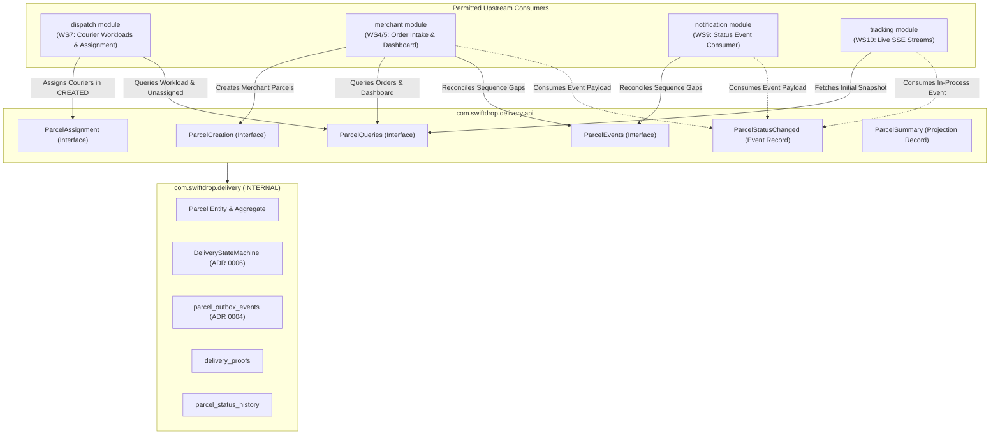
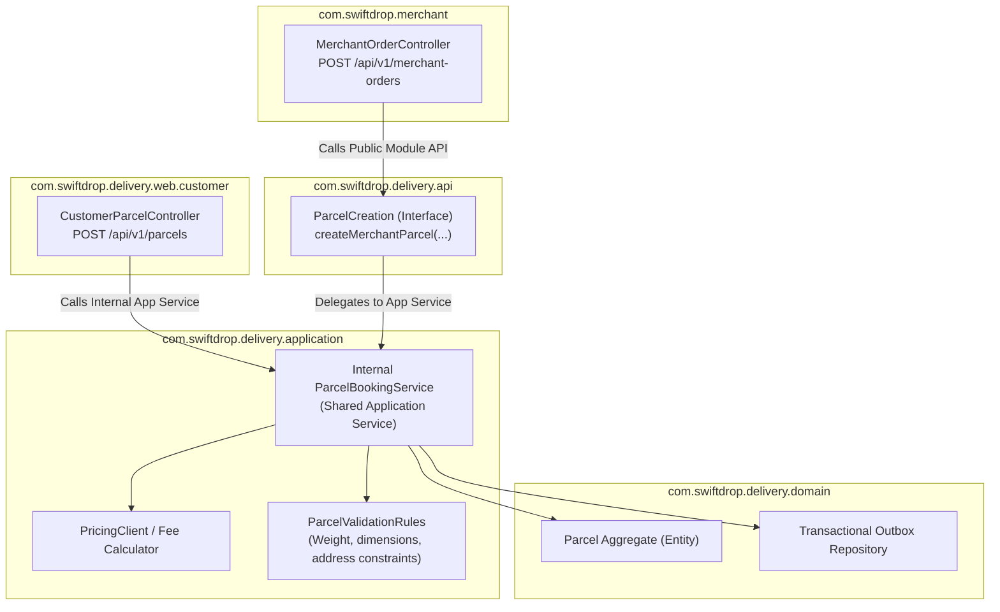
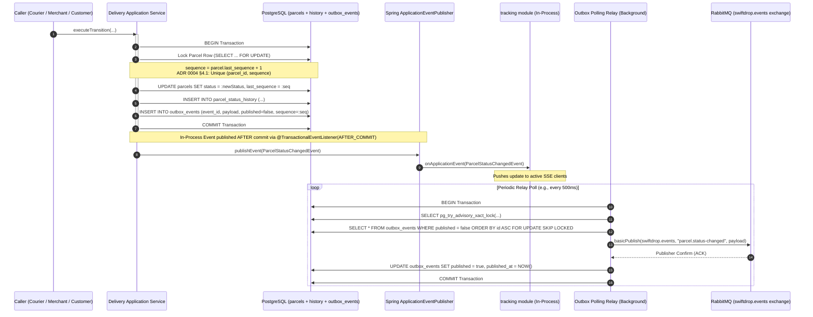
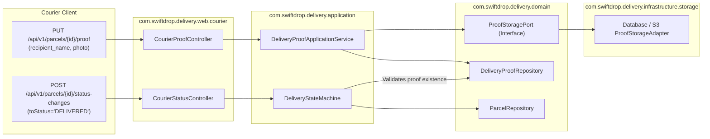
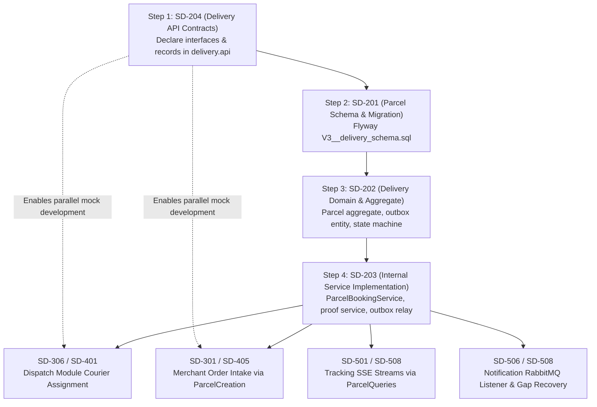

# Delivery Module Public API Contract Analysis & Specification Review

> **Document Status:** Architectural Analysis & Contract Design Review  
> **Related Task / Decision:** ACT-05 (Prepare Delivery Module Public API Contracts)  
> **Target Package:** `com.swiftdrop.delivery.api`  
> **Author / Lead:** Member 3 (Delivery Module Owner) & System Architect  
> **Primary Reviewers:** Member 2 (Customer WS2), Member 4/5 (Merchant WS4/5), Member 7 (Dispatch WS7), Member 9 (Messaging WS9), Member 10 (Tracking WS10)  

---

## 1. Existing Delivery API Inventory

Inspection of the actual codebase at [`backend/src/main/java/com/swiftdrop/delivery/api/`](file:///d:/Programming/SwiftDrop/SwiftDrop/backend/src/main/java/com/swiftdrop/delivery/api/) reveals that only **vocabulary enums and a single read projection** currently exist:

| Artifact | Type | Implemented? | Description / Current Scope |
|---|---|---|---|
| [`ParcelStatus.java`](file:///d:/Programming/SwiftDrop/SwiftDrop/backend/src/main/java/com/swiftdrop/delivery/api/ParcelStatus.java) | `public enum` | **YES** | 6 lifecycle constants: `CREATED`, `PICKED_UP`, `IN_TRANSIT`, `OUT_FOR_DELIVERY`, `DELIVERED`, `FAILED`. Verified compliant with accepted ADR 0006. |
| [`FailureReason.java`](file:///d:/Programming/SwiftDrop/SwiftDrop/backend/src/main/java/com/swiftdrop/delivery/api/FailureReason.java) | `public enum` | **YES** | 5 standardized failure codes: `RECIPIENT_UNAVAILABLE`, `ADDRESS_NOT_FOUND`, `REFUSED`, `DAMAGED`, `OTHER` (D-19). |
| [`ParcelSource.java`](file:///d:/Programming/SwiftDrop/SwiftDrop/backend/src/main/java/com/swiftdrop/delivery/api/ParcelSource.java) | `public enum` | **YES** | 2 origin sources: `CUSTOMER` (direct web booking) and `MERCHANT` (API order intake). |
| [`ParcelSummary.java`](file:///d:/Programming/SwiftDrop/SwiftDrop/backend/src/main/java/com/swiftdrop/delivery/api/ParcelSummary.java) | `public record` | **YES** | Read-only projection record containing: `id`, `trackingNumber`, `status`, `size`, `weightGrams`, `source`, `customerId`, `merchantId`, `merchantOrderReference`, `assignedCourierId`, `createdAt`. |
| `package-info.java` | Package descriptor | **YES** | Javadoc defining `delivery.api` as the only exportable package of the `delivery` module. |

### Summary of What Exists
No service interfaces, mutation facades, query facades, or event records currently exist in Java source code.

---

## 2. Missing Required Contracts

To satisfy the modular monolith boundaries ([ADR 0003](../adr/0003-backend-modules-and-boundaries.md)), transactional outbox messaging ([ADR 0004](../adr/0004-messaging-and-integration-reliability.md)), and delivery lifecycle rules ([ADR 0006](../adr/0006-delivery-lifecycle-and-transition-rules.md)), the following four core interfaces and supporting DTO records are required:

1. **`delivery.api.ParcelCreation`**: Required by `merchant` module (order intake). *(Customer booking runs internally in `delivery.web.customer`).*
2. **`delivery.api.ParcelAssignment`**: Required by `dispatch` module to assign or reassign couriers while a parcel is `CREATED`.
3. **`delivery.api.ParcelQueries`**: Required by `dispatch` (unassigned lists, active workload counts), `merchant` (dashboard queries, reference lookups), and `tracking` (snapshot lookups).
4. **`delivery.api.ParcelEvents`**: Required by `notification` and `merchant` modules for sequence gap reconciliation.
5. **`delivery.api.ParcelStatusChanged`**: The versioned in-process and messaging event envelope payload (ADR 0004 §2).

---

## 3. Consumer-to-Contract Mapping & Allowed Dependency Graph

According to [ADR 0003](../adr/0003-backend-modules-and-boundaries.md), the allowed module dependency graph is:

$$\begin{aligned}
\text{dispatch} &\longrightarrow \text{delivery.api} \\
\text{merchant} &\longrightarrow \text{delivery.api} \\
\text{notification} &\longrightarrow \text{delivery.api} \\
\text{tracking} &\longrightarrow \text{delivery.api}
\end{aligned}$$

Every other cross-module dependency is strictly forbidden. The `delivery` module **never** imports or calls `dispatch`, `merchant`, `notification`, or `tracking`.



---

## 4. Proposed Public API Contracts Specification

### A. Contract 1: `ParcelCreation`
- **Consumer:** `merchant` module (WS5, order intake endpoint `POST /api/v1/merchant-orders`).
- **Responsibility:** Ingests an authorized merchant order and atomically creates a `Parcel` aggregate in `CREATED` status.
- **Why Cross-Module?** The merchant module owns merchant authentication and API key validation (`X-Api-Key`), but [ADR 0003](../adr/0003-backend-modules-and-boundaries.md) dictates that `delivery` alone owns the `parcels` table.
- **Proposed Signature:**
  ```java
  package com.swiftdrop.delivery.api;

  public interface ParcelCreation {
      CreatedParcel createMerchantParcel(NewMerchantParcel command);
  }
  ```
- **Supporting DTOs:**
  ```java
  public record NewMerchantParcel(
      UUID merchantId,
      String merchantOrderReference,
      DeliveryContact pickup,
      DeliveryContact dropoff,
      ParcelSize size,
      int weightGrams,
      String description
  ) {}

  public record DeliveryContact(
      String contactName,
      String phone,
      String line1,
      String line2,
      String city,
      UUID zoneId,
      String postalCode
  ) {}

  public record CreatedParcel(
      UUID parcelId,
      String trackingNumber,
      ParcelStatus status,
      BigDecimal feeAmount,
      String feeCurrency,
      Instant createdAt
  ) {}
  ```
- **Idempotency Rule (D-25):** If a merchant submits the same `merchantOrderReference` again, `ParcelCreation` must return the existing `CreatedParcel` without creating a duplicate aggregate or emitting a second event.

---

### B. Contract 2: `ParcelAssignment`
- **Consumer:** `dispatch` module (WS7, assignment workflow endpoint `POST /api/v1/parcel-assignments`).
- **Responsibility:** Records the assignment of an eligible courier to a parcel.
- **Why Cross-Module?** `dispatch` checks courier profiles, eligibility (active, enabled `COURIER` role), and workload balances. Once verified, `delivery` records the assignment on the parcel aggregate.
- **Proposed Signature:**
  ```java
  package com.swiftdrop.delivery.api;

  public interface ParcelAssignment {
      void assignCourier(UUID parcelId, UUID courierUserId, UUID dispatcherUserId);
  }
  ```
- **Invariants Enforced by Delivery (ADR 0006 §3):**
  - Parcel must be in status **`CREATED`**. If the parcel is in `PICKED_UP`, `IN_TRANSIT`, `OUT_FOR_DELIVERY`, `DELIVERED`, or `FAILED`, the call throws a domain exception that translates to **`409 Conflict`**.
  - Once `PICKED_UP`, the courier assignment is immutable.
  - Does **not** change the status and does **not** emit a status change outbox event.

---

### C. Contract 3: `ParcelQueries`
- **Consumers:**
  - `dispatch`: Needs unassigned parcels (to assign) and active courier workload counts (to balance dispatching).
  - `merchant`: Needs order listings and status lookups by merchant order reference.
  - `tracking`: Needs public tracking snapshot on SSE connection.
- **Proposed Signature:**
  ```java
  package com.swiftdrop.delivery.api;

  public interface ParcelQueries {
      Page<ParcelSummary> findUnassignedParcels(Pageable pageable);

      Map<UUID, Long> countActiveParcelsByCourier();

      Page<ParcelSummary> findParcelsByMerchant(UUID merchantId, ParcelStatus statusFilter, Pageable pageable);

      Optional<ParcelSummary> findByMerchantReference(UUID merchantId, String merchantOrderReference);

      Optional<PublicTrackingView> findPublicTrackingView(String trackingNumber);
  }
  ```
- **Public vs Private Query DTOs:**
  - `ParcelSummary`: Used by staff and merchants. Contains IDs, tracking number, status, weight, and size.
  - `PublicTrackingView`: Used by public tracking page (`tracking` module and unauthenticated endpoint). Contains **zero PII**:
    ```java
    public record PublicTrackingView(
        String trackingNumber,
        ParcelStatus status,
        String pickupCity,
        String dropoffCity,
        List<PublicStatusEvent> history
    ) {}

    public record PublicStatusEvent(
        ParcelStatus status,
        Instant occurredAt
    ) {}
    ```

---

### D. Contract 4: `ParcelEvents` & Event Payload
- **Consumers:** `notification` module (WS9) and `merchant` module (WS5).
- **Responsibility:** Provides historical event rebuilding for consumer sequence gap reconciliation as required by [ADR 0004](../adr/0004-messaging-and-integration-reliability.md) §4.3.
- **Proposed Signature:**
  ```java
  package com.swiftdrop.delivery.api;

  public interface ParcelEvents {
      List<ParcelStatusChangedEvent> getEventsBetween(UUID parcelId, int fromSequence, int toSequence);
  }
  ```
- **Standardized Event Payload (`ParcelStatusChangedEvent`):**
  Matches ADR 0004 §2 JSON envelope schema:
  ```java
  public record ParcelStatusChangedEvent(
      UUID eventId,
      String eventType, // "parcel.status-changed"
      int schemaVersion, // 1
      Instant occurredAt,
      String producer, // "delivery"
      ParcelStatusData data
  ) {}

  public record ParcelStatusData(
      UUID parcelId,
      String trackingNumber,
      ParcelStatus previousStatus,
      ParcelStatus newStatus,
      int sequence,
      ParcelSource source,
      UUID ownerCustomerId,
      UUID ownerMerchantId,
      String merchantOrderReference,
      FailureReason failureReasonCode
  ) {}
  ```

---

## 5. Security & Privacy Boundaries

To prevent information disclosure and maintain strict data privacy compliance:

1. **PII Exclusion from Events:**
   - Notice that `ParcelStatusData` contains **no names, phone numbers, addresses, photo bytes, or notes**.
   - `notification` looks up recipient phone numbers via `identity.api.UserDirectory` using `ownerCustomerId`.
   - `merchant` webhook subscribers receive status and tracking references only.
2. **PII Exclusion from Public Tracking:**
   - `PublicTrackingView` exposes only `status`, `pickupCity`, `dropoffCity`, and event timestamps.
   - Recipient names, street addresses, and courier notes are strictly omitted.
3. **Existence Protection via Error Mapping:**
   - Unauthorized queries across customer, merchant, or courier boundaries must return **`404 Not Found`** (not `403 Forbidden`).

---

## 6. Unresolved Architectural Questions for Team Alignment

Before declaring these interfaces in source code, the team must align on four design decisions:

### Question 1: Customer Booking API Contract vs Internal Delivery Web Controller
- **Context:** Does Customer Booking (`POST /api/v1/parcels`) call `ParcelCreation` via `delivery.api`, or does it call an internal application service in `delivery.application`?
- **Analysis:**
  - `delivery.web.customer` is part of the `delivery` module package hierarchy (`com.swiftdrop.delivery.web.customer`).
  - By [ADR 0003](../adr/0003-backend-modules-and-boundaries.md) rules, classes inside `delivery` may access package-private application services directly.
  - `merchant` is a separate top-level module (`com.swiftdrop.merchant`) and **must** call through `delivery.api.ParcelCreation`.
- **Recommendation:** Keep `ParcelCreation` in `delivery.api` tailored for cross-module merchant order creation, but allow the customer booking application service to share common aggregate validation logic internally.

### Question 2: Representation of Pagination and Sorting
- **Context:** Should `ParcelQueries` use Spring Data's `Pageable` and `Page<T>`, or a custom module-neutral record?
- **Analysis:**
  - SwiftDrop is a modular monolith running in a single Spring Boot application runtime, not separate microservices.
  - Spring Data is already Boot-managed and used across all modules.
  - [SD-002](file:///d:/Programming/SwiftDrop/SwiftDrop/docs/work-plan.md#L97) introduced `com.swiftdrop.shared.web.PageResponse<T>`.
- **Recommendation:** Standardize on Spring Data `Pageable` for method arguments and return `PageResponse<T>` or `Page<T>` across module APIs.

### Question 3: Proof-of-Delivery Handling Across Module Boundaries
- **Context:** Does proof-of-delivery capture (`PUT /api/v1/parcels/{id}/proof`) cross any module boundary?
- **Analysis:**
  - Proof capture is executed by the assigned courier via the courier web portal (`delivery.web.courier`).
  - Proof storage (`delivery_proofs`) is owned 100% by the `delivery` module.
  - No external module (such as `dispatch` or `merchant`) needs to upload or store proof.
- **Recommendation:** Proof capture remains an **internal `delivery` module concern**. It does **not** need an interface in `delivery.api`.

---

## 7. Related GitHub Issues & Dependencies

| Issue ID | Title | Module / Owner | Contract Dependency | Status |
|---|---|---|---|---|
| **SD-204** | Implement Parcel aggregate, schema, and repositories | `delivery` (M3) | Underlying persistence for all contracts | **Ready to Start** (ADR 0006 accepted) |
| **SD-206** | Customer parcel booking REST endpoint | `delivery` (M2) | Shares aggregate creation invariants | Depends on SD-204, SD-202 |
| **SD-301** | Status state machine and history transitions | `delivery` (M3) | Enforces preconditions on status change | Depends on SD-204 |
| **SD-302** | `delivery.api` query and assignment contracts | `delivery` (M3) | **Direct implementation of `ParcelAssignment` and `ParcelQueries`** | Depends on SD-301 |
| **SD-306** | Unassigned parcel listing and courier assignment | `dispatch` (M7) | Consumes `ParcelQueries.findUnassignedParcels` & `ParcelAssignment.assignCourier` | Blocked on SD-302 |
| **SD-405** | Merchant order intake API | `merchant` (M5) | Consumes `ParcelCreation.createMerchantParcel` | Blocked on SD-204 |
| **SD-406** | Merchant dashboard API | `merchant` (M4) | Consumes `ParcelQueries.findParcelsByMerchant` | Blocked on SD-302 |
| **SD-503** | Shared ordered-consumer support | `shared` (M9) | Consumes `ParcelEvents.getEventsBetween` | Blocked on SD-505 |
| **SD-505** | `delivery.api.ParcelEvents` for reconciliation | `delivery` (M3) | **Direct implementation of `ParcelEvents`** | Depends on SD-303 |
| **SD-508** | SSE tracking stream | `tracking` (M10) | Consumes `ParcelQueries.findPublicTrackingView` | Blocked on SD-304 |

---

## 8. Recommended Implementation Order

To maintain clean compilation and avoid breaking parallel feature branches:

1. **Step 1 (Interface Declaration):** Declare `ParcelCreation`, `ParcelAssignment`, `ParcelQueries`, `ParcelEvents`, and `ParcelStatusChangedEvent` in `backend/src/main/java/com/swiftdrop/delivery/api/` as interfaces/records without implementations.
2. **Step 2 (Aggregate Foundation - SD-204):** Implement the `Parcel` entity, repository, and Flyway migration.
3. **Step 3 (Lifecycle Engine - SD-301):** Implement the state machine enforcing the accepted ADR 0006 rules.
4. **Step 4 (Service Implementation - SD-302):** Implement `ParcelAssignment` and `ParcelQueries` in `delivery.application`.
5. **Step 5 (Consumer Integration):** Dispatch (SD-306) and Merchant (SD-405/406) begin consuming the contracts.

---

## 9. Contract Design Refinement (ACT-05B)

This section addresses the architectural refinements, ambiguities, framework decoupling, and design issues identified across the proposed public contracts in Section 4.

### 9.1 Verification of Proposed Interfaces

A rigorous review of the proposed interfaces was performed to eliminate artificial boundaries, avoid duplicate methods, and confirm genuine cross-module caller requirements:

#### A. `ParcelCreationService` (Renamed / Verified as `ParcelCreation`)
- **Consumer Modules:** Exclusively `merchant` module (WS5: `POST /api/v1/merchant-orders`).
- **Required Operations:**
  - `CreatedParcel createMerchantParcel(NewMerchantParcel command)`
- **Cross-Module Verification:** **Genuinely crosses module boundary.** The `merchant` module handles API key authentication and authorization, but [ADR 0003](../adr/0003-backend-modules-and-boundaries.md) grants ownership of the `parcels` table solely to `delivery`.
- **Public vs. Internal:** Customer parcel creation (`POST /api/v1/parcels`) is an internal web entry point residing inside `com.swiftdrop.delivery.web.customer`. It must **not** be placed on the public `delivery.api` interface.
- **Deduplication:** No existing capability duplicated.

#### B. `ParcelAssignmentService` (Renamed / Verified as `ParcelAssignment`)
- **Consumer Modules:** Exclusively `dispatch` module (WS7: `POST /api/v1/parcel-assignments`).
- **Required Operations:**
  - `void assignCourier(UUID parcelId, UUID courierUserId, UUID dispatcherUserId)`
- **Cross-Module Verification:** **Genuinely crosses module boundary.** `dispatch` checks courier operational eligibility (active status, working hours, license) and dispatcher authorization, but cannot write directly to `parcels.assigned_courier_id`.
- **Invariants Enforced by Provider:** `delivery` strictly enforces that `assignCourier` can only be called when the parcel status is `CREATED` (ADR 0006 §3). If the parcel has progressed beyond `CREATED`, it rejects the call with `IllegalStateException` (translating to `409 Conflict`).
- **Deduplication:** No status mutation is permitted through this interface; courier assignment is an independent property and does not emit a status change outbox event.

#### C. `ParcelQueryService` (Renamed / Verified as `ParcelQueries`)
- **Consumer Modules:**
  - `dispatch`: Requires unassigned parcel lists and active courier workload metrics.
  - `merchant`: Requires order lookups by internal ID, merchant order reference, and merchant parcel listings.
  - `tracking`: Requires public tracking snapshots for SSE initialization and web client lookups.
- **Refined Operations (Framework-Independent):**
  1. `PageResult<ParcelSummary> findUnassignedParcels(PageRequest request)` *(for `dispatch`)*
  2. `Map<UUID, Long> countActiveParcelsByCourier()` *(for `dispatch` workload balancer)*
  3. `PageResult<ParcelSummary> findParcelsByMerchant(UUID merchantId, ParcelStatus statusFilter, PageRequest request)` *(for `merchant` dashboard)*
  4. `Optional<ParcelSummary> findByMerchantReference(UUID merchantId, String merchantOrderReference)` *(for `merchant` idempotency & order lookup)*
  5. `Optional<PublicTrackingView> findPublicTrackingView(String trackingNumber)` *(for `tracking`)*
- **Cross-Module Verification:** Each method represents an authorized cross-module read.
- **Removed Duplicate / Misplaced Methods:**
  - A generic `findById(UUID parcelId)` without tenant scoping was rejected. Public queries for merchants must take `merchantId` to strictly enforce tenant isolation and prevent cross-tenant enumeration attacks.

#### D. `ParcelEventQueryService` (Renamed / Verified as `ParcelEvents`)
- **Consumer Modules:** `notification` module (WS9) and `merchant` module (WS5).
- **Required Operations:**
  - `List<ParcelStatusChangedEvent> getEventsBetween(UUID parcelId, int fromSequence, int toSequence)`
- **Cross-Module Verification:** **Genuinely crosses module boundary.** Required by [ADR 0004](../adr/0004-messaging-and-integration-reliability.md) §4.3 to allow consumers who detect a gap in their local sequence counter (`received_seq > expected_seq`) to synchronously reconcile missing historical status events directly from `delivery`'s authoritative `parcel_status_history`.
- **Deduplication:** Does not duplicate RabbitMQ event consumption; it acts strictly as the recovery/reconciliation backchannel.

---

### 9.2 Resolution: Customer vs. Merchant Parcel Creation Architecture

To satisfy ADR 0003 boundaries without duplicating business validation logic across customer and merchant paths:



#### Shared vs. Separate Responsibilities
1. **Entry Points:**
   - **Customer Path:** Internal entry point via `delivery.web.customer.CustomerParcelController`. Caller is authenticated via JWT (`CUSTOMER` role). Uses customer profile ID from the security context.
   - **Merchant Path:** Public cross-module contract via `delivery.api.ParcelCreation.createMerchantParcel()`. Called by `merchant.web.MerchantOrderController` after validating the merchant's `X-Api-Key` and resolving `merchantId`.
2. **Shared Internal Application Service (`ParcelBookingService`):**
   - Both entry points delegate to a single internal Spring service: `com.swiftdrop.delivery.application.ParcelBookingService`.
   - **Shared Validation Rules:** Parcel dimensions, weight boundaries, address structure completeness, and pricing fee calculation via `pricing.api.PricingCalculation` are executed identically.
   - **Shared Invariants:**
     - Status is initialized to `CREATED`.
     - Sequence number is initialized to `1`.
     - Tracking number is generated using the standardized format (e.g. `SD-YYYYMMDD-XXXXXX`).
     - Initial status history entry and initial transactional outbox record (`parcel.status-changed`, `CREATED`) are written within the same database transaction.

---

### 9.3 Event Publishing Architecture & Sequence Guarantees

In accordance with [ADR 0004](../adr/0004-messaging-and-integration-reliability.md), the system strictly forbids dual-write hazards and prevents second independent event publishers.



#### Architectural Principles & Invariants:
1. **One Authoritative Event Creator:**
   - Events are constructed **only** inside `delivery.application.DeliveryStateMachine` during aggregate state persistence. External modules cannot construct or emit `ParcelStatusChangedEvent`.
2. **Transactional Outbox Persistence:**
   - The aggregate status update, the row in `parcel_status_history`, and the row in `outbox_events` are inserted in the **exact same database transaction**.
   - If the database transaction fails or rolls back, zero events are emitted or published.
3. **Role of `ApplicationEventPublisher`:**
   - `ApplicationEventPublisher` is used **only** for local, in-process notifications to the `tracking` module via `@TransactionalEventListener(phase = TransactionPhase.AFTER_COMMIT)`.
   - It is **never** used to publish directly to RabbitMQ.
   - If an in-process listener fails, it logs an error but does not affect the committed status; `tracking` can reload state from `delivery.api.ParcelQueries` upon client reconnection.
4. **Triggering RabbitMQ Publishing:**
   - RabbitMQ publishing is performed solely by the `OutboxRelay` scheduled background task in `delivery.infrastructure.messaging`.
   - Uses RabbitMQ **Publisher Confirms** with the `mandatory` flag. Rows are marked `published = true` only upon receiving a broker ACK.
5. **Preventing Duplicate Event Publication:**
   - The relay uses a PostgreSQL transaction-scoped advisory lock (`pg_try_advisory_xact_lock`) ensuring only one relay instance publishes at any time.
   - Messages carry an immutable `message-id` equal to `event_id` (UUID). Downstream consumers (`merchant`, `notification`) deduplicate incoming messages by recording processed event IDs in their local deduplication tables.
6. **Sequence Number Generation & Ordering:**
   - Sequence numbers are monotonic integers starting at `1` (`CREATED`).
   - Every status transition acquires a pessimistic lock (`PESSIMISTIC_WRITE` / `SELECT FOR UPDATE`) on the `parcels` row.
   - `sequence = parcel.last_sequence + 1`.
   - A PostgreSQL database constraint `UNIQUE(parcel_id, sequence)` enforces that duplicate sequence numbers per parcel are physically impossible.

---

### 9.4 DTO Design & Framework Decoupling

To prevent leaking Spring Data infrastructure or domain entities across module boundaries:

#### Framework Decoupling Strategy:
1. **No Spring Data `Pageable` or `Page` in Public API:**
   - Spring Data's `org.springframework.data.domain.Pageable` and `Page` leak web/ORM framework details into the public Java API and complicate testing.
   - **Decision:** Introduce lightweight, framework-independent record abstractions in `com.swiftdrop.delivery.api`:
     ```java
     public record PageRequest(int page, int size) {
         public PageRequest {
             if (page < 0) throw new IllegalArgumentException("Page must be >= 0");
             if (size <= 0 || size > 100) throw new IllegalArgumentException("Size must be between 1 and 100");
         }
     }

     public record PageResult<T>(List<T> content, int page, int size, long totalElements, int totalPages) {}
     ```
2. **Usage of `Optional`:**
   - Allowed and recommended on query single-item lookups (`Optional<ParcelSummary>`, `Optional<PublicTrackingView>`) to clearly signify nullable return states without returning `null`.
3. **Immutability via Java Records:**
   - Every DTO in `delivery.api` must be an immutable Java 21 `record`.
4. **Zero Entity Leakage:**
   - JPA entity classes (`Parcel`, `ParcelStatusHistory`, `DeliveryProof`) are package-private to `com.swiftdrop.delivery.domain` and are never referenced in `delivery.api`.

---

### 9.5 Security, Privacy & Tenant Isolation Matrix

To uphold project security guidelines and prevent personal data exposure across modules:

| Consumer / Caller | Permitted Interface / Method | Data Returned | Strict Data Protections |
| :--- | :--- | :--- | :--- |
| **Public Web Client (Unauthenticated)** | `ParcelQueries.findPublicTrackingView` via `tracking` module | Tracking number, current status, pickup city, dropoff city, status timeline (status + timestamp) | **ZERO PII:** No recipient/sender names, no phone numbers, no street addresses, no postal codes, no coordinates, no proof images. |
| **Merchant Module (WS5)** | `ParcelQueries.findByMerchantReference`, `findParcelsByMerchant` | Parcel metadata for the authenticated `merchantId`: dimensions, status, fee, courier ID, delivery timestamps | **Tenant Isolation:** Queries strictly take `merchantId`. Accessing a parcel owned by another merchant returns `Optional.empty()` (translating to `404 Not Found`, never `403 Forbidden` to prevent ID enumeration). |
| **Dispatch Module (WS7)** | `ParcelQueries.findUnassignedParcels`, `countActiveParcelsByCourier` | Parcel IDs, sizes, weights, zone IDs, creation timestamps, and active count per courier ID | **Operational Scoping:** Dispatchers do not receive recipient contact numbers or proof images in workload summaries. |
| **RabbitMQ Consumers (`notification`, `merchant`)** | `ParcelStatusChangedEvent` | Aggregate IDs (`parcelId`, `merchantId`, `courierId`), tracking number, previous/new status, sequence number, failure reason code | **Privacy Invariant:** Events **never** contain recipient contact names, phone numbers, addresses, free-text notes, or proof URLs. |
| **Customer / Courier Web Endpoints** | Internal `delivery.web.*` | Full recipient contact, street address, and proof details | Scoped strictly to authenticated owner or assigned courier via Spring Security. |

---

### 9.6 Proof-of-Delivery Ownership Architecture

[ADR 0006](../adr/0006-delivery-lifecycle-and-transition-rules.md) §5 governs the Proof of Delivery (POD) workflow (D-12). Clarifying the ownership boundaries:



#### Key Architecture Clarifications:
1. **Completely Internal to Delivery:**
   - Proof of delivery is **NOT** exposed on `delivery.api`.
   - External modules (`dispatch`, `merchant`, `tracking`) have no operational role in uploading or validating proof.
2. **Clean Separation of Concerns:**
   - **Web Controller (`CourierProofController`):** Authenticates the courier, validates HTTP multipart/JSON payload (`recipient_name` non-blank, photo $\le 2\text{ MB}$, JPEG/PNG).
   - **Application Service (`DeliveryProofApplicationService`):** Orchestrates storage and persists proof metadata in `delivery_proofs`. Verifies the parcel is currently in `OUT_FOR_DELIVERY`.
   - **Storage Abstraction (`ProofStoragePort`):** Encapsulates binary storage (stores as `BYTEA` in PostgreSQL for v1 local profile; adaptable to object storage without domain refactoring).
3. **Atomic Delivery Validation:**
   - When the courier subsequently calls `POST /api/v1/parcels/{id}/status-changes` with `toStatus="DELIVERED"`, the `DeliveryStateMachine` checks `DeliveryProofRepository.existsByParcelId(parcelId)` within the same database transaction.
   - If no valid proof exists, the transition is rejected with `IllegalStateException` (`409 Conflict`).

---

### 9.7 Lifecycle Consistency with Accepted ADR 0006

The refined public contracts strictly adhere to the transition rules of ADR 0006:
1. **No External Status Mutators:**
   - There are **no methods** on `ParcelCreation`, `ParcelAssignment`, `ParcelQueries`, or `ParcelEvents` that allow external modules to set or alter a parcel's status.
   - Status changes are executed exclusively by the courier via internal delivery endpoints (`POST /api/v1/parcels/{id}/status-changes`).
2. **Immutable Assignments Post-Pickup:**
   - `ParcelAssignment.assignCourier` strictly enforces `status == CREATED`.
   - Once a courier picks up the parcel (`PICKED_UP`), the courier assignment cannot be changed by dispatchers or administrators.
3. **Strict Terminal States:**
   - Once in `DELIVERED` or `FAILED`, no assignments, status changes, or proof uploads are accepted.
4. **Failure Reason Mandatory:**
   - The failure reason code (`FailureReason`) is strictly required for transitions to `FAILED` and is encapsulated in the aggregate and domain events.

---

### 9.8 Summary of Proposals & Decisions Requiring Team Approval

The following items are architectural refinements made during ACT-05B that are proposed for formal sign-off by the relevant module owners:

| Proposal Item | Proposed Decision | Impacted Modules | Status |
| :--- | :--- | :--- | :--- |
| **PR-01: Framework-Independent Pagination** | Replace `org.springframework.data.domain.Pageable` with `delivery.api.PageRequest` and `PageResult<T>`. | `dispatch` (WS7), `merchant` (WS4/5) | **PROPOSAL (Pending Team Review)** |
| **PR-02: Tenant-Scoped Query Signatures** | All merchant query methods in `ParcelQueries` must explicitly require `UUID merchantId` parameter and return `Optional.empty()` for mismatches. | `merchant` (WS4/5) | **PROPOSAL (Pending Team Review)** |
| **PR-03: In-Process vs RabbitMQ Event Separation** | Use Spring `ApplicationEventPublisher` exclusively for `tracking` in-process pushes; use Transactional Outbox + Relay exclusively for RabbitMQ. | `tracking` (WS10), `notification` (WS9) | **PROPOSAL (Pending Team Review)** |
| **PR-04: Single Shared Booking Service** | Unify customer and merchant parcel creation rules inside internal `ParcelBookingService`. | `customer` (WS2), `merchant` (WS5) | **PROPOSAL (Pending Team Review)** |

---

### 9.9 Implementation Dependencies and Recommended Order

The refined contracts establish the definitive path for downstream development:



1. **Phase 1: Public Contract Freeze (Issue SD-204):**
   - Declare the four core interfaces (`ParcelCreation`, `ParcelAssignment`, `ParcelQueries`, `ParcelEvents`), supporting records (`NewMerchantParcel`, `CreatedParcel`, `ParcelSummary`, `PublicTrackingView`, `PageRequest`, `PageResult`), and event envelope (`ParcelStatusChangedEvent`) in `backend/src/main/java/com/swiftdrop/delivery/api/`.
   - Run `./mvnw test -Dtest=ModuleBoundaryTest` to confirm compilation and zero architecture boundary violations.
2. **Phase 2: Database Schema & Entity Model (Issue SD-201 & SD-202):**
   - Create Flyway migration `V3__delivery_schema.sql` (`parcels`, `parcel_status_history`, `delivery_proofs`, `parcel_outbox_events`).
   - Implement JPA entity aggregates in `com.swiftdrop.delivery.domain`.
3. **Phase 3: Lifecycle State Machine & Outbox Relay (Issue SD-203 & SD-301):**
   - Implement `DeliveryStateMachine` enforcing ADR 0006 transitions.
   - Implement `OutboxRelay` scheduled publisher enforcing ADR 0004 publisher confirms and per-parcel sequence order.
4. **Phase 4: Consumer Integration (Parallel Tracks):**
   - Merchant team (WS4/5) implements `POST /api/v1/merchant-orders` consuming `ParcelCreation`.
   - Dispatch team (WS7) implements `POST /api/v1/parcel-assignments` consuming `ParcelAssignment`.
   - Tracking team (WS10) connects SSE to `ParcelQueries` and in-process events.
   - Notification team (WS9) connects RabbitMQ consumer and reconciles gaps via `ParcelEvents`.


