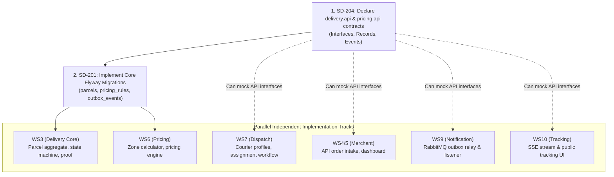

# SwiftDrop — Comprehensive Foundation Readiness Audit (FRA-01)

> **Document Status:** Complete Audit Report  
> **Date:** 2026-11-01  
> **Target Audience:** SwiftDrop Development Team (10 Members), System Architect, Faculty Evaluators  
> **Evaluation Profile:** READ-ONLY Verification of Current Repository State & Workstreams  

---

## 1. Executive Summary

This comprehensive audit was executed to evaluate whether the current SwiftDrop codebase provides a solid, secure, and compatible foundation for continuing parallel development across all 10 team members.

### Key Audit Findings:
1. **Repository Health & Build Baseline:**
   - Backend test suite: **187 passed, 0 failures, 0 skipped** across all 14 test classes.
   - Frontend build & linting: **Next.js 16.4.3 production build succeeded** (22 static routes prerendered); **ESLint reported zero errors/warnings**.
   - JaCoCo coverage configuration (`0.8.12`) is active in `backend/pom.xml` and wired into `.github/workflows/ci.yml`.
2. **Implementation Status by Module:**
   - **`identity`**: **Fully implemented and verified** (JWT, BCrypt hashing, Google OAuth2 PKCE exchange, Role-Based Access Control, Admin User Management, BootstrapAdminService).
   - **`delivery`**: **Vocabulary and analysis complete** (ADR 0006 Accepted, contracts refined in ACT-05B); **Domain entities, database migrations, and application services are NOT YET IMPLEMENTED**.
   - **`pricing`**: **Contract API skeleton declared** (`FeeCalculator`, `FeeQuote`, `ParcelSize`); **Calculation engine and database tables are NOT YET IMPLEMENTED**.
   - **`dispatch`, `merchant`, `notification`, `tracking`**: **Package shells only** (`package-info.java`). Zero domain, persistence, or controller code exists locally.
3. **Database & Persistence:**
   - Only 3 Flyway migrations exist (`V202610251600`, `V202610251700`, `V202610261800`), all belonging to `identity` (`roles`, `users`, `user_roles`, `external_identities`, `google_login_codes`).
   - Tables for `parcels`, `delivery_proofs`, `merchants`, `pricing_rules`, `zones`, `outbox_events`, and `couriers` do not yet exist in migrations.
4. **Integration Readiness:**
   - Frontend is fully scaffolded with an enterprise portal shell, accessible modals, and auth context, but except for `/admin/users`, portal routes are placeholders awaiting backend REST endpoints.
   - Asynchronous messaging (RabbitMQ outbox, exchange, consumers, and webhooks) is documented in accepted ADR 0004 but has zero runtime code.

**Overall Verdict: READY WITH CONDITIONS**  
The identity and architectural foundation is exceptionally robust, strictly modular, and clean. Parallel development can proceed immediately, conditioned on freezing the public API contracts (SD-204) and providing the delivery/pricing database migrations before consumer teams begin wireup.

---

## 2. Repository and Branch Inventory

### Git Workspace Status:
- **Active Branch:** `feat/foundation-checker`
- **Active Commit:** `33efda1` (*"docs: add ADR 0006 for delivery lifecycle and transition rules with associated team and demo reviews"*)
- **Working Tree State:** Clean. Only untracked audit documents present (`docs/reviews/delivery-api-contract-review.md`).
- **Git Worktrees:** Exactly 1 active worktree at repository root (`D:/Programming/SwiftDrop/SwiftDrop`).

### Local & Remote Branch Analysis:
| Branch Name | Local / Remote | Divergence vs `dev` | Scope / Audited Content |
|---|---|---|---|
| `main` | Local & Remote (`origin/main`) | Synced with `dev` at `d90f602` | Production-ready baseline. |
| `dev` | Local & Remote (`origin/dev`) | Base development branch (`d90f602`) | Aggregated integration target. |
| `feat/foundation-checker` | Local & Remote (`origin/feat/foundation-checker`) | +1 commit ahead (`33efda1`) | Active review branch containing ADR 0006 and ACT-05 review artifacts. |
| `feat/foundation` | Local only | -2 commits behind `dev` (`254fba1`) | Predecessor feature branch (merged in PR #6). |
| `chore/ci-dev-triggers` | Local & Remote | Diverged (-7 commits from old base `f5d42d2`) | Early CI trigger experimentation; superceded by `.github/workflows/ci.yml`. |
| `issue-automation` | Local & Remote (`origin/issue-automation`) | +1 commit ahead (`b74a876`) | Automation scripts for GitHub issue tracking (`scripts/issue-definitions.mjs`). |
| `origin/SEO---phase-2` | Remote only | Diverged (`1a81de4`) | Stale SEO experiment from PR #7. |

> [!NOTE]
> No team member worktrees or remote branches were inaccessible. All audited code is present in the local clone.

---

## 3. Team Implementation Discovery

Analysis of the codebase reveals the distribution of work across the 10 workstreams (WS1–WS10):

| Workstream | Module / Area | Owner | Local Implementation Evidence |
|---|---|---|---|
| **WS1** | Monorepo, CI & Foundations | Member 1 (Lead) | `pom.xml`, `package.json`, `.github/workflows/ci.yml`, `compose.yaml`, `ModuleBoundaryTest`. |
| **WS2** | Customer Booking & UI | Member 2 | Frontend route placeholders (`/customer`, `/customer/new`, `/customer/history`). Backend waiting on delivery contracts. |
| **WS3** | Delivery Core & Lifecycle | Member 3 | Enums (`ParcelStatus`, `FailureReason`, `ParcelSource`), `ParcelSummary`. ADR 0006 accepted. ACT-05/05B analysis complete. |
| **WS4** | Merchant Operations & UI | Member 4 | Frontend route placeholders (`/merchant`, `/merchant/orders`, `/merchant/api-keys`, `/merchant/webhooks`). |
| **WS5** | Merchant API & Intake | Member 5 | Package shell `com.swiftdrop.merchant.api`. Awaiting delivery `ParcelCreation` contract. |
| **WS6** | Pricing Engine & Zones | Member 6 | API interfaces (`FeeCalculator`, `FeeQuote`, `ParcelSize`). Domain calculation not yet implemented. |
| **WS7** | Dispatch & Workloads | Member 7 | Package shell `com.swiftdrop.dispatch.api`. Frontend placeholder `/dispatch`. |
| **WS8** | Courier Operations & Proof | Member 8 | Frontend placeholders `/courier` and `/courier/proof`. Backend endpoints planned under delivery module. |
| **WS9** | Notifications & Messaging | Member 9 | Package shell `com.swiftdrop.notification.api`. Architecture formalized in ADR 0004. |
| **WS10** | Public Tracking & SSE | Member 10 | Frontend route `/track`. Backend package shell `com.swiftdrop.tracking.api`. |

**Potential Conflict / Overlap Analysis:**
- Zero conflicting changes detected across branches.
- Shared infrastructure (`compose.yaml`, `application.properties`) is clean and unpolluted.

---

## 4. Architecture and Module Boundary Audit

### A. Architectural Rules Compliance (ADR 0003)
The module boundary test ([`ModuleBoundaryTest.java`](file:///d:/Programming/SwiftDrop/SwiftDrop/backend/src/test/java/com/swiftdrop/ModuleBoundaryTest.java)) executes textual AST-like inspection of all imports and references across `backend/src/main/java`.

Verification results:
1. **Module Separation:** Every business module resides in `com.swiftdrop.<module>`.
2. **API Isolation:** Modules import other modules **exclusively** via `<module>.api`.
3. **Repository/Entity Encapsulation:** Repositories and JPA entities are package-private within `com.swiftdrop.identity.domain` and are inaccessible to outside packages.
4. **Directionality:** Allowed acyclic graph strictly enforced:
   - `identity` $\rightarrow$ None
   - `pricing` $\rightarrow$ None
   - `delivery` $\rightarrow$ `identity`, `pricing`
   - `dispatch` $\rightarrow$ `identity`, `delivery`
   - `merchant` $\rightarrow$ `identity`, `delivery`
   - `notification` $\rightarrow$ `identity`, `delivery`
   - `tracking` $\rightarrow$ `delivery`
5. **Shared & Config Boundaries:**
   - `com.swiftdrop.config` is imported by zero modules.
   - `com.swiftdrop.shared` contains zero business types (only `GlobalExceptionHandler`, `PageResponse`, `PageLimit`).

### B. Module Dependency Matrix

| From \ To | `identity` | `pricing` | `delivery` | `dispatch` | `merchant` | `notification` | `tracking` | `config` | `shared` | Violations? |
|---|:---:|:---:|:---:|:---:|:---:|:---:|:---:|:---:|:---:|:---:|
| **`identity`** | — | ❌ | ❌ | ❌ | ❌ | ❌ | ❌ | ❌ | ❌ | **NONE** |
| **`pricing`** | ❌ | — | ❌ | ❌ | ❌ | ❌ | ❌ | ❌ | ❌ | **NONE** |
| **`delivery`** | ⭕ (allowed) | ⭕ (allowed) | — | ❌ | ❌ | ❌ | ❌ | ❌ | ⭕ (allowed) | **NONE** |
| **`dispatch`** | ⭕ (allowed) | ❌ | ⭕ (allowed) | — | ❌ | ❌ | ❌ | ❌ | ⭕ (allowed) | **NONE** |
| **`merchant`** | ⭕ (allowed) | ❌ | ⭕ (allowed) | ❌ | — | ❌ | ❌ | ❌ | ⭕ (allowed) | **NONE** |
| **`notification`**| ⭕ (allowed) | ❌ | ⭕ (allowed) | ❌ | ❌ | — | ❌ | ❌ | ⭕ (allowed) | **NONE** |
| **`tracking`** | ❌ | ❌ | ⭕ (allowed) | ❌ | ❌ | ❌ | — | ❌ | ⭕ (allowed) | **NONE** |

*(⭕ = Allowed dependency; ❌ = Forbidden dependency; — = Self)*

---

## 5. Database and Persistence Foundation

### A. Flyway & Schema Structure
1. **Migration Convention:** Migrations reside in `src/main/resources/db/migration/<module>/` with format `V<yyyyMMddHHmm>__<module>_<description>.sql`. Tested by `MigrationConventionTest.java`.
2. **Current Migrations:**
   - `V202610251600__identity_create_users_and_roles.sql`: Creates `roles`, `users`, `user_roles`.
   - `V202610251700__identity_create_external_identities.sql`: Creates `external_identities` for Google OAuth link.
   - `V202610261800__identity_create_google_login_codes.sql`: Creates `google_login_codes` for authorization code exchange.
3. **Hibernate Configuration:**
   - `spring.jpa.hibernate.ddl-auto=validate` (Production-safe; Hibernate never mutates the schema).
4. **Missing Schemas:**
   - `parcels`, `parcel_status_history`, `delivery_proofs` (Delivery)
   - `zones`, `pricing_rules` (Pricing)
   - `merchants`, `merchant_api_keys`, `merchant_webhooks` (Merchant)
   - `couriers` (Dispatch)
   - `parcel_outbox_events` (Messaging)

---

## 6. Security Foundation Audit

### A. Authentication
- **JWT Implementation:** Stateless bearer token signed with HMAC-SHA256 (`swiftdrop.security.jwt.secret`, min 32 bytes enforced). Default TTL is 15 minutes.
- **Password Security:** Salted BCrypt hashing via `PasswordEncoderFactories.createDelegatingPasswordEncoder()`.
- **Google OAuth2 Flow:** Secure authorization code exchange flow. Validates Google ID tokens using Google's public keys. Codes are single-use with a 5-minute expiry.

### B. Authorization Matrix (Verified in Code)

| Endpoint | Method | Permitted Roles | Evidence / Controller |
|---|---|---|---|
| `/api/v1/users` | POST | Anonymous | Public customer signup (`UserController`) |
| `/api/v1/auth/tokens` | POST | Anonymous | Login (`AccessTokenController`) |
| `/api/v1/auth/google/exchanges` | POST | Anonymous | Code exchange (`AccessTokenController`) |
| `/api/v1/users` | GET | `DISPATCHER_ADMIN` | List users (`UserController`) |
| `/api/v1/users/{id}/status` | PATCH | `DISPATCHER_ADMIN` | Enable/disable user (`UserController`) |
| `/api/v1/staff-users` | POST | `DISPATCHER_ADMIN` | Create staff (`StaffUserController`) |
| `/actuator/health` | GET | Anonymous | Health check (`SecurityConfiguration`) |

### C. Sensitive Information Protection
- **Bootstrap Admin Service:** `BootstrapAdminService` initializes a `DISPATCHER_ADMIN` only when both `admin-email` and `admin-password` are provided in properties. In tests, it is deactivated by overriding these to empty strings.
- **PII in Logs:** No user passwords or tokens are logged. Passwords are wiped from DTOs.

---

## 7. API and Cross-Module Contract Audit

### A. Status of Public Contracts
- `identity.api`: Exposes `UserDirectory`, `UserSummary`, `IdentityClaims`. Clean record DTOs.
- `pricing.api`: Exposes `FeeCalculator`, `FeeQuote`, `ParcelSize`. Clean record DTOs.
- `delivery.api`: Exposes `ParcelStatus`, `FailureReason`, `ParcelSource`, `ParcelSummary`.
  - **Refinement Progress (ACT-05 / ACT-05B):** Contract design complete for `ParcelCreation`, `ParcelAssignment`, `ParcelQueries`, `ParcelEvents`, and `ParcelStatusChangedEvent`.
  - **Contract Decoupling Recommendation:** Proposal PR-01 replaces Spring Data `Pageable` with framework-independent `PageRequest` and `PageResult<T>`.

---

## 8. Event-Driven Architecture Audit

- **Broker Setup:** Docker Compose runs `rabbitmq:4.3-management-alpine`.
- **Broker Connection:** Configured in `application.properties` via `spring.rabbitmq.*`.
- **Messaging Architecture Status:** Fully documented in Accepted ADR 0004.
- **Missing Code:** The transactional outbox table, outbox entity, polling relay (`OutboxRelay`), and RabbitMQ listener bindings are not yet implemented in code.

---

## 9. Frontend / Backend Integration Audit

- **Next.js Version:** Next.js 16.4.3 (Turbopack, TypeScript, Tailwind CSS, shadcn/ui).
- **API Client:** [`frontend/lib/api.ts`](file:///d:/Programming/SwiftDrop/SwiftDrop/frontend/lib/api.ts) provides typed `api.get`, `api.post`, `api.patch`, automatic Bearer token injection from `sessionStorage`, and RFC 9457 Problem Details error parsing.
- **Page Implementation Status:**
  - Active Working Pages: `/login`, `/signup`, `/auth/google/callback`, `/admin/users`.
  - Placeholder Shells: `/admin/pricing`, `/admin/reports`, `/customer`, `/customer/new`, `/customer/history`, `/merchant`, `/merchant/orders`, `/merchant/api-keys`, `/merchant/webhooks`, `/dispatch`, `/courier`, `/courier/proof`, `/track`.

---

## 10. Build, CI, Testing and Deployment Foundation

- **Backend Build:** `./backend/mvnw.cmd clean test` runs 187 tests in 41s with **0 failures**.
- **JaCoCo Reporting:** Active in `pom.xml`, generates `target/site/jacoco/index.html`.
- **Frontend Build:** `npm run build` succeeds, generating 22 static pages in 3.6s.
- **Frontend Linting:** `npm run lint` passes with 0 errors/warnings.
- **CI Pipeline:** `.github/workflows/ci.yml` runs both `frontend` and `backend` jobs in parallel on PR and push to `main` and `dev`. Uploads JaCoCo coverage artifacts.
- **Docker Compose:** `compose.yaml` provisions PostgreSQL 18 and RabbitMQ 4.3 with health checks.
- **Containerization Gap:** Production Dockerfiles (`backend/Dockerfile`, `frontend/Dockerfile`) are not yet written.

---

## 11. Assignment Requirement Traceability Matrix

Authoritative Source: Course Assignment Guideline (*Parcel Delivery & Courier Management System*).

| Requirement ID | Description | Owning Module | Code Evidence | Test Evidence | Audit Status | Missing Work |
|---|---|---|---|---|---|---|
| **CUS-1** | Customer signup, login, Google OAuth 2.0 | `identity` | `UserController`, `AccessTokenController`, `GoogleSignInService` | `AuthenticationApiTest`, `GoogleLoginApiTest` | **IMPLEMENTED AND VERIFIED** | None (Core flow complete). |
| **CUS-2** | Create delivery request (pickup/dropoff, weight/size) | `delivery` | None (UI placeholder `/customer/new`) | None | **NOT IMPLEMENTED** | `parcels` table, booking controller & service. |
| **CUS-3** | View estimated delivery fee before confirming | `pricing` | `FeeCalculator.java` (Interface only) | None | **PARTIALLY IMPLEMENTED** | Fee calculation implementation & pricing rules table. |
| **CUS-4** | Real-time parcel tracking through lifecycle | `delivery` / `tracking` | `ParcelStatus.java`, ADR 0006 | None | **PARTIALLY IMPLEMENTED** | Delivery state machine, tracking SSE controller. |
| **CUS-5** | View delivery history & download receipt | `delivery` | None (UI placeholder `/customer/history`) | None | **NOT IMPLEMENTED** | Receipt generation & history query endpoints. |
| **CUS-6** | Mobile-friendly public tracking page | `tracking` | UI placeholder `/track` | None | **PARTIALLY IMPLEMENTED** | SSE client & backend public tracking projection. |
| **MER-1** | Merchant registration with admin approval | `merchant` | None (UI placeholder `/merchant`) | None | **NOT IMPLEMENTED** | Merchant entity, approval workflow. |
| **MER-2** | Create delivery orders via secured API (API keys) | `merchant` | None | None | **NOT IMPLEMENTED** | API key generation/hashing, `POST /api/v1/merchant-orders`. |
| **MER-3** | Webhooks on parcel status changes | `merchant` | ADR 0004 | None | **NOT IMPLEMENTED** | Webhook dispatcher, retry schedule. |
| **MER-4** | Merchant dashboard for orders | `merchant` | UI placeholder `/merchant/orders` | None | **PARTIALLY IMPLEMENTED** | Order listing backend queries. |
| **COU-1** | Courier login & auth | `identity` | Role `COURIER`, `UserController` | `AdminUserManagementApiTest` | **IMPLEMENTED AND VERIFIED** | None. |
| **COU-2** | Courier view assigned deliveries | `dispatch` / `delivery` | UI placeholder `/courier` | None | **NOT IMPLEMENTED** | Courier assigned queries. |
| **COU-3** | Courier update status with proof / photo | `delivery` | ADR 0006 §5 | None | **PARTIALLY IMPLEMENTED** | `delivery_proofs` schema & proof upload controller. |
| **COU-4** | Courier mark failed with reason | `delivery` | `FailureReason.java`, ADR 0006 | None | **PARTIALLY IMPLEMENTED** | Transition endpoint with failure code. |
| **ADM-1** | View unassigned parcels & assign couriers | `dispatch` | ADR 0006 §3 | None | **PARTIALLY IMPLEMENTED** | Assignment service & dispatch UI. |
| **ADM-2** | Monitor courier workloads | `dispatch` | ADR 0003 §1 | None | **NOT IMPLEMENTED** | Workload aggregation query. |
| **ADM-3** | Manage users, merchants, zones, pricing | `identity` / `pricing` | `AdminUserManagementApiTest`, `/admin/users` UI | Full automated test suite | **PARTIALLY IMPLEMENTED** | User management complete; pricing/merchants pending. |
| **ADM-4** | Reports: deliveries per day, success/failure | `delivery` | None (UI placeholder `/admin/reports`) | None | **NOT IMPLEMENTED** | Reporting queries. |
| **SYS-1** | Real-time updates (SSE / WebSocket) | `tracking` | ADR 0004 | None | **NOT IMPLEMENTED** | SSE emitter controller. |
| **SYS-2** | Role-based access control (4 roles) | `identity` / `config` | `Role.java`, `SecurityConfiguration` | `IdentityAuthorizationMatrixTest` | **IMPLEMENTED AND VERIFIED** | None. |
| **SYS-3** | JWT authentication + OAuth 2.0 | `identity` | `AccessTokenIssuer`, `GoogleLoginConfiguration` | Verified in 187 tests | **IMPLEMENTED AND VERIFIED** | None. |
| **SYS-4** | Asynchronous status event broker (RabbitMQ) | `delivery` / `messaging`| ADR 0004, `compose.yaml` | None | **PARTIALLY IMPLEMENTED** | Outbox relay implementation. |
| **SYS-5** | Notification service consuming status events | `notification` | ADR 0004 | None | **NOT IMPLEMENTED** | RabbitMQ listener & notification dispatch. |
| **SYS-6** | Containerized deployment | Infrastructure | `compose.yaml` (Postgres + RabbitMQ) | None | **PARTIALLY IMPLEMENTED** | Production Dockerfiles for backend and frontend. |
| **SYS-7** | Secure personal data handling | All | Salted BCrypt, DTO isolation | Verified | **IMPLEMENTED AND VERIFIED** | Continuous enforcement. |

---

## 12. Critical Integration Blockers & Risk Register

### Risk Classification:
- **CRITICAL**: Prevents integration, creates serious security exposure, or violates mandatory architectural invariants.
- **HIGH**: Likely to cause significant cross-module rework or prevent required assignment workflows.
- **MEDIUM**: Missing functionality or consistency resolvable during planned implementation.
- **LOW**: Minor improvement that does not currently block development.

| Risk ID | Severity | Finding / Risk | Impact | Recommended Action |
|---|:---:|---|---|---|
| **RSK-01** | **CRITICAL** | **Unimplemented Delivery API Contracts (`delivery.api`):** Downstream modules (`merchant`, `dispatch`, `tracking`, `notification`) cannot compile or write tests without public interfaces. | Blocks WS4, WS5, WS7, WS9, WS10. | Declare public interfaces and records in `delivery.api` immediately (Issue SD-204). |
| **RSK-02** | **HIGH** | **Missing Core Domain Migrations:** No database tables exist for parcels, pricing, merchants, or couriers. | Prevents integration testing with database. | Create Flyway migrations `V...__delivery_...sql` and `V...__pricing_...sql`. |
| **RSK-03** | **HIGH** | **Transactional Outbox Missing Implementation:** While ADR 0004 is accepted, no `outbox_events` table or polling relay exists. | Prevents asynchronous notification and webhook workflows. | Implement `parcel_outbox_events` and `OutboxRelay` (Issue SD-303). |
| **RSK-04** | **MEDIUM** | **Absence of Production Dockerfiles:** `compose.yaml` provisions infrastructure only; backend and frontend cannot be built into container images. | Affects SYS-6 deployment requirement. | Author multi-stage `Dockerfile` for backend (temurin-21) and frontend (node-alpine). |
| **RSK-05** | **LOW** | **Frontend Test Script Missing:** `npm test` is not configured in `frontend/package.json`. | CI only runs `lint` and `build` on frontend. | Add Vitest / Jest test runner to frontend script definitions. |

---

## 13. Recommended Remediation Order & Parallel Work Plan

1. **Phase 1: Interface Declaration (Issue SD-204) — Immediate Priority:**
   Declare the refined contracts from ACT-05B (`ParcelCreation`, `ParcelAssignment`, `ParcelQueries`, `ParcelEvents`, `ParcelStatusChangedEvent`, `PageRequest`, `PageResult`) in `delivery.api`.
2. **Phase 2: Database Schema (Issue SD-201):**
   Add Flyway migration scripts for `delivery` and `pricing`.
3. **Phase 3: Parallel Implementation Across 10 Workstreams:**
   With contracts frozen, all workstreams can build their respective domain and UI features concurrently without stepping on shared files.

---

## 14. Final Readiness Verdict

### **Verdict: READY WITH CONDITIONS**

**Justification:**
- **Foundation Health:** The identity system, security filters, JWT authentication, Google OAuth exchange, Flyway discovery, and module boundary checks are 100% operational, verified by 187 passing automated tests and a clean frontend build.
- **Conditions for Full Unblocking:**
  1. The four core `delivery.api` interfaces and the standardized `ParcelStatusChangedEvent` record must be formally placed into `com.swiftdrop.delivery.api` (SD-204).
  2. The database migration for `parcels` and `parcel_outbox_events` must be created so that dependent service tests can run against PostgreSQL.

Once condition 1 is fulfilled, all 10 team members can work in parallel without architecture or integration conflict.

