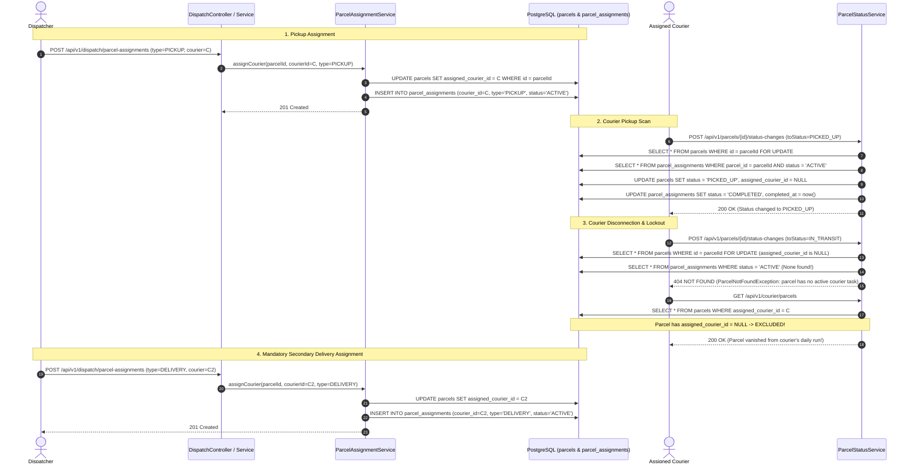

# Local Code Review: PR #105 — Dispatcher Dashboard and Courier Assignment

> **Document Status:** Formally Validated & Complete  
> **Review Date:** 2026-11-06  
> **PR Number:** [#105](https://github.com/ShenSandaru/SwiftDrop/pull/105)  
> **PR Title:** `feat(dispatcher): implement dispatcher dashboard and courier assignment`  
> **PR Author:** Gayangi Devindi (`@gayangidevindi`)  
> **Reviewer:** Antigravity (Local Comprehensive Read-Only Audit & Validation)  
> **Review Outcome / Final Recommendation:** **REQUEST CHANGES**

---

## 1. Executive Summary & Review Overview

Pull Request #105 introduces the operational dispatcher interface and courier assignment orchestration for SwiftDrop:
1. An administrative Dispatcher Dashboard UI built with Next.js and Tailwind CSS at `/dispatch`.
2. A dispatch orchestration backend (`com.swiftdrop.dispatch`) interfacing with `delivery.api` and `identity.api`.
3. An assignment history persistence schema (`parcel_assignments`) and stage-aware assignment logic in `delivery`.
4. An Architecture Decision Record ([ADR 0008](../../docs/adr/0008-dispatch-assignment-history-and-handoff.md)) specifying a two-stage "courier handoff" model (separate pickup and delivery tasks).

While the pull request exhibits high-quality frontend styling, strong keyboard accessibility, and strict adherence to the modular monolith package boundary rules (verified by `ModuleBoundaryTest`), an independent code-level validation against the repository's code, tests, and database schema confirms **blocking defects and an unauthorized architectural change**:

- **Confirmed Defect 1 (Single-Task Courier Cap):** Database partial unique index `uq_parcel_assignments_active_courier` restricts every courier account in the entire platform to at most **one active parcel** across the entire lifecycle, breaking multi-parcel delivery routes and workload balancing (SD-307).
- **Confirmed Defect 2 (Courier Lockout at `PICKED_UP`):** On pickup transition, `parcel.releaseCurrentCourier()` sets `assigned_courier_id = null`. The courier holding the physical parcel cannot see it in `findCourierDay` and receives HTTP 404 if they attempt to transition it to `IN_TRANSIT`.
- **Architectural Decision Requiring Approval (ADR 0008):** ADR 0008 unilaterally supersedes accepted decisions ADR 0003 and ADR 0006 without team consensus or indexing, and was marked `Accepted` without review.
- **Confirmed Defect 4 (Concurrency Non-Compliance & Missing Tests):** Issue SD-317 required optimistic locking with an `@Version` column and multi-threaded integration tests. The PR implemented pessimistic locking on `parcels` where competing pickup assignments silently overwrite each other rather than returning HTTP 409 Conflict, and omitted all concurrency integration tests.
- **Confirmed Defect 5 (Wrong Target Branch):** PR #105 targets `main` instead of `dev`, violating `CONTRIBUTING.md`.

---

## 2. Git & Branch Inspection

| Attribute | Value | Status / Notes |
|---|---|---|
| **Repository State** | Clean (`pr/105` checked out, 0 uncommitted changes) | Verified |
| **Source Branch** | `gayangidevindi:feat/dispatcher` (`github-desktop-gayangidevindi/feat/dispatcher`) | Available locally on `pr/105` |
| **PR Target Branch** | `main` | **CONFIRMED DEFECT:** Must target `dev` |
| **Base Commit** | `681d019df6f0be88e21aed16e6e94d85a706adc1` (`Merge pull request #88 from ShenSandaru/dev`) | Branched from `main` |
| **Head Commit** | `751b814985cd0fb4ca52ceb99fd7acf752e1f313` | Latest PR commit |
| **Branch Divergence** | `origin/dev` is at `d92d738`, which is ahead of base commit `681d019` | Rebase/merge required |
| **Merge Compatibility** | `git merge-tree` against `origin/dev` completes with 0 conflicts | Retargeting is safe |
| **PR Commit History** | 1. `b4fd11d` feat(dispatcher): implement dispatcher dashboard and courier assignment workflow<br>2. `907eec1` fix(dispatcher): resolve frontend lint and backend CI tests<br>3. `751b814` fix(dispatcher): align parcel assignment error message with test | Clean linear history on PR |

---

## 3. Linked GitHub Issues & Scope Traceability

The PR addresses work under **EPIC-02: Dispatch Module Completion (#101)**:

| Issue | Title | Expected Scope vs PR Implementation | Validation Status |
|---|---|---|---|
| **#35** | **SD-305: Implement courier profile management and eligibility schema in dispatch** | **Expected:** Flyway migration for `couriers` table under `db/migration/dispatch/`, `CourierProfile` entity with vehicle types and active toggles, REST endpoints `GET/POST/PATCH /api/v1/courier-profiles`.<br>**Implemented:** **Omitted completely.** No dispatch migrations or tables created. Couriers are queried directly from `identity.api.UserDirectory`. | **NOT IMPLEMENTED** |
| **#36** | **SD-306: Implement unassigned parcel listing and courier assignment workflow** | **Expected:** `GET /api/v1/unassigned-parcels`, `POST /api/v1/parcel-assignments`. Reject non-`CREATED` assignments with 409.<br>**Implemented:** Implemented via `/api/v1/dispatch/parcels` and `/api/v1/dispatch/parcel-assignments`. Enforces courier validation via `identity.api` and assignment via `delivery.api`. | **PARTIALLY COMPLIANT** (Path deviations) |
| **#37** | **SD-307: Implement active courier workload query endpoint** | **Expected:** `GET /api/v1/courier-workload` returning fleet courier workload list.<br>**Implemented:** Implemented via `GET /api/v1/dispatch/courier-workloads` returning `Map<UUID, Long>`. Only includes couriers with active parcels (>0). | **PARTIALLY COMPLIANT** |
| **#38** | **SD-308: Implement dispatcher console UI for unassigned parcels and courier assignment** | **Expected:** Interactive console at `/dispatch` with unassigned parcels table, candidate courier selection, workload counters, fleet roster.<br>**Implemented:** Comprehensive 2-pane / tabbed UI with metrics, filtering, parcel dialog, and fleet roster. | **COMPLIANT** |
| **#93** | **SD-317: Dispatch Courier Assignment Concurrency and Optimistic Locking Engine** | **Expected:** `@Version` column on assignment records (`V202611051210__dispatch_assignment_version.sql`), `OptimisticLockingFailureException` mapping, multi-threaded concurrency integration test.<br>**Implemented:** Uses pessimistic write locking on `parcels` (`SELECT FOR UPDATE`) and DB partial unique indexes. No `@Version` column, no concurrency test. | **NON-COMPLIANT** |

---

## 4. Critical Finding Validation

Independent verification of the 5 primary findings against the codebase, tests, migrations, and database schema yielded the following results.

```
┌────────────────────────────────────────────────────────────────────────────────────────┐
│                               FINDING VALIDATION MATRIX                                │
├───────────┬─────────────────────────────────────────────────┬──────────────────────────┤
│ Finding   │ Topic                                           │ Determination            │
├───────────┼─────────────────────────────────────────────────┼──────────────────────────┤
│ Finding 1 │ Database partial index uq_active_courier        │ CONFIRMED DEFECT         │
│ Finding 2 │ Courier assignment released at PICKED_UP        │ CONFIRMED DEFECT         │
│ Finding 3 │ Architecture decision ADR 0008 vs ADR 0003/0006 │ REQUIRES TEAM APPROVAL   │
│ Finding 4 │ Concurrency locking & missing tests (SD-317)    │ CONFIRMED NON-COMPLIANCE │
│ Finding 5 │ PR target branch main vs dev                    │ CONFIRMED WORKFLOW ERROR │
└───────────┴─────────────────────────────────────────────────┴──────────────────────────┘
```

---

### Finding 1: Active Assignment Database Constraint (`uq_parcel_assignments_active_courier`)

- **Status:** **CONFIRMED DEFECT**
- **Exact File:** `backend/src/main/resources/db/migration/delivery/V202611041200__delivery_add_dispatch_assignment_history.sql` (lines 3–17, 57–59)

#### Technical Code & Schema Analysis

1. **Does it prevent one courier from having multiple active parcels?**
   **YES.** The migration executes:
   ```sql
   CREATE UNIQUE INDEX uq_parcel_assignments_active_courier
       ON parcel_assignments (courier_id)
       WHERE status = 'ACTIVE';
   ```
   In PostgreSQL, this partial unique index requires that within the `parcel_assignments` table, a given `courier_id` can appear **at most once** with `status = 'ACTIVE'`.
2. **What exactly does `ACTIVE` mean in the assignment-history model?**
   In `ParcelAssignmentRecord.java` (line 58), every new assignment record is initialized with `status = ParcelAssignmentStatus.ACTIVE`. An assignment remains `ACTIVE` until it is explicitly updated to `COMPLETED` (via `complete()`) or `REASSIGNED` (via `reassign()`). In `ParcelStatusService.java` (lines 94–98), `complete()` is triggered only when the parcel reaches `PICKED_UP`, `DELIVERED`, or `FAILED`.
   Consequently, an assignment is `ACTIVE` during the entire duration of the physical pickup task or the physical delivery task.
3. **Does the existing business workflow require couriers to handle multiple parcels?**
   **YES.** In a logistics and parcel delivery application, couriers service delivery routes with multiple packages. In `CourierParcelService.java` (line 25, line 70), the service method `today(UUID courierId)` returns `List<CourierParcel>` representing "their unfinished parcels plus the ones they finished today". In `ParcelRepository.java` (lines 91–97), `countActiveByCourier` groups by `assignedCourierId` returning the count of active parcels per courier. Neither the domain model nor the requirements envision a courier carrying exactly one parcel at a time.
4. **Does the constraint conflict with workload management requirements?**
   **YES.** Issue SD-307 explicitly states:
   > *"Objective: Provide dispatchers with real-time active parcel counts per courier to balance assignment workloads across the fleet. Returns list of active couriers with their current count of non-terminal assigned parcels (including zero)."*
   If every courier is hard-capped at $\le 1$ active parcel by a database constraint, workload balancing is meaningless because no courier can ever accumulate a workload count greater than 1.
5. **Preflight Guard Failure Risk:**
   Lines 3–17 of the migration enforce:
   ```sql
   DO $$
   BEGIN
       IF EXISTS (
           SELECT assigned_courier_id
           FROM parcels
           WHERE assigned_courier_id IS NOT NULL
             AND status NOT IN ('DELIVERED', 'FAILED')
           GROUP BY assigned_courier_id
           HAVING COUNT(*) > 1
       ) THEN
           RAISE EXCEPTION
               'Cannot enable single-active-task courier assignments: resolve existing duplicate active courier assignments first';
       END IF;
   END
   $$;
   ```
   If applied to an existing production or staging database where any courier holds 2 or more non-terminal parcels, Flyway migration execution immediately fails.
6. **Correct Database Constraint:**
   The intended business rule is: *A parcel can only have at most one active courier assignment at any time.* This rule is already correctly enforced by:
   ```sql
   CREATE UNIQUE INDEX uq_parcel_assignments_active_parcel
       ON parcel_assignments (parcel_id)
       WHERE status = 'ACTIVE';
   ```
   Index `uq_parcel_assignments_active_courier` serves no valid domain purpose and **must be dropped**.

---

### Finding 2: Courier Assignment Released at `PICKED_UP`

- **Status:** **CONFIRMED DEFECT**
- **Exact Files & Methods:**
  - `backend/src/main/java/com/swiftdrop/delivery/application/ParcelStatusService.java:94-99` (`changeStatus`)
  - `backend/src/main/java/com/swiftdrop/delivery/domain/Parcel.java:220-228` (`releaseCurrentCourier`)
  - `backend/src/main/java/com/swiftdrop/delivery/domain/ParcelRepository.java:82-89` (`findCourierDay`)

#### Technical Trace & Sequence of the Current Implementation



#### Detailed Findings on Courier Handoff

1. **Is the assigned courier cleared at `PICKED_UP`?**
   **YES.** In `ParcelStatusService.java` lines 94–98:
   ```java
   if (change.toStatus() == ParcelStatus.PICKED_UP
           || change.toStatus() == ParcelStatus.DELIVERED
           || change.toStatus() == ParcelStatus.FAILED) {
       activeAssignment.complete(now);
       parcel.releaseCurrentCourier(now);
   }
   ```
   And `Parcel.releaseCurrentCourier()` sets:
   ```java
   assignedCourierId = null;
   assignedAt = null;
   updatedAt = now;
   ```
2. **Can the courier continue updating the parcel afterward?**
   **NO.** Lines 74–85 of `ParcelStatusService.java` evaluate:
   ```java
   ParcelAssignmentRecord activeAssignment = assignments
           .findFirstByParcelIdAndStatus(parcelId, ParcelAssignmentStatus.ACTIVE)
           .orElse(null);
   if (activeAssignment == null) {
       if (!courier.userId().equals(parcel.getAssignedCourierId())) {
           throw new ParcelNotFoundException();
       }
       throw new ParcelConflictException("The parcel has no active courier task");
   }
   ```
   Because `activeAssignment` is `null` and `parcel.getAssignedCourierId()` is `null`, `courier.userId().equals(null)` is false, throwing `ParcelNotFoundException` (HTTP 404). The courier holding the physical parcel is locked out from transitioning it to `IN_TRANSIT`.
3. **Does the parcel remain visible in the courier's daily delivery list?**
   **NO.** `CourierParcelService.today(courierId)` delegates to `parcels.findCourierDay(courierId, ...)`, which executes:
   ```sql
   SELECT p FROM Parcel p
   WHERE p.assignedCourierId = :courierId
     AND (p.status NOT IN :terminal OR p.updatedAt >= :since)
   ```
   Because `p.assignedCourierId` is now `NULL`, the condition `NULL = :courierId` evaluates to false. The parcel immediately vanishes from the courier's daily delivery run upon scanning pickup.
4. **Author's Own Test Proves the Lockout:**
   In `ParcelStatusServiceTest.java` (lines 121–126), the author was forced to add a manual reassignment in the test fixture to test transitioning to `FAILED` after `PICKED_UP`:
   ```java
   service.changeStatus(PARCEL_ID, new StatusChange(ParcelStatus.PICKED_UP, null, null), Actor.courier(COURIER_ID));
   parcel.assignDeliveryCourier(COURIER_ID, NOW.plusSeconds(1)); // <--- Had to manually reassign!
   activeAssignment = new ParcelAssignmentRecord(PARCEL_ID, COURIER_ID, ParcelAssignmentType.DELIVERY,
           UUID.randomUUID(), NOW.plusSeconds(1));
   service.changeStatus(PARCEL_ID, new StatusChange(ParcelStatus.FAILED, FailureReason.DAMAGED, null), Actor.courier(COURIER_ID));
   ```
   Without lines 122–124, the second status transition would have thrown `ParcelNotFoundException`.
5. **Is a separate handoff genuinely required?**
   **NO.** Standard parcel delivery in SwiftDrop is point-to-point: one assigned courier handles pickup, transit, and dropoff. While an optional depot handoff could be designed as a specialized feature, forcing **every** parcel into mandatory dual dispatch (requiring a dispatcher to intervene between `PICKED_UP` and `IN_TRANSIT`) halts normal delivery operations.

---

### Finding 3: Architecture Decision (ADR 0003, ADR 0006 vs ADR 0008)

- **Status:** **CONFIRMED ARCHITECTURAL GOVERNANCE VIOLATION (Requires Team Approval)**
- **Exact File:** `docs/adr/0008-dispatch-assignment-history-and-handoff.md`

#### Analysis of Architectural Rules & Governance

1. **Applicable Architectural Rules:**
   - **ADR 0003 (Backend Modules & Boundaries, Accepted):** Establishes that `delivery` owns parcel state, lifecycle, and history; `dispatch` orchestrates assignments using `delivery.api`.
   - **ADR 0006 (Delivery Lifecycle & Transition Rules, Accepted 2026-11-01):**
     - Section 1: Standard lifecycle sequence: $\text{CREATED} \rightarrow \text{PICKED\_UP} \rightarrow \text{IN\_TRANSIT} \rightarrow \text{OUT\_FOR\_DELIVERY} \rightarrow \text{DELIVERED / FAILED}$.
     - Section 3: *"Assignment and reassignment are permitted only while the parcel is in CREATED status... Once PICKED_UP is reached, the assigned courier is immutable."*
   - **Repository Decision Authority (`docs/ai-agent-guidelines.md` §Decision authority):**
     - *"Accepted ADRs remain authoritative for architectural decisions. A task does not override them."*
     - *"If a task would require violating an accepted ADR, changing the architecture or overriding a mandatory rule, stop and ask for explicit approval before making any change."*
     - *"An accepted decision changes only through a new or superseding ADR that is explicitly reviewed and accepted."*
   - **ADR Process (`docs/adr/README.md` §Process):**
     - *"2. Set the status to Proposed, add the ADR to the index with that status, and open a pull request. A Proposed ADR is not binding."*
     - *"3. Only after the decision has been explicitly reviewed and approved, set the status to Accepted in the ADR and in the index."*
2. **Does ADR 0008 introduce a conflicting lifecycle?**
   **YES.** ADR 0008 lines 49–50 state:
   > *"This ADR supersedes the assignment ownership and reassignment provisions in ADR 0003 and the courier assignment provisions in ADR 0006."*
   It replaces the single-courier immutable assignment model with a mandatory two-stage handoff where `assigned_courier_id` is wiped at `PICKED_UP`.
3. **Does the decision have evidence of team approval?**
   **NO.** In `docs/reviews/`, there is a formal team review record for ADR 0006 (`adr-0006-team-review.md`). There is **no review document** for ADR 0008. ADR 0008 was committed directly in commit `b4fd11d` and was not even registered in the table of contents of `docs/adr/README.md`.
4. **Resolution:**
   ADR 0008 cannot be accepted unilaterally. Its status must be set to `Proposed`, and the team must decide whether to adopt a multi-leg handoff architecture or preserve ADR 0006's end-to-end courier assignment.

---

### Finding 4: Concurrency & Locking Approach (SD-317)

- **Status:** **CONFIRMED NON-COMPLIANCE (Scope Deviation & Missing Concurrency Tests)**
- **Exact Files:**
  - `backend/src/main/java/com/swiftdrop/delivery/domain/ParcelAssignmentRecord.java`
  - `backend/src/main/java/com/swiftdrop/delivery/application/ParcelAssignmentService.java:64-85`
  - `backend/src/test/java/com/swiftdrop/dispatch/web/DispatchQueriesIT.java`

#### Analysis Against Issue SD-317 Acceptance Criteria

Issue SD-317 defines the following acceptance criteria:
- Criterion 1: *"Version column added to dispatch assignment tables."*
- Criterion 2: *"Concurrent assignment attempts on the same parcel result in exactly one successful assignment and HTTP 409 for competing attempts."*
- Criterion 3: *"Assignment rejected with 409 if parcel has already progressed past CREATED."*
- Criterion 4: *"Multi-threaded concurrency integration test verifies zero duplicate assignments."*

1. **Criterion 1 (Version Column): FAILED.**
   `ParcelAssignmentRecord.java` does not contain an `@Version` annotation, and the table `parcel_assignments` contains no `version` column.
2. **Criterion 2 (Competing Attempts Result in 409): FAILED.**
   The implementation uses pessimistic locking on `parcels` (`findByIdForUpdate`). When two dispatchers concurrently assign the same parcel for `PICKUP`:
   - Request 1 locks the parcel, writes the assignment, and commits.
   - Request 2 acquires the lock, reads `current != null`, executes `current.reassign(now)`, and **overwrites** the assignment with the second courier.
   - Request 2 succeeds with HTTP 201 Created instead of being rejected with HTTP 409 Conflict.
3. **Criterion 3 (Reject non-CREATED assignments): PARTIALLY COMPLIANT.**
   `type = PICKUP` is rejected if status is not `CREATED`. However, `type = DELIVERY` allows assignment at `PICKED_UP`.
4. **Criterion 4 (Multi-threaded Concurrency Integration Test): FAILED.**
   The PR adds `DispatchQueriesIT.java`, which contains only two tests checking that empty queries return 200 OK. There are **zero** concurrent or multi-threaded integration tests in the PR.

---

### Finding 5: PR Target Branch

- **Status:** **CONFIRMED WORKFLOW ERROR**
- **Exact Reference:** GitHub Pull Request #105 metadata (`baseRefName: "main"`)

1. **CONTRIBUTING.md Requirement:**
   Lines 84–95 of `CONTRIBUTING.md` dictate:
   > *"dev is the integration branch and main is the stable/release branch... Create one short-lived branch per task from the latest dev... Workflow: feature pull request into dev -> review and CI -> merge; for a release, a separate pull request from dev into main -> review and CI -> merge."*
2. **Impact:** Merging PR #105 directly into `main` bypasses `dev`, diverging branches and violating release management conventions.
3. **Compatibility with `dev`:**
   A simulation of merging `pr/105` into `origin/dev` using `git merge-tree` verified that the branch merges cleanly with 0 merge conflicts. The PR author or repository administrator simply needs to update the target branch in GitHub's PR settings from `main` to `dev`.

---

## 5. Architecture & Backend Review

### 5.1 Modular Monolith Boundaries
The backend modular boundaries established in ADR 0003 and checked by `ModuleBoundaryTest` were **fully respected**:
- The new `com.swiftdrop.dispatch` module accesses `delivery` strictly through `com.swiftdrop.delivery.api` (`ParcelQueries`, `ParcelAssignment`, `DispatchParcelSummary`, `ParcelAssignmentSummary`, etc.).
- `dispatch` accesses `identity` strictly through `com.swiftdrop.identity.api.UserDirectory`.
- `dispatch` contains no repository references to internal entities of `delivery` or `identity`.
- `ModuleBoundaryTest` passes with 0 violations.

### 5.2 API Design & Exception Handling
- The new dispatch endpoints are grouped under `/api/v1/dispatch/`:
  - `GET /api/v1/dispatch/parcels`
  - `GET /api/v1/dispatch/awaiting-delivery-assignments`
  - `GET /api/v1/dispatch/active-assignments`
  - `GET /api/v1/dispatch/courier-workloads`
  - `GET /api/v1/dispatch/parcels/{id}/assignment-history`
  - `POST /api/v1/dispatch/parcel-assignments`
- **Broad Exception Catching in `DispatchExceptionHandler`:**
  Lines 33–40 catch generic `DataIntegrityViolationException` and return 409 Conflict with `"The parcel or courier already has an active assignment"`. Any unforeseen foreign key failure or database constraint violation is masked as an assignment conflict.

---

## 6. Frontend Dispatcher Dashboard Review

The frontend changes introduce `frontend/app/(dispatch)/dispatch/page.tsx`, `frontend/components/dispatch/parcel-dialog.tsx`, and `frontend/lib/dispatch.ts`.

### 6.1 Strengths
- **Real Backend Data:** The dashboard exclusively binds to real backend endpoints; no mock data or hardcoded arrays remain.
- **Accessibility:** The assignment dialog implements keyboard navigation (Esc to close, Tab focus trapping), proper ARIA modal roles, and `aria-labelledby`.
- **Responsive Layout:** Clean desktop table views paired with mobile card layouts for small viewports.
- **Visual Feedback:** Loading skeletons/spinners for async actions and immediate banner feedback on successful courier assignment.

### 6.2 Frontend Defects & Weaknesses
1. **Inefficient N+1 Data Fetching (`listAllDispatchCouriers` & `listAllActiveDispatchAssignments`):**
   In `frontend/lib/dispatch.ts`, `listAllDispatchCouriers` and `listAllActiveDispatchAssignments` recursively fetch every single page of couriers and assignments from the server. Loading the dashboard causes multiple concurrent paginated requests, exhausting client bandwidth and database connections as the user base grows.
2. **Courier Selection Hard-Lock:**
   In `frontend/components/dispatch/parcel-dialog.tsx`:
   ```ts
   const eligibleCouriers = couriers.filter(
     (courier) => courier.enabled && workloads !== null && (workloads[courier.id] ?? 0) === 0,
   );
   ```
   Couriers with `workloads[id] > 0` are completely filtered out. If the workload endpoint fails or returns `null`, the list is empty and dispatchers are blocked from assigning anyone.
3. **Lint Warnings:**
   `npm run lint` reports 2 warnings in `page.tsx`:
   - Line 1097:9: `'availabilityClass' is assigned a value but never used`
   - Line 1239:10: `'UnavailablePanel' is defined but never used`

---

## 7. Security Review

| Checkpoint | Assessment | Notes |
|---|---|---|
| **Endpoint Authorization** | **Pass** | `@PreAuthorize("hasRole('DISPATCHER_ADMIN')")` correctly applied to `DispatchController`. |
| **Principal Integrity** | **Pass** | Dispatcher ID extracted from `jwt.getSubject()` via authenticated principal, preventing identity spoofing. |
| **Data Exposure & PII** | **Pass** | `DispatchParcelSummary` hides sensitive recipient contact details (phone, full street line) which remain behind the authorized detail API. |
| **Error Handling & IDOR** | **Warning (Medium)** | `DispatchExceptionHandler` maps generic `DataIntegrityViolationException` to 409 Conflict with `"The parcel or courier already has an active assignment"`. This masks underlying database constraint errors or foreign key failures. |
| **Authorization Matrix Test** | **Warning (Medium)** | The new `/api/v1/dispatch/*` endpoints were not integrated into the automated `ParcelAuthorizationMatrixIT` or `IdentityAuthorizationMatrixTest`. |

---

## 8. Testing & Verification Results

### 8.1 Backend Tests
- **Command:** `.\mvnw.cmd test`
- **Result:** **BUILD SUCCESS** (439 tests run, 0 failures, 0 errors, 0 skipped).
- **Module Boundary Check:** `.\mvnw.cmd test -Dtest=ModuleBoundaryTest` passed (9 tests, 0 violations).
- **Test Fragility Concern:** Adding `ParcelAssignmentRepository` required modifying 11 unrelated slice test classes across identity, delivery, and pricing modules to inject `@MockitoBean(types = ParcelAssignmentRepository.class)`.
- **Missing Concurrency Tests:** No multi-threaded integration test was included to verify race-condition handling on concurrent assignments (violating SD-317 acceptance criteria).

### 8.2 Frontend Tests
- **Lint Check:** `npm run lint` passed with **2 warnings** (unused variables/components in `dispatch/page.tsx`).
- **Build Check:** `npm run build` passed (Next.js 16.4.3 static and dynamic routes generated successfully).
- **Automated Tests:** `npm test` does not exist (SD-705 pending).

---

## 9. Categorized Findings & Recommendations

### Category A: Confirmed Defects (Must Fix Before Merge)

#### Finding C-01: Hard-Coded Single-Active-Task Constraint per Courier
- **File:** `backend/src/main/resources/db/migration/delivery/V202611041200__delivery_add_dispatch_assignment_history.sql:57-59`
- **Problem:** Database strictly enforces `COUNT(active_assignments) <= 1` per courier across the platform.
- **Why it matters:** Courier fleet operations rely on couriers delivering multiple parcels in a route. This constraint breaks multi-parcel delivery and contradicts SD-307's goal of fleet workload balancing.
- **Reproduction:** Assign courier $C$ to parcel $P_1$. Attempting to assign courier $C$ to parcel $P_2$ while $P_1$ is non-terminal results in a database unique constraint violation (HTTP 409).
- **Recommended Correction:** Remove index `uq_parcel_assignments_active_courier` and the preflight check in lines 3–17. Retain `uq_parcel_assignments_active_parcel`.

#### Finding C-02: Courier Lockout & Workflow Stalling upon `PICKED_UP`
- **File:** `backend/src/main/java/com/swiftdrop/delivery/application/ParcelStatusService.java:94-99`
- **Problem:** When status reaches `PICKED_UP`, `parcel.releaseCurrentCourier(now)` wipes `parcels.assigned_courier_id = null`.
- **Why it matters:** The assigned courier loses access to the parcel in their daily run (`findCourierDay`) and cannot advance it to `IN_TRANSIT` or `DELIVERED`. The parcel is stranded until an administrative dispatcher manually intervenes.
- **Reproduction:** Courier updates parcel from `CREATED` to `PICKED_UP`. Immediate subsequent request by courier to advance status to `IN_TRANSIT` throws `ParcelNotFoundException` (404).
- **Recommended Correction:** Do not release the assigned courier at `PICKED_UP`. Maintain courier assignment across pickup and delivery for single-courier operations.

#### Finding H-01: Pull Request Targets `main` Branch
- **File:** GitHub Pull Request #105 Settings
- **Problem:** PR base branch is set to `main` instead of `dev`.
- **Why it matters:** Directly violates `CONTRIBUTING.md` §Branches. Merging directly to `main` bypasses `dev`.
- **Recommended Correction:** Change base branch on GitHub to `dev`.

#### Finding H-02: Concurrency Defect & Missing Tests (SD-317)
- **File:** `backend/src/main/java/com/swiftdrop/delivery/application/ParcelAssignmentService.java:71-85`
- **Problem:** Competing pickup assignments on the same parcel silently overwrite each other as reassignments instead of returning 409 Conflict. No multi-threaded integration tests exist.
- **Why it matters:** Violates SD-317 acceptance criteria #2 and #4.
- **Recommended Correction:** If an active pickup assignment already exists for another courier, reject competing concurrent assignment requests with 409 Conflict unless explicit reassignment is requested. Add multi-threaded concurrency tests.

#### Finding H-03: Broad Exception Catching in `DispatchExceptionHandler`
- **File:** `backend/src/main/java/com/swiftdrop/dispatch/web/DispatchExceptionHandler.java:33-40`
- **Problem:** Catching all `DataIntegrityViolationException` and returning HTTP 409 with `"The parcel or courier already has an active assignment"`.
- **Why it matters:** Masks foreign key failures and null constraint violations.
- **Recommended Correction:** Inspect constraint name before mapping to 409 Conflict.

#### Finding M-01: Unbounded Full-Dataset Client Queries (`listAllDispatchCouriers`)
- **File:** `frontend/lib/dispatch.ts:81-93`, `frontend/app/(dispatch)/dispatch/page.tsx:280-310`
- **Problem:** Client recursively fetches all couriers and active assignments across all pages on every refresh.
- **Why it matters:** High latency, memory bloat, and backend request storms at scale.
- **Recommended Correction:** Implement server-side pagination and search in the UI.

#### Finding M-02: ESLint Dead Code Warnings
- **File:** `frontend/app/(dispatch)/dispatch/page.tsx:1097:9`, `1239:10`
- **Problem:** Unused variable `availabilityClass` and unused component `UnavailablePanel`.
- **Recommended Correction:** Delete unused identifiers.

---

### Category B: Architectural Decisions Requiring Team Approval

#### Finding ARC-01: ADR 0008 Governance & Lifecycle Supercession
- **File:** `docs/adr/0008-dispatch-assignment-history-and-handoff.md`
- **Context:** ADR 0008 supersedes ADR 0003 and ADR 0006 by introducing a two-stage courier handoff model.
- **Action Required:**
  1. Downgrade ADR 0008 status from `Accepted` to `Proposed`.
  2. Index ADR 0008 in `docs/adr/README.md`.
  3. Convene a team architecture review to decide whether SwiftDrop should support mandatory dual dispatch or retain ADR 0006's end-to-end courier model.

---

## 10. Positive Implementation Observations

1. **Architecture Boundary Adherence:** The dispatch module strictly communicates with `delivery` and `identity` via their public `api` packages. `ModuleBoundaryTest` passed seamlessly with 0 violations.
2. **Real Data Integration:** The frontend UI is entirely backed by real API calls, properly handling loading spinners, error states, and empty queue displays without dummy stubs.
3. **Accessibility & Usability:** `ParcelDialog` demonstrates excellent keyboard trap handling, focus management, and semantic ARIA labeling.
4. **Pessimistic Concurrency Safety on Parcels:** Using `findByIdForUpdate` prevents race conditions on the parcel entity itself during status and assignment checks.

---

## 11. Final Recommendation

### **REQUEST CHANGES**

PR #105 must not be merged in its current state. The contributor must address the following checklist:

1. **Retarget PR Branch:** Change PR #105 target branch on GitHub from `main` to `dev`.
2. **Drop Single-Active-Task Index:** Delete `uq_parcel_assignments_active_courier` and lines 3–17 from `V202611041200__delivery_add_dispatch_assignment_history.sql`.
3. **Fix Courier Lockout at `PICKED_UP`:** Preserve `assigned_courier_id` across `PICKED_UP` in `ParcelStatusService.java` so that the courier can continue the delivery journey to `IN_TRANSIT` and `DELIVERED`.
4. **Resolve Concurrency Collision Behavior:** Ensure conflicting assignment attempts return 409 Conflict, and provide multi-threaded concurrency integration tests as required by SD-317.
5. **Downgrade ADR 0008 to Proposed:** Update ADR 0008 status to `Proposed` and index it in `docs/adr/README.md` pending team review.
6. **Clean ESLint Warnings:** Remove unused variables in `frontend/app/(dispatch)/dispatch/page.tsx`.
